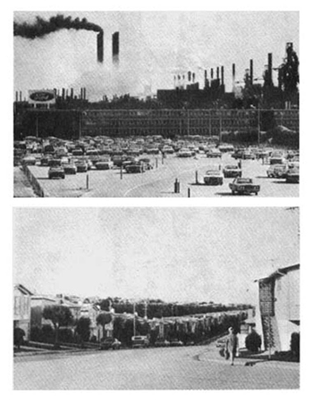
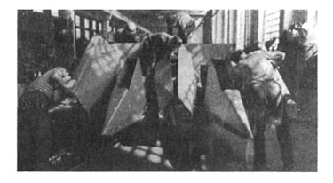
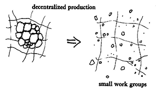

<section class="pattern-plate" aria-labelledby="t-scattered-work">
<a href="/patterns">A Pattern Language</a> · <a href="/patterns#towns">Towns</a> · Pattern 9 · p. 51 · **
<h1 class="pattern-title" id="t-scattered-work">Scattered Work</h1><figure class="pattern-figure pl-figure"></figure><nav class="pattern-links" aria-label="Connections"><h2>Links to</h2><ul><li><a href="/patterns/mosaic-of-subcultures">8 Mosaic Of Subcultures</a></li><li><a href="/patterns/subculture-boundary">13 Subculture Boundary</a></li><li><a href="/patterns/neighborhood-boundary">15 Neighborhood Boundary</a></li><li><a href="/patterns/work-community">41 Work Community</a></li><li><a href="/patterns/industrial-ribbon">42 Industrial Ribbon</a></li><li><a href="/patterns/self-governing-workshops-and-offices">80 Self-Governing Workshops And Offices</a></li><li><a href="/patterns/home-workshop">157 Home Workshop</a></li></ul><h2>Linked from</h2><ul><li><a href="/patterns/the-countryside">7 The Countryside</a></li><li><a href="/patterns/web-of-shopping">19 Web Of Shopping</a></li><li><a href="/patterns/nine-per-cent-parking">22 Nine Per Cent Parking</a></li><li><a href="/patterns/men-and-women">27 Men And Women</a></li><li><a href="/patterns/interchange">34 Interchange</a></li><li><a href="/patterns/work-community">41 Work Community</a></li><li><a href="/patterns/industrial-ribbon">42 Industrial Ribbon</a></li><li><a href="/patterns/green-streets">51 Green Streets</a></li><li><a href="/patterns/quiet-backs">59 Quiet Backs</a></li><li><a href="/patterns/self-governing-workshops-and-offices">80 Self-Governing Workshops And Offices</a></li><li><a href="/patterns/home-workshop">157 Home Workshop</a></li></ul></nav></section><article class="pattern-text" aria-label="The text of Scattered Work">
52… this pattern helps the gradual evolution of <a class="pl-ref" href="/patterns/mosaic-of-subcultures">MOSAIC OF SUBCULTURES (8)</a>, by placi ng fam ilies and work together, and so intensifying the emergence of highly diff erentiated subcultures, each with its individual character.

◆ ◆ ◆

<strong>The artificial separation of houses and work creates in tolerable rifts in people’s inner lives.</strong>

In modern times almost all cities create zones for “work” and other zones for “living” and in most cases enforce the separation by law. Two reasons arc given for the separation. First, the 53work-places need to be near each other, for commercial reasons. Second, workplaces destroy the quiet and safety of residential neighborhoods.

<figure class="pl-figure"><figcaption><em>Concentration and segregation of work … leads to dead neighborhoods</em>.</figcaption></figure>

But this separation creates enormous rifts in people’s emotional lives. Children grow up in areas where there are no men, except on weekends; women are trapped in an atmosphere where they are expected to be pretty, unintelligent housekeepers; men are forced to accept a schism in which they spend the greater part of their waking lives “at work, and away from their families” and then the other part of their lives “with their families, away from work.”

Throughout, this separation reinforces the idea that work is a toil, while only family life is “living”-a schizophrenic view which creates tremendous problems for all the members of a family.

In order to overcome this schism and re-establish the connection between love and work, central to a sane society, there needs to be a redistribution of all workplaces throughout the areas where people live, in such a way that children are near both men and women during the day, women are able to see themselves both as loving mothers and wives and still capable of creative work, and men too are able to experience the hourly connection of their lives as workmen and their lives as loving husbands and fathers.

What are the requirements for a distribution of work that can overcome these problems?

1.  Every home is within 20-30 minutes of many hundreds of workplaces.

2.  Many workplaces are within walking distance of children and families.

3.  Workers can go home casually for lunch, run errands, work half-time, and spend half the day at home.

4.  Some workplaces are in homes; there are many opportunities for people to work from their homes or to take work home.

5. Neighborhoods are protected from the traffic and noise generated by “noxious” workplaces.

The only pattern of work which does justice to these requirements is a pattern of scattered work: a pattern in which work is strongly decentralized. To protect the neighborhoods from the noise and traffic that workplaces often generate, some noisy work 54places can be in the boundaries of neighborhoods, communities and subcultures—See <a class="pl-ref" href="/patterns/subculture-boundary">SUBCULTURE BOUNDARY (13)</a>; others, not noisy or noxious, can be built right into homes and neighborhoods. In both cases, the crucial fact is this: <em>every home is within a few minutes of dozens of workplaces</em>. Then each household would have the chance to create for itself an intimate ecology of home and work: all its members have the option of arranging a workplace for themselves close to each other and their friends. People can meet for lunch, children can drop in, workers can run home. And under the prompting of such connections the workplaces themselves will inevitably become nicer places, more like homes, where life is carried on, not banished for eight hours.

This pattern is natural in traditional societies, where workplaces are relatively small and households comparatively self-sufficient. But is it compatible with the facts of high technology and the concentration of workers in factories? How strong is the need for workplaces to be near each other ?

The main argument behind the centralization of plants, and their gradual increase in size, is an economic one. It has been demonstrated over and again that there are economies of scale in production, advantages which accrue from producing a huge number of goods or services in one place.

However, large centralized organizations are not intrinsic to mass production. There are many excellent examples which demonstrate the fact that where work is substantially scattered, people can still produce goods and services of enormous complexity. One of the best historical examples is the Jura Federation of watchmakers, formed in the mountain villages of Switzerland in the early 1870’s. These workers produced watches in their home workshops, each preserving his independence while coordinating his efforts with other craftsmen from the surrounding villages. (For an account of this federation, see, for example, George Woodcock, <em>Anarchism: A History of Libertarian Ideas and Movements</em>, Cleveland: Meridian Books, 1962, pp. 168–69.)

In our own time, Raymond Vernon has shown that small, scattered workplaces in the New York metropolitan economy, respond much faster to changing demands and supplies, and that the degree of creativity in agglomerations of small businesses is vastly greater than that of the more cumbersome and centralized 55industrial giants. (See Raymond Vernon, <em>Metropolis</em> 1985, Chapter 7: External Economics.)

To understand these facts, we must first realize that the city itself is a vast centralized workspace and that all the benefits of this centralization are potentially available to every work group that is a part of the city’s vast work community. In effect, the urban region as a whole acts to produce economies of scale by bringing thousands of work groups within range of each other. If this kind of “centralization” is properly developed, it can support an endless number of combinations between small, scattered workgroups; and it can lend great flexibility to the modes of production. “Once we understand that modem industry does not necessarily bring with it financial and physical concentration, the growth of smaller centers and a more widespread distribution of genuine benefits of technology will, I think, take place” (Lewis Mumford, <em>Sticks and Stones</em>, New York, 1924, p. 216).

Remember that even such projects as complicated and seemingly centralized as the building of a bridge or a moon rocket, can be organized this way. Contracting and subcontracting procedures make it possible to produce complicated industrial goods and services by combining the efforts of hundreds of small firms. The Apollo project drew together more than 30,000 independent firms to produce the complicated spaceships to the moon.

Furthermore, there is evidence that the agencies which set up such multiple contracts look for small, semi-autonomous firms. They know instinctively that the smaller, more self-governing the group, the better the product and the service (<em>Small Sellers and Large Buyers in American Industry</em>, Business Research Center, College of Business Administration, Syracuse University, New York, 1961).

Let us emphasize: we are not suggesting that the decentralization of work should take precedence over a sophisticated technology. We believe that the two are compatible: it is possible to fuse the human requirements for interesting and creative work with the exquisite technology of modern times. It is possible to make television sets, xerox machines and IBM typewriters, automobiles, stereo sets and washing machines under human working conditions. We mention in particular the xerox and IBM typewriters because they have played a vital role for us, the authors of 56this book, We could not have made this book together, in the communal way we have done, without these machines: and we consider them a vital part of the new decentralized society we seek.

<figure class="pl-figure"><figcaption><em>A small factory in Zemun, Yugoslavia; the work group is building a corn picking machine, an item they themselves decided to produce and sell in the market place</em>.</figcaption></figure>

Therefore:

<strong>Use zoning laws, neighborhood planning, tax incentives, and any other means available to scatter workplaces throughout the city. Prohibit large concentrations of work, without family life around them. Prohibit large concentrations of family life, without workplaces around them.</strong>

<figure class="pl-figure"></figure>
◆ ◆ ◆

57The scattered work itself can take a great variety of forms. It can occur in belts of industry, where it is essential for an industry to occupy an acre or more between subcultures—<a class="pl-ref" href="/patterns/subculture-boundary">SUBCULTURE BOUNDARY (13)</a>, <a class="pl-ref" href="/patterns/industrial-ribbon">INDUSTRIAL RIBBON (42)</a>; it can occur in work communities, which are scattered among the neighborhoods—<a class="pl-ref" href="/patterns/neighborhood-boundary">NEIGHBORHOOD BOUNDARY (15)</a>, <a class="pl-ref" href="/patterns/work-community">WORK COMMUNITY (41)</a>; and it can occur in individual workshops, right among the houses—<a class="pl-ref" href="/patterns/home-workshop">HOME WORKSHOP (157)</a>. The size of each workplace is limited only by the nature of human groups and the process of self-governance. It is discussed in detail in <a class="pl-ref" href="/patterns/self-governing-workshops-and-offices">SELF-GOVERNING WORKSHOPS AND OFFICES (80)</a>….
</article>

Christopher Alexander, Sara Ishikawa and Murray Silverstein, with Max Jacobson, Ingrid Fiksdahl-King and Shlomo Angel, <cite>A Pattern Language</cite> (Oxford University Press, 1977), pattern 9, pp. 51–57. Text and illustrations from the <a href="https://github.com/natureoforder/sources">Nature of Order sources</a> reading edition, transcribed from the 1977 printing; report errors on <a href="https://github.com/natureoforder/alexander-wiki/issues">GitHub</a>.

<a href="/patterns/mosaic-of-subcultures">← 8 Mosaic Of Subcultures</a> · <a href="/patterns">All 253 patterns</a> · <a href="/patterns/magic-of-the-city">10 Magic Of The City →</a>

