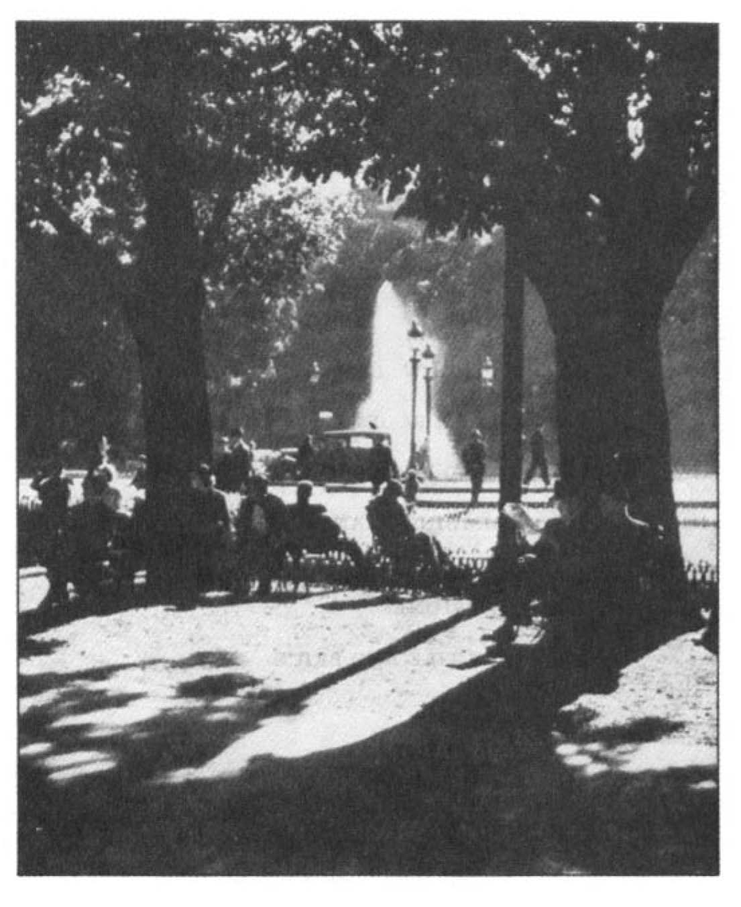
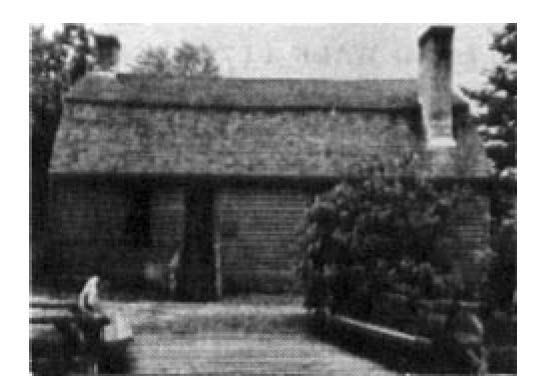
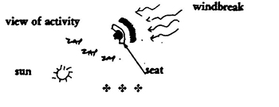

<section class="pattern-plate" aria-labelledby="t-seat-spots">
<a href="/patterns">A Pattern Language</a> · <a href="/patterns#construction">Construction</a> · Pattern 241 · p. 1118 · **
<h1 class="pattern-title" id="t-seat-spots">Seat Spots</h1><figure class="pattern-figure pl-figure"></figure><nav class="pattern-links" aria-label="Connections"><h2>Links to</h2><ul><li><a href="/patterns/path-shape">121 Path Shape</a></li><li><a href="/patterns/activity-pockets">124 Activity Pockets</a></li><li><a href="/patterns/stair-seats">125 Stair Seats</a></li><li><a href="/patterns/private-terrace-on-the-street">140 Private Terrace On The Street</a></li><li><a href="/patterns/outdoor-room">163 Outdoor Room</a></li><li><a href="/patterns/connection-to-the-earth">168 Connection To The Earth</a></li><li><a href="/patterns/trellised-walk">174 Trellised Walk</a></li><li><a href="/patterns/garden-seat">176 Garden Seat</a></li><li><a href="/patterns/front-door-bench">242 Front Door Bench</a></li><li><a href="/patterns/sitting-wall">243 Sitting Wall</a></li></ul><h2>Linked from</h2><ul><li><a href="/patterns/public-outdoor-room">69 Public Outdoor Room</a></li><li><a href="/patterns/grave-sites">70 Grave Sites</a></li><li><a href="/patterns/bus-stop">92 Bus Stop</a></li><li><a href="/patterns/sleeping-in-public">94 Sleeping In Public</a></li><li><a href="/patterns/paths-and-goals">120 Paths And Goals</a></li><li><a href="/patterns/activity-pockets">124 Activity Pockets</a></li><li><a href="/patterns/stair-seats">125 Stair Seats</a></li><li><a href="/patterns/sequence-of-sitting-spaces">142 Sequence Of Sitting Spaces</a></li><li><a href="/patterns/building-edge">160 Building Edge</a></li><li><a href="/patterns/sunny-place">161 Sunny Place</a></li><li><a href="/patterns/tree-places">171 Tree Places</a></li><li><a href="/patterns/half-inch-trim">240 Half-Inch Trim</a></li><li><a href="/patterns/front-door-bench">242 Front Door Bench</a></li><li><a href="/patterns/sitting-wall">243 Sitting Wall</a></li></ul></nav></section><article class="pattern-text" aria-label="The text of Seat Spots">
1119… assume that the main structure of the building is complete. To make it perfectly complete you need to build in the details of the gardens and the terraces around the building. In some cases, you will probably have laid out the walls and flowers and seats, at least in rough outline; but it is usually best to make the final decisions about them after the building is really there—so that you can make them fit the building and help to tie it into its surroundings—<a class="pl-ref" href="/patterns/path-shape">PATH SHAPE (121)</a>, <a class="pl-ref" href="/patterns/activity-pockets">ACTIVITY POCKETS (124)</a>, <a class="pl-ref" href="/patterns/private-terrace-on-the-street">PRIVATE TERRACE ON THE STREET (140)</a>, BUILDING EDGE (l60), SUNNY PLACE (l6l), <a class="pl-ref" href="/patterns/outdoor-room">OUTDOOR ROOM (163)</a>, <a class="pl-ref" href="/patterns/connection-to-the-earth">CONNECTION TO THE EARTH (168)</a>, <a class="pl-ref" href="/patterns/trellised-walk">TRELLISED WALK (174)</a>, <a class="pl-ref" href="/patterns/garden-seat">GARDEN SEAT (176)</a>, etc. First, the outdoor seats, public and private.

◆ ◆ ◆

<strong>Where outdoor aeati are set down without regard for tew and climate, they will almost certainly be useless.</strong>

We made random spot checks on selected benches in Berkeley, California, and recorded these facts about each bench: Was it occupied or empty? Did it give a view of current activity or not? Was it in the sun or not? What was the current wind velocity? Three of the eleven benches were occupied; eight were empty.

At the moment of observation, all three occupied benches looked onto activity, were in the sun, and had a wind velocity of less than 1.5 feet per second. At the moment of observation, none of the eight empty benches had all three of these characteristics. Three of them had shelter and activity but no sun; three of them had activity but no sun, and wind greater than 3 feet per second; two of them had sun and shelter but no activity.

A second series of observations compared the numbers of old people sitting in Union Square at 3:00 P.M. on a sunny day with the number at 3:00 P.M. on a cloudy day: 65 people on the sunny day and 21 on the cloudy day, even though the air temperature was the same on both days.

It’s obvious, of course—but the point is this—when you are going to mark in spots in your project for the location of outdoor 1120seats, sitting walls, stair seats, garden seats, look for places with these characteristics:

1 Benches facing directly onto pedestrian activity.

2 Benches open to the south for sun exposure during winter months.

3 A wall on those sides where the winter wind comes down.

4 In hot climates—cover to give sun protection during the midday hours of summer months, and the bench open to the direction of the summer breeze.

<figure class="pl-figure"><figcaption><em>Neiu England benches</em>.</figcaption></figure>

Therefore:

<strong>Choosing good spots for outdoor seats is far more important than building fancy benches. Indeed, if the spot is right, the most simple kind of seat is perfect.</strong>

<strong>In cool climates, choose them to face the sun, and to be protected from the wind; in hot climates, put them in shade and open to summer breezes. In both cases, place them to face activities.</strong>

<figure class="pl-figure"></figure>
If these seats can be made continuous with stain or building entrances or low walls or ballustrades, so much the better—<a class="pl-ref" href="/patterns/stair-seats">STAIR SEATS (125)</a>, <a class="pl-ref" href="/patterns/front-door-bench">FRONT DOOR BENCH (242)</a>, <a class="pl-ref" href="/patterns/sitting-wall">SITTING WALL (243)</a>….
</article>

Christopher Alexander, Sara Ishikawa and Murray Silverstein, with Max Jacobson, Ingrid Fiksdahl-King and Shlomo Angel, <cite>A Pattern Language</cite> (Oxford University Press, 1977), pattern 241, pp. 1118–1120. Text and illustrations from the <a href="https://github.com/natureoforder/sources">Nature of Order sources</a> reading edition, transcribed from the 1977 printing; report errors on <a href="https://github.com/natureoforder/alexander-wiki/issues">GitHub</a>.

<a href="/patterns/half-inch-trim">← 240 Half-Inch Trim</a> · <a href="/patterns">All 253 patterns</a> · <a href="/patterns/front-door-bench">242 Front Door Bench →</a>

