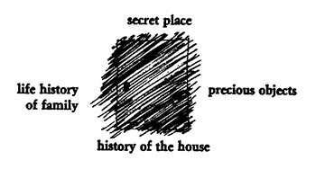

<section class="pattern-plate" aria-labelledby="t-secret-place">
<a href="/patterns">A Pattern Language</a> · <a href="/patterns#buildings">Buildings</a> · Pattern 204 · p. 930
<h1 class="pattern-title" id="t-secret-place">Secret Place</h1><nav class="pattern-links" aria-label="Connections"><h2>Links to</h2><ul><li><a href="/patterns/ceiling-height-variety">190 Ceiling Height Variety</a></li><li><a href="/patterns/thick-walls">197 Thick Walls</a></li><li><a href="/patterns/closets-between-rooms">198 Closets Between Rooms</a></li><li><a href="/patterns/thickening-the-outer-walls">211 Thickening The Outer Walls</a></li><li><a href="/patterns/floor-ceiling-vaults">219 Floor-Ceiling Vaults</a></li></ul><h2>Linked from</h2><ul><li><a href="/patterns/corner-doors">196 Corner Doors</a></li><li><a href="/patterns/thick-walls">197 Thick Walls</a></li><li><a href="/patterns/thickening-the-outer-walls">211 Thickening The Outer Walls</a></li></ul></nav></section><article class="pattern-text" aria-label="The text of Secret Place">
931… and here is a finishing touch to the THICK WALLS, perhaps even to the low ceilings—<a class="pl-ref" href="/patterns/thick-walls">THICK WALLS (197)</a>, <a class="pl-ref" href="/patterns/ceiling-height-variety">CEILING HEIGHT VARIETY (190)</a>.

◆ ◆ ◆

<strong>Where can the need for concealment be expressed; the need to hide; the need for something precious to be lost, and then revealed?</strong>

We believe that there is a need in people to live with a secret place in their homes: a place that is used in special ways, and revealed only at very special moments.

To live in a home where there is such a place alters your experience. It invites you to put something precious there, to conceal, to let only some in on the secret and not others. It allows you to keep something that is precious in an entirely personal way, so that no one may ever find it, until the moment you say to your friend, “Now I am going to show you something special”—and tell the story behind it.

There is strong support for the reality of this need in Gaston Bachelard’s <em>The Poetics of Space</em> (New York: The Omen Press, 1964). We quote from Chapter 3:

With the theme of drawers, chests, locks and wardrobes, we shall resume contact with the unfathomable store of daydreams of intimacy.

Wardrobes with their shelves, desks with their drawers, and chests with their false bottoms are veritable organs of the secret psychological life. Indeed, without these “objects” and a few others in equally high favor, our intimate life would lack a model of intimacy. They are hybrid objects, subject objects. Like us, through us and for us, they have a quality of intimacy….

If we give objects the friendship they should have, we do not open a wardrobe without a slight start. Beneath its russet wood, a wardrobe is a very white almond. To open it, is to experience an event of whiteness.

An anthology devoted to small boxes, such as chests and caskets, would constitute an important chapter in psychology. These complex pieces that a craftsman creates are very evident witnesses of the need for secrecy, of an intuitive sense of hiding places. It is not merely a matter of keeping a possession well guarded. The lock doesn’t exist that could resist absolute violence, and all locks are an invitation to thieves. A lock is a psychological threshold….

Therefore:

<strong>Make a place in the house, perhaps only a few feet square, which is kept locked and secret; a place which is virtually impossible to discover—until you have been shown where it is; a place where the archives of the house, or other more potent secrets, might be kept.</strong>

<figure class="pl-figure"></figure>
◆ ◆ ◆

Classic types of secret places are the panel that slides back, revealing the cavity in the wall, the loose board beneath the rug, the trap door—<a class="pl-ref" href="/patterns/closets-between-rooms">CLOSETS BETWEEN ROOMS (198)</a>, <a class="pl-ref" href="/patterns/thickening-the-outer-walls">THICKENING THE OUTER WALLS (211)</a>, <a class="pl-ref" href="/patterns/floor-ceiling-vaults">FLOOR-CEILING VAULTSE (219)</a>….
</article>

Christopher Alexander, Sara Ishikawa and Murray Silverstein, with Max Jacobson, Ingrid Fiksdahl-King and Shlomo Angel, <cite>A Pattern Language</cite> (Oxford University Press, 1977), pattern 204, pp. 930–931. Text and illustrations from the <a href="https://github.com/natureoforder/sources">Nature of Order sources</a> reading edition, transcribed from the 1977 printing; report errors on <a href="https://github.com/natureoforder/alexander-wiki/issues">GitHub</a>.

<a href="/patterns/child-caves">← 203 Child Caves</a> · <a href="/patterns">All 253 patterns</a> · <a href="/patterns/structure-follows-social-spaces">205 Structure Follows Social Spaces →</a>

