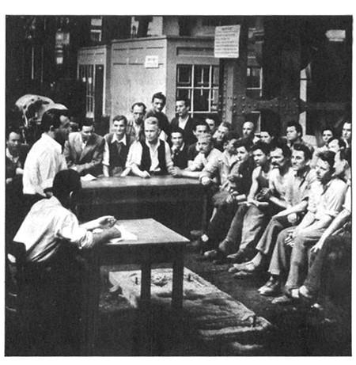

<section class="pattern-plate" aria-labelledby="t-self-governing-workshops-and-offices">
<a href="/patterns">A Pattern Language</a> · <a href="/patterns#towns">Towns</a> · Pattern 80 · p. 398 · **
<h1 class="pattern-title" id="t-self-governing-workshops-and-offices">Self-Governing Workshops And Offices</h1><figure class="pattern-figure pl-figure"></figure><nav class="pattern-links" aria-label="Connections"><h2>Links to</h2><ul><li><a href="/patterns/scattered-work">9 Scattered Work</a></li><li><a href="/patterns/building-complex">95 Building Complex</a></li></ul><h2>Linked from</h2><ul><li><a href="/patterns/scattered-work">9 Scattered Work</a></li><li><a href="/patterns/work-community">41 Work Community</a></li><li><a href="/patterns/your-own-home">79 Your Own Home</a></li><li><a href="/patterns/office-connections">82 Office Connections</a></li><li><a href="/patterns/master-and-apprentices">83 Master And Apprentices</a></li><li><a href="/patterns/shopfront-schools">85 Shopfront Schools</a></li><li><a href="/patterns/wings-of-light">107 Wings Of Light</a></li><li><a href="/patterns/bulk-storage">145 Bulk Storage</a></li><li><a href="/patterns/flexible-office-space">146 Flexible Office Space</a></li><li><a href="/patterns/communal-eating">147 Communal Eating</a></li><li><a href="/patterns/small-work-groups">148 Small Work Groups</a></li><li><a href="/patterns/reception-welcomes-you">149 Reception Welcomes You</a></li><li><a href="/patterns/rooms-to-rent">153 Rooms To Rent</a></li><li><a href="/patterns/home-workshop">157 Home Workshop</a></li><li><a href="/patterns/open-stairs">158 Open Stairs</a></li></ul></nav></section><article class="pattern-text" aria-label="The text of Self-Governing Workshops And Offices">
399… all kinds of work, office work and industrial work and agricultural work, are radically decentralized by <a class="pl-ref" href="/patterns/scattered-work">scattered work (9)</a>, and industrial ribbons (42) and grouped in small communities—work community (41). This pattern helps to generate these larger patterns by giving the fundamental nature of all work organizations, no matter what their type.

◆ ◆ ◆

<strong>No one enjoys his work if he is a cog in a machine.</strong>

A man enjoys his work when he understands the whole and when he is responsible for the quality of the whole. He can only understand the whole and be responsible for the whole when the work which happens in society, all of it, is undertaken by small self-governing human groups; groups small enough to give people understanding through face-to-face contact, and autonomous enough to let the workers themselves govern their own affairs.

The evidence for this pattern is built upon a single, fundamental proposition: work is a form of living, with its own intrinsic rewards; any way of organizing work which is at odds with this idea, which treats work instrumentally, as a means only to other ends, is inhuman. Down through the ages people have described and proposed ways of working according to this proposition. Recently, E. F. Schumacher, the economist, has made a beautiful statement of this attitude (E. F. Schumacher, “Buddhist Economics,” <em>Resurgence</em>, 275 Kings Road, Kingston, Surrey, Volume I, Number 11, January, 1968).

The Buddhist point of view takes the function of work to be at least threefold: to give a man a chance to utilize and develop his faculties; to enable him to overcome his ego-centeredness by joining with other people in a common task; and to bring forth the goods and services needed for a becoming existence. Again, the consequences that flow from this view are endless. To organize work in such a manner that it becomes meaningless, boring, stultifying, or nerve-racking for the worker would be little short of criminal; it would indicate a greater concern with goods than with people, an evil lack of compassion and a soul-destroying degree of attachment to the most 400primitive side of this worldly existence. Equally, to strive for leisure as an alternative to work would be considered a complete misunderstanding of one of the basic truths of human existence, namely, that work and leisure are complementary parts of the same living process and cannot be separated without destroying the joy of work and the bliss of leisure.

From the Buddhist point of view, there are therefore two types of mechanization which must be clearly distinguished: one that enhances a man’s skill and power and one that turns the work of man over to a mechanical slave, leaving man in a position of having to serve the slave. How to tell the one from the other? “The craftsman himself,” says Ananda Coomaraswamy, a man equally competent to talk about the Modern West as the Ancient East, “the craftsman himself can always, if allowed to, draw the delicate distinction between the machine and the tool. The carpet loom is a tool, a contrivance for holding warp threads at a stretch for the pile to be woven round them by the craftsmen’s fingers; but the power loom is a machine, and its significance as a destroyer of culture lies in the fact that it does the essentially human part of the work.” It is clear, therefore, that Buddhist economics must be very different from the economics of modern materialism, since the Buddhist sees the essence of civilization not in a multiplication of wants but in the purification of human character. Character, at the same time, is formed primarily by a man’s work. And work, properly conducted in conditions of human dignity and freedom, blesses those who do it and equally their products. The Indian philosopher and economist J. C. Kumarappa sums the matter up as follows:

“If the nature of the work is properly appreciated and applied, it will stand in the same relation to the higher faculties as food is to the physical body. It nourishes and enlivens the higher man and urges him to produce the best he is capable of. It directs his freewill along the proper course and disciplines the animal in him into progressive channels. It furnishes an excellent background for man to display his scale of values and develop his personality.”

In contrast to this form of work stands the style of work that has been created by the technological progress of the past two hundred years. In this style workers are made to operate like parts of a machine; they create parts of no consequence, and have no responsibility for the whole. We may fairly say that the alienation of workers from the intrinsic pleasures of their work has been a primary product of the industrial revolution. The alienation is particularly acute in large organizations, where faceless workers repeat endlessly menial tasks to create products and services with which they cannot identify.

401In these organizations, with all the power and benefits that the unions have been able to wrest from the hands of the owners, there is still evidence that workers are fundamentally unhappy with their work. In the auto industry, for example, the absentee rate on Mondays and Fridays is staggering—15 to 20 per cent; and there is evidence of “massive alcoholism, similar to what the Russians are experiencing with their factory workers” (Nicholas von Hoffman, <em>Washington Post)</em>. The fact is that people cannot find satisfaction in work unless it is performed at a human scale and in a setting where the worker has a say.

Job dissatisfaction in modern industry has also led to industrial sabotage and a faster turnover of workers in recent years. A new super-automated General Motors assembly plant in Lordstown, Ohio, was sabotaged and shut down for several weeks. Absenteeism in the three largest automobile manufacturing companies has doubled in the past seven years. The turnover of workers has also doubled. Some industrial engineers believe that “American industry in some cases may have pushed technology too far by taking the last few bits of skill out of jobs, and that a point of human resistance has been reached” (Agis Salpukis, “Is the machine pushing man over the brink?” <em>San Francisco Sunday Examiner and Chronicle</em>, April 16, 1972).

Perhaps the most dramatic empirical evidence for the connection between work and life is that presented in the recent study, “Work in America,” commissioned by Elliot Richardson, as Secretary of Health, Education and Welfare Department, 1972. This study finds that <em>the single best predictor of long life is not whether a person smokes or how often he sees a doctor, but the extent to which he is satisfied with his job</em>. The report identifies the two main elements of job dissatisfaction as the diminishing independence of workers, and the increasing simplification, fragmentation, and isolation of tasks—both of which are rampant in modern industrial and office work alike.

But for most of human history, the production of goods and services was for a far more personal, self-regulating affair; when each job of work was a matter of creative interest. And there is no reason why work can’t be like that again, today.

For instance, Seymour Melman, in <em>Decision Making and Productivity</em>, compares the manufacture of tractors in Detroit and in 402Coventry, England. He contrasts Detroit’s managerial rule with Coventry’s gang system and shows that the gang system produced high quality products and the highest wages in British industry. “The most characteristic feature of the decision-formulation process is that of mutuality in decision-making with final authority residing in the hands of the group workers themselves.”

Other projects and experiments and evidence which indicate that modern work can be organized in this manner and still be compatible with sophisticated technology, have been collected by Hunnius, Garson, and Chase. See <em>Workers’ Control</em>, New York: Vintage Books, 1973.

And another example comes from the reports by E. L. Trist, <em>Organizational Choice</em> and P. Herbst, <em>Autonomous Group Functioning</em>. These authors describe the organization of work in mining pits in Durham which was put into practice by groups of miners.

The composite work organization may be described as one in which the group takes over complete responsibility for the total cycle of operations involved in mining the coal-face. No member of the group has a fixed work-role. Instead, the men deploy themselves, depending on the requirements of the ongoing group task. Within the limits of technological and safety requirements they are free to evolve their way of organizing and carrying out their task.

[The experiment demonstrates] the ability of quite large primary work groups of 40-50 members to act as self-regulating, self-developing social organisms able to maintain.themselves in a steady state of high productivity. (Quoted in Colin Ward, “The organization of anarchy,” <em>Patterns of Anarchy</em>, Krimerman and Perry, eds., New York: Anchor Books, 1966, pp. 349–51.)

We believe that these small self-governing groups are not only most efficient, but also the only possible source of job satisfaction. They provide the only style of work that is nourishing and intrinsically satisfying.

Therefore:

<strong>Encourage the formation of self-governing workshops and offices of 5 to 20 workers. Make each group autonomous—with respect to organization, style, relation to other groups, hiring and firing, work schedule. Where the work 403is complicated and requires larger organizations, several of these work groups can federate and cooperate to produce complex artifacts and services.</strong>

<figure class="pl-figure"></figure>
◆ ◆ ◆

Hoote the workgroup in a building of its own—office connections (82), <a class="pl-ref" href="/patterns/building-complex">building complex (95)</a>; if the workgroup is large enough, and if it serves the public, break it down into autonomous departments, easily identifiable, with no more than a dozen people each—small services without red tape (81); in any case, divide all work into small team work, either directly within the cooperative workgroup or under the departments, with the people of each team in common space—master and apprentices (83) and small work croups (148)….
</article>

Christopher Alexander, Sara Ishikawa and Murray Silverstein, with Max Jacobson, Ingrid Fiksdahl-King and Shlomo Angel, <cite>A Pattern Language</cite> (Oxford University Press, 1977), pattern 80, pp. 398–403. Text and illustrations from the <a href="https://github.com/natureoforder/sources">Nature of Order sources</a> reading edition, transcribed from the 1977 printing; report errors on <a href="https://github.com/natureoforder/alexander-wiki/issues">GitHub</a>.

<a href="/patterns/your-own-home">← 79 Your Own Home</a> · <a href="/patterns">All 253 patterns</a> · <a href="/patterns/small-services-without-red-tape">81 Small Services Without Red Tape →</a>

