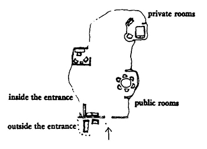

<section class="pattern-plate" aria-labelledby="t-sequence-of-sitting-spaces">
<a href="/patterns">A Pattern Language</a> · <a href="/patterns#buildings">Buildings</a> · Pattern 142 · p. 673 · *
<h1 class="pattern-title" id="t-sequence-of-sitting-spaces">Sequence Of Sitting Spaces</h1><nav class="pattern-links" aria-label="Connections"><h2>Links to</h2><ul><li><a href="/patterns/intimacy-gradient">127 Intimacy Gradient</a></li><li><a href="/patterns/common-areas-at-the-heart">129 Common Areas At The Heart</a></li><li><a href="/patterns/entrance-room">130 Entrance Room</a></li><li><a href="/patterns/short-passages">132 Short Passages</a></li><li><a href="/patterns/zen-view">134 Zen View</a></li><li><a href="/patterns/couples-realm">136 Couple’s Realm</a></li><li><a href="/patterns/childrens-realm">137 Children’s Realm</a></li><li><a href="/patterns/farmhouse-kitchen">139 Farmhouse Kitchen</a></li><li><a href="/patterns/private-terrace-on-the-street">140 Private Terrace On The Street</a></li><li><a href="/patterns/a-room-of-ones-own">141 A Room Of One’s Own</a></li><li><a href="/patterns/flexible-office-space">146 Flexible Office Space</a></li><li><a href="/patterns/reception-welcomes-you">149 Reception Welcomes You</a></li><li><a href="/patterns/a-place-to-wait">150 A Place To Wait</a></li><li><a href="/patterns/small-meeting-rooms">151 Small Meeting Rooms</a></li><li><a href="/patterns/half-private-office">152 Half-Private Office</a></li><li><a href="/patterns/garden-seat">176 Garden Seat</a></li><li><a href="/patterns/alcoves">179 Alcoves</a></li><li><a href="/patterns/sitting-circle">185 Sitting Circle</a></li><li><a href="/patterns/the-shape-of-indoor-space">191 The Shape Of Indoor Space</a></li><li><a href="/patterns/seat-spots">241 Seat Spots</a></li></ul><h2>Linked from</h2><ul><li><a href="/patterns/intimacy-gradient">127 Intimacy Gradient</a></li><li><a href="/patterns/common-areas-at-the-heart">129 Common Areas At The Heart</a></li><li><a href="/patterns/entrance-room">130 Entrance Room</a></li><li><a href="/patterns/tapestry-of-light-and-dark">135 Tapestry Of Light And Dark</a></li><li><a href="/patterns/farmhouse-kitchen">139 Farmhouse Kitchen</a></li><li><a href="/patterns/private-terrace-on-the-street">140 Private Terrace On The Street</a></li><li><a href="/patterns/outdoor-room">163 Outdoor Room</a></li><li><a href="/patterns/alcoves">179 Alcoves</a></li><li><a href="/patterns/sitting-circle">185 Sitting Circle</a></li><li><a href="/patterns/interior-windows">194 Interior Windows</a></li><li><a href="/patterns/corner-doors">196 Corner Doors</a></li><li><a href="/patterns/built-in-seats">202 Built-In Seats</a></li><li><a href="/patterns/different-chairs">251 Different Chairs</a></li></ul></nav></section><article class="pattern-text" aria-label="The text of Sequence Of Sitting Spaces">
… at various points along the <a class="pl-ref" href="/patterns/intimacy-gradient">INTIMACY GRADIENT (127)</a> of a house, or office, or a public building, there is a need for sitting space. Some of this space may take the form of rooms devoted entirely to sitting, like the formal sitting rooms of old; others may be simply areas or corners of other rooms. This pattern states the range and distribution of these sitting spaces, and helps create the intimacy gradient by doing so.

◆ ◆ ◆

<strong>Every comer of a building is a potential sitting space. But each sitting space has different needs for comfort and enclosure according to its position in the intimacy gradient.</strong>

We know from <a class="pl-ref" href="/patterns/intimacy-gradient">INTIMACY GRADIENT (127)</a> that a building has a natural sequence of spaces in it, ranging from the most public areas, outside the entrance, to the most private, in individual rooms and couples realms. Here is a sequence of sitting spaces that would correspond roughly to the <a class="pl-ref" href="/patterns/intimacy-gradient">INTIMACY GRADIENT (127)</a>:

1 Outside the entrance—<a class="pl-ref" href="/patterns/entrance-room">ENTRANCE ROOM (130)</a>, FRONT DOOR BENCH (24.2)

2 Inside the entrance—<a class="pl-ref" href="/patterns/entrance-room">ENTRANCE ROOM (130)</a>, <a class="pl-ref" href="/patterns/reception-welcomes-you">RECEPTION WELCOMES YOU (149)</a>

3 Common rooms—<a class="pl-ref" href="/patterns/common-areas-at-the-heart">COMMON AREAS AT THE HEART (129)</a>,<a class="pl-ref" href="/patterns/short-passages">SHORT PASSAGES (132)</a>, <a class="pl-ref" href="/patterns/farmhouse-kitchen">FARMHOUSE KITCHEN (139)</a>, <a class="pl-ref" href="/patterns/small-meeting-rooms">SMALL MEETING ROOMS (151)</a>

4.. Half-private rooms—<a class="pl-ref" href="/patterns/childrens-realm">CHILDREN’S REALM (137)</a>, <a class="pl-ref" href="/patterns/private-terrace-on-the-street">PRIVATE TERRACE ON THE STREET (140)</a>, <a class="pl-ref" href="/patterns/half-private-office">HALF-PRIVATE OFFICE (152)</a>, <a class="pl-ref" href="/patterns/alcoves">ALCOVES (179)</a>

5. Private rooms—<a class="pl-ref" href="/patterns/couples-realm">COUPLE’S REALM (136)</a>, <a class="pl-ref" href="/patterns/a-room-of-ones-own">A ROOM OF ONE’S OWN (141)</a>, <a class="pl-ref" href="/patterns/garden-seat">GARDEN SEAT (176)</a>.

674Now, what is the problem? Simply, it is the following. People have a tendency to think about <em>the</em> sitting room, as though a building, and especially a house, has just one room made for sitting. Within this frame of reference, this one sitting room gets a great deal of care and attention. But the fact that human activity naturally occurs all through the house, at a variety of degrees of intensity and intimacy, is forgotten—and the sitting spaces throughout the building fail to support the real rhythms of sitting and hanging around.

To solve the problem, recognize that your building should contain a sequence of sitting spaces of varying degrees of intimacy, and that each space in this sequence needs the degree of enclosure and comfort appropriate to its position. Pay attention to the full sequence, not just to one room. Ask yourself if the building you are making or repairing has the full sequence of sitting spaces, and what needs to be done to create this sequence, in its full richness and variety.

Of course, you may want to build a special sitting room—a <em>sale</em> or a parlor or a library or a living room—as one of the sitting spaces in your house. But remember that each office and workroom needs a sitting space too; so does a kitchen, so does a couple’s realm, so does a garden, so does an entrance room, so does a corridor even, so does a roof, so does a window place. Pick the sequence of sitting spaces quite deliberately, mark it, and pay equal attention to the various spaces in the sequence as you go further into the details of the design.

Therefore:

<strong>Put in a sequence of graded sitting spaces throughout the building, varying according to their degree of enclosure. Enclose the most formal ones entirely, in rooms by themselves; put the least formal ones in comers of other rooms, without any kind of screen around them; and place the intermediate one with a partial enclosure round them to keep them connected to some larger space, but also partly separate.</strong>

675

<figure class="pl-figure"></figure>
◆ ◆ ◆

Put the most formal sitting spaces in the <a class="pl-ref" href="/patterns/common-areas-at-the-heart">COMMON AREAS AT THE HEART (129)</a> and in the <a class="pl-ref" href="/patterns/entrance-room">ENTRANCE ROOM (130)</a>; put the intermediate spaces also in the <a class="pl-ref" href="/patterns/common-areas-at-the-heart">COMMON AREAS AT THE HEART (129)</a>, in <a class="pl-ref" href="/patterns/flexible-office-space">FLEXIBLE OFFICE SPACE (146)</a>, in <a class="pl-ref" href="/patterns/a-place-to-wait">a PLACE TO WAIT (150)</a>, and on the <a class="pl-ref" href="/patterns/private-terrace-on-the-street">PRIVATE TERRACE ON THE STREET (140)</a>; and put the most intimate and most informal sitting spaces in the <a class="pl-ref" href="/patterns/couples-realm">COUPLE’S REALM (136)</a>, the <a class="pl-ref" href="/patterns/farmhouse-kitchen">FARMHOUSE KITCHEN (139)</a>, the <a class="pl-ref" href="/patterns/a-room-of-ones-own">ROOMS OF ONE’S OWN (141)</a>, and the <a class="pl-ref" href="/patterns/half-private-office">HALF-PRIVATE OFFICES (152)</a>. Build the enclosure round each space, according to its position in the scale of sitting spaces—<a class="pl-ref" href="/patterns/the-shape-of-indoor-space">THE SHAPE OF INDOOR SPACE (191)</a>; and make each one, wherever it is, comfortable and lazy by placing chairs correctly with respect to fires and windows <a class="pl-ref" href="/patterns/zen-view">ZEN VIEW (134)</a>, WINDOW PLACE (l80), THE FIRE (l8l), <a class="pl-ref" href="/patterns/sitting-circle">SITTING CIRCLE (183)</a>, <a class="pl-ref" href="/patterns/seat-spots">SEAT SPOTS (241)</a>….
</article>

Christopher Alexander, Sara Ishikawa and Murray Silverstein, with Max Jacobson, Ingrid Fiksdahl-King and Shlomo Angel, <cite>A Pattern Language</cite> (Oxford University Press, 1977), pattern 142, pp. 673–675. Text and illustrations from the <a href="https://github.com/natureoforder/sources">Nature of Order sources</a> reading edition, transcribed from the 1977 printing; report errors on <a href="https://github.com/natureoforder/alexander-wiki/issues">GitHub</a>.

<a href="/patterns/a-room-of-ones-own">← 141 A Room Of One’s Own</a> · <a href="/patterns">All 253 patterns</a> · <a href="/patterns/bed-cluster">143 Bed Cluster →</a>

