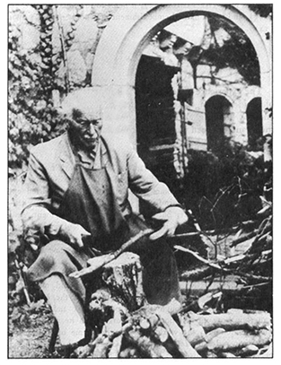
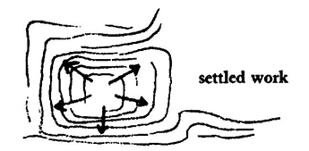

<section class="pattern-plate" aria-labelledby="t-settled-work">
<a href="/patterns">A Pattern Language</a> · <a href="/patterns#buildings">Buildings</a> · Pattern 156 · p. 733 · *
<h1 class="pattern-title" id="t-settled-work">Settled Work</h1><figure class="pattern-figure pl-figure"></figure><nav class="pattern-links" aria-label="Connections"><h2>Links to</h2><ul><li><a href="/patterns/life-cycle">26 Life Cycle</a></li><li><a href="/patterns/the-family">75 The Family</a></li><li><a href="/patterns/private-terrace-on-the-street">140 Private Terrace On The Street</a></li><li><a href="/patterns/a-room-of-ones-own">141 A Room Of One’s Own</a></li><li><a href="/patterns/old-age-cottage">155 Old Age Cottage</a></li><li><a href="/patterns/home-workshop">157 Home Workshop</a></li><li><a href="/patterns/opening-to-the-street">165 Opening To The Street</a></li></ul><h2>Linked from</h2><ul><li><a href="/patterns/life-cycle">26 Life Cycle</a></li><li><a href="/patterns/old-people-everywhere">40 Old People Everywhere</a></li><li><a href="/patterns/half-private-office">152 Half-Private Office</a></li><li><a href="/patterns/old-age-cottage">155 Old Age Cottage</a></li><li><a href="/patterns/open-stairs">158 Open Stairs</a></li></ul></nav></section><article class="pattern-text" aria-label="The text of Settled Work">
734… as people grow older, simple satisfying work which nourishes, becomes more and more important. This pattern specifies the need for this development to be a part of every family. It helps to form <a class="pl-ref" href="/patterns/the-family">THE FAMILY (75)</a>, it helps form <a class="pl-ref" href="/patterns/old-age-cottage">OLD AGE COTTAGE (155)</a>, and it is a natural embellishment of <a class="pl-ref" href="/patterns/a-room-of-ones-own">A ROOM OF ONE’S OWN (141)</a>.

◆ ◆ ◆

<strong>The experience of settled work is a prerequisite for peace of mind in old age. Yet our society undermines this experience by making a rift between working life and retirement, and between workplace and home.</strong>

First of all, what do we mean by “settled work”? It is the work which unites all the threads of a person’s life into one activity: the activity becomes a complete and wholehearted extension of the person behind it. It is a kind of work that one cannot come to overnight; but only by gradual development. And it is a kind of work that is so thoroughly a part of one’s way of life that it most naturally occurs within or very near the home: when it is free to develop, the workplace and the home gradually fuse and become one thing.

It may be the same kind of work that a man has been doing all his life—but as settled work it becomes more profound, more concrete, and more unique. For example, there is the bureaucrat who finally breaks through all the paper work and finds the underlying organic function in his work. Then he begins to let this function into the world. This is the theme of Kurosawa’s most beautiful film, <em>Ikiru: To Live</em>. Or it may be work that a person begins in his spare time, away from his occupation, and it gradually expands and becomes more involving, until it replaces his old occupation altogether.

The problem is that very many people never achieve the experience of settled work. This is essentially because a person, 735during his working life, has neither the time nor the space to develop it. In today’s marketplace most people are forced to adapt their work to the rules of the office, the factory, or the institution. And generally this work is all-consuming—when the weekends come people do not have the energy to start a new, demanding kind of work. Even in the self-governing workshops and offices, where working procedures are created ad hoc by the workers as they go, the work itself is generally geared to the demands of the marketplace. It does not allow time for the slow growth of “settled work”—which comes from within and may not always carry its weight in the marketplace.

To solve the problem, we must first of all create a working environment, where a person, from say middle age, has the opportunity of slowly developing a kind of settled work that is right for him. For instance, if people were able to take off one day a week, with half-time pay, beginning at the age of 40, they could gradually set up for themselves a workshop in their home or in their neighborhood. If the time is increased gradually over the years, a person can explore various kinds of work; and, then, gradually let the settled work replace his working life.

We make special mention of settled work as the work of old age, because, even though it must begin early on in a person’s life, it is in old age that having such work becomes a necessity. The crisis of old age, life integrity versus despair and cynicism, can only be solved by a person engaged in some form of settled work—see <a class="pl-ref" href="/patterns/life-cycle">LIFE CYCLE (26)</a>. People who have the opportunity to develop such work and to relate it in some appropriate way to the world about them, will find their way to a successful resolution of this crisis as they grow old; others will sink into despair.

Therefore:

<strong>Give each person, especially as he grows old, the chance to set up a workplace of his own, within or very near his home. Make it a place that can grow slowly, perhaps in the beginning sustaining a weekend hobby and gradually becoming a complete, productive, and comfortable workshop.</strong>

736

<figure class="pl-figure"></figure>
◆ ◆ ◆

Arrange the workshop, physically, along the lines defined by <a class="pl-ref" href="/patterns/home-workshop">HOME WORKSHOP (157)</a>, and make the workshop open to the street, a part of local street life—<a class="pl-ref" href="/patterns/private-terrace-on-the-street">PRIVATE TERRACE ON THE STREET (140)</a>, <a class="pl-ref" href="/patterns/opening-to-the-street">OPENING TO THE STREET (165)</a>….
</article>

Christopher Alexander, Sara Ishikawa and Murray Silverstein, with Max Jacobson, Ingrid Fiksdahl-King and Shlomo Angel, <cite>A Pattern Language</cite> (Oxford University Press, 1977), pattern 156, pp. 733–736. Text and illustrations from the <a href="https://github.com/natureoforder/sources">Nature of Order sources</a> reading edition, transcribed from the 1977 printing; report errors on <a href="https://github.com/natureoforder/alexander-wiki/issues">GitHub</a>.

<a href="/patterns/old-age-cottage">← 155 Old Age Cottage</a> · <a href="/patterns">All 253 patterns</a> · <a href="/patterns/home-workshop">157 Home Workshop →</a>

