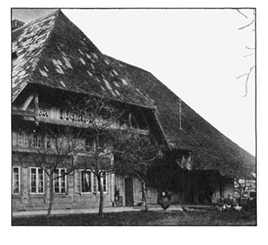
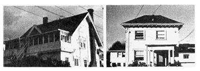
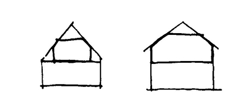
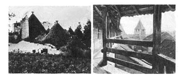
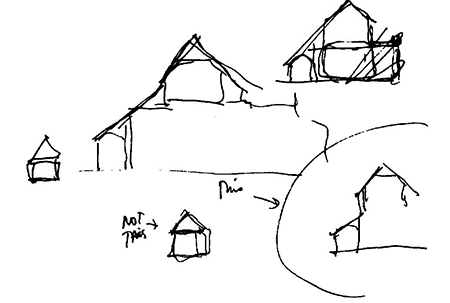

<section class="pattern-plate" aria-labelledby="t-sheltering-roof">
<a href="/patterns">A Pattern Language</a> · <a href="/patterns#buildings">Buildings</a> · Pattern 117 · p. 569 · **
<h1 class="pattern-title" id="t-sheltering-roof">Sheltering Roof</h1><figure class="pattern-figure pl-figure"></figure><nav class="pattern-links" aria-label="Connections"><h2>Links to</h2><ul><li><a href="/patterns/wings-of-light">107 Wings Of Light</a></li><li><a href="/patterns/cascade-of-roofs">116 Cascade Of Roofs</a></li><li><a href="/patterns/roof-garden">118 Roof Garden</a></li><li><a href="/patterns/arcades">119 Arcades</a></li><li><a href="/patterns/bulk-storage">145 Bulk Storage</a></li><li><a href="/patterns/gallery-surround">166 Gallery Surround</a></li><li><a href="/patterns/roof-layout">209 Roof Layout</a></li><li><a href="/patterns/roof-vaults">220 Roof Vaults</a></li><li><a href="/patterns/dormer-windows">231 Dormer Windows</a></li></ul><h2>Linked from</h2><ul><li><a href="/patterns/number-of-stories">96 Number Of Stories</a></li><li><a href="/patterns/long-thin-house">109 Long Thin House</a></li><li><a href="/patterns/cascade-of-roofs">116 Cascade Of Roofs</a></li><li><a href="/patterns/roof-garden">118 Roof Garden</a></li><li><a href="/patterns/arcades">119 Arcades</a></li><li><a href="/patterns/bulk-storage">145 Bulk Storage</a></li><li><a href="/patterns/roof-layout">209 Roof Layout</a></li><li><a href="/patterns/final-column-distribution">213 Final Column Distribution</a></li><li><a href="/patterns/roof-vaults">220 Roof Vaults</a></li><li><a href="/patterns/dormer-windows">231 Dormer Windows</a></li></ul></nav></section><article class="pattern-text" aria-label="The text of Sheltering Roof">
570… over the <a class="pl-ref" href="/patterns/wings-of-light">WINGS OF LIGHT (107)</a>, within the overall <a class="pl-ref" href="/patterns/cascade-of-roofs">CASCADE OF ROOFS (116)</a>, some parts of the cascade are flat and some are steeply pitched or vaulted. This pattern gives the character of those parts which are steeply pitched or vaulted; the next one gives the character of those which must be flat.

◆ ◆ ◆

<strong>The roof plays a primal role in our lives. The most primitive buildings are nothing but a roof. If the roof is hidden, if its presence cannot be felt around the building, or if it cannot be used, then people will lack a fundamental sense of shelter.</strong>

This sheltering function cannot be created by a pitched roof, or large roof, which is merely added to the top of an existing structure. The roof itself only shelters if it contains, embraces, covers, surrounds the process of living. This means very simply, that the roof must not only be large and visible, but it must also include living quarters <em>within</em> its volume, not only underneath it.

Compare the following examples. They show clearly how different roofs are, when they have living quarters within them and when they don’t.

<figure class="pl-figure"><figcaption><em>One roof lived in, the other stuck on</em>.</figcaption></figure>

The difference between these two houses comes largely from the fact that in one the roof is an integral part of the volume of the building, while in the other it is no more than a cap that has been set down on top of the building. In the first case, where the 571building conveys an enormous sense of shelter, it is impossible to draw a horizontal line across the facade of the building and separate the roof from the inhabited parts of the building. But in the second case, the roof is so separate and distinct a thing, that such a line almost draws itself.

We believe that this connection between the geometry of roofs, and their capacity to provide psychological shelter, can be put on empirical grounds: first, there is a kind of evidence which shows that both children and adults naturally incline toward the sheltering roofs, almost as if they had archetypal properties. For example, here is Amos Rapoport on the subject:

… “roof” is a symbol of home, as in the phrase “a roof over one’s head,” and its importance has been stressed in a number of studies. In one study, the importance of images—i.e., symbols—for house form is stressed, and the pitched roof is said to be symbolic of shelter while the flat roof is not, and is therefore unacceptable on symbolic grounds. Another study of this subject shows the importance of these aspects in the choice of house form in England, and also shows that the pitched, tile roof is a symbol of security. It is considered, and even shown in a building-society advertisement, as an umbrella, and the houses directly reflect this view. (Amos Rapoport, <em>House Form and Culture</em>, Englewood Cliffs, N.J.: Prentice-Hall, 1969, p. 134.)

George Rand has drawn a similar point from his research. Rand finds that people are extremely conservative about their images of home and shelter. Despite 50 yean of the flat roofs of the “modem movement,” people still find the simple pitched roof the most powerful symbol of shelter. (George Rand, “Children’s Images of Houses: A Prolegomena to the Study of Why People Still Want Pitched Roofs,” <em>Environmental Design: Research and Practice</em>, Proceedings of the EDRA 3/AR 8 Conference, University of California at Los Angeles, William J. Mitchell, ed., January 1972, pp. 6–9–2 to 6–9–10.)

And the French psychiatrist, Menie Gregoire, makes the following observation about children:

At Nancy the children from the apartments were asked to draw a house. These children had been bora in these apartment slabs which stand up like a house of cards upon an isolated hill. Without exception they each drew a small cottage with two windows and smoke curling up from a chimney on die roof. (M. Gregoire, “The Child in the High-Rise,” <em>Ekistics</em>, May 1971, pp. 331–33.)

572Such evidence as this can perhaps be dismissed on the grounds that it is culturally induced. But there is a second kind of evidence, more obvious, which lies in the simple fact of making the connection between the features of a roof and the feeling of shelter completely clear. In the passage which follows, we explain the geometric features which a roof must have in order to create an atmosphere of shelter.

1. The space under or on the roof must be useful space, space that people come into contact with daily. The whole feeling of shelter comes from the fact that the roof <em>surrounds</em> people at the same time that it covers them. You can imagine this taking either of the following forms. In both cases, the rooms under the roof are actually surrounded by the roof.

<figure class="pl-figure"><figcaption><em>Two roof sections</em>.</figcaption></figure>

2. Seen from afar, the roof of the building must be made to form a massive part of the building. When you see the building, you see the roof. This is perhaps the most dramatic feature of a strong, sheltering roof.

What constitutes the charm to the eye of the old-fashioned country barn but its immense roof—a slope of gray shingle exposed to the weather like the side of a hill, and by its amplitude suggesting a bounty that warms the heart. Many of the old farmhouses, too, were modelled on the same generous scale, and at a distance little was visible but their great sloping roofs. They covered their inmates as a hen covereth her brood, and are touching pictures of the domestic spirit in its simpler forms. (John Burroughs, <em>Signs and Seasons</em>, New York: Houghton Mifflin, 1914, p. 252.)

3. And a sheltering roof must be placed so that one can touch it—touch it from outside. If it is pitched or vaulted, some 573part of the roof must come down low to the ground, just in a place where there is a path, so that it becomes a natural thing to touch the roof edge as you pass it.

<figure class="pl-figure"><figcaption><em>Roof edges you can touch</em>.</figcaption></figure>

Therefore:

<strong>Slope the roof or make a vault of it, make its entire surface visible, and bring the eaves of the roof down low, as low as 6’o” or 6’6” at places like the entrance, where people pause. Build the top story of each wing right into the roof, so that the roof does not only cover it, but actually surrounds it.</strong>

<figure class="pl-figure"></figure>
574

◆ ◆ ◆

Get the exact shape of the cross section from <a class="pl-ref" href="/patterns/roof-vaults">ROOF VAULTS (220)</a>; use the space inside the top of the sloped roof for <a class="pl-ref" href="/patterns/bulk-storage">BULK STORAGE (145)</a>; where the roof comes down low, perhaps make it continuous with an <a class="pl-ref" href="/patterns/arcades">ARCADE (119)</a> or <a class="pl-ref" href="/patterns/gallery-surround">GALLERY SURROUND (166)</a>. Build the roof flat, not sloped, only where people can get out to it to use it as a garden—<a class="pl-ref" href="/patterns/roof-garden">ROOF GARDENS (118)</a>; where rooms are built into the roof, make windows in the roof—<a class="pl-ref" href="/patterns/dormer-windows">DORMER WINDOWS (231)</a>. If the building plan is complex, get the exact way that different sloped roofs meet from <a class="pl-ref" href="/patterns/roof-layout">ROOF LAYOUT (209)</a>….
</article>

Christopher Alexander, Sara Ishikawa and Murray Silverstein, with Max Jacobson, Ingrid Fiksdahl-King and Shlomo Angel, <cite>A Pattern Language</cite> (Oxford University Press, 1977), pattern 117, pp. 569–574. Text and illustrations from the <a href="https://github.com/natureoforder/sources">Nature of Order sources</a> reading edition, transcribed from the 1977 printing; report errors on <a href="https://github.com/natureoforder/alexander-wiki/issues">GitHub</a>.

<a href="/patterns/cascade-of-roofs">← 116 Cascade Of Roofs</a> · <a href="/patterns">All 253 patterns</a> · <a href="/patterns/roof-garden">118 Roof Garden →</a>

