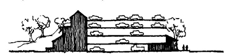
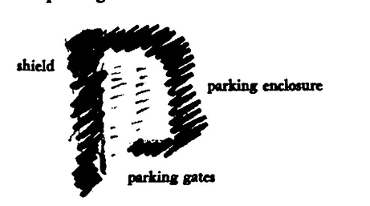

<section class="pattern-plate" aria-labelledby="t-shielded-parking">
<a href="/patterns">A Pattern Language</a> · <a href="/patterns#buildings">Buildings</a> · Pattern 97 · p. 477 · *
<h1 class="pattern-title" id="t-shielded-parking">Shielded Parking</h1><nav class="pattern-links" aria-label="Connections"><h2>Links to</h2><ul><li><a href="/patterns/local-transport-areas">11 Local Transport Areas</a></li><li><a href="/patterns/nine-per-cent-parking">22 Nine Per Cent Parking</a></li><li><a href="/patterns/housing-hill">39 Housing Hill</a></li><li><a href="/patterns/housing-in-between">48 Housing In Between</a></li><li><a href="/patterns/individually-owned-shops">87 Individually Owned Shops</a></li><li><a href="/patterns/building-complex">95 Building Complex</a></li><li><a href="/patterns/circulation-realms">98 Circulation Realms</a></li><li><a href="/patterns/small-parking-lots">103 Small Parking Lots</a></li><li><a href="/patterns/main-entrance">110 Main Entrance</a></li><li><a href="/patterns/tapestry-of-light-and-dark">135 Tapestry Of Light And Dark</a></li><li><a href="/patterns/open-stairs">158 Open Stairs</a></li><li><a href="/patterns/gallery-surround">166 Gallery Surround</a></li><li><a href="/patterns/structure-follows-social-spaces">205 Structure Follows Social Spaces</a></li><li><a href="/patterns/canvas-roofs">244 Canvas Roofs</a></li></ul><h2>Linked from</h2><ul><li><a href="/patterns/local-transport-areas">11 Local Transport Areas</a></li><li><a href="/patterns/subculture-boundary">13 Subculture Boundary</a></li><li><a href="/patterns/neighborhood-boundary">15 Neighborhood Boundary</a></li><li><a href="/patterns/ring-roads">17 Ring Roads</a></li><li><a href="/patterns/shopping-street">32 Shopping Street</a></li><li><a href="/patterns/small-parking-lots">103 Small Parking Lots</a></li><li><a href="/patterns/main-entrance">110 Main Entrance</a></li></ul></nav></section><article class="pattern-text" aria-label="The text of Shielded Parking">
… many patterns we have given discourage dependence on the use of cars; we hope that these patterns will gradually get rid, altogether, of the need for large parking lots and parking structures—<a class="pl-ref" href="/patterns/local-transport-areas">LOCAL TRANSPORT AREAS (11)</a>, <a class="pl-ref" href="/patterns/nine-per-cent-parking">NINE PER CENT PARKING (22)</a>. However, in certain cases, unfortunately, large areas of parking are still necessary. Whenever this is so, this parking must be placed very early, to be sure that it does not destroy the <a class="pl-ref" href="/patterns/building-complex">BUILDING COMPLEX (95)</a> altogether.

◆ ◆ ◆

<strong>Large parking structures full of cars are inhuman and dead buildings—no one wants to see them or walk by them. At the same time, if you are driving, the entrance to a parking structure is essentially the main entrance to the building—and it needs to be visible.</strong>

In <a class="pl-ref" href="/patterns/nine-per-cent-parking">NINE PER CENT PARKING (22)</a>, we have already defined an upper limit on the total amount of parking in a neighborhood. In <a class="pl-ref" href="/patterns/small-parking-lots">SMALL PARKING LOTS (103)</a> we give the best size and the distribution of the lots when they are on the ground. But in certain cases it is still necessary to build larger parking lots or parking structures. The environment can tolerate these larger lots and structures, provided that they are built so that they do not pollute the land around them.

This is a simple biological principle. In the human body, for example, there are waste products; the waste products are part of the way the body works, and obviously they must have a place. But the stomach and colon are built in such a way as to shield the other internal organs from the poisons carried by the wastes.

The same is true in a city. At this moment in history the city requires a certain limited amount of parking; and for the time being there is no getting away from that. But the parking must be built in such a way that it is shielded—by shops, houses, hills of 478grassy earth, walls, or any other buildings of any kind—-anything, so long as the interior of the parking structure and the cars are not visible from the surrounding land. On ground level, the shield is especially critical. Shops are useful since they generate their own pedestrian scale immediately. And since the need for parking often goes hand in hand with commercial development, shops are often very feasible economically.

<figure class="pl-figure"><figcaption><em>A shielded parking structure</em>.</figcaption></figure>

And of course, the houses themselves can serve the same function. In Paris, many of the most charming and beautiful apartment houses are arranged around courtyards, which permit parking inside, away from the street. There are few enough cars, so that they don’t destroy the courtyard, for the houses; and the street is left free of parked cars entirely.

Along with the need to shield parking structures there is the equally pressing need on the part of a driver to be able to spot the parking structure quickly—and see how it is connected to the building he is headed for. One of the most frequent complaints about the parking near a building is not that it is too far away, but that you don’t know where you can go to find a parking spot and still be sure of how to get back into the building.

This means that

1. Parking, which is specifically for the use of visitors, must be clearly marked from the directions of approach, even though the structure as a whole is shielded. The person who is coming by car will be looking for the building, not the parking lot. The entrance to parking must be marked as an important entrance—a gate—so that you can see it automatically, in the process of looking for the building. And it must be placed so that you find it about the same time that you see the building’s main entrance.

2. While you are parking your car you must be able to see the exit from the parking area which will lead you into the building. This will let you search for the closest spots, and will mean that you don’t have to walk around searching for the exit.

479Therefore.

<strong>Put all large parking lots, or parking garages, behind some kind of natural wall, so that the cars and parking structures cannot be seen from outside. The wall which surrounds the can may be a building, connected houses, or housing hills, earth berms, or shops.</strong>

<strong>Make the entrance to the parking lot a natural gateway to the buildings which it serves, and place it so that you can easily see the main entrance to the building from the entrance to the parking.</strong>

<figure class="pl-figure"></figure>
◆ ◆ ◆

For shields see <a class="pl-ref" href="/patterns/housing-hill">HOUSING HILL (39)</a>, <a class="pl-ref" href="/patterns/housing-in-between">HOUSING IN BETWEEN (48)</a>, <a class="pl-ref" href="/patterns/individually-owned-shops">INDIVIDUALLY OWNED SHOPS (87)</a>, <a class="pl-ref" href="/patterns/open-stairs">OPEN STAIRS (158)</a>, <a class="pl-ref" href="/patterns/gallery-surround">GALLERY SURROUND (166)</a>. One of the cheapest ways of all to shield a parking lot is with canvas awnings—the canvas can be many colors: underneath, the light is beautiful—<a class="pl-ref" href="/patterns/canvas-roofs">CANVAS ROOFS (244)</a>. Make certain that the major entrances of buildings are quite clearly visible from the place where you drive into parking lots, and from the places where you leave the parking lots on foot <a class="pl-ref" href="/patterns/circulation-realms">CIRCULATION REALMS (98)</a>, FAMILY OF ENTRANCES (l02), <a class="pl-ref" href="/patterns/main-entrance">MAIN ENTRANCES (102)</a>. In covered parking structures, use a huge shaft of daylight as a natural direction which tells people where to walk to leave the parking—<a class="pl-ref" href="/patterns/tapestry-of-light-and-dark">TAPESTRY OF LIGHT AND DARK (135)</a>; and finally, for the load-bearing structure, engineering, and construction, begin with <a class="pl-ref" href="/patterns/structure-follows-social-spaces">STRUCTURE FOLLOWS SOCIAL SPACES(205)</a>….
</article>

Christopher Alexander, Sara Ishikawa and Murray Silverstein, with Max Jacobson, Ingrid Fiksdahl-King and Shlomo Angel, <cite>A Pattern Language</cite> (Oxford University Press, 1977), pattern 97, pp. 477–479. Text and illustrations from the <a href="https://github.com/natureoforder/sources">Nature of Order sources</a> reading edition, transcribed from the 1977 printing; report errors on <a href="https://github.com/natureoforder/alexander-wiki/issues">GitHub</a>.

<a href="/patterns/number-of-stories">← 96 Number Of Stories</a> · <a href="/patterns">All 253 patterns</a> · <a href="/patterns/circulation-realms">98 Circulation Realms →</a>

