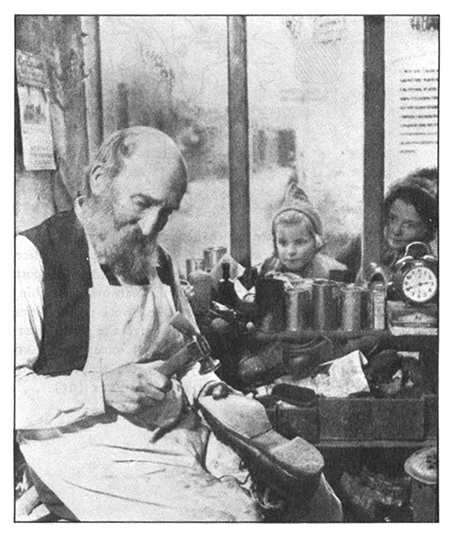
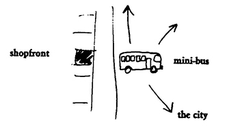

<section class="pattern-plate" aria-labelledby="t-shopfront-schools">
<a href="/patterns">A Pattern Language</a> · <a href="/patterns#towns">Towns</a> · Pattern 85 · p. 420
<h1 class="pattern-title" id="t-shopfront-schools">Shopfront Schools</h1><figure class="pattern-figure pl-figure"></figure><nav class="pattern-links" aria-label="Connections"><h2>Links to</h2><ul><li><a href="/patterns/network-of-learning">18 Network Of Learning</a></li><li><a href="/patterns/accessible-green">60 Accessible Green</a></li><li><a href="/patterns/self-governing-workshops-and-offices">80 Self-Governing Workshops And Offices</a></li><li><a href="/patterns/childrens-home">86 Children’s Home</a></li><li><a href="/patterns/building-complex">95 Building Complex</a></li><li><a href="/patterns/pedestrian-street">100 Pedestrian Street</a></li><li><a href="/patterns/opening-to-the-street">165 Opening To The Street</a></li></ul><h2>Linked from</h2><ul><li><a href="/patterns/network-of-learning">18 Network Of Learning</a></li><li><a href="/patterns/life-cycle">26 Life Cycle</a></li><li><a href="/patterns/activity-nodes">30 Activity Nodes</a></li><li><a href="/patterns/children-in-the-city">57 Children In The City</a></li><li><a href="/patterns/your-own-home">79 Your Own Home</a></li></ul></nav></section><article class="pattern-text" aria-label="The text of Shopfront Schools">
421… the <a class="pl-ref" href="/patterns/childrens-home">CHILDREN’S HOME (86)</a> provides the beginning of learning and forms the foundation of the <a class="pl-ref" href="/patterns/network-of-learning">NETWORK OF LEARNING (18)</a> in a community. As children grow older and more independent, these patterns must be supplemented by a mass of tiny institutions, schools and yet not schools, dotted among the living functions of the community.

◆ ◆ ◆

<strong>Around the age of 6 or 7, children develop a great need to learn by doing, to make their mark on a community outside the home. If the setting is right, these needs lead children directly to basic skills and habits of learning.</strong>

The right setting for a child is the community itself, just as the right setting for an infant learning to speak is his own home.

For example:

On the first day of school we had lunch in one of the Los Angeles city parks. After lunch I gathered everyone, and I said, “Let’s do some tree identification,” and they all moaned. So I said, “Aw, come on, you live with these plants, you could at least know their names. What’s the name of these trees we’re sitting under?”

They all looked up, and in unison said “Sycamores.” So I said, “What kind of sycamore?” and no one knew. I got out my <em>Trees of North America</em> book, and said, “Let’s find out.” There were only three kinds of sycamore in the book, only one on the West Coast, and it was called the California Sycamore. I thought it was all over, but I persisted, “We better make sure by checking these trees against the description in the book.” So I started reading the text, “Leaves: six to eight inches.” I fished a cloth measuring tape out of a box, handed it to Jeff, and said, “Go check out those leaves.” He found that the leaves were indeed six to eight inches.

I went back to the book and read, “‘Height of mature trees, 30-50 feet.’ How are we going to check that?” A big discussion followed, and we finally decided that I should stand up against one of the trees, they would back off as far as they could and estimate how many “Rusches” high the tree was. A little simple multiplication followed and we had an approximate tree height. Everyone was pretty involved by now, so I asked them “How else could you do it?” Eric was in the seventh grade and knew a little geometry, so he taught us how to measure the height by triangulation.

422I was delighted just to have everyone’s attention, so I went back to the book and kept reading. Near the bottom of the paragraph, came the clincher, “Diameter: one to three feet.” So I handed over the measuring tape, and said, “Get me the diameter of that tree over there.” They went over to the tree, and it wasn’t until they were right on top of it that they realized that the only way to measure the diameter of a tree directly is to cut it down. But I insisted that we had to know the diameter of the tree, so two of them stretched out the tape next to the tree, and by eyeballing along one “edge” and then the other, they came up with eighteen inches.

I said, “Is that an accurate answer or just approximate?” They agreed it was only a guess, so I said, “How else could you do it?” Right off, Daniel said, “Well you could measure all the way around it, lay that circle out in the dirt, and then measure across it.” I was really impressed, and said, “Go to it.” Meanwhile, I turned to the rest of the group, and said, “How else could you do it?”

Eric, who turned out to be a visualizer and was perhaps visualizing the tree as having two sides, said, “Well, you could measure all the way around it, and divide by two.” Since I believe you learn at least as much from mistakes as from successes, I said, “Okay, try it.” Meanwhile, Daniel was measuring across the circle on the ground, and by picking the right points on a somewhat lopsided circle came up with the same answer, “Eighteen inches.” So I gave the tape to Eric, he measured around the tree, got sixty inches, divided by two, and got thirty for the diameter. He was naturally a little disappointed, so I said, “Well, I like your idea, maybe you just have the wrong number. Is there a better number to divide with than two?” Right off, Michael said, “Well you could divide by three,” and then thinking ahead quickly added, “and subtract two.”

I said, “Great! Now you have a formula, check it out on that tree over there,” pointing to one only about six inches in diameter. They went over, measured the circumference, divided by three, subtracted two, and checked it against a circle on the ground. The result was disappointing, so I told them try some more trees. They checked about three more trees and came back. “How did it work?”

“Well,” Mark said, “Dividing by three works pretty well, but subtracting two isn’t so good.”

“How good is dividing by three?” I asked, and Michael replied, “It’s not quite big enough.”

“How big should it be ?”

“About three and a half,” said Daniel.

“No,” said Michael, “It’s more like three and an eighth.”

At that point, these five kids, ranging in age from 9 to u were within two one hundredths of discovering tr and I was having trouble containing myself. I suppose I could have extended the lesson by having them convert one-eighth to decimals, but I was too excited.

423“Look,” I said, “I want to tell you a secret. There’s a magic number which is so special it has it own name. It’s called ir. And the magic is that once you know how big it is, you can take any circle, no matter how big or how small, and go from circumference to diameter, or diameter to circumference. Now here is how it works…”

After my explanation, we went around the park, estimating the circumferences of trees by guessing their diameter, or figuring the diameter by measuring the circumference and dividing by π. Later when I had taught them how to use a slide rule, I pointed out π to them and gave them a whole series of “tree” problems. Later still, I reviewed the whole thing with telephone poles and lighting standards, just to make sure that the concept of π didn’t disappear into the obscurity of abstract mathematics. I know that I didn’t really understand π until I got to college, despite an excellent math program in high school. But for those five kids at least, π is something real; it “lives” in trees and telephone poles. (Charles W. Rusch, “Moboc: The Mobile Open Classroom,” School of Architecture and Urban Planning, University of California, Los Angeles, November 1973.)

A few children in a bus, visiting a city park with a teacher. That works because there are only a <em>few</em> children and one teacher. Any public school can provide the teacher and the bus. But they cannot provide the low student-teacher ratio, because the sheer size of the school eats up all the money in administrative costs and overheads—which end up making higher student ratios economically essential. So even though everyone knows that the secret of good teaching lies in low student-teacher ratios, the schools make this one central thing impossible to get, because they waste their money being large.

But as our example suggests, we can cut back on the overhead costs of large concentrated schools and lower the student-teacher ratio; simply by making our schools smaller. This approach to schooling—the mini-school or shopfront school—has been tried in a number of communities across the United States. Sec, for instance, Paul Goodman, “Mini-schools: a prescription for the reading problem,” <em>New York Review of Books</em>, January 1968. To date, we know of no systematic empirical account of this experiment. But a good deal has been written about these schools. Perhaps the most interesting account is George Dennison’s <em>The Lives of Children</em> (New York: Vintage Book, 1969) :

424I would like to make clear that in contrasting our own procedures with those of the public schools, I am not trying to criticize the teachers who find themselves embattled in the institutional setting and overburdened to the point of madness…. My point is precisely that the intimacy and small scale of our school should be imitated widely, since these things alone make possible the human contact capable of curing the diseases we have been naming with such frequency for the last ten years.

Now that “mini-schools” are being discussed (they have been proposed most cogently by Paul Goodman and Dr. Elliott Shapiro), it’s worth saying that that’s exactly what we were: the first of the mini-schools….

By eliminating the expenses of the centralized school, Dennison found he was able to reduce the student-teacher ratio by a factor of three!

For the twenty-three children there were three full-time teachers, one part-time (myself), and several others who came at scheduled periods for singing, dancing, and music.

Public school teachers, with their 30 to 1 ratios, will be aware that we have entered the realm of sheer luxury. One of the things that will bear repeating, however, is that this luxury was purchased at a cost per child a good bit lower than that of the public system, for the similarity of operating costs does not reflect the huge capital investment of the public schools or the great difference in the quality of service. Not that our families paid tuition (hardly anyone did) j I mean simply that our money was not drained away by vast administrative costs, bookkeeping, elaborate buildings, maintenance, enforcement personnel, and vandalism.

Charles Rusch, director of Moboc, Mobil Open Classroom, has made the same discovery:

… by eliminating the building and the salaries of all those persons who do not directly work with the children, the student/teacher ratio can be reduced from something like 35/1 to 10/1. In this one stroke many of the most pressing public school problems can be eliminated at no extra cost to the school or school district. Rusch, “Moboc: The Mobile Open Classroom,” p. 7.

Therefore:

<strong>Instead of building large public schools for children 7 to 12, set up tiny independent schools, one school at a time. Keep the school small, so that its overheads are low and 425a teacher-student ratio of 1:10 can be maintained. Locate it in the public part of the community, with a shopfront and three or four rooms.</strong>

<figure class="pl-figure"></figure>
◆ ◆ ◆

Place the school on a pedestrian street—<a class="pl-ref" href="/patterns/pedestrian-street">PEDESTRIAN STREET (100)</a>; near other functioning workshops—<a class="pl-ref" href="/patterns/self-governing-workshops-and-offices">SELF-GOVERNING WORKSHOPS AND OFFICES (80)</a> and within walking distance of a park—<a class="pl-ref" href="/patterns/accessible-green">ACCESSIBLE GREEN (60)</a>. Make it an identifiable part of the building it is part of—<a class="pl-ref" href="/patterns/building-complex">BUILDING COMPLEX (95)</a>; and give it a good strong opening at the front, so that it is connected with the street—<a class="pl-ref" href="/patterns/opening-to-the-street">OPENING TO THE STREET (165)</a>….
</article>

Christopher Alexander, Sara Ishikawa and Murray Silverstein, with Max Jacobson, Ingrid Fiksdahl-King and Shlomo Angel, <cite>A Pattern Language</cite> (Oxford University Press, 1977), pattern 85, pp. 420–425. Text and illustrations from the <a href="https://github.com/natureoforder/sources">Nature of Order sources</a> reading edition, transcribed from the 1977 printing; report errors on <a href="https://github.com/natureoforder/alexander-wiki/issues">GitHub</a>.

<a href="/patterns/teen-age-society">← 84 Teen-Age Society</a> · <a href="/patterns">All 253 patterns</a> · <a href="/patterns/childrens-home">86 Children’s Home →</a>

