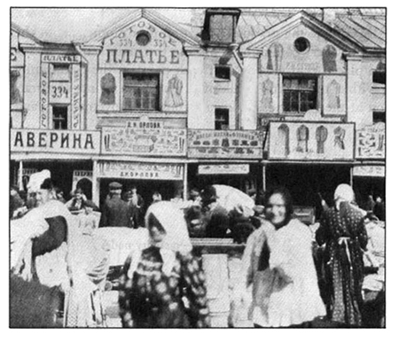
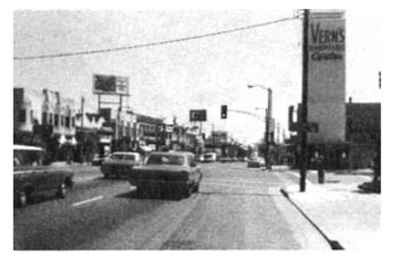
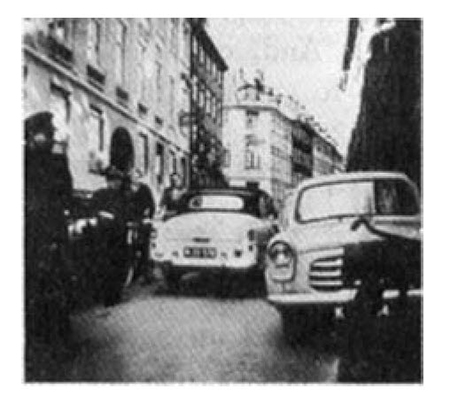
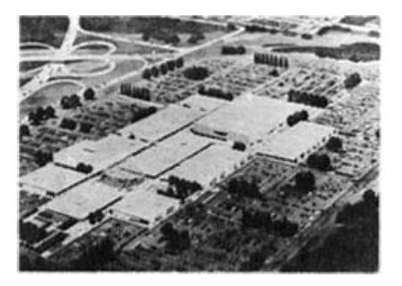
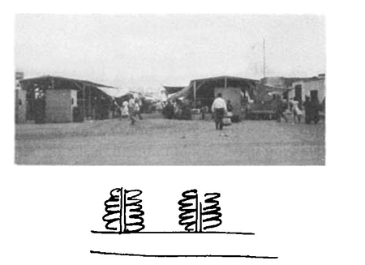
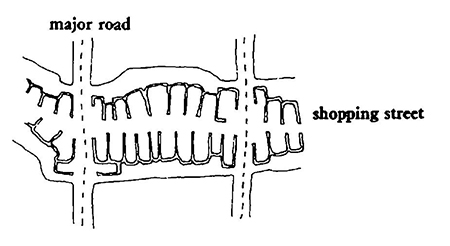

<section class="pattern-plate" aria-labelledby="t-shopping-street">
<a href="/patterns">A Pattern Language</a> · <a href="/patterns#towns">Towns</a> · Pattern 32 · p. 174 · *
<h1 class="pattern-title" id="t-shopping-street">Shopping Street</h1><figure class="pattern-figure pl-figure"></figure><nav class="pattern-links" aria-label="Connections"><h2>Links to</h2><ul><li><a href="/patterns/magic-of-the-city">10 Magic Of The City</a></li><li><a href="/patterns/web-of-shopping">19 Web Of Shopping</a></li><li><a href="/patterns/parallel-roads">23 Parallel Roads</a></li><li><a href="/patterns/promenade">31 Promenade</a></li><li><a href="/patterns/market-of-many-shops">46 Market Of Many Shops</a></li><li><a href="/patterns/housing-in-between">48 Housing In Between</a></li><li><a href="/patterns/network-of-paths-and-cars">52 Network Of Paths And Cars</a></li><li><a href="/patterns/road-crossing">54 Road Crossing</a></li><li><a href="/patterns/individually-owned-shops">87 Individually Owned Shops</a></li><li><a href="/patterns/shielded-parking">97 Shielded Parking</a></li><li><a href="/patterns/pedestrian-street">100 Pedestrian Street</a></li><li><a href="/patterns/canvas-roofs">244 Canvas Roofs</a></li></ul><h2>Linked from</h2><ul><li><a href="/patterns/neighborhood-boundary">15 Neighborhood Boundary</a></li><li><a href="/patterns/web-of-shopping">19 Web Of Shopping</a></li><li><a href="/patterns/men-and-women">27 Men And Women</a></li><li><a href="/patterns/eccentric-nucleus">28 Eccentric Nucleus</a></li><li><a href="/patterns/promenade">31 Promenade</a></li><li><a href="/patterns/individually-owned-shops">87 Individually Owned Shops</a></li><li><a href="/patterns/pedestrian-street">100 Pedestrian Street</a></li><li><a href="/patterns/small-parking-lots">103 Small Parking Lots</a></li><li><a href="/patterns/path-shape">121 Path Shape</a></li></ul></nav></section><article class="pattern-text" aria-label="The text of Shopping Street">
175… this pattern helps to complete the <a class="pl-ref" href="/patterns/magic-of-the-city">MAGIC OF THE CITY (10)</a> and <a class="pl-ref" href="/patterns/promenade">PROMENADE (31)</a>. And, each time a shopping street gets built, it will also help to generate the <a class="pl-ref" href="/patterns/web-of-shopping">WEB OF SHOPPING (19)</a>.

◆ ◆ ◆

<strong>Shopping centers depend on access: they need locations near major traffic arteries. However, the shoppers them. selves don’t benefit from traffic: they need quiet, comfort, and convenience, and access from the pedestrian paths in the surrounding area.</strong>

This simple and obvious conflict has almost never been effectively resolved. On the one hand, we have shopping strips. Here the shops are arranged along the major traffic arteries. This is convenient for cars, but it is not convenient for pedestrians. A strip does not have the characteristics which pedestrian areas need.

<figure class="pl-figure"><figcaption><em>Shopping strit-for cars</em>.</figcaption></figure>

On the other hand, we have those “pre-automobile” shopping streets in the center of old towns. Here the pedestrians’ needs are taken into account, at least partially. But, as the town spreads out and the streets become congested, they are inconvenient to reach; and again the cars dominate the narrow streets.

The modern solution is the shopping center. They are usually located along, or near to, major traffic arteries, so they 176are convenient for cars; and they of ten have pedestrian precincts in them—so that, in theory at least, they are comfortable and convenient for pedestrians. But they are usually isolated, in the middle of a vast parking lot, and thereby disconnected from the pedestrian fabric of the surrounding areas. I n short, you cannot walk to them.

<figure class="pl-figure"><figcaption><em>Old slsopping street--inconvenient for cars and people</em>.</figcaption></figure>
<figure class="pl-figure"><figcaption><em>New slsop ping center--only for cars</em>.</figcaption></figure>

To be convenient for traffic, and convenient for people walking, and connected to the fabric of the surrounding town, the shops must be arranged along a street, itself pedestrian, but opening off a major traffic artery, perhaps two, with parking behind, or underneath, to keep the cars from isolating the shops from surrounding areas.

We observed this pattern growing spontaneously in certain neighborhoods of Lima, Peru: a wide road is set down for automobile traffic, and the shops begin to form themselves, in pedestrian streets that are perpendicular off-shoots off this road.

177

<figure class="pl-figure"><figcaption><em>Shopping streets growing spontaneously in Lima, Peru</em>.</figcaption></figure>

This pattern is also the form of the famous Stroget m Copenhagen. The Stroget is the central shopping spine for the city; it is extremely long—almost a mile—and is entirely pedestrian, only cut periodically by roads which run at right angles to it.

Therefore:

<strong>Encourage local shopping centers to grow in the form of short pedestrian streets, at right angles to major roads and opening off these roads-with parking behind the shops, so that the cars can pull directly off the road, and yet not harm the shopping street.</strong>

<figure class="pl-figure"></figure>
178

◆ ◆ ◆

Treat the physical character of the street like any other <a class="pl-ref" href="/patterns/pedestrian-street">PEDESTRIAN STREET (100)</a> on the <a class="pl-ref" href="/patterns/network-of-paths-and-cars">NETWORK OF PATHS AND CARS (52)</a>, at right angles to major <a class="pl-ref" href="/patterns/parallel-roads">PARALLEL ROADS (23)</a>; have as many shops as small as possible—<a class="pl-ref" href="/patterns/individually-owned-shops">INDIVIDUALLY OWNED SHOPS (87)</a>; where the shopping street crosses the road, make the crossing wide, giving priority to the pedestrians—<a class="pl-ref" href="/patterns/road-crossing">ROAD CROSSING (54)</a>; parking can easily be provided by a single row of parking spaces in an alley lying behind the shops-all along the backs of the shops, off the alley, with the parking spaces walled, and perhaps even given canvas roofs, so that they don’t destroy the area—<a class="pl-ref" href="/patterns/shielded-parking">SHIELDED PARKING (97)</a>, <a class="pl-ref" href="/patterns/canvas-roofs">CANVAS ROOFS (244)</a>. Make sure that every shopping street includes a <a class="pl-ref" href="/patterns/market-of-many-shops">MARKET OF MANY SHOPS (46)</a>, and some <a class="pl-ref" href="/patterns/housing-in-between">HOUSING IN BETWEEN (48)</a>….
</article>

Christopher Alexander, Sara Ishikawa and Murray Silverstein, with Max Jacobson, Ingrid Fiksdahl-King and Shlomo Angel, <cite>A Pattern Language</cite> (Oxford University Press, 1977), pattern 32, pp. 174–178. Text and illustrations from the <a href="https://github.com/natureoforder/sources">Nature of Order sources</a> reading edition, transcribed from the 1977 printing; report errors on <a href="https://github.com/natureoforder/alexander-wiki/issues">GitHub</a>.

<a href="/patterns/promenade">← 31 Promenade</a> · <a href="/patterns">All 253 patterns</a> · <a href="/patterns/night-life">33 Night Life →</a>

