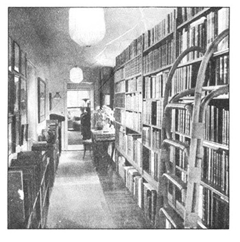
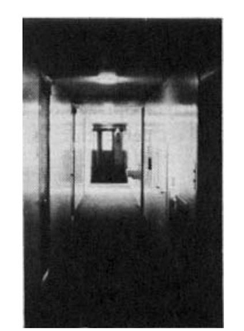
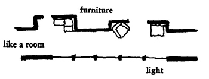

<section class="pattern-plate" aria-labelledby="t-short-passages">
<a href="/patterns">A Pattern Language</a> · <a href="/patterns#buildings">Buildings</a> · Pattern 132 · p. 632 · *
<h1 class="pattern-title" id="t-short-passages">Short Passages</h1><figure class="pattern-figure pl-figure"></figure><nav class="pattern-links" aria-label="Connections"><h2>Links to</h2><ul><li><a href="/patterns/circulation-realms">98 Circulation Realms</a></li><li><a href="/patterns/building-thoroughfare">101 Building Thoroughfare</a></li><li><a href="/patterns/the-flow-through-rooms">131 The Flow Through Rooms</a></li><li><a href="/patterns/half-private-office">152 Half-Private Office</a></li><li><a href="/patterns/light-on-two-sides-of-every-room">159 Light On Two Sides Of Every Room</a></li><li><a href="/patterns/outdoor-room">163 Outdoor Room</a></li><li><a href="/patterns/gallery-surround">166 Gallery Surround</a></li><li><a href="/patterns/the-shape-of-indoor-space">191 The Shape Of Indoor Space</a></li><li><a href="/patterns/interior-windows">194 Interior Windows</a></li><li><a href="/patterns/closets-between-rooms">198 Closets Between Rooms</a></li><li><a href="/patterns/low-sill">222 Low Sill</a></li><li><a href="/patterns/solid-doors-with-glass">237 Solid Doors With Glass</a></li></ul><h2>Linked from</h2><ul><li><a href="/patterns/wings-of-light">107 Wings Of Light</a></li><li><a href="/patterns/something-roughly-in-the-middle">126 Something Roughly In The Middle</a></li><li><a href="/patterns/common-areas-at-the-heart">129 Common Areas At The Heart</a></li><li><a href="/patterns/the-flow-through-rooms">131 The Flow Through Rooms</a></li><li><a href="/patterns/staircase-as-a-stage">133 Staircase As A Stage</a></li><li><a href="/patterns/zen-view">134 Zen View</a></li><li><a href="/patterns/tapestry-of-light-and-dark">135 Tapestry Of Light And Dark</a></li><li><a href="/patterns/childrens-realm">137 Children’s Realm</a></li><li><a href="/patterns/sequence-of-sitting-spaces">142 Sequence Of Sitting Spaces</a></li></ul></nav></section><article class="pattern-text" aria-label="The text of Short Passages">
633… <a class="pl-ref" href="/patterns/the-flow-through-rooms">THE FLOW THROUGH ROOMS (131)</a> describes the generosity of light and movement in the way that rooms connect ti one another and recommends against the use of passages. Bu when there has to be a passage in an office or a house and whei it is too small to be a <a class="pl-ref" href="/patterns/building-thoroughfare">BUILDING THOROUGHFARE (101)</a>, it must be treated very specially, as if it were itself a room. This pattern gives the character of these smallest passages, and so completes the circulation system laid down by <a class="pl-ref" href="/patterns/circulation-realms">CIRCULATION REALMS (98)</a> an <a class="pl-ref" href="/patterns/building-thoroughfare">BUILDING THOROUGHFARE (101)</a> and <a class="pl-ref" href="/patterns/the-flow-through-rooms">THE FLOW THROUGH ROOMS (131)</a>.

◆ ◆ ◆

<strong>“… long, sterile corridors set the scene for everything bad about modem architecture.”</strong>

In fact, the ugly long repetitive corridors of the machine age have so far infected the word “corridor” that it is hard to imagine that a corridor could ever be a place of beauty, a moment in your passage from room to room, which means as much as all the moments you spend in the rooms themselves.

<figure class="pl-figure"><figcaption><em>Long corridors</em>.</figcaption></figure>

We shall now try to pinpoint the difference between the corridors which live, which give pleasure, and make people feel 634alive, and those which do not. There are four main issues.

The most profound issue, to our minds, is natural light. A hall or passage that is generously lit by the sun is almost always pleasant. The archetype is the one-sided hall, lined with windows and doors on its open side. (Notice that this is one of the few places where it is a good idea to light a space from one side).

The second issue is the relation of the passage to the rooms which open off it. Interior windows, opening from these rooms into the hall, help animate the hall. They establish a flow between the rooms and the passage; they support a more informal style of communication; they give the person moving through the hall a taste of life inside the rooms. Even in an office, this contact is fine so long as it is not extreme; so long as the workplaces are protected individually by distance or by a partial wall—see <a class="pl-ref" href="/patterns/half-private-office">HALF-PRIVATE OFFICE (152)</a>, WORKSPACE ENCLOSURE (l83).

The third issue which makes the difference between a lively passage and a dead one is the presence of furnishings. If the passage is made in a way which invites people to furnish it with book cases, small tables, places to lean, even seats, then it becomes very much a part of the living space of the building, not something entirely separate.

And finally, there is the critical issue of length. We know intuitively that corridors in office buildings, hospitals, hotels, apartment buildings—even sometimes in houses—are far too long. People dislike them; they represent bureaucracy and monotony. And there is even evidence to show that they do actual damage.

Consider a study by Mayer Spivack on the unconscious effects of long hospital corridors on perception, communication, and behavior:

Four examples of long mental hospital corridors are examined • it is concluded that such spaces interfere with normal verbal communication due to their characteristic acoustical properties. Optical phenomena common to these passageways obscure the perception of the human figure and face, and distort distance perception. Paradoxical visual cues produced by one tunnel created interrelated, cross-sensory illusions involving room size, distance, walking speed and time. Observations of patient behavior suggest the effect of narrow corridors upon anxiety is via the penetration of the personal 635space envelope. (M. Spivack, “Sensory Distortion in Tunnels and Corridors,” <em>Hospital and Community Psychiatry</em>, 18, No. i, January 1967.)

When does a corridor become too long? In an earlier version of this pattern (<em>Short corridors</em> in <em>A Pattern Language Which Generates Multi-Service Centers</em>, CES, 1967, pp. 179–82), we have presented evidence which suggests that there is a definite cognitive breakpoint between long corridors and short halls: the evidence points to a figure of some 50 feet as a critical threshold. Beyond that, passages begin to feel dead and monotonous.

Of course it is possible to make even very long corridors in a human way; but if they have to be longer than 50 feet, it is essential to break down their scale in some fashion. For example, a long hall that is lit in patches from one side at short intervals can be very pleasant indeed: the sequence of light and dark and the chance to pause and glance out, breaks down the feeling of the endless dead corridor; or a hall which opens out into wider rooms, every now and then, has the same effect. However, do everything you can to keep the passages really short.

Therefore:

<strong>Keep passages short. Make them as much like rooms as possible, with carpets or wood on the floor, furniture, bookshelves, beautiful windows. Make them generous in shape, and always give them plenty of light; the best corridors and passages of all are those which have windows along an entire wall.</strong>

<figure class="pl-figure"></figure>
not too long

636Put in windows, bookshelves, and furnishings to make them as much like actual rooms as possible, with alcoves, seats along the edge <a class="pl-ref" href="/patterns/light-on-two-sides-of-every-room">LIGHT ON TWO SIDES OF EVERY ROOM (159)</a>, ALCOVES (l79), WINDOW PLACE (l8o), THICK WALLS (l97), <a class="pl-ref" href="/patterns/closets-between-rooms">CLOSETS BETWEEN ROOMS (198)</a>; open up the long side into the garden or out onto balconies—<a class="pl-ref" href="/patterns/outdoor-room">OUTDOOR ROOM (163)</a>, <a class="pl-ref" href="/patterns/gallery-surround">GALLERY SURROUND (166)</a>, <a class="pl-ref" href="/patterns/low-sill">LOW SILL (222)</a>. Make interior windows between the passage and the rooms which open off it—<a class="pl-ref" href="/patterns/interior-windows">INTERIOR WINDOWS (194)</a>, <a class="pl-ref" href="/patterns/solid-doors-with-glass">SOLID DOORS WITH GLASS (237)</a>. And finally, for the shape of the passages, in detail, start with <a class="pl-ref" href="/patterns/the-shape-of-indoor-space">THE SHAPE OF INDOOR SPACE (191)</a>….
</article>

Christopher Alexander, Sara Ishikawa and Murray Silverstein, with Max Jacobson, Ingrid Fiksdahl-King and Shlomo Angel, <cite>A Pattern Language</cite> (Oxford University Press, 1977), pattern 132, pp. 632–636. Text and illustrations from the <a href="https://github.com/natureoforder/sources">Nature of Order sources</a> reading edition, transcribed from the 1977 printing; report errors on <a href="https://github.com/natureoforder/alexander-wiki/issues">GitHub</a>.

<a href="/patterns/the-flow-through-rooms">← 131 The Flow Through Rooms</a> · <a href="/patterns">All 253 patterns</a> · <a href="/patterns/staircase-as-a-stage">133 Staircase As A Stage →</a>

