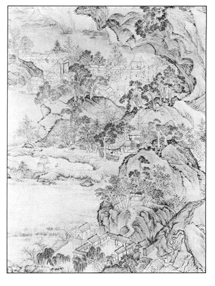
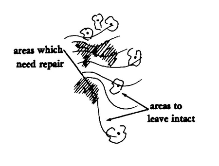

<section class="pattern-plate" aria-labelledby="t-site-repair">
<a href="/patterns">A Pattern Language</a> · <a href="/patterns#buildings">Buildings</a> · Pattern 104 · p. 508 · **
<h1 class="pattern-title" id="t-site-repair">Site Repair</h1><figure class="pattern-figure pl-figure"></figure><nav class="pattern-links" aria-label="Connections"><h2>Links to</h2><ul><li><a href="/patterns/building-complex">95 Building Complex</a></li><li><a href="/patterns/number-of-stories">96 Number Of Stories</a></li><li><a href="/patterns/circulation-realms">98 Circulation Realms</a></li><li><a href="/patterns/south-facing-outdoors">105 South Facing Outdoors</a></li><li><a href="/patterns/positive-outdoor-space">106 Positive Outdoor Space</a></li><li><a href="/patterns/wings-of-light">107 Wings Of Light</a></li><li><a href="/patterns/long-thin-house">109 Long Thin House</a></li><li><a href="/patterns/terraced-slope">169 Terraced Slope</a></li><li><a href="/patterns/tree-places">171 Tree Places</a></li><li><a href="/patterns/garden-growing-wild">172 Garden Growing Wild</a></li></ul><h2>Linked from</h2><ul><li><a href="/patterns/building-complex">95 Building Complex</a></li><li><a href="/patterns/number-of-stories">96 Number Of Stories</a></li><li><a href="/patterns/small-parking-lots">103 Small Parking Lots</a></li><li><a href="/patterns/south-facing-outdoors">105 South Facing Outdoors</a></li><li><a href="/patterns/main-entrance">110 Main Entrance</a></li><li><a href="/patterns/half-hidden-garden">111 Half-Hidden Garden</a></li><li><a href="/patterns/hierarchy-of-open-space">114 Hierarchy Of Open Space</a></li><li><a href="/patterns/terraced-slope">169 Terraced Slope</a></li><li><a href="/patterns/tree-places">171 Tree Places</a></li><li><a href="/patterns/root-foundations">214 Root Foundations</a></li></ul></nav></section><article class="pattern-text" aria-label="The text of Site Repair">
509… the most general aspects of a building complex are established in <a class="pl-ref" href="/patterns/building-complex">BUILDING COMPLEX (95)</a>, <a class="pl-ref" href="/patterns/number-of-stories">NUMBER OF STORIES (96)</a>, and <a class="pl-ref" href="/patterns/circulation-realms">CIRCULATION REALMS (98)</a>. The patterns which follow, and all remaining patterns in the language, concern the design of one single building and its surroundings. This pattern explains the very first action you must take—the process of repairing the site. Since it tends to identify very particular small areas of any site as promising areas of development, it is greatly supported by <a class="pl-ref" href="/patterns/building-complex">BUILDING COMPLEX (95)</a> which breaks buildings into smaller parts, and therefore makes it possible to tuck them into different corners of the site in the best places.

◆ ◆ ◆

<strong>Buildings must always be built on those parts of the land which are in the worst condition, not the best.</strong>

This idea is indeed very simple. But it is the exact opposite of what usually happens; and it takes enormous will power to follow it through.

What usually happens when someone thinks of building on a piece of land? He looks for the best site—where the grass is most beautiful, the trees most healthy, the slope of the land most even, the view most lovely, the soil most fertile—and that is just where he decides to put his house. The same thing happens whether the piece of land is large or small. On a small lot in a town the building goes in the sunniest comer, wherever it is most pleasant. On a hundred acres in the country, the buildings go on the most pleasant hillside.

It is only human nature; and, for a person who lacks a total view of the ecology of the land, it seems the most obvious and sensible thing to do. If you are going to build a building, “… build it in the best possible place.”

But think now of the three-quarters of the available land which are not quite so nice. Since people always build on the one quarter which is healthiest, the other three-quarters, already less healthy ecologically, become neglected. Gradually, they become 510less and less healthy. Who is ever going to do anything on that corner of the lot which is dark and dank, where the garbage accumulates, or that part of the land which is a stagnant swamp, or the dry, stony hillside, where no plants are growing?

Not only that. When we build on the best parts of the land, those beauties which are there already—the crocuses that break through the lawn each spring, the sunny pile of stones where lizards sun themselves, the favorite gravel path, which we love walking on—it is always these things which get lost in the shuffle. When the construction starts on the parts of the land which are already healthy, innumerable beauties are wiped out with every act of building.

People always say to themselves, well, of course, we can always start another garden, build another trellis, put in another gravel path, put new crocuses in the new lawn, and the lizards will find some other pile of stones. <em>But it just is not so</em>. These simple things take years to grow—it isn’t all that easy to create them, just by wanting to. And every time we disturb one of these precious details, it may take twenty years, a lifetime even, before some comparable details grow again from our small daily acts.

If we always build on that part of the land which is most healthy, we can be virtually certain that a great deal of the land will always be less than healthy. If we want the land to be healthy all over—all of it—then we must do the opposite. We must treat every new act of building as an opportunity to mend some rent in the existing cloth; each act of building gives us the chance to make one of the ugliest and least healthy parts of the environment more healthy—as for those parts which are already healthy and beautiful—they of course need no attention. And in fact, we must discipline ourselves most strictly to <em>leave them alone</em>, so that our energy actually goes to the places which need it. This is the principle of site repair.

The fact is, that current development hardly ever does well by this pattern: everyone has a story about how some new building or road destroyed a place dear to them. The following news article from the San Francisco Chronicle (February 6, 1973) headlined “Angry Boys Bulldoze House” struck us as the perfect case:

Two 13-year old boys—enraged over a swath of suburban homes being built in the midst of their rabbit-hunting turf—were arrested 511after they admitted flattening one of the homes with a purloined bulldozer.

According to the Washoe County sheriff’s office, the youths started up a bulldozer used at the construction site about four miles north of Reno, then plowed the sturdy vehicle through one of the homes four times late last Friday night.

The ranch-style house—which was nearly completed—was a shambles when workmen arrived yesterday morning. Damage was estimated at $7800 by the contractor. One of the boys told authorities the home along with several others nearby was ruining a “favorite rabbit-hunting preserve.”

The two boys were booked on charges of felonious destruction.

The idea of site repair is just a beginning. It deals with the problem of how to minimize damage. But the most talented of traditional builders have always been able to use built form, not only to avoid damage, but also to improve the natural landscape. This attitude is so profoundly different from our current view of building, that concepts which will help us decide how to place buildings to <em>imfrove</em> the landscape don’t even exist yet.

Therefore:

<strong>On no account place buildings in the places which are most beautiful. In fact, do the opposite. Consider the site and its buildings as a single living eco-system. Leave those areas that are the most precious, beautiful, comfortable, and healthy as they are, and build new structures in those parts of the site which are least pleasant now.</strong>

<figure class="pl-figure"></figure>
512

◆ ◆ ◆

Above all, leave trees intact and build around them with great care—<a class="pl-ref" href="/patterns/tree-places">TREE PLACES (171)</a>; keep open spaces open to the south of buildings, for the sun—<a class="pl-ref" href="/patterns/south-facing-outdoors">SOUTH FACING OUTDOORS (105)</a>; try, generally, to shape space in such a way that each place becomes positive, in its own right—<a class="pl-ref" href="/patterns/positive-outdoor-space">POSITIVE OUTDOOR SPACE (106)</a>. Repair slopes if they need it with <a class="pl-ref" href="/patterns/terraced-slope">TERRACED SLOPE (169)</a>, and leave the outdoors in its natural state as much as possible—<a class="pl-ref" href="/patterns/garden-growing-wild">GARDEN GROWING WILD (172)</a>. If necessary, push and shove the building into odd corners to preserve the beauty of an old vine, a bush you love, a patch of lovely grass—<a class="pl-ref" href="/patterns/wings-of-light">WINGS OF LIGHT(107)</a>, <a class="pl-ref" href="/patterns/long-thin-house">LONG THIN HOUSE (109)</a>….
</article>

Christopher Alexander, Sara Ishikawa and Murray Silverstein, with Max Jacobson, Ingrid Fiksdahl-King and Shlomo Angel, <cite>A Pattern Language</cite> (Oxford University Press, 1977), pattern 104, pp. 508–512. Text and illustrations from the <a href="https://github.com/natureoforder/sources">Nature of Order sources</a> reading edition, transcribed from the 1977 printing; report errors on <a href="https://github.com/natureoforder/alexander-wiki/issues">GitHub</a>.

<a href="/patterns/small-parking-lots">← 103 Small Parking Lots</a> · <a href="/patterns">All 253 patterns</a> · <a href="/patterns/south-facing-outdoors">105 South Facing Outdoors →</a>

