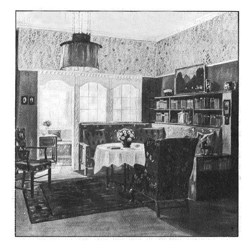
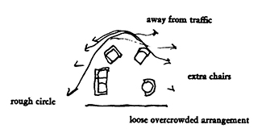

<section class="pattern-plate" aria-labelledby="t-sitting-circle">
<a href="/patterns">A Pattern Language</a> · <a href="/patterns#buildings">Buildings</a> · Pattern 185 · p. 857 · *
<h1 class="pattern-title" id="t-sitting-circle">Sitting Circle</h1><figure class="pattern-figure pl-figure"></figure><nav class="pattern-links" aria-label="Connections"><h2>Links to</h2><ul><li><a href="/patterns/intimacy-gradient">127 Intimacy Gradient</a></li><li><a href="/patterns/common-areas-at-the-heart">129 Common Areas At The Heart</a></li><li><a href="/patterns/sequence-of-sitting-spaces">142 Sequence Of Sitting Spaces</a></li><li><a href="/patterns/window-place">180 Window Place</a></li><li><a href="/patterns/the-fire">181 The Fire</a></li><li><a href="/patterns/the-shape-of-indoor-space">191 The Shape Of Indoor Space</a></li><li><a href="/patterns/half-open-wall">193 Half-Open Wall</a></li><li><a href="/patterns/different-chairs">251 Different Chairs</a></li><li><a href="/patterns/pools-of-light">252 Pools Of Light</a></li></ul><h2>Linked from</h2><ul><li><a href="/patterns/couples-realm">136 Couple’s Realm</a></li><li><a href="/patterns/sequence-of-sitting-spaces">142 Sequence Of Sitting Spaces</a></li><li><a href="/patterns/small-meeting-rooms">151 Small Meeting Rooms</a></li><li><a href="/patterns/half-private-office">152 Half-Private Office</a></li><li><a href="/patterns/teenagers-cottage">154 Teenager’s Cottage</a></li><li><a href="/patterns/compost">178 Compost</a></li><li><a href="/patterns/the-fire">181 The Fire</a></li><li><a href="/patterns/workspace-enclosure">183 Workspace Enclosure</a></li><li><a href="/patterns/half-open-wall">193 Half-Open Wall</a></li><li><a href="/patterns/different-chairs">251 Different Chairs</a></li><li><a href="/patterns/pools-of-light">252 Pools Of Light</a></li></ul></nav></section><article class="pattern-text" aria-label="The text of Sitting Circle">
858… according to the <a class="pl-ref" href="/patterns/sequence-of-sitting-spaces">SEQUENCE OF SITTING SPACES (142)</a>, there will be a variety of different kinds of sitting space throughout an office building or a house or workshop—some formal, some informal, some large, some small, laid out in part according to the <a class="pl-ref" href="/patterns/intimacy-gradient">INTIMACY GRADIENT (127)</a>. This pattern deals with the actual physical layout of any one of these sitting spaces. And of course, it can be used to help create the sequence of sitting spaces, piecemeal, one space at a time.

◆ ◆ ◆

<strong>A group of chairs, a sofa and a chair, a pile of cushions—these are the most obvious things in everybody’s life—and yet to make them work, so people become animated and alive in them, is a very subde business. Most seating arrangements are sterile, people avoid them, nothing ever happens there. Others seem somehow to gather life around them, to concentrate and liberate energy. What is the difference between the two?</strong>

Most important of all, perhaps, is their position. A sitting circle needs essentially the same position as a common area at the heart (129), but in miniature: a well defined area, with paths running past it, not cutting through it, and placed so that people naturally pass by it, stop and talk, lean on the backs of chairs, gradually sit down, move position, get up again. These characteristics are vital. The reasons are exactly the same as those given in <a class="pl-ref" href="/patterns/common-areas-at-the-heart">common areas at the heart (129)</a>; only the scale is different.

Second, the rough shape of a circle. When people sit down to talk together they try to arrange themselves roughly in a circle. Empirical evidence for this has been presented by Margaret Mead (“Conference Behavior,” <em>Columbia University Forum</em>, Summer, 1967, pp. 20–25). Perhaps one reason for the circle, as opposed to other forms, is the fact that people like to sit at an angle to one another, not side by side (Robert Sommer, “Studies in Personal Space,” <em>Sociometry</em>, 22 September 1959, pp. 247–60.) 859In a circle, even neighbors are at a slight angle to one another. This, together with the first point, suggests that a rough circle is best.

But it is not enough for the chairs to be in a circle. The chairs themselves will only hold this position if the actual architecture—the columns, walls, fire, windows—subtly suggest a partly contained, defined area, which is roughly a circle. The fire especially helps to anchor a sitting circle. Other things can do it almost as well.

Third, we have observed that the seating arrangement needs to be slightly loose—not too formal. Relatively loose arrangements, where there are many different sofas, cushions, and chairs, all free to move, work to bring a sitting circle to life. The chairs can be adjusted slightly, they can be turned at slight angles; and if there are one or two too many, all the better: this seems to animate the group. People get up and walk around, then sometimes sit back down in a new chair.

Therefore:

<strong>Place each sitting space in a position which is protected, not cut by paths or movement, roughly circular, made so that the room itself helps to suggest the circle—not too strongly—with paths and activities around it, so that people naturally gravitate toward the chairs when they get into the mood to sit Place the chairs and cushions loosely in the circle, and have a few too many.</strong>

<figure class="pl-figure"></figure>
◆ ◆ ◆

860Use a fire, and columns, and half-open walls to form the shape of the circle—<a class="pl-ref" href="/patterns/the-fire">THE FIRE (181)</a>, <a class="pl-ref" href="/patterns/the-shape-of-indoor-space">THE SHAPE OF INDOOR SPACE (191)</a>, <a class="pl-ref" href="/patterns/half-open-wall">HALF-OPEN WALL (193)</a>; but do not make it too formal or too enclosed—<a class="pl-ref" href="/patterns/common-areas-at-the-heart">COMMON AREAS AT THE HEART (129)</a>, <a class="pl-ref" href="/patterns/sequence-of-sitting-spaces">SEQUENCE OF SITTING SPACES (142)</a>. USE <a class="pl-ref" href="/patterns/different-chairs">DIFFERENT CHAIRS (251)</a>, big ones, small ones, cushions, and a few too many, so that they are never too perfectly arranged, but always in a bit of a jumble. Make a <a class="pl-ref" href="/patterns/pools-of-light">POOL OF LIGHT (252)</a> to mark the sitting circle, and perhaps a <a class="pl-ref" href="/patterns/window-place">WINDOW PLACE (180)</a>….
</article>

Christopher Alexander, Sara Ishikawa and Murray Silverstein, with Max Jacobson, Ingrid Fiksdahl-King and Shlomo Angel, <cite>A Pattern Language</cite> (Oxford University Press, 1977), pattern 185, pp. 857–860. Text and illustrations from the <a href="https://github.com/natureoforder/sources">Nature of Order sources</a> reading edition, transcribed from the 1977 printing; report errors on <a href="https://github.com/natureoforder/alexander-wiki/issues">GitHub</a>.

<a href="/patterns/cooking-layout">← 184 Cooking Layout</a> · <a href="/patterns">All 253 patterns</a> · <a href="/patterns/communal-sleeping">186 Communal Sleeping →</a>

