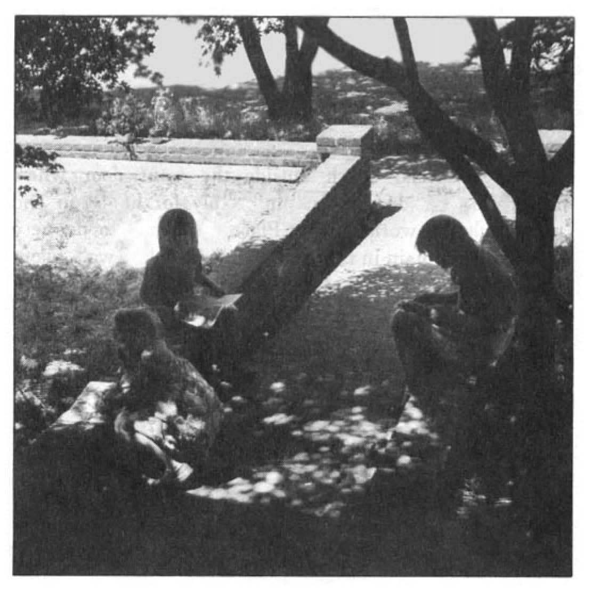
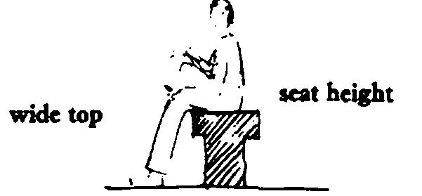

<section class="pattern-plate" aria-labelledby="t-sitting-wall">
<a href="/patterns">A Pattern Language</a> · <a href="/patterns#construction">Construction</a> · Pattern 243 · p. 1124 · **
<h1 class="pattern-title" id="t-sitting-wall">Sitting Wall</h1><figure class="pattern-figure pl-figure"></figure><nav class="pattern-links" aria-label="Connections"><h2>Links to</h2><ul><li><a href="/patterns/green-streets">51 Green Streets</a></li><li><a href="/patterns/pedestrian-street">100 Pedestrian Street</a></li><li><a href="/patterns/positive-outdoor-space">106 Positive Outdoor Space</a></li><li><a href="/patterns/hierarchy-of-open-space">114 Hierarchy Of Open Space</a></li><li><a href="/patterns/activity-pockets">124 Activity Pockets</a></li><li><a href="/patterns/private-terrace-on-the-street">140 Private Terrace On The Street</a></li><li><a href="/patterns/outdoor-room">163 Outdoor Room</a></li><li><a href="/patterns/opening-to-the-street">165 Opening To The Street</a></li><li><a href="/patterns/gallery-surround">166 Gallery Surround</a></li><li><a href="/patterns/garden-growing-wild">172 Garden Growing Wild</a></li><li><a href="/patterns/seat-spots">241 Seat Spots</a></li><li><a href="/patterns/front-door-bench">242 Front Door Bench</a></li><li><a href="/patterns/raised-flowers">245 Raised Flowers</a></li><li><a href="/patterns/soft-tile-and-brick">248 Soft Tile And Brick</a></li><li><a href="/patterns/ornament">249 Ornament</a></li></ul><h2>Linked from</h2><ul><li><a href="/patterns/still-water">71 Still Water</a></li><li><a href="/patterns/local-sports">72 Local Sports</a></li><li><a href="/patterns/adventure-playground">73 Adventure Playground</a></li><li><a href="/patterns/street-cafe">88 Street Cafe</a></li><li><a href="/patterns/activity-pockets">124 Activity Pockets</a></li><li><a href="/patterns/something-roughly-in-the-middle">126 Something Roughly In The Middle</a></li><li><a href="/patterns/private-terrace-on-the-street">140 Private Terrace On The Street</a></li><li><a href="/patterns/outdoor-room">163 Outdoor Room</a></li><li><a href="/patterns/opening-to-the-street">165 Opening To The Street</a></li><li><a href="/patterns/six-foot-balcony">167 Six-Foot Balcony</a></li><li><a href="/patterns/terraced-slope">169 Terraced Slope</a></li><li><a href="/patterns/tree-places">171 Tree Places</a></li><li><a href="/patterns/column-place">226 Column Place</a></li><li><a href="/patterns/half-inch-trim">240 Half-Inch Trim</a></li><li><a href="/patterns/seat-spots">241 Seat Spots</a></li><li><a href="/patterns/front-door-bench">242 Front Door Bench</a></li><li><a href="/patterns/raised-flowers">245 Raised Flowers</a></li><li><a href="/patterns/soft-tile-and-brick">248 Soft Tile And Brick</a></li><li><a href="/patterns/ornament">249 Ornament</a></li></ul></nav></section><article class="pattern-text" aria-label="The text of Sitting Wall">
1125… if all is well, the outdoor areas are largely made up of positive spaces—<a class="pl-ref" href="/patterns/positive-outdoor-space">POSITIVE OUTDOOR SPACES (106)</a>; in some fashion you have marked boundaries between gardens and streets, between terraces and gardens, between outdoor rooms and terraces, between play areas and gardens—<a class="pl-ref" href="/patterns/green-streets">GREEN STREETS (51)</a>,<a class="pl-ref" href="/patterns/pedestrian-street">PEDESTRIAN STREET (100)</a>, HALF-HIDDEN GARDEN (1ll), <a class="pl-ref" href="/patterns/hierarchy-of-open-space">HIERARCHY OF OPEN SPACE (114)</a>, PATH SHAPE (l2l), <a class="pl-ref" href="/patterns/activity-pockets">ACTIVITY POCKETS (124)</a>, <a class="pl-ref" href="/patterns/private-terrace-on-the-street">PRIVATE TERRACE ON THE STREET (140)</a>, <a class="pl-ref" href="/patterns/outdoor-room">OUTDOOR ROOM (163)</a>, <a class="pl-ref" href="/patterns/opening-to-the-street">OPENING TO THE STREET (165)</a>, <a class="pl-ref" href="/patterns/gallery-surround">GALLERY SURROUND (166)</a>, <a class="pl-ref" href="/patterns/garden-growing-wild">GARDEN GROWING WILD (172)</a>. With this pattern, you can help these natural boundaries take on their proper character, by building walls, just low enough to sit on, and high enough to mark the boundaries.

If you have also marked the places where it makes sense to build seats—<a class="pl-ref" href="/patterns/seat-spots">SEAT SPOTS (241)</a>, <a class="pl-ref" href="/patterns/front-door-bench">FRONT DOOR BENCH (242)</a>—you can kill two birds with one stone by using the walls as seats which help enclose the outdoor space wherever its positive character is weakest.

◆ ◆ ◆

<strong>In many places walls and fences between outdoor spaces are too high; but no boundary at all does injustice to the subtlety of the divisions between the spaces.</strong>

Consider, for example, a garden on a quiet street. At least somewhere along the edge between the two there is a need for a seam, a place which unites the two, but does so without breaking down the fact that they are separate places. If there is a high wall or a hedge, then the people in the garden have no way of being connected to the street; the people in the street have no way of being connected to the garden. But if there is no barrier at all—then the division between the two is hard to maintain. Stray dogs can wander in and out at will; it is even uncomfortable to sit in the garden, because it is essentially like sitting in the street.

1126<em>The problem can only be solved by a kind of barrier which junctions as a barrier which separates, and as a seam which joins, at the same time</em>.

A low wall or balustrade, just at the right height for sitting, is perfect. It creates a barrier which separates. But because it invites people to sit on it—invites them to sit first with their legs on one side, then with their legs on top, then to swivel round still further to the other side, or to sit astride it—it also functions as a seam, which makes a positive connection between the two places.

Examples: A low wall with the children’s sandbox on one side, circulation path on the other; low wall at the front of the garden, connecting the house to the public path; a sitting wall that is a retaining wall, with plants on one side, where people can sit close to the flowers and eat their lunch.

Ruskin describes a sitting wall he experienced:

Last summer I was lodging for a little while in a cottage in the country, and in front of my low window there were, first, some beds of daisies, then a row of gooseberry and currant bushes, and then a low wall about three feet above the ground, covered with stone-cress. Outside, a corn-field, with its green ears glistening in the sun, and a field path through it, just past the garden gate. From my window I could see every peasant of the village who passed that way, with basket on arm for market, or spade on shoulder for field. When I was inclined for society, I could lean over my wall, and talk fo anybody; when 1 was inclined for science, I could botanize all along the top of my wall—there were four species of stone-cress alone growing on it; and when I was inclined for exercise, I could jump over my wall, backwards and forwards. That’s the sort of fence to have in a Christian country; not a thing which you can’t walk inside of without making yourself look like a wild beast, nor look at out of your window in the morning without expecting to see somebody impaled upon it in the night. (John Ruskin, <em>The Two Paths</em>, New York: Everyman’s Library, 1907, p. 203.)

Therefore:

<strong>Surround any natural outdoor area, and make minor boundaries between outdoor areas with low walls, about 16 inches high, and wide enough to sit on, at least 12 inches wide.</strong>

1127

<figure class="pl-figure"></figure>
◆ ◆ ◆

Place the walls to coincide with natural seat spots, so that extra benches are not necessary—<a class="pl-ref" href="/patterns/seat-spots">SEAT SPOTS (241)</a>; make them of brick or tile, if possible—<a class="pl-ref" href="/patterns/soft-tile-and-brick">SOFT TILE AND BRICK (248)</a>; if they separate two areas of slightly different height, pierce them with holes to make them balustrades—<a class="pl-ref" href="/patterns/ornament">ORNAMENT (249)</a>. Where they are in the sun, and can be large enough, plant flowers in them or against them—<a class="pl-ref" href="/patterns/raised-flowers">RAISED FLOWERS (245)</a>….
</article>

Christopher Alexander, Sara Ishikawa and Murray Silverstein, with Max Jacobson, Ingrid Fiksdahl-King and Shlomo Angel, <cite>A Pattern Language</cite> (Oxford University Press, 1977), pattern 243, pp. 1124–1127. Text and illustrations from the <a href="https://github.com/natureoforder/sources">Nature of Order sources</a> reading edition, transcribed from the 1977 printing; report errors on <a href="https://github.com/natureoforder/alexander-wiki/issues">GitHub</a>.

<a href="/patterns/front-door-bench">← 242 Front Door Bench</a> · <a href="/patterns">All 253 patterns</a> · <a href="/patterns/canvas-roofs">244 Canvas Roofs →</a>

