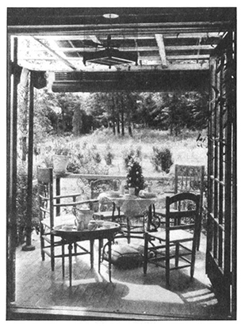
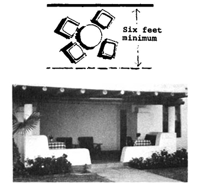
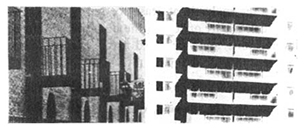
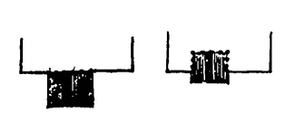
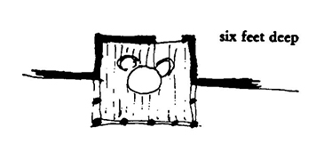

<section class="pattern-plate" aria-labelledby="t-six-foot-balcony">
<a href="/patterns">A Pattern Language</a> · <a href="/patterns#buildings">Buildings</a> · Pattern 167 · p. 781 · **
<h1 class="pattern-title" id="t-six-foot-balcony">Six-Foot Balcony</h1><figure class="pattern-figure pl-figure"></figure><nav class="pattern-links" aria-label="Connections"><h2>Links to</h2><ul><li><a href="/patterns/arcades">119 Arcades</a></li><li><a href="/patterns/sunny-place">161 Sunny Place</a></li><li><a href="/patterns/outdoor-room">163 Outdoor Room</a></li><li><a href="/patterns/gallery-surround">166 Gallery Surround</a></li><li><a href="/patterns/the-shape-of-indoor-space">191 The Shape Of Indoor Space</a></li><li><a href="/patterns/half-open-wall">193 Half-Open Wall</a></li><li><a href="/patterns/column-place">226 Column Place</a></li><li><a href="/patterns/sitting-wall">243 Sitting Wall</a></li></ul><h2>Linked from</h2><ul><li><a href="/patterns/pedestrian-street">100 Pedestrian Street</a></li><li><a href="/patterns/courtyards-which-live">115 Courtyards Which Live</a></li><li><a href="/patterns/roof-garden">118 Roof Garden</a></li><li><a href="/patterns/open-stairs">158 Open Stairs</a></li><li><a href="/patterns/building-edge">160 Building Edge</a></li><li><a href="/patterns/sunny-place">161 Sunny Place</a></li><li><a href="/patterns/gallery-surround">166 Gallery Surround</a></li><li><a href="/patterns/connection-to-the-earth">168 Connection To The Earth</a></li><li><a href="/patterns/half-open-wall">193 Half-Open Wall</a></li><li><a href="/patterns/column-place">226 Column Place</a></li><li><a href="/patterns/column-connections">227 Column Connections</a></li></ul></nav></section><article class="pattern-text" aria-label="The text of Six-Foot Balcony">
782… in various places <a class="pl-ref" href="/patterns/arcades">ARCADES (119)</a> and <a class="pl-ref" href="/patterns/gallery-surround">GALLERY SURROUND (166)</a> have helped you to imagine some kind of a balcony, veranda, terrace, porch, arcade along the building edge or halfway into it. This pattern simply specifies the depth of this arcade or porch or balcony, to make sure that it really works.

◆ ◆ ◆

<strong>Balconies and porches which are less than six feet deep are hardly ever used.</strong>

Balconies and porches are often made very small to save money; but when they are too small, they might just as well not be there.

A balcony is first used properly when there is enough room for two or three people to sit in a small group with room to stretch their legs, and room for a small table where they can set down glasses, cups, and the newspaper. No balcony works if it is so narrow that people have to sit in a row facing outward. The critical size is hard to determine, but it is at least six feet. The following drawing and photograph show roughly why:

<figure class="pl-figure"><figcaption><em>Six feet deef.</em></figcaption></figure>

783Our observations make it clear that the difference between deep balconies and those which are not deep enough is simply astonishing. In our experience, almost no balconies at all which are 3 or 4 feet deep manage to gather life to them or to get used. And almost no balconies which are more than six feet deep are <em>not</em> used.

<figure class="pl-figure"><figcaption><em>Narrow balconies are useless</em>.</figcaption></figure>

Two other features of the balcony make a difference in the degree to which people will use it: its enclosure and its recession into the building.

As far as enclosure goes, we have noticed that among the deeper balconies, it is those with half-open enclosures around them—columns, wooden slats, rose-covered trellises—which are used most. Apparently, the partial privacy given by a half-open screen makes people more comfortable—see <a class="pl-ref" href="/patterns/half-open-wall">HALF-OPEN WALL (193)</a>.

And recesses seem to have a similar effect. On a cantilevered balcony people must sit outside the mass of the building; the balcony lacks privacy and tends to feel unsafe. In an English study (“Private Balconies in Flats and Maisonettes,” <em>Architect’s Journal</em>, March 1957, pp. 372–76), two-thirds of the people that never used their balconies gave lack of privacy as their reason, and said that they preferred recessed balconies, because, in contrast to cantilevered balconies, the recesses seemed more secure.

<figure class="pl-figure"><figcaption><em>Not this this</em>.</figcaption></figure>

784Therefore:

<strong>Whenever you build a balcony, a porch, a gallery, or a terrace always make it at least six feet deep. If possible, recess at least a part of it into the building so that it is not cantilevered out and separated from the building by a simple line, and enclose it partially.</strong>

<figure class="pl-figure"></figure>
◆ ◆ ◆

Enclose the balcony with a low wall—<a class="pl-ref" href="/patterns/sitting-wall">SITTING WALL (243)</a>, heavy columns—<a class="pl-ref" href="/patterns/column-place">COLUMN PLACES (226)</a>, and half-open walls or screens—<a class="pl-ref" href="/patterns/half-open-wall">HALF-OPEN WALL (193)</a>. Keep it open toward the south—<a class="pl-ref" href="/patterns/sunny-place">SUNNY PLACE (161)</a>. Treat it as an <a class="pl-ref" href="/patterns/outdoor-room">OUTDOOR ROOM (163)</a>, and get the details of its shape and its construction from <a class="pl-ref" href="/patterns/the-shape-of-indoor-space">THE SHAPE OF INDOOR SPACE (191)</a>….
</article>

Christopher Alexander, Sara Ishikawa and Murray Silverstein, with Max Jacobson, Ingrid Fiksdahl-King and Shlomo Angel, <cite>A Pattern Language</cite> (Oxford University Press, 1977), pattern 167, pp. 781–784. Text and illustrations from the <a href="https://github.com/natureoforder/sources">Nature of Order sources</a> reading edition, transcribed from the 1977 printing; report errors on <a href="https://github.com/natureoforder/alexander-wiki/issues">GitHub</a>.

<a href="/patterns/gallery-surround">← 166 Gallery Surround</a> · <a href="/patterns">All 253 patterns</a> · <a href="/patterns/connection-to-the-earth">168 Connection To The Earth →</a>

