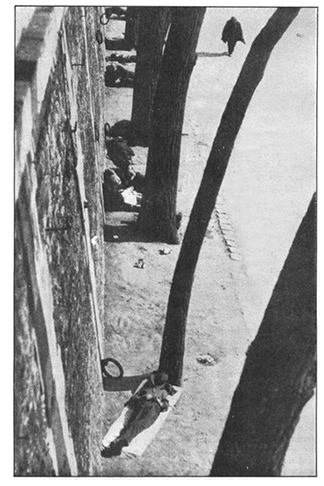
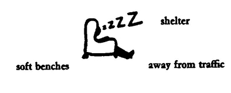

<section class="pattern-plate" aria-labelledby="t-sleeping-in-public">
<a href="/patterns">A Pattern Language</a> · <a href="/patterns#towns">Towns</a> · Pattern 94 · p. 457
<h1 class="pattern-title" id="t-sleeping-in-public">Sleeping In Public</h1><figure class="pattern-figure pl-figure"></figure><nav class="pattern-links" aria-label="Connections"><h2>Links to</h2><ul><li><a href="/patterns/interchange">34 Interchange</a></li><li><a href="/patterns/small-public-squares">61 Small Public Squares</a></li><li><a href="/patterns/public-outdoor-room">69 Public Outdoor Room</a></li><li><a href="/patterns/street-cafe">88 Street Cafe</a></li><li><a href="/patterns/pedestrian-street">100 Pedestrian Street</a></li><li><a href="/patterns/building-thoroughfare">101 Building Thoroughfare</a></li><li><a href="/patterns/a-place-to-wait">150 A Place To Wait</a></li><li><a href="/patterns/building-edge">160 Building Edge</a></li><li><a href="/patterns/bed-alcove">188 Bed Alcove</a></li><li><a href="/patterns/seat-spots">241 Seat Spots</a></li></ul><h2>Linked from</h2><ul><li><a href="/patterns/accessible-green">60 Accessible Green</a></li><li><a href="/patterns/childrens-home">86 Children’s Home</a></li><li><a href="/patterns/travelers-inn">91 Traveler’s Inn</a></li><li><a href="/patterns/a-place-to-wait">150 A Place To Wait</a></li></ul></nav></section><article class="pattern-text" aria-label="The text of Sleeping In Public">
458… this pattern helps to make places like the <a class="pl-ref" href="/patterns/interchange">INTERCHANGE (34)</a>, <a class="pl-ref" href="/patterns/small-public-squares">SMALL PUBLIC SQUARES (61)</a>, <a class="pl-ref" href="/patterns/public-outdoor-room">PUBLIC OUTDOOR ROOMS (69)</a>, <a class="pl-ref" href="/patterns/street-cafe">STREET CAFE (88)</a>, <a class="pl-ref" href="/patterns/pedestrian-street">PEDESTRIAN STREET (100)</a>, <a class="pl-ref" href="/patterns/building-thoroughfare">BUILDING THOROUGHFARE(101)</a>, <a class="pl-ref" href="/patterns/a-place-to-wait">A PLACE TO WAIT (150)</a> Completely public.

◆ ◆ ◆

<strong>It is a mark of success in a park, public lobby or a porch, when people can come there and fall asleep.</strong>

In a society which nurtures people and fosters trust, the fact that people sometimes want to sleep in public is the most natural thing in the world. If someone lies down on a pavement or a bench and falls asleep, it is possible to treat it seriously as a need. If he has no place to go—then, we, the people of the town, can be happy that he can at least sleep on the public paths and benches; and, of course, it may also be someone who does have a place to go, but happens to like napping in the street.

But our society does not invite this kind of behavior. In our society, sleeping in public, like loitering, is thought of as an act for criminals and destitutes. In our world, when homeless people start sleeping on public benches or in public buildings, upright citizens get nervous, and the police soon restore “public order.”

Thus we cleared these difficult straits, my bicycle and I, together. But a little further on I heard myself hailed. I raised my head and saw a policeman. Elliptically speaking, for it was only later, by way of induction, or deduction, I forget which, that I knew what it was. What are you doing there? he said. I’m used to that question, I understood it immediately. Resting, I said. Resting, he said. Resting, I said. Will you answer my question? he cried. So it always is when I’m reduced to confabulation. I honestly believe I have answered the question I am asked and in reality I do nothing of the kind. I won’t reconstruct the conversation in all its meanderings. It ended in my understanding that my way of resting, my attitude when at rest, astride my bicycle, my arms on the handlebars, my head on my arms, was a violation of I don’t know what, public order, public decency….

What is certain is this, that I never rested in that way again, my 459feet obscenely resting on the earth, my arms on the handlebars and on my arms my head, rocking and abandoned. It is indeed a deplorable sight, a deplorable example, for the people, who so need to be encouraged, in their bitter toil, and to have before their eyes manifestations of strength only, of courage and joy, without which they might collapse, at the end of the day, and roll on the ground. (Samuel Beckett, <em>Molloy.)</em>

It seems, at first, as though this is purely a social problem and that it can only be changed by changing people’s attitudes. But the fact is, that these attitudes are largely shaped by the environment itself. In an environment where there are very few places to lie down and sleep people who sleep in public seem unnatural, because it is so rare.

Therefore:

<strong>Keep the environment filled with ample benches, comfortable places, comers to sit on the ground, or lie in comfort in the sand. Make these places relatively sheltered, protected from circulation, perhaps up a step, with seats and grass to slump down upon, read the paper and doze off.</strong>

<figure class="pl-figure"></figure>
◆ ◆ ◆

Above all, put the places for sleeping along <a class="pl-ref" href="/patterns/building-edge">BUILDING EDGES (160)</a>; make seats there, and perhaps even a bed alcove or two in public might be a nice touch—<a class="pl-ref" href="/patterns/bed-alcove">BED ALCOVE (188)</a>, <a class="pl-ref" href="/patterns/seat-spots">SEAT SPOTS (241)</a>; but above all, it will hinge on the attitudes which people have—do anything you can to create trust, so that people feel no fear in going to sleep in public and so that other people feel no fear of people sleeping in the street.
</article>

Christopher Alexander, Sara Ishikawa and Murray Silverstein, with Max Jacobson, Ingrid Fiksdahl-King and Shlomo Angel, <cite>A Pattern Language</cite> (Oxford University Press, 1977), pattern 94, pp. 457–459. Text and illustrations from the <a href="https://github.com/natureoforder/sources">Nature of Order sources</a> reading edition, transcribed from the 1977 printing; report errors on <a href="https://github.com/natureoforder/alexander-wiki/issues">GitHub</a>.

<a href="/patterns/food-stands">← 93 Food Stands</a> · <a href="/patterns">All 253 patterns</a> · <a href="/patterns/building-complex">95 Building Complex →</a>

