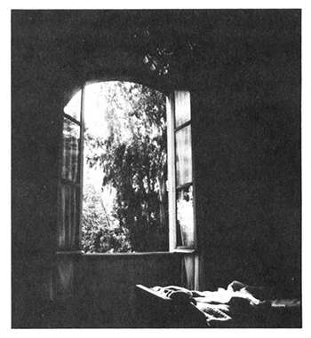
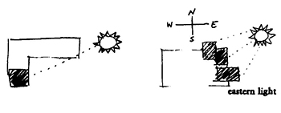

<section class="pattern-plate" aria-labelledby="t-sleeping-to-the-east">
<a href="/patterns">A Pattern Language</a> · <a href="/patterns#buildings">Buildings</a> · Pattern 138 · p. 656 · *
<h1 class="pattern-title" id="t-sleeping-to-the-east">Sleeping To The East</h1><figure class="pattern-figure pl-figure"></figure><nav class="pattern-links" aria-label="Connections"><h2>Links to</h2><ul><li><a href="/patterns/intimacy-gradient">127 Intimacy Gradient</a></li><li><a href="/patterns/indoor-sunlight">128 Indoor Sunlight</a></li><li><a href="/patterns/couples-realm">136 Couple’s Realm</a></li><li><a href="/patterns/childrens-realm">137 Children’s Realm</a></li><li><a href="/patterns/bed-cluster">143 Bed Cluster</a></li><li><a href="/patterns/window-place">180 Window Place</a></li><li><a href="/patterns/marriage-bed">187 Marriage Bed</a></li><li><a href="/patterns/bed-alcove">188 Bed Alcove</a></li><li><a href="/patterns/natural-doors-and-windows">221 Natural Doors And Windows</a></li><li><a href="/patterns/filtered-light">238 Filtered Light</a></li></ul><h2>Linked from</h2><ul><li><a href="/patterns/indoor-sunlight">128 Indoor Sunlight</a></li><li><a href="/patterns/tapestry-of-light-and-dark">135 Tapestry Of Light And Dark</a></li><li><a href="/patterns/couples-realm">136 Couple’s Realm</a></li><li><a href="/patterns/bed-cluster">143 Bed Cluster</a></li><li><a href="/patterns/bathing-room">144 Bathing Room</a></li><li><a href="/patterns/communal-sleeping">186 Communal Sleeping</a></li></ul></nav></section><article class="pattern-text" aria-label="The text of Sleeping To The East">
657… at the back of the <a class="pl-ref" href="/patterns/intimacy-gradient">INTIMACY GRADIENT (127)</a>, the position of the <a class="pl-ref" href="/patterns/couples-realm">COUPLE’S REALM (136)</a> and <a class="pl-ref" href="/patterns/childrens-realm">CHILDREN’S REALM (137)</a>, give some idea of where bedrooms will be. This pattern settles the position of the bedrooms by placing them to face the east, and thereby complements the effect of <a class="pl-ref" href="/patterns/indoor-sunlight">INDOOR SUNLIGHTE (128)</a>, which places the more public rooms toward the south.

◆ ◆ ◆

<strong>This is one of the patterns people most often disagree with. However, we believe they are mistaken.</strong>

People’s attitude to this pattern often runs along the following lines: “The pattern suggests that I should sleep somewhere where the sun can wake me up; but I don’t want the sun to wake me up; I want to be able to sleep late, whenever I can. I guess I have a different style of life; so the pattern doesn’t apply to me.”

We believe there may be fundamental biological matters at stake here and that no one who once understands them will want to ignore them, even if his present style of life does seem to contradict them.

The facts, as far as we can tell, are these. Our human organism contains a number of very sensitive biological clocks. We are creatures of rhythms and cycles. Whenever we behave in a way which is not in tune with our natural rhythms and cycles, we run a very good chance of disturbing our natural physiological and emotional functioning.

Specifically, these cycles have a great deal to do with sleep. And the cycle of the sun governs our physiology to such an extent, that we cannot afford to sleep out of touch with this cycle. Consider the fact that the body reaches its lowest metabolic activity in the middle of the sun’s night, at about 2 A.M. It seems very likely, then, that the most nourishing kind of sleep is a sleep whose curve more or less coincides with the curve of metabolic activity—which is in turn dependent on the sun.

It has recently been shown by Dr. London at the San Francisco Medical School, that our whole day depends critically on the 658conditions under which we waken. If we wake up immediately after a period of dreaming (REM sleep), we will feel ebullient, energetic, and refreshed for the whole day, because certain critical hormones are injected into the bloodstream immediately after REM sleep. If, however, we wake up during delta sleep (another type of sleep, which happens in between periods of dreaming), we will feel irritable, drowsy, flat, and lethargic all day long: the relevant hormones are not in the bloodstream at the critical moment of awakening.

Now, obviously, anyone who is woken by an alarm clock, will sometimes be woken in the middle of delta sleep and will, on those days, have a lethargic day; and will sometimes wake up just after REM sleep and will, on those days, have an energetic day. Of course this is tremendously oversimplified—many other matters intervene. But if these facts about sleep are correct, they cannot help but have <em>some</em> impact on your waking hours.

Now, the only way to make sure that you wake up at the right time, with the closure of REM sleep, is to wake up naturally. But you can only wake up naturally, and in accordance with the other, larger cycle of metabolic activity, if you wake up with the sun. The sun warms you, increases the light, gently nudges you to wake up—but in a way that is so gentle, that you will still actually wake up at the moment which serves you best—that is, just <em>after</em> a dream.

We believe, in short, that this pattern is fundamental to the process of having a healthy, active, energetic day—and that anyone who rejects this pattern on the grounds that he does not want to be woken by the sun, is making a serious mistake about the functioning of his or her own body.

What about details? You want to see the sunlight, but you don’t want the sun to shine on the bed itself or you’ll wake up hot and uncomfortable. The right kind of place is one which provides morning light—consequently a window in the room that lets in the eastern light—and a bed that provides a view of the light without being directly in the light shaft.

And finally, the matter of the view from the bed is worth mentioning. People look out in the morning to see what kind of day its going to be. Some views give this information very well; others not at all. A good morning window looks out on some kind 659of constant object or growing thing, which reflects the changes of season and the weather, and allows a person to establish the mood of the day as soon as he wakes up.

Therefore:

<strong>Give those parts of the house where people sleep, an eastern orientation, so that they wake up with the sun and light. This means, typically, that the sleeping area needs to be on the eastern side of the house; but it can also be on the western side provided there is a courtyard or a terrace to the east of it.</strong>

<figure class="pl-figure"></figure>
◆ ◆ ◆

Place all the beds with care, so that they get the morning light, not only as a group—<a class="pl-ref" href="/patterns/couples-realm">COUPLE’S REALM (136)</a>, <a class="pl-ref" href="/patterns/bed-cluster">BED CLUSTER (143)</a>, but individually, so that each gets eastern light from some specific window—<a class="pl-ref" href="/patterns/marriage-bed">MARRIAGE BED (187)</a>, <a class="pl-ref" href="/patterns/bed-alcove">BED ALCOVE (188)</a>. Use <a class="pl-ref" href="/patterns/filtered-light">FILTERED LIGHT (238)</a> to prevent the sun from shining too directly on the bed. If there is room, make this window function as a <a class="pl-ref" href="/patterns/window-place">WINDOW PLACE (180)</a>. Place the window nearest the bed carefully so that it frames a view which tells a person waking what the weather is like—<a class="pl-ref" href="/patterns/natural-doors-and-windows">NATURAL DOORS AND WINDOWS (221)</a>….
</article>

Christopher Alexander, Sara Ishikawa and Murray Silverstein, with Max Jacobson, Ingrid Fiksdahl-King and Shlomo Angel, <cite>A Pattern Language</cite> (Oxford University Press, 1977), pattern 138, pp. 656–659. Text and illustrations from the <a href="https://github.com/natureoforder/sources">Nature of Order sources</a> reading edition, transcribed from the 1977 printing; report errors on <a href="https://github.com/natureoforder/alexander-wiki/issues">GitHub</a>.

<a href="/patterns/childrens-realm">← 137 Children’s Realm</a> · <a href="/patterns">All 253 patterns</a> · <a href="/patterns/farmhouse-kitchen">139 Farmhouse Kitchen →</a>

