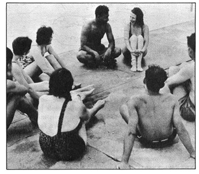
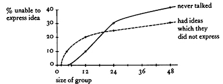
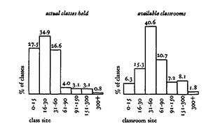
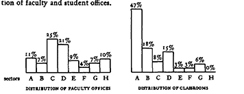
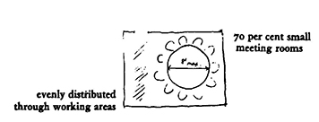

<section class="pattern-plate" aria-labelledby="t-small-meeting-rooms">
<a href="/patterns">A Pattern Language</a> · <a href="/patterns#buildings">Buildings</a> · Pattern 151 · p. 712 · *
<h1 class="pattern-title" id="t-small-meeting-rooms">Small Meeting Rooms</h1><figure class="pattern-figure pl-figure"></figure><nav class="pattern-links" aria-label="Connections"><h2>Links to</h2><ul><li><a href="/patterns/university-as-a-marketplace">43 University As A Marketplace</a></li><li><a href="/patterns/local-town-hall">44 Local Town Hall</a></li><li><a href="/patterns/master-and-apprentices">83 Master And Apprentices</a></li><li><a href="/patterns/flexible-office-space">146 Flexible Office Space</a></li><li><a href="/patterns/small-work-groups">148 Small Work Groups</a></li><li><a href="/patterns/light-on-two-sides-of-every-room">159 Light On Two Sides Of Every Room</a></li><li><a href="/patterns/sitting-circle">185 Sitting Circle</a></li><li><a href="/patterns/the-shape-of-indoor-space">191 The Shape Of Indoor Space</a></li><li><a href="/patterns/different-chairs">251 Different Chairs</a></li><li><a href="/patterns/pools-of-light">252 Pools Of Light</a></li></ul><h2>Linked from</h2><ul><li><a href="/patterns/master-and-apprentices">83 Master And Apprentices</a></li><li><a href="/patterns/sequence-of-sitting-spaces">142 Sequence Of Sitting Spaces</a></li><li><a href="/patterns/bulk-storage">145 Bulk Storage</a></li><li><a href="/patterns/communal-eating">147 Communal Eating</a></li><li><a href="/patterns/alcoves">179 Alcoves</a></li></ul></nav></section><article class="pattern-text" aria-label="The text of Small Meeting Rooms">
713… within organizations and workplaces—<a class="pl-ref" href="/patterns/university-as-a-marketplace">UNIVERSITY AS A MARKETPLACE (43)</a>, <a class="pl-ref" href="/patterns/local-town-hall">LOCAL TOWN HALL (44)</a>, <a class="pl-ref" href="/patterns/master-and-apprentices">MASTER AND APPRENTICES (83)</a>, <a class="pl-ref" href="/patterns/flexible-office-space">FLEXIBLE OFFICE SPACE (146)</a>, <a class="pl-ref" href="/patterns/small-work-groups">SMALL WORK CROUPS (148)</a>, there will, inevitably, be meeting rooms, group rooms, classrooms, of one kind or another. Investigation of meeting rooms shows that the best distribution—both by size and by position—is rather unexpected.

◆ ◆ ◆

<strong>The larger meetings are, the less people get out of them. But institutions often put their money and attention into large meeting rooms and lecture halls.</strong>

We first discuss the sheer size of meetings. It has been shown that the number of people in a group influences both the number who never talk, and the number who feel they have ideas which they have not been able to express. For example, Bernard Bass (<em>Organizational Psychology</em>, Boston: Allyn, 1965, p. 200) has conducted an experiment relating group size to participation. The results of this experiment are shown in the following graph.

<figure class="pl-figure"><figcaption><em>As size of group grow, more and more people hold back</em>.</figcaption></figure>

There is no particularly natural threshold for group size; but it is clear that the number who never talk climbs very rapidly. In a group of 12, one person never talks. In a group of 24, there are six people who never talk.

We get similar thresholds when we consider comfortable distances for talking. Edward Hall has established the upper 714range for full casual voice at about 8 feet; a person with 20/20 vision can see details of facial expression up to 12 feet; two people whose heads are 8 to 9 feet apart, can pass an object if they both stretch; clear vision (that is, macular vision) includes 12 degrees horizontally and 3 degrees vertically—which includes one face but not two, at distances up to about 10 feet. (See Edward Hall, <em>The Silent Language</em>, New York: Doubleday, 1966, pp. 118–19.)

Thus a small group discussion will function best if the members of the group are arranged in a rough circle, with a maximum diameter of about 8 feet. At this diameter, the circumference of the circle will be 25 feet, Since people require about 27 inches each for their seats, there can be no more than about 12 people round the circle.

Next we shall present evidence to show that in institutions and workgroups, the natural history of meetings tends also to converge on this size.

The following histograms show the relative numbers of different sized classes held at the University of Oregon in the Fall of 1970 and the relative numbers of available classrooms in the different size ranges. We believe these figures are typical for many universities. But it is obvious at a glance that there are too many large classrooms and too few small classrooms. Most of the classes actually held are relatively small seminars and “section” meetings, while most of the classrooms are in the 30 to 150 size range. These large classrooms may have reflected the teaching methods of an earlier period, but apparently they do not conform to the actual practice of teaching in the 1970’s.

<figure class="pl-figure"><figcaption><em>Histogram: Classes don’t fit the classrooms</em>.</figcaption></figure>

715We found that the meetings of official committees, boards, and commissions in the City of Berkeley have a similar distribution. Among the various city boards, commissions, and committees, 73 per cent have an average attendance of 15 or less. Yet of course, most of these meetings are held in rooms designed for far more than 15 people. Here again, most of the meetings are held in rooms that are too large; the rooms are half-empty; people tend to sit at the back; speakers face rows of empty seats. The intimate and intense atmosphere typical of a good small meeting cannot be achieved under these circumstances.

Finally, the <em>spatial</em> distribution of meeting rooms is often as poorly adapted to the actual meetings as the size distribution. The following histograms compare the distribution of classrooms in different sectors of the University of Oregon with the distribution of faculty and student offices.

<figure class="pl-figure"><figcaption><em>The meeting rooms are not located, where people work</em>.</figcaption></figure>

Once again, this discrepancy has a bad effect on the social life of small meetings. The meetings work best when the meeting rooms are fairly near the participants’ offices. Then discussions which begin in the meeting rooms are able to continue in the office or the laboratory. When the meeting rooms are a long walk from offices, the chances of this kind of informal business are drastically reduced.

Therefore:

<strong>Make at least 70 per cent of all meeting rooms really small—for 12 people or less. Locate them in the most public parts of the building, evenly scattered among the workplaces.</strong>

716

<figure class="pl-figure"></figure>
◆ ◆ ◆

Shape meeting rooms like any other rooms, perhaps with special emphasis on the fact that there must be no glare—<a class="pl-ref" href="/patterns/light-on-two-sides-of-every-room">LIGHT ON TWO SIDES OF EVERY ROOM (159)</a>—and on the fact that the rooms should be roughly round or square, and not too long or narrow—<a class="pl-ref" href="/patterns/sitting-circle">SITTING CIRCLE (185)</a>. People will feel best if many of the chairs are different, to suit different temperaments and moods and shapes and sizes—<a class="pl-ref" href="/patterns/different-chairs">DIFFERENT CHAIRS (251)</a>. A light over the table or over the center of the group will help tie people together—<a class="pl-ref" href="/patterns/pools-of-light">POOLS OF LIGHT (252)</a>. For the shape of the room in detail, start with <a class="pl-ref" href="/patterns/the-shape-of-indoor-space">THE SHAPE OF INDOOR SPACE (191)</a>….
</article>

Christopher Alexander, Sara Ishikawa and Murray Silverstein, with Max Jacobson, Ingrid Fiksdahl-King and Shlomo Angel, <cite>A Pattern Language</cite> (Oxford University Press, 1977), pattern 151, pp. 712–716. Text and illustrations from the <a href="https://github.com/natureoforder/sources">Nature of Order sources</a> reading edition, transcribed from the 1977 printing; report errors on <a href="https://github.com/natureoforder/alexander-wiki/issues">GitHub</a>.

<a href="/patterns/a-place-to-wait">← 150 A Place To Wait</a> · <a href="/patterns">All 253 patterns</a> · <a href="/patterns/half-private-office">152 Half-Private Office →</a>

