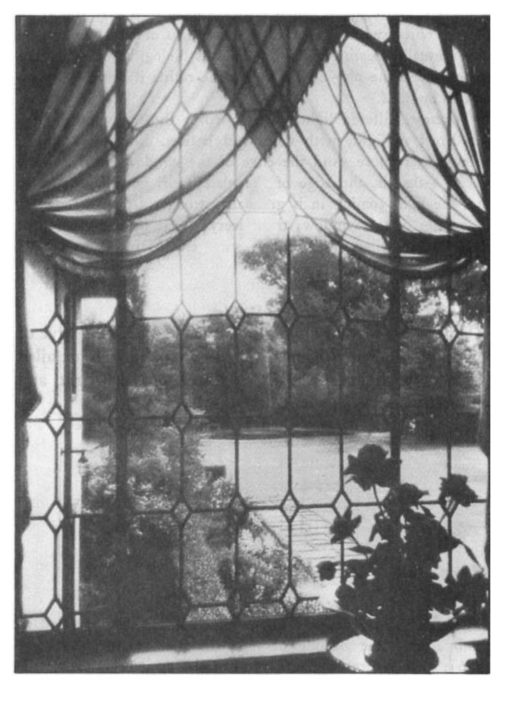
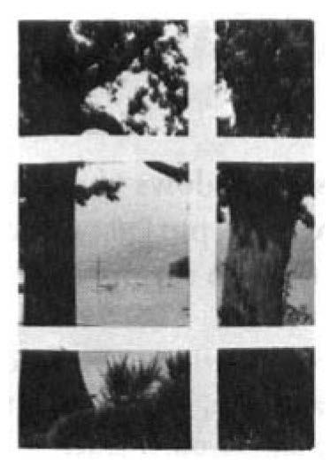
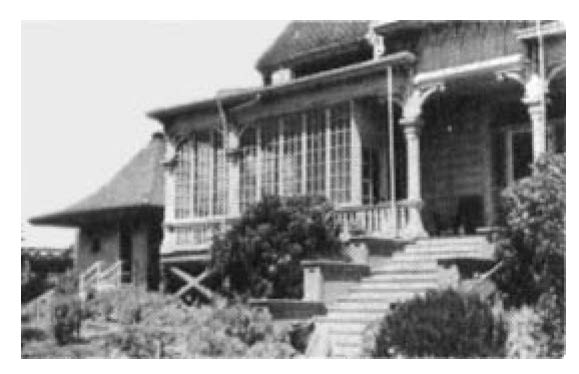
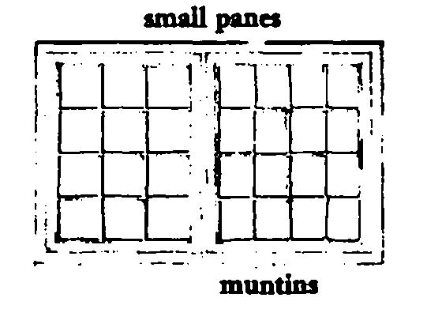

<section class="pattern-plate" aria-labelledby="t-small-panes">
<a href="/patterns">A Pattern Language</a> · <a href="/patterns#construction">Construction</a> · Pattern 239 · p. 1108 · **
<h1 class="pattern-title" id="t-small-panes">Small Panes</h1><figure class="pattern-figure pl-figure"></figure><nav class="pattern-links" aria-label="Connections"><h2>Links to</h2><ul><li><a href="/patterns/interior-windows">194 Interior Windows</a></li><li><a href="/patterns/frames-as-thickened-edges">225 Frames As Thickened Edges</a></li><li><a href="/patterns/windows-which-open-wide">236 Windows Which Open Wide</a></li><li><a href="/patterns/solid-doors-with-glass">237 Solid Doors With Glass</a></li><li><a href="/patterns/filtered-light">238 Filtered Light</a></li><li><a href="/patterns/half-inch-trim">240 Half-Inch Trim</a></li></ul><h2>Linked from</h2><ul><li><a href="/patterns/wings-of-light">107 Wings Of Light</a></li><li><a href="/patterns/windows-overlooking-life">192 Windows Overlooking Life</a></li><li><a href="/patterns/half-open-wall">193 Half-Open Wall</a></li><li><a href="/patterns/interior-windows">194 Interior Windows</a></li><li><a href="/patterns/natural-doors-and-windows">221 Natural Doors And Windows</a></li><li><a href="/patterns/frames-as-thickened-edges">225 Frames As Thickened Edges</a></li><li><a href="/patterns/dormer-windows">231 Dormer Windows</a></li><li><a href="/patterns/roof-caps">232 Roof Caps</a></li><li><a href="/patterns/windows-which-open-wide">236 Windows Which Open Wide</a></li><li><a href="/patterns/solid-doors-with-glass">237 Solid Doors With Glass</a></li><li><a href="/patterns/filtered-light">238 Filtered Light</a></li></ul></nav></section><article class="pattern-text" aria-label="The text of Small Panes">
1109… this pattern gives the glazing for the windows in <a class="pl-ref" href="/patterns/interior-windows">INTERIOR WINDOWS (194)</a>, NATURAL DOORS AND WINDOWS (22l), <a class="pl-ref" href="/patterns/windows-which-open-wide">WINDOWS WHICH OPEN WIDE (236)</a>, and <a class="pl-ref" href="/patterns/solid-doors-with-glass">SOLID DOORS WITH GLASS (237)</a>. In most cases, the glazing can be built as a continuation of the <a class="pl-ref" href="/patterns/frames-as-thickened-edges">FRAMES AS THICKENED EDGES (225)</a>.

◆ ◆ ◆

<strong>When plate glass windows became possible, people thought that they would put us more directly in touch with nature. In fact, they do the opposite.</strong>

They alienate us from the view. The smaller the windows are, and the smaller the panes are, the more intensely windows help connect us with what is on the other side.

This is an important paradox. The clear plate window seems as though it ought to bring nature closer to us, just because it seems to be more like an opening, more like the air. But, in fact, our contact with the view, our contact with the things we see through windows is affected by the way the window frames them. When we consider a window as an eye through which to see a view, we must recognize that it is the extent to which the window frames the view, that increases the view, increases its intensity, increases its variety, even increases the number of views we seem to see—and it is because of this that windows which are broken into smaller windows, and windows which are filled with tiny panes, put us so intimately in touch with what is on the other side. It is because they create far more frames: and it is the multitude of frames which makes the view.

Thomas Markus, who has studied windows extensively, has arrived at the same conclusion: windows which are broken up make for more interesting views. (“The Function of Windows—A Reappraisal,” <em>Building Science</em>, Vol. 2, 1967, pp. 101–4). He points out that small and narrow windows afford different views from different positions in the room, while the view tends to be the same through large windows or horizontal ones.

We believe that the same thing, almost exactly, happens 1110within the window frame itself. The following picture shows a simple landscape, broken up as it might be by six panes. Instead of one view, we see six views. The view becomes alive because the small panes make it so.

<figure class="pl-figure"><figcaption><em>Six views</em>.</figcaption></figure>

Another argument for small panes: Modern architecture and building have deliberately tried to make windows less like windows and more as though there was nothing between you and the outdoors. Yet this entirely contradicts the nature of windows. It is the function of windows to offer a view and provide a relationship to the outside, true. But this does not mean that they should not at the same time, like the walls and roof, give you a sense of protection and shelter from the outside. It is uncomfortable to feel that there is nothing between you and the outside, when in fact you are <em>inside</em> a building. It is the nature of windows to give you a relationship to the outside <em>and</em> at the same time give a sense of enclosure.

<figure class="pl-figure"><figcaption><em>Small fanes in Mendocino</em>.</figcaption></figure>

1111Not only that. Big areas of dear glass are sometimes even dangerous. People walk into plate glass windows, because they look like air. By comparison, windows with small panes give a dear functional message—the frames of the panes definitely tell you that something is there separating you from the outside. And they help to create <a class="pl-ref" href="/patterns/filtered-light">FILTERED LIGHT (238)</a>.

Therefore:

<strong>Divide each window into small panes. These panes can be very small indeed, and should hardly ever be more than a foot square. To get the exact size of the panes, divide the width and height of the window by the number of panes. Then each window will have different sized panes according to its height and width.</strong>

<figure class="pl-figure"></figure>
◆ ◆ ◆

In certain cases you may want to make the small panes even finer near the window edge, to filter the light around the upper edge of windows which stand out against the sky—<a class="pl-ref" href="/patterns/filtered-light">FILTERED LIGHT (238)</a>. As for the muntins, they can be made from the same materials as trim—<a class="pl-ref" href="/patterns/half-inch-trim">HALF-INCH TRIM (240)</a>….
</article>

Christopher Alexander, Sara Ishikawa and Murray Silverstein, with Max Jacobson, Ingrid Fiksdahl-King and Shlomo Angel, <cite>A Pattern Language</cite> (Oxford University Press, 1977), pattern 239, pp. 1108–1111. Text and illustrations from the <a href="https://github.com/natureoforder/sources">Nature of Order sources</a> reading edition, transcribed from the 1977 printing; report errors on <a href="https://github.com/natureoforder/alexander-wiki/issues">GitHub</a>.

<a href="/patterns/filtered-light">← 238 Filtered Light</a> · <a href="/patterns">All 253 patterns</a> · <a href="/patterns/half-inch-trim">240 Half-Inch Trim →</a>

