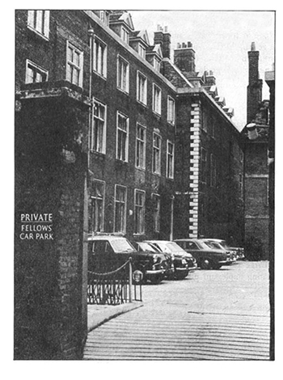
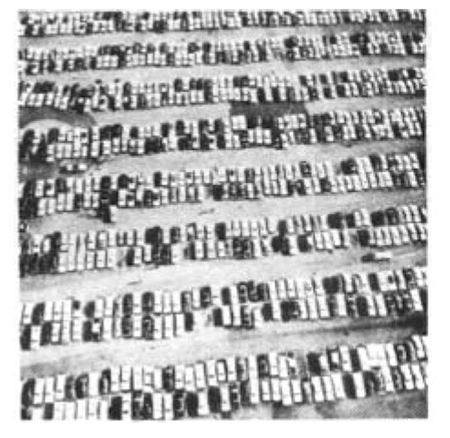
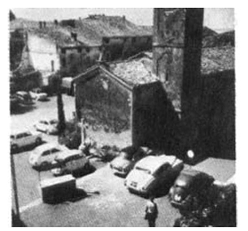
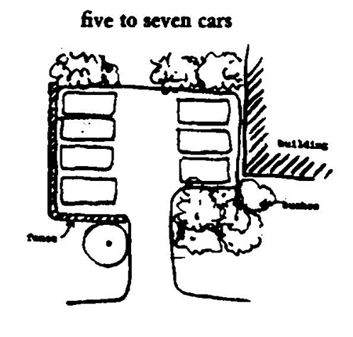

<section class="pattern-plate" aria-labelledby="t-small-parking-lots">
<a href="/patterns">A Pattern Language</a> · <a href="/patterns#buildings">Buildings</a> · Pattern 103 · p. 503 · *
<h1 class="pattern-title" id="t-small-parking-lots">Small Parking Lots</h1><figure class="pattern-figure pl-figure"></figure><nav class="pattern-links" aria-label="Connections"><h2>Links to</h2><ul><li><a href="/patterns/nine-per-cent-parking">22 Nine Per Cent Parking</a></li><li><a href="/patterns/shopping-street">32 Shopping Street</a></li><li><a href="/patterns/house-cluster">37 House Cluster</a></li><li><a href="/patterns/work-community">41 Work Community</a></li><li><a href="/patterns/green-streets">51 Green Streets</a></li><li><a href="/patterns/main-gateways">53 Main Gateways</a></li><li><a href="/patterns/shielded-parking">97 Shielded Parking</a></li><li><a href="/patterns/circulation-realms">98 Circulation Realms</a></li><li><a href="/patterns/site-repair">104 Site Repair</a></li><li><a href="/patterns/south-facing-outdoors">105 South Facing Outdoors</a></li><li><a href="/patterns/positive-outdoor-space">106 Positive Outdoor Space</a></li><li><a href="/patterns/wings-of-light">107 Wings Of Light</a></li><li><a href="/patterns/connected-buildings">108 Connected Buildings</a></li><li><a href="/patterns/long-thin-house">109 Long Thin House</a></li><li><a href="/patterns/tree-places">171 Tree Places</a></li><li><a href="/patterns/garden-wall">173 Garden Wall</a></li></ul><h2>Linked from</h2><ul><li><a href="/patterns/neighborhood-boundary">15 Neighborhood Boundary</a></li><li><a href="/patterns/nine-per-cent-parking">22 Nine Per Cent Parking</a></li><li><a href="/patterns/access-to-water">25 Access To Water</a></li><li><a href="/patterns/shielded-parking">97 Shielded Parking</a></li><li><a href="/patterns/canvas-roofs">244 Canvas Roofs</a></li></ul></nav></section><article class="pattern-text" aria-label="The text of Small Parking Lots">
504… since a small parking lot is a kind of gateway—the place where you leave your car, and enter a pedestrian realm—this pattern helps to complete <a class="pl-ref" href="/patterns/shopping-street">SHOPPING STREETS (32)</a>, <a class="pl-ref" href="/patterns/house-cluster">HOUSE CLUSTER (37)</a>, <a class="pl-ref" href="/patterns/work-community">WORK COMMUNITY (41)</a>, <a class="pl-ref" href="/patterns/green-streets">GREEN STREETS (51)</a>, <a class="pl-ref" href="/patterns/main-gateways">MAIN GATEWAYS (53)</a>, <a class="pl-ref" href="/patterns/circulation-realms">CIRCULATION REALMS (98)</a>, and any other areas which need small and convenient amounts of parking. But above all, if it is used correctly, this pattern, together with <a class="pl-ref" href="/patterns/shielded-parking">SHIELDED PARKING (97)</a>, will help to generate <a class="pl-ref" href="/patterns/nine-per-cent-parking">NINE PER CENT PARKING (22)</a> gradually, by increments.

◆ ◆ ◆

<strong>Vast parking lots wreck the land for people.</strong>

In <a class="pl-ref" href="/patterns/nine-per-cent-parking">NINE PER CENT PARKING (22)</a>, we have suggested that the fabric of society is threatened by the mere existence of cars, if areas for parked cars take up more than 9 or 10 per cent of the land in a community.

We now face a second problem. Even when parked cars occupy less than 9 per cent of the land, they can still be distributed in two entirely different ways. They can be concentrated in a few huge parking lots; or they can be scattered in many tiny parking lots. The tiny parking lots are far better for the environment than the large ones, even when their total areas are the same.

Large parking lots have a way of taking over the landscape, creating unpleasant places, and having a depressing effect on the open space around them. They make people feel dominated by cars; they separate people from the pleasure and convenience of being near their cars; and, if they are large enough to contain unpredictable traffic, they are dangerous for children, since children inevitably play in parking lots.

<figure class="pl-figure"><figcaption><em>The destruction of human scale</em>.</figcaption></figure>

505The problems stem essentially from the fact that a car is so much bigger than a person. Large parking lots, suited for the cars, have all the wrong properties for people. They are too wide; they contain too much pavement; they have no place to linger. In fact, we have noticed that people speed up when they arc walking through large parking lots to get out of them as fast as possible.

It is hard to pin down the exact size at which parking lots become too big. Our observations suggest that parking lots for four cars are still essentially pedestrian and human in character; that lots for six cars are acceptable; but that any area near a parking lot which holds eight cars is already clearly identifiable as “car dominated territory.”

This may be connected with the well-known perceptual facts about the number seven. A collection of less than five to seven objects can be grasped as one thing, and the objects in it can be grasped as individuals. A collection of more than five to seven things is perceived as “many things.” (See G. Miller, “The Magical Number Seven, Plus or Minus Two: Some Limits on Our Capacity for Processing Information,” in D. Beardslee and M. Wertheimer, eds., <em>Readings in Perceftion</em>, New York, 1958, esp. p. 103.) It may be true that the impression of a “sea of cars” first comes into being with about seven cars.

<figure class="pl-figure"><figcaption><em>The small lots can be quite loosely placed</em>.</figcaption></figure>

506Therefore:

<strong>Make parking lots small, serving no more than five to seven cars, each lot surrounded by garden walls, hedges, fences, slopes, and trees, so that from outside the cars are almost invisible. Space these small lots so that they are at least ioo feet apart</strong>

<figure class="pl-figure"></figure>
◆ ◆ ◆

Place entrances and exits of the parking lots in such a way that they fit naturally into the pattern of pedestrian movement and lead directly, without confusion, to the major entrances to individual buildings—<a class="pl-ref" href="/patterns/circulation-realms">CIRCULATION REALMS (98)</a>. Shield even these quite modest parking lots with garden walls, and trees, and fences, so that they help to generate the space around them—POSITIVE OUTDOOR SPACE (l06), <a class="pl-ref" href="/patterns/tree-places">TREE PLACES (171)</a>, <a class="pl-ref" href="/patterns/garden-wall">GARDEN WALLS (173)</a>….

507<strong><em>fix the position of individual buildings on the site, within the complex, one by one, according to the nature of the site, the trees, the sun: this is one of the most important moments in the language;</em></strong>

<a class="pl-ref" href="/patterns/site-repair">104. SITE REPAIR</a>

<a class="pl-ref" href="/patterns/south-facing-outdoors">105. SOUTH FACING OUTDOORS</a>

<a class="pl-ref" href="/patterns/positive-outdoor-space">106. POSITIVE OUTDOOR SPACE</a>

<a class="pl-ref" href="/patterns/wings-of-light">107. WINGS OF LIGHT</a>

<a class="pl-ref" href="/patterns/connected-buildings">108. CONNECTED BUILDINGS</a>

<a class="pl-ref" href="/patterns/long-thin-house">109. LONG THIN HOUSE</a>
</article>

Christopher Alexander, Sara Ishikawa and Murray Silverstein, with Max Jacobson, Ingrid Fiksdahl-King and Shlomo Angel, <cite>A Pattern Language</cite> (Oxford University Press, 1977), pattern 103, pp. 503–507. Text and illustrations from the <a href="https://github.com/natureoforder/sources">Nature of Order sources</a> reading edition, transcribed from the 1977 printing; report errors on <a href="https://github.com/natureoforder/alexander-wiki/issues">GitHub</a>.

<a href="/patterns/family-of-entrances">← 102 Family Of Entrances</a> · <a href="/patterns">All 253 patterns</a> · <a href="/patterns/site-repair">104 Site Repair →</a>

