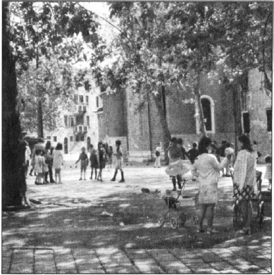
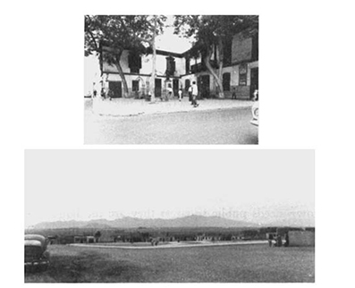
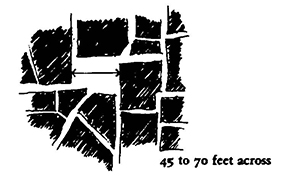

<section class="pattern-plate" aria-labelledby="t-small-public-squares">
<a href="/patterns">A Pattern Language</a> · <a href="/patterns#towns">Towns</a> · Pattern 61 · p. 310 · **
<h1 class="pattern-title" id="t-small-public-squares">Small Public Squares</h1><figure class="pattern-figure pl-figure"></figure><nav class="pattern-links" aria-label="Connections"><h2>Links to</h2><ul><li><a href="/patterns/identifiable-neighborhood">14 Identifiable Neighborhood</a></li><li><a href="/patterns/promenade">31 Promenade</a></li><li><a href="/patterns/work-community">41 Work Community</a></li><li><a href="/patterns/building-fronts">122 Building Fronts</a></li><li><a href="/patterns/pedestrian-density">123 Pedestrian Density</a></li><li><a href="/patterns/stair-seats">125 Stair Seats</a></li><li><a href="/patterns/something-roughly-in-the-middle">126 Something Roughly In The Middle</a></li></ul><h2>Linked from</h2><ul><li><a href="/patterns/identifiable-neighborhood">14 Identifiable Neighborhood</a></li><li><a href="/patterns/density-rings">29 Density Rings</a></li><li><a href="/patterns/activity-nodes">30 Activity Nodes</a></li><li><a href="/patterns/local-town-hall">44 Local Town Hall</a></li><li><a href="/patterns/road-crossing">54 Road Crossing</a></li><li><a href="/patterns/children-in-the-city">57 Children In The City</a></li><li><a href="/patterns/high-places">62 High Places</a></li><li><a href="/patterns/dancing-in-the-street">63 Dancing In The Street</a></li><li><a href="/patterns/public-outdoor-room">69 Public Outdoor Room</a></li><li><a href="/patterns/street-cafe">88 Street Cafe</a></li><li><a href="/patterns/food-stands">93 Food Stands</a></li><li><a href="/patterns/sleeping-in-public">94 Sleeping In Public</a></li><li><a href="/patterns/hierarchy-of-open-space">114 Hierarchy Of Open Space</a></li><li><a href="/patterns/activity-pockets">124 Activity Pockets</a></li><li><a href="/patterns/stair-seats">125 Stair Seats</a></li><li><a href="/patterns/street-windows">164 Street Windows</a></li></ul></nav></section><article class="pattern-text" aria-label="The text of Small Public Squares">
311… this pattern forms the core which makes an activity node (30): it can also help to generate a node, by its mere existence, provided that it is correctly placed along the intersection of the paths which people use most often. And it can also help to generate a <a class="pl-ref" href="/patterns/promenade">promenade (31)</a>, a <a class="pl-ref" href="/patterns/work-community">work community (41)</a>, an <a class="pl-ref" href="/patterns/identifiable-neighborhood">identifiable neighborhood (14)</a>, through the action of the people who gather there. But it is essential, in every case, that ii is not too large.

◆ ◆ ◆

<strong>A town needs public squares; they are the largest, most public rooms, that the town has. But when they are too large, they look and feel deserted.</strong>

It is natural that every public street will swell out at those important nodes where there is the most activity. And it is only these widened, swollen, public squares which can accommodate the public gatherings, small crowds, festivities, bonfires, carnivals, speeches, dancing, shouting, mourning, which must have their place in the life of the town.

But for some reason there is a temptation to make these public squares too large. Time and again in modern cities, architects and planners build plazas that are too large. They look good on drawings; but in real life they end up desolate and dead.

Our observations suggest strongly that open places intended as public squares should be very small. As a general rule, we have found that they work best when they have a diameter of about 60 feet—at this diameter people often go to them, they become favorite places, and people feel comfortable there. When the diameter gets above 70 feet, the squares begin to seem deserted and unpleasant. The only exceptions we know are places like the Piazza San Marco and Trafalgar Square, which are great town centers, teeming with people.

What possible functional basis is there for these observations? First, we know from the pattern, <a class="pl-ref" href="/patterns/pedestrian-density">pedestrian density (123)</a>, that a place begins to seem deserted when it has more than about 300 square feet per person.

312

<figure class="pl-figure"><figcaption><em>The squares in Lima: one small and alive, the other huge and deserted</em>.</figcaption></figure>

On this basis a square with a diameter of 100 feet will begin to seem deserted if there are less than 3 3 people in it. There are few places in a city where you can be sure there will always be 3 3 people. On the other hand, it only takes 4 people to give life to a square with a diameter of 35 feet, and only 12 to give life to a square with a diameter of 60 feet. Since there are far far better chances of 4 or 12 people being in a certain place than 33, the smaller squares will feel comfortable for a far greater percentage of the time.

The second possible basis for our observations depends on the diameter. A person’s face is just recognizable at about 70 feet; and under typical urban noise conditions, a loud voice can just barely be heard across 70 feet. This may mean that people feel half-consciously tied together in plazas that have diameters of 31370 feet or less—where they can make out the faces and half-hear the talk of the people around them; and this feeling of being at one with a loosely knit square is lost in the larger spaces. Roughly similar things have been said by Philip Thiel (“An Architectural and Urban Space Sequence Notation.” unpublished ms., University of California, Department of Architecture, August i960, p. 5) and by Hans Blumenfeld (“Scale in Civic Design,” <em>Town Planning Review</em>, April 1953, pp. 35–46). For example, Blumenfeld gives the following figures: a person’s face can be recognized at up to 70 or 80 feet; a person’s face can be recognized as “a portrait,” in rich detail, at up to about 48 feet.

Our own informal experiments show the following results. Two people with normal vision can communicate comfortably up to 75 feet. They can talk with raised voice, and they can see the general outlines of the expression on one another’s faces. This 75 foot maximum is extremely reliable. Repeated experiments gave the same distance again and again, ±10 per cent. At 100 feet it is uncomfortable to talk, and facial expression is no longer clear. Anything above 100 feet is hopeless.

Therefore:

<strong>Make a public square much smaller than you would at first imagine; usually no more than 45 to 60 feet across, never more than 70 feet across. This applies only to its width in the short direction. In the long direction it can certainly be longer.</strong>

<figure class="pl-figure"></figure>
314

◆ ◆ ◆

An even better estimate for the size of the square: make a guess about the number of people who will typically be there (say, P), and make the area of the square no greater than 150 to 300P square feet—pedestrian density (123); ring the square around with pockets of activity where people congregate—activity pockets (124); build buildings round the square in such a way that they give it a definite shape, with views out into other larger places—positive outdoor space (106), hierarchy op open space (114), <a class="pl-ref" href="/patterns/building-fronts">building fronts (122)</a>, <a class="pl-ref" href="/patterns/stair-seats">stair seats (125)</a>; and to make the center of the square as useful as the edges, build <a class="pl-ref" href="/patterns/something-roughly-in-the-middle">SOMETHING ROUGHLY IN THE MIDDLE (126)</a>….
</article>

Christopher Alexander, Sara Ishikawa and Murray Silverstein, with Max Jacobson, Ingrid Fiksdahl-King and Shlomo Angel, <cite>A Pattern Language</cite> (Oxford University Press, 1977), pattern 61, pp. 310–314. Text and illustrations from the <a href="https://github.com/natureoforder/sources">Nature of Order sources</a> reading edition, transcribed from the 1977 printing; report errors on <a href="https://github.com/natureoforder/alexander-wiki/issues">GitHub</a>.

<a href="/patterns/accessible-green">← 60 Accessible Green</a> · <a href="/patterns">All 253 patterns</a> · <a href="/patterns/high-places">62 High Places →</a>

