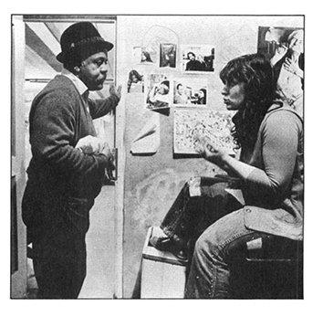
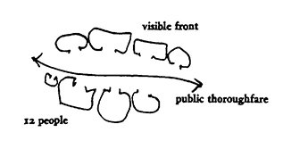

<section class="pattern-plate" aria-labelledby="t-small-services-without-red-tape">
<a href="/patterns">A Pattern Language</a> · <a href="/patterns#towns">Towns</a> · Pattern 81 · p. 404 · *
<h1 class="pattern-title" id="t-small-services-without-red-tape">Small Services Without Red Tape</h1><figure class="pattern-figure pl-figure"></figure><nav class="pattern-links" aria-label="Connections"><h2>Links to</h2><ul><li><a href="/patterns/work-community">41 Work Community</a></li><li><a href="/patterns/university-as-a-marketplace">43 University As A Marketplace</a></li><li><a href="/patterns/local-town-hall">44 Local Town Hall</a></li><li><a href="/patterns/necklace-of-community-projects">45 Necklace Of Community Projects</a></li><li><a href="/patterns/health-center">47 Health Center</a></li><li><a href="/patterns/office-connections">82 Office Connections</a></li><li><a href="/patterns/teen-age-society">84 Teen-Age Society</a></li><li><a href="/patterns/building-complex">95 Building Complex</a></li><li><a href="/patterns/building-thoroughfare">101 Building Thoroughfare</a></li><li><a href="/patterns/family-of-entrances">102 Family Of Entrances</a></li><li><a href="/patterns/flexible-office-space">146 Flexible Office Space</a></li><li><a href="/patterns/small-work-groups">148 Small Work Groups</a></li></ul><h2>Linked from</h2><ul><li><a href="/patterns/your-own-home">79 Your Own Home</a></li><li><a href="/patterns/office-connections">82 Office Connections</a></li><li><a href="/patterns/a-place-to-wait">150 A Place To Wait</a></li></ul></nav></section><article class="pattern-text" aria-label="The text of Small Services Without Red Tape">
405… all offices which provide service to the public—<a class="pl-ref" href="/patterns/work-community">WORK COMMUNITY (41)</a>, <a class="pl-ref" href="/patterns/university-as-a-marketplace">UNIVERSITY AS A MARKETPLACE (43)</a>, <a class="pl-ref" href="/patterns/local-town-hall">LOCAL TOWN HALL (44)</a>, <a class="pl-ref" href="/patterns/health-center">HEATH CENTER (47)</a>, <a class="pl-ref" href="/patterns/teen-age-society">TEENAGE SOCIETY (84)</a> need subsidiary departments, where the members of the public go. And of course, piecemeal development of these small departments, one department at a time, can also help to generate these larger patterns gradually.

◆ ◆ ◆

<strong>Departments and public services don’t work if they are too large. When they are large, their human qualities vanish; they become bureaucratic; red tape takes over.</strong>

There is a great deal of literature on the way red tape and bureaucracy work against human needs. See, for example, Gideon Sjoberg, Richard Brymer, and Buford Farris, “Bureaucracy and the Lower Class,” Sociology and Social Research, 50, April, 1966, pp. 325–77; and Alvin W. Gouldner, “Red Tape as a Social Problem,” in Robert Mertin, <em>Reader in Bureaucracy</em>, Free Press, 1952, pp. 410–18.

According to these authors, red tape can be overcome in two ways. First, it can be overcome by making each service program small and autonomous. A great deal of evidence shows that red tape occurs largely as a result of impersonal relationships in large institutions. When people can no longer communicate on a face-to-face basis, they need formal regulations, and in the lower echelons of the organization, these formal regulations are followed blindly and narrowly.

Second, red tape can be overcome by changing the passive nature of the clients’ relation to service programs. There is considerable evidence to show that when clients have an active relationship with a social institution, the institution loses its power to intimidate them.

We have therefore concluded that no service should have more than 12 persons total (all staff, including clerks). We base this figure on the fact that 12 seems to be the largest number of 406people that can ait down in a face-to-face discussion. It seems likely that a smaller staff size will work better still. Furthermore, each service should be relatively autonomous—subject only to a few simple, coordinative regulations from parent organizations—and that this should be emphasized by physical autonomy. In order to be physically autonomous, each service must have an area which is entirely under its own jurisdiction; with its own door on a public thoroughfare, and complete physical separation from other services.

This pattern applies equally to the departments of a city hall, a medical center, or to the local branches of a welfare agency. In most of these cases the pattern would require basic changes in administrative organization. However difficult they may be to implement, we believe these changes are required.

Therefore:

<strong>In any institution whose departments provide public service:</strong>

<strong>1.  Make each service or department autonomous as far as possible.</strong>

<strong>2.  Allow no one service more than 12 staff members total.</strong>

<strong>3.  House each one in an identifiable piece of the building.</strong>

<strong>4.  Give each one direct access to a public thoroughfare.</strong>

<figure class="pl-figure"></figure>
407

◆ ◆ ◆

Arrange these departments in space, according to the prescription of <a class="pl-ref" href="/patterns/office-connections">OFFICE CONNECTIONS (82)</a> and <a class="pl-ref" href="/patterns/building-complex">BUILDING COMPLEX (95)</a>; if the public thoroughfare is indoors, make it a <a class="pl-ref" href="/patterns/building-thoroughfare">BUILDING THOROUGHFARE (101)</a>, and make the fronts of the services visible as a <a class="pl-ref" href="/patterns/family-of-entrances">FAMILY OF ENTRANCES (102)</a>; wherever the services are in any way connected to the political life of the community, mix them with ad hoc groups created by the citizens or users—<a class="pl-ref" href="/patterns/necklace-of-community-projects">NECKLACE OF COMMUNITY PROJECTS (45)</a>; arrange the inside space of the department according to <a class="pl-ref" href="/patterns/flexible-office-space">FLEXIBLE OFFICE SPACE (146)</a>; and provide rooms where people can team up in two’s and three’s—<a class="pl-ref" href="/patterns/small-work-groups">SMALL WORK GROUPS (148)</a>….
</article>

Christopher Alexander, Sara Ishikawa and Murray Silverstein, with Max Jacobson, Ingrid Fiksdahl-King and Shlomo Angel, <cite>A Pattern Language</cite> (Oxford University Press, 1977), pattern 81, pp. 404–407. Text and illustrations from the <a href="https://github.com/natureoforder/sources">Nature of Order sources</a> reading edition, transcribed from the 1977 printing; report errors on <a href="https://github.com/natureoforder/alexander-wiki/issues">GitHub</a>.

<a href="/patterns/self-governing-workshops-and-offices">← 80 Self-Governing Workshops And Offices</a> · <a href="/patterns">All 253 patterns</a> · <a href="/patterns/office-connections">82 Office Connections →</a>

