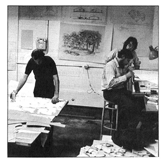
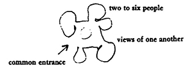

<section class="pattern-plate" aria-labelledby="t-small-work-groups">
<a href="/patterns">A Pattern Language</a> · <a href="/patterns#buildings">Buildings</a> · Pattern 148 · p. 701 · **
<h1 class="pattern-title" id="t-small-work-groups">Small Work Groups</h1><figure class="pattern-figure pl-figure"></figure><nav class="pattern-links" aria-label="Connections"><h2>Links to</h2><ul><li><a href="/patterns/self-governing-workshops-and-offices">80 Self-Governing Workshops And Offices</a></li><li><a href="/patterns/office-connections">82 Office Connections</a></li><li><a href="/patterns/master-and-apprentices">83 Master And Apprentices</a></li><li><a href="/patterns/common-areas-at-the-heart">129 Common Areas At The Heart</a></li><li><a href="/patterns/flexible-office-space">146 Flexible Office Space</a></li><li><a href="/patterns/half-private-office">152 Half-Private Office</a></li><li><a href="/patterns/open-stairs">158 Open Stairs</a></li><li><a href="/patterns/workspace-enclosure">183 Workspace Enclosure</a></li></ul><h2>Linked from</h2><ul><li><a href="/patterns/small-services-without-red-tape">81 Small Services Without Red Tape</a></li><li><a href="/patterns/master-and-apprentices">83 Master And Apprentices</a></li><li><a href="/patterns/bulk-storage">145 Bulk Storage</a></li><li><a href="/patterns/flexible-office-space">146 Flexible Office Space</a></li><li><a href="/patterns/communal-eating">147 Communal Eating</a></li><li><a href="/patterns/small-meeting-rooms">151 Small Meeting Rooms</a></li><li><a href="/patterns/half-private-office">152 Half-Private Office</a></li><li><a href="/patterns/open-stairs">158 Open Stairs</a></li></ul></nav></section><article class="pattern-text" aria-label="The text of Small Work Groups">
702… within the workspace of an institution—<a class="pl-ref" href="/patterns/self-governing-workshops-and-offices">SELF-GOVERNING WORKSHOPS AND OFFICES (80)</a>, <a class="pl-ref" href="/patterns/flexible-office-space">FLEXIBLE OFFICE SPACE (146)</a>, there need to be still further subdivisions. Above all, as this pattern shows, it is essential that the smallest human working groups each have their own physical space.

◆ ◆ ◆

<strong>When more than half a dozen people work in the same place, it is essential that they not be forced to work in one huge undifferentiated space, but that instead, they can divide their workspace up, and so form smaller groups.</strong>

In fact, people will feel oppressed, both when they are either working in an undifferentiated mass of workers and when they are forced to work in isolation. The small group achieves a nice balance between the one extreme in which there are so many people, that there is no opportunity for an intimate social structure to develop, and the other extreme in which there are so few, that the possibility of social groups does not occur at all.

This attitude toward the size of work groups is supported by the findings of the Pilkington Research Unit, in their investigations of office life (<em>Office Design: A Study of Environment</em>, ed. Peter Manning, Department of Building Science, University of Liverpool, 1965, pp. 104–28). In a very large study indeed, office workers were asked their opinions of large offices and small offices. The statements they chose most often to describe their opinions were: “The larger offices make one feel relatively unimportant” and “There is an uncomfortable feeling of being watched all the time in a large office.” And when asked to compare five different possible layouts for offices, workers consistently chose those layouts in which workgroups were smallest.

<figure class="pl-figure"><figcaption><em>The five layouts in order of preference</em>.</figcaption></figure>

703Analysis of the results also showed that “the people who work in small office areas are more opposed to large office areas than those who actually work in them.” Apparently, once people have had the experience of working in small groups, they find it very uncomfortable to imagine going back to the larger office settings.

In our own survey of attitudes toward workspace—taken among workers at the Berkeley City Hall—we found that people prefer to be part of a group that ranges from two to eight. When there are more than eight, people lose touch with the group as a human gathering; and almost no one likes working alone.

A similar finding is reported by the Japanese architect, T. Takano, in his study of work groups in Japan. In the offices he studied, he found that five persons formed the most useful functional group. (Building Section, Building and Repairs Bureau, Ministry of Construction; The Design of Akita prefectural government office, Public Buildings, 1961.)

How should these small groups be related to each other? Brian Wells points out that while small offices support an intimate atmosphere, they do not support communications between groups. “The Psycho-Social Influence of Building Environment” (<em>Building Science</em>, Vol. 1, Pergamon Press, 1965, p. 153). It would seem that this problem can be solved by arranging the small Work groups so that several of them share common facilities: drinking fountains, toilets, office equipment, perhaps a common anteroom and garden.

Therefore:

<strong>Break institutions into small, spatially identifiable work groups, with less than half <em>a</em> dozen people in each. Arrange these work groups so that each person is in at least partial view of the other members of his own group; and arrange several groups in such a way that they share a common entrance, food, office equipment, drinking fountains, bathrooms.</strong>

704

<figure class="pl-figure"></figure>
◆ ◆ ◆

Lay the workgroups out with respect to each other so that the distances between groups is within the constraints of <a class="pl-ref" href="/patterns/office-connections">OFFICE CONNECTIONS (82)</a>, and give each group office space which leaves room to expand and to contract—<a class="pl-ref" href="/patterns/flexible-office-space">FLEXIBLE OFFICE SPACE (146)</a>; provide a common area, either for the group itself or for several groups together or both—<a class="pl-ref" href="/patterns/common-areas-at-the-heart">COMMON AREA AT THE HEART (129)</a>. Treat each small work group, in every kind of industry and office, as a place of learning—<a class="pl-ref" href="/patterns/master-and-apprentices">MASTER AND APPRENTICES (83)</a>. Give it its own stair, directly to the street—<a class="pl-ref" href="/patterns/open-stairs">OPEN STAIRS (158)</a>. Arrange the individual workspaces within the small work group according to <a class="pl-ref" href="/patterns/half-private-office">HALF-PRIVATE OFFICE (152)</a> and <a class="pl-ref" href="/patterns/workspace-enclosure">WORKSPACE ENCLOSURE (183)</a>….
</article>

Christopher Alexander, Sara Ishikawa and Murray Silverstein, with Max Jacobson, Ingrid Fiksdahl-King and Shlomo Angel, <cite>A Pattern Language</cite> (Oxford University Press, 1977), pattern 148, pp. 701–704. Text and illustrations from the <a href="https://github.com/natureoforder/sources">Nature of Order sources</a> reading edition, transcribed from the 1977 printing; report errors on <a href="https://github.com/natureoforder/alexander-wiki/issues">GitHub</a>.

<a href="/patterns/communal-eating">← 147 Communal Eating</a> · <a href="/patterns">All 253 patterns</a> · <a href="/patterns/reception-welcomes-you">149 Reception Welcomes You →</a>

