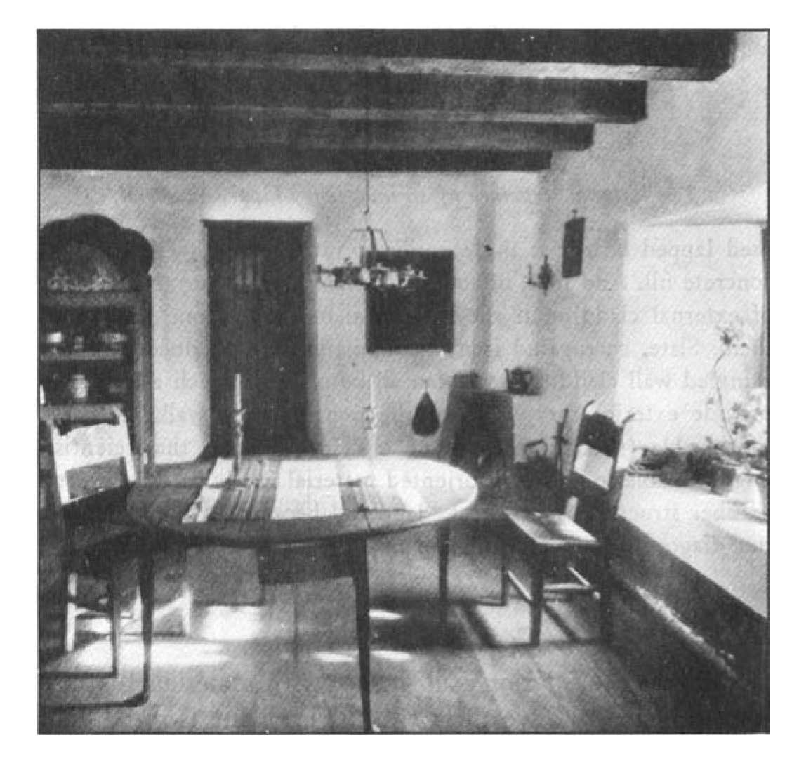
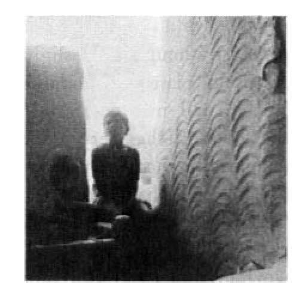
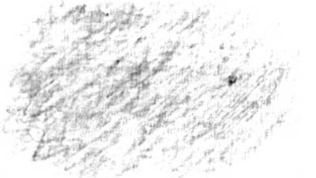

<section class="pattern-plate" aria-labelledby="t-soft-inside-walls">
<a href="/patterns">A Pattern Language</a> · <a href="/patterns#construction">Construction</a> · Pattern 235 · p. 1096 · *
<h1 class="pattern-title" id="t-soft-inside-walls">Soft Inside Walls</h1><figure class="pattern-figure pl-figure"></figure><nav class="pattern-links" aria-label="Connections"><h2>Links to</h2><ul><li><a href="/patterns/wall-membrane">218 Wall Membrane</a></li><li><a href="/patterns/floor-ceiling-vaults">219 Floor-Ceiling Vaults</a></li><li><a href="/patterns/half-inch-trim">240 Half-Inch Trim</a></li></ul><h2>Linked from</h2><ul><li><a href="/patterns/good-materials">207 Good Materials</a></li><li><a href="/patterns/wall-membrane">218 Wall Membrane</a></li><li><a href="/patterns/floor-ceiling-vaults">219 Floor-Ceiling Vaults</a></li><li><a href="/patterns/roof-caps">232 Roof Caps</a></li><li><a href="/patterns/half-inch-trim">240 Half-Inch Trim</a></li><li><a href="/patterns/ornament">249 Ornament</a></li><li><a href="/patterns/warm-colors">250 Warm Colors</a></li></ul></nav></section><article class="pattern-text" aria-label="The text of Soft Inside Walls">
1097… and this pattern finishes the inner surface of the <a class="pl-ref" href="/patterns/wall-membrane">WALL MEMBRANES (218)</a>, and the under surface of <a class="pl-ref" href="/patterns/floor-ceiling-vaults">FLOOR-CEILING VAULTS (219)</a>. If it is possible to use a soft material for the inner sheet of the wall membrane, then the wall will have the right character built in from the beginning.

◆ ◆ ◆

<strong>A wall which is too hard or too cold or too solid is unpleasant to touch; it makes decoration impossible, and creates hollow echoes.</strong>

A very good material is soft white gypsum plaster. It is warm in color (even though white), warm to the touch, soft enough to take tacks and nails and hooks, easy to repair, and makes a mellow sound, because its sound absorption capacity is reasonably high.

However, cement plaster, though only slightly different—and even confused with gypsum plaster—is opposite in all of these respects. It is too hard to nail into comfortably; it is cold and hard and rough to the touch; it has very low absorption acoustically—that is, very high reflectance—which creates a harsh, hollow sound; and it is relatively hard to repair, because once a crack forms in it, it is hard to make a repair that is homogeneous with the original.

In general, we have found that modern construction has gone more and more toward materials for inside walls that are hard and smooth. This is partly an effort to make buildings clean and impervious to human wear. But it is also because the kinds of materials used today are machine made—each piece perfect and exactly the same.

Buildings made of these flawless, hard and smooth surfaces leave us totally unrelated to them. We tend to stay away from them not only because they are psychologically strange, but because in fact they are physically uncomfortable to lean against; they have no give; they don’t respond to us.

1098The solution to the problem lies in the following:

1 Gypsum plaster as opposed to cement plaster. Soft baked tiles as opposed to hard fired ones. When materials are porous and low in density they are generally softer and warmer to the touch.

2 Use materials which are granular and have natural texture, and which can be used in small pieces, or in such a way that there is repetition of the same small element. Walls finished in wood have the quality—the wood itself has texture; boards repeat it at a larger scale. Plaster has this character when it is hand finished. First there is the granular quality of the plaster and then the larger texture created by the motion of the human hand.

One of the most beautiful versions of this pattern is the one used in Indian village houses. The walls are plastered, by hand, with a mixture of cow dung and mud, which dries to a beautiful soft finish and shows the five fingers of the plasterer’s hand all over the walls.

<figure class="pl-figure"><figcaption><em>Cow dung flatter in an Indian village house</em>.</figcaption></figure>

Therefore:

<strong>Make every inside surface warm to the touch, soft enough to take small nails and tacks, and with a certain slight “give” to the touch. Soft plaster is very good; textile hangings, canework, weavings, also have this character And wood is fine, where you can afford it.</strong>

<strong><em>soft to the touch</em></strong>

1099

<figure class="pl-figure"><figcaption><em>enough “give” for nails</em></figcaption></figure>

◆ ◆ ◆

In our own building system, we find it is worth putting on a light skim coat of plaster over the inner surfaces of the <a class="pl-ref" href="/patterns/wall-membrane">WALL MEMBRANE (218)</a> and <a class="pl-ref" href="/patterns/floor-ceiling-vaults">FLOOR-CEILING VAULTS (219)</a>. Wherever finish plaster meets columns, and beams, and doors and window frames, cover the joint with half-inch wooden trim—<a class="pl-ref" href="/patterns/half-inch-trim">HALF-INCH TRIM (240)</a>….
</article>

Christopher Alexander, Sara Ishikawa and Murray Silverstein, with Max Jacobson, Ingrid Fiksdahl-King and Shlomo Angel, <cite>A Pattern Language</cite> (Oxford University Press, 1977), pattern 235, pp. 1096–1099. Text and illustrations from the <a href="https://github.com/natureoforder/sources">Nature of Order sources</a> reading edition, transcribed from the 1977 printing; report errors on <a href="https://github.com/natureoforder/alexander-wiki/issues">GitHub</a>.

<a href="/patterns/lapped-outside-walls">← 234 Lapped Outside Walls</a> · <a href="/patterns">All 253 patterns</a> · <a href="/patterns/windows-which-open-wide">236 Windows Which Open Wide →</a>

