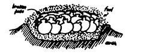
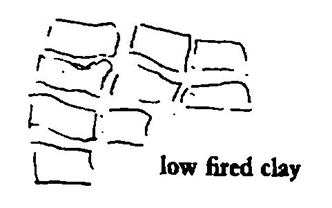

<section class="pattern-plate" aria-labelledby="t-soft-tile-and-brick">
<a href="/patterns">A Pattern Language</a> · <a href="/patterns#construction">Construction</a> · Pattern 248 · p. 1141
<h1 class="pattern-title" id="t-soft-tile-and-brick">Soft Tile And Brick</h1><nav class="pattern-links" aria-label="Connections"><h2>Links to</h2><ul><li><a href="/patterns/connection-to-the-earth">168 Connection To The Earth</a></li><li><a href="/patterns/good-materials">207 Good Materials</a></li><li><a href="/patterns/floor-surface">233 Floor Surface</a></li><li><a href="/patterns/sitting-wall">243 Sitting Wall</a></li><li><a href="/patterns/paving-with-cracks-between-the-stones">247 Paving With Cracks Between The Stones</a></li><li><a href="/patterns/ornament">249 Ornament</a></li><li><a href="/patterns/warm-colors">250 Warm Colors</a></li><li><a href="/patterns/different-chairs">251 Different Chairs</a></li><li><a href="/patterns/pools-of-light">252 Pools Of Light</a></li><li><a href="/patterns/things-from-your-life">253 Things From Your Life</a></li></ul><h2>Linked from</h2><ul><li><a href="/patterns/stair-seats">125 Stair Seats</a></li><li><a href="/patterns/connection-to-the-earth">168 Connection To The Earth</a></li><li><a href="/patterns/ground-floor-slab">215 Ground Floor Slab</a></li><li><a href="/patterns/wall-membrane">218 Wall Membrane</a></li><li><a href="/patterns/stair-vault">228 Stair Vault</a></li><li><a href="/patterns/floor-surface">233 Floor Surface</a></li><li><a href="/patterns/half-inch-trim">240 Half-Inch Trim</a></li><li><a href="/patterns/sitting-wall">243 Sitting Wall</a></li><li><a href="/patterns/paving-with-cracks-between-the-stones">247 Paving With Cracks Between The Stones</a></li><li><a href="/patterns/ornament">249 Ornament</a></li><li><a href="/patterns/warm-colors">250 Warm Colors</a></li></ul></nav></section><article class="pattern-text" aria-label="The text of Soft Tile And Brick">
… several patterns call for the use of tiles and bricks—CONNECTION TO THE EARTH (l68), <a class="pl-ref" href="/patterns/good-materials">GOOD MATERIALS (207)</a>, <a class="pl-ref" href="/patterns/floor-surface">FLOOR SURFACE (233)</a>, <a class="pl-ref" href="/patterns/sitting-wall">SITTING WALL (243)</a>, <a class="pl-ref" href="/patterns/paving-with-cracks-between-the-stones">PAVING WITH CRACKS BETWEEN THE STONES (247)</a>.

◆ ◆ ◆

<strong>How can a person feel the earth, or time, or any connection with his surroundings, when he is walking on the hard mechanical wash-easy surfaces of concrete, asphalt, hard-fired architectural paving bricks, or artificially concocted mixes like tcrxazo.</strong>

It is essential, above all, that the ground level surfaces we walk on—both around our buildings and indoors in those places like passages and kitchens where the floor has to be hard—be soft enough, at least, to show the passage of time, in gradual undulations and unevenness, that tell the story of a thousand passing feet, and make it clear that buildings are like people—not impervious and alien, but alive, changing with time, remembering the paths which people tread.

Nothing shows the passage of time so well as very soft, baked or lightly fired, bricks and tiles. They are among the cheapest tiles that can be made; they use ordinary clay, are biodegradable, and always develop a beautiful sense of wear and time in the undulations made by people walking over them.

In addition, those paved areas around a building required by <a class="pl-ref" href="/patterns/connection-to-the-earth">CONNECTION TO THE EARTH (168)</a> play a special role. They arc the places which are halfway between the building—with its artificial materials—and the earth—which is entirely natural. To make this connection felt, the materials themselves must also be halfway, in character, between the building and the earth. Again, soft, lightly fixed tiles are most appropriate.

1142We consider this so important, that we advocate, specifically, that the people who are making the building, make the quantity of bricks and tiles they need for ground floor and outdoor surfaces—and that these be made in local clay and soft fired, in stacks, right on the site.

It is easy to do. We shall now give detailed instructions for making the tiles themselves and for making a rudimentary outdoor firing pit.

We start with the clay: it would be best to make one’s own clay from scratch.

Clay is decomposed feldspathic rock. There is an abundance of it all over the earth. One may be fortunate enough to find it in one’s back yard.

To test whether it is clay, pick up a bit of it and wet it. If it is plastic and sticky enough to form a smooth ball, it is clay….

Process the clay as follows:

1 First, remove impurities such as twigs, leaves, roots and stones.

2 Then, let the chunks dry in the sun.

3 Break up these chunks and grind them up as finely as possible.

4 Put this ground-up clay in water so that there is a mound above water.

5 Let this mixture soak for one day, then stir it, and sieve it through a screen.

6 Let stand again for another day, and remove excess water.

7 Then put the clay in a plaster container; plaster absorbs water, thus stiffening the mixture into workable clay.

8. Work the clay a little to test it. If cracks appear, it is “short”; when that happens, add to the mixture, up to 7% bentonite. If clay is too plastic, add “grog.” …

Shrinkage may be decreased by adding flint or grog to the clay. Grog is clay that has been biscuit-fired and then crushed. Some people prepare their own grog from broken biscuit-fired pieces. It can be bought at very little cost at any supply company in varying degrees of fineness. The coarser the particles of grog added to the clay, the coarser the texture of the fired object will be.

Grog makes clay porous and is used for objects which are not intended to hold water. Grog also prevents warpage and is, therefore, very useful for tile making and for sculpture. 20% is a good proportion of grog in a clay mixture.

(Muriel Pargh Turoff, <em>Hovi to Make Pottery and Other Ceramic Ware</em>, New York: Crown Publishers, 1949, p. 13.)

Once you have the clay, you can make the tiles.

In this method of tile making, a wooden form is used that has the dimensions desired for the finished tiles. It is put together by 1143nailing four strips of wood to a smooth piece of board. The strips should be 1 inch wide and their height may vary from inch to <em>Y</em> inch, depending on how thick you wish the finished tiles to be. It is a good plan to put a piece of oilcloth on the base board before nailing down the strips. This will keep the board from warping….

Roll out a slab of clay…. Then cut from the slab a piece that will fit comfortably into the form and roll it down with a rolling pin. Do not roll the pin all the way across the surface of the clay, but work from the center outwards to all four sides…. Let the tile dry until it is leather-hard) then separate it from the form by running a knife around its edges….

Clay tiles should be allowed to dry very slowly, and for this reason should be put in a cool place. If they dry too quickly under heat, they are apt to crack or warp. The edges have a tendency to dry more rapidly than the center and usually should be dampened from time to time to prevent this. (Joseph Leeming, <em>Fun With Clay,</em> Philadelphia and New York: J. B. Lippincott Company.)

To fire soft tiles and bricks, it is not necessary to build real kilns. They can be fired in open pits much like those which primitive potters used to fire their pottery. This type of open pit firing is described in detail by Daniel Rhodes, in <em>Kilns: Design</em>, <em>Construction and Operation</em>, Philadelphia: Chilton Book Company. Briefly:

Dig a shallow pit about 14 to ao inches deep, and several square feet in area. Line this pit (bottom and sides) with branches, reeds, twigs, etc. Place the tiles and brides to be fired on the lining, so that they are compactly piled with just a tiny bit of airspace between them—(they can be criss-crossed)…. If you use old tiles to line the pit, it will keep the heat in even better) and air holes low down at one end will help combustion…. Put some fuel in between stacks and over them. Then light the fuel in the pit, and allow it to burn slowly—which it will to begin with because not much air can get to it. Pile more fuel on as the fire burns up to a level above the pit. After the entire pit and its contents reach red heat, allow the fire to die down, and cover the top of the fire with wet leaves, dung or ashes to retain the heat. After the fire has died down, and the embers cooled, the tiles can be removed.

<figure class="pl-figure"><figcaption><em>A simple kiln</em>.</figcaption></figure>

1144Therefore:

Use bricks and tiles which are soft baked, low fired—so that they will wear with time, and show the marks of use.

You can make them in a simple mold from local clay, right on the site; surround the stack with twigs and firewood; and fire them, to a soft pink color which will leave them soft enough to wear with time.

<figure class="pl-figure"></figure>
◆ ◆ ◆

The soft pink color helps to create <a class="pl-ref" href="/patterns/warm-colors">WARM COLORS (250)</a>. Before firing, you may want to give the tiles some <a class="pl-ref" href="/patterns/ornament">ORNAMENT (249)</a>….

1145<strong><em>complete the building with ornament and, light and color and your own things</em>.</strong>

<a class="pl-ref" href="/patterns/ornament">249. ORNAMENT</a>

<a class="pl-ref" href="/patterns/warm-colors">250. WARM COLORS</a>

<a class="pl-ref" href="/patterns/different-chairs">251. DIFFERENT CHAIRS</a>

<a class="pl-ref" href="/patterns/pools-of-light">252. POOLS OF LIGHT</a>

<a class="pl-ref" href="/patterns/things-from-your-life">253. THINGS FROM YOUR LIFE</a>
</article>

Christopher Alexander, Sara Ishikawa and Murray Silverstein, with Max Jacobson, Ingrid Fiksdahl-King and Shlomo Angel, <cite>A Pattern Language</cite> (Oxford University Press, 1977), pattern 248, pp. 1141–1145. Text and illustrations from the <a href="https://github.com/natureoforder/sources">Nature of Order sources</a> reading edition, transcribed from the 1977 printing; report errors on <a href="https://github.com/natureoforder/alexander-wiki/issues">GitHub</a>.

<a href="/patterns/paving-with-cracks-between-the-stones">← 247 Paving With Cracks Between The Stones</a> · <a href="/patterns">All 253 patterns</a> · <a href="/patterns/ornament">249 Ornament →</a>

