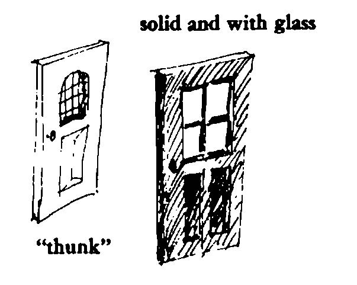

<section class="pattern-plate" aria-labelledby="t-solid-doors-with-glass">
<a href="/patterns">A Pattern Language</a> · <a href="/patterns#construction">Construction</a> · Pattern 237 · p. 1103
<h1 class="pattern-title" id="t-solid-doors-with-glass">Solid Doors With Glass</h1><nav class="pattern-links" aria-label="Connections"><h2>Links to</h2><ul><li><a href="/patterns/tapestry-of-light-and-dark">135 Tapestry Of Light And Dark</a></li><li><a href="/patterns/interior-windows">194 Interior Windows</a></li><li><a href="/patterns/corner-doors">196 Corner Doors</a></li><li><a href="/patterns/wall-membrane">218 Wall Membrane</a></li><li><a href="/patterns/low-doorway">224 Low Doorway</a></li><li><a href="/patterns/small-panes">239 Small Panes</a></li></ul><h2>Linked from</h2><ul><li><a href="/patterns/building-thoroughfare">101 Building Thoroughfare</a></li><li><a href="/patterns/entrance-room">130 Entrance Room</a></li><li><a href="/patterns/short-passages">132 Short Passages</a></li><li><a href="/patterns/corner-doors">196 Corner Doors</a></li><li><a href="/patterns/low-doorway">224 Low Doorway</a></li><li><a href="/patterns/frames-as-thickened-edges">225 Frames As Thickened Edges</a></li><li><a href="/patterns/roof-caps">232 Roof Caps</a></li><li><a href="/patterns/small-panes">239 Small Panes</a></li></ul></nav></section><article class="pattern-text" aria-label="The text of Solid Doors With Glass">
… this pattern finishes the doors defined by <a class="pl-ref" href="/patterns/corner-doors">CORNER DOORS (196)</a> and <a class="pl-ref" href="/patterns/low-doorway">LOW DOORWAY (224)</a>. It also helps to finish <a class="pl-ref" href="/patterns/tapestry-of-light-and-dark">TAPESTRY OF LIGHT AND DARK (135)</a> and <a class="pl-ref" href="/patterns/interior-windows">INTERIOR WINDOWS (194)</a>, since it requires glazing in the doors, and can help to create daylight in the darker parts of indoor places.

◆ ◆ ◆

<strong>An opaque door makes sense in a vast house or palace, where every room is large enough to be a world unto itself; but in a small building, with small rooms, the opaque door is only very rarely useful.</strong>

What is needed is a kind of door which gives some sense of visual connection together with the possibility of acoustic isolation: a door which you can see through but can’t hear through.

Glazed doors have been traditional in certain periods—they are beautiful, and enlarge the sense of connection and make the life in the house one, but still leave people the possibility of privacy they need. A glazed door allows for a more graceful entrance into a room and for a more graceful reception by people in the room, because it allows both parties to get ready for each other. It also allows for different degrees of privacy: You can leave the door open, or you can shut it for acoustical privacy but maintain the visual connection; or you can curtain the window for visual and acoustic privacy. And, most important, it gives the feeling that everyone in the building is connected—not isolated in private rooms.

Therefore:

<strong>As often as possible build doors with glazing in them, so that the upper half at least, allows you to see through them. At the same time, build the doors solid enough, so 1104that they give acoustic isolation and make a comfortable “thunk” when they are closed.</strong>

<figure class="pl-figure"></figure>
◆ ◆ ◆

Glaze the door with small panes of glass—<a class="pl-ref" href="/patterns/small-panes">SMALL PANES (239)</a>; and make the doors more solid, by building them like <a class="pl-ref" href="/patterns/wall-membrane">WALL MEMBRANES (218)</a>….
</article>

Christopher Alexander, Sara Ishikawa and Murray Silverstein, with Max Jacobson, Ingrid Fiksdahl-King and Shlomo Angel, <cite>A Pattern Language</cite> (Oxford University Press, 1977), pattern 237, pp. 1103–1104. Text and illustrations from the <a href="https://github.com/natureoforder/sources">Nature of Order sources</a> reading edition, transcribed from the 1977 printing; report errors on <a href="https://github.com/natureoforder/alexander-wiki/issues">GitHub</a>.

<a href="/patterns/windows-which-open-wide">← 236 Windows Which Open Wide</a> · <a href="/patterns">All 253 patterns</a> · <a href="/patterns/filtered-light">238 Filtered Light →</a>

