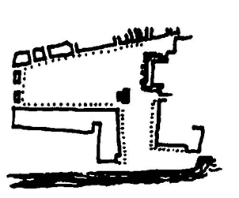
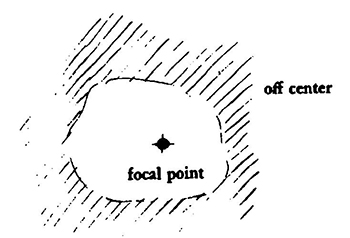

<section class="pattern-plate" aria-labelledby="t-something-roughly-in-the-middle">
<a href="/patterns">A Pattern Language</a> · <a href="/patterns#buildings">Buildings</a> · Pattern 126 · p. 606
<h1 class="pattern-title" id="t-something-roughly-in-the-middle">Something Roughly In The Middle</h1><nav class="pattern-links" aria-label="Connections"><h2>Links to</h2><ul><li><a href="/patterns/high-places">62 High Places</a></li><li><a href="/patterns/dancing-in-the-street">63 Dancing In The Street</a></li><li><a href="/patterns/pools-and-streams">64 Pools And Streams</a></li><li><a href="/patterns/common-land">67 Common Land</a></li><li><a href="/patterns/public-outdoor-room">69 Public Outdoor Room</a></li><li><a href="/patterns/still-water">71 Still Water</a></li><li><a href="/patterns/hierarchy-of-open-space">114 Hierarchy Of Open Space</a></li><li><a href="/patterns/courtyards-which-live">115 Courtyards Which Live</a></li><li><a href="/patterns/paths-and-goals">120 Paths And Goals</a></li><li><a href="/patterns/path-shape">121 Path Shape</a></li><li><a href="/patterns/activity-pockets">124 Activity Pockets</a></li><li><a href="/patterns/stair-seats">125 Stair Seats</a></li><li><a href="/patterns/intimacy-gradient">127 Intimacy Gradient</a></li><li><a href="/patterns/indoor-sunlight">128 Indoor Sunlight</a></li><li><a href="/patterns/common-areas-at-the-heart">129 Common Areas At The Heart</a></li><li><a href="/patterns/entrance-room">130 Entrance Room</a></li><li><a href="/patterns/the-flow-through-rooms">131 The Flow Through Rooms</a></li><li><a href="/patterns/short-passages">132 Short Passages</a></li><li><a href="/patterns/staircase-as-a-stage">133 Staircase As A Stage</a></li><li><a href="/patterns/zen-view">134 Zen View</a></li><li><a href="/patterns/tapestry-of-light-and-dark">135 Tapestry Of Light And Dark</a></li><li><a href="/patterns/tree-places">171 Tree Places</a></li><li><a href="/patterns/sitting-wall">243 Sitting Wall</a></li></ul><h2>Linked from</h2><ul><li><a href="/patterns/small-public-squares">61 Small Public Squares</a></li><li><a href="/patterns/courtyards-which-live">115 Courtyards Which Live</a></li><li><a href="/patterns/roof-garden">118 Roof Garden</a></li><li><a href="/patterns/paths-and-goals">120 Paths And Goals</a></li></ul></nav></section><article class="pattern-text" aria-label="The text of Something Roughly In The Middle">
… SMALL PUBLIC SQUARES (6l), <a class="pl-ref" href="/patterns/common-land">COMMON LAND (67)</a>, <a class="pl-ref" href="/patterns/courtyards-which-live">COURTYARDS WHICH LIVE (115)</a>, <a class="pl-ref" href="/patterns/path-shape">PATH SHAPE (121)</a> all draw their life from the activities around their edges—<a class="pl-ref" href="/patterns/activity-pockets">ACTIVITY POCKETS (124)</a> and <a class="pl-ref" href="/patterns/stair-seats">STAIR SEATS (125)</a>. But even then, the middle is still empty, and it needs embellishment.

◆ ◆ ◆

<strong>A public space without a middle is quite likely to stay empty.</strong>

We have discussed the fact that people tend to take up positions from which they are protected, partly, at their backs—<a class="pl-ref" href="/patterns/hierarchy-of-open-space">HIERARCHY OF OPEN SPACE (114)</a>, and the way this fact tends to make the action grow around the edge of public squares—<a class="pl-ref" href="/patterns/activity-pockets">ACTIVITY POCKETS (124)</a>, <a class="pl-ref" href="/patterns/stair-seats">STAIR SEATS (125)</a>. If the space is a tiny one, there is no need for anything beyond an edge. But if there is a reasonable area in the middle, intended for public use, it will be wasted unless there are trees, monuments, seats, fountains—a place where people can protect their backs, as easily as they can around the edge. This reason for setting something roughly in the middle of a square is obvious and practical. But perhaps there is an even more primitive instinct at work.

Imagine a bare table in your house. Think of the power of the instinct which tells you to put a candle or a bowl of flowers in the middle. And think of the power of the effect once you have done it. Obviously, it is an act of great significance; yet clearly it has nothing to do with activities at the edge or in the center.

Apparently the effect is purely geometrical. Perhaps it is the sheer fact that the space of the table is given a center, and the point at the center then organizes the space around it, and makes it clear, and puts it roughly at rest. The same thing happens in a courtyard or a public square. It is perhaps related to the man607dala instinct, which finds in any centrally symmetric figure a powerful receptacle for dreams and images and for conjugations of the self.

We believe that this instinct is at work in every courtyard and every square. Even in the Piazza San Marco, one of the few squares without an obvious center piece, the campanile juts out and creates an off beat center to the two plazas together.

<figure class="pl-figure"><figcaption><em>The campanile forms a rough center to the two piazzas</em>.</figcaption></figure>

Camillo Sitte, the great Italian planner, describes the evolution of such focal points and their functional significance in his book <em>City Planning According to Artistic Principles</em> (New York: Random House, 1965, pp. 20–31). But interestingly, he claims that the impulse to center something <em>perfectly</em> in a square is an “affliction” of modern times.

Imagine the open square of a small market town in the country, covered with deep snow and criss-crossed by several roads and paths that, shaped by the traffic, form the natural lines of communication. Between them are left irregularly distributed patches untouched by traffic….

On exactly such spots, undisturbed by the flow of vehicles, rose the fountains and monuments of old communities….

Therefore:

<strong>Between the natural paths which cross a public square or courtyard or a piece of common land choose something to stand roughly in the middle: a fountain, a tree, a statue, a clock-tower with seats, a windmill, a bandstand. Make 608it something which gives a strong and steady pulse to the square, drawing people in toward the center. Leave it exactly where it falls between the paths; resist the impulse to put it exactly in the middle.</strong>

<figure class="pl-figure"></figure>
◆ ◆ ◆

Connect the different “somethings” to one another with the path system—<a class="pl-ref" href="/patterns/paths-and-goals">PATHS AND COALS (120)</a>. They may include <a class="pl-ref" href="/patterns/high-places">HIGH PLACES (62)</a>, <a class="pl-ref" href="/patterns/dancing-in-the-street">DANCING IN THE STREETS (63)</a>, <a class="pl-ref" href="/patterns/pools-and-streams">POOLS AND STREAMS (64)</a>, <a class="pl-ref" href="/patterns/public-outdoor-room">PUBLIC OUTDOOR ROOM (69)</a>, <a class="pl-ref" href="/patterns/still-water">STILL WATER (71)</a>, <a class="pl-ref" href="/patterns/tree-places">TREE PLACES (171)</a>; make sure that each one has a <a class="pl-ref" href="/patterns/sitting-wall">SITTING WALL (243)</a> around it. . . .

609<em>Now, with the paths fixed, we come back to the building: Within the various wings of any one building, work out the fundamental gradients of space, and decide how the movement will connect the spaces in the gradients;</em>

<a class="pl-ref" href="/patterns/intimacy-gradient">127. INTIMACY GRADIENT</a>

<a class="pl-ref" href="/patterns/indoor-sunlight">128. INDOOR SUNLIGHT</a>

<a class="pl-ref" href="/patterns/common-areas-at-the-heart">129. COMMON AREAS AT THE HEART</a>

<a class="pl-ref" href="/patterns/entrance-room">130. ENTRANCE ROOM</a>

<a class="pl-ref" href="/patterns/the-flow-through-rooms">131. THE FLOW THROUGH ROOMS</a>

<a class="pl-ref" href="/patterns/short-passages">132. SHORT PASSAGES</a>

<a class="pl-ref" href="/patterns/staircase-as-a-stage">133. STAIRCASE AS A STAGE</a>

<a class="pl-ref" href="/patterns/zen-view">134. ZEN VIEW</a>

<a class="pl-ref" href="/patterns/tapestry-of-light-and-dark">135. TAPESTRY OF LIGHT AND DARK</a>
</article>

Christopher Alexander, Sara Ishikawa and Murray Silverstein, with Max Jacobson, Ingrid Fiksdahl-King and Shlomo Angel, <cite>A Pattern Language</cite> (Oxford University Press, 1977), pattern 126, pp. 606–609. Text and illustrations from the <a href="https://github.com/natureoforder/sources">Nature of Order sources</a> reading edition, transcribed from the 1977 printing; report errors on <a href="https://github.com/natureoforder/alexander-wiki/issues">GitHub</a>.

<a href="/patterns/stair-seats">← 125 Stair Seats</a> · <a href="/patterns">All 253 patterns</a> · <a href="/patterns/intimacy-gradient">127 Intimacy Gradient →</a>

