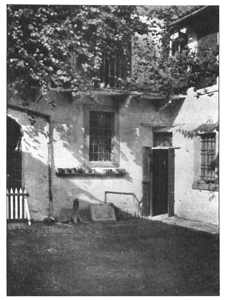
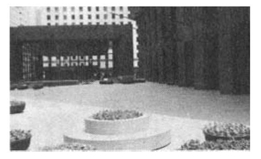
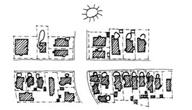
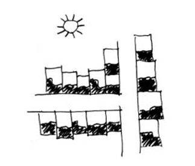
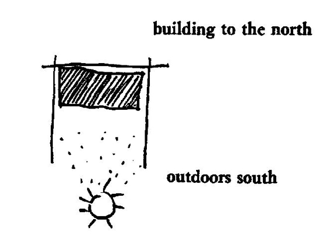

<section class="pattern-plate" aria-labelledby="t-south-facing-outdoors">
<a href="/patterns">A Pattern Language</a> · <a href="/patterns#buildings">Buildings</a> · Pattern 105 · p. 513 · **
<h1 class="pattern-title" id="t-south-facing-outdoors">South Facing Outdoors</h1><figure class="pattern-figure pl-figure"></figure><nav class="pattern-links" aria-label="Connections"><h2>Links to</h2><ul><li><a href="/patterns/site-repair">104 Site Repair</a></li><li><a href="/patterns/positive-outdoor-space">106 Positive Outdoor Space</a></li><li><a href="/patterns/wings-of-light">107 Wings Of Light</a></li><li><a href="/patterns/half-hidden-garden">111 Half-Hidden Garden</a></li><li><a href="/patterns/indoor-sunlight">128 Indoor Sunlight</a></li><li><a href="/patterns/sunny-place">161 Sunny Place</a></li><li><a href="/patterns/north-face">162 North Face</a></li></ul><h2>Linked from</h2><ul><li><a href="/patterns/building-complex">95 Building Complex</a></li><li><a href="/patterns/number-of-stories">96 Number Of Stories</a></li><li><a href="/patterns/small-parking-lots">103 Small Parking Lots</a></li><li><a href="/patterns/site-repair">104 Site Repair</a></li><li><a href="/patterns/positive-outdoor-space">106 Positive Outdoor Space</a></li><li><a href="/patterns/wings-of-light">107 Wings Of Light</a></li><li><a href="/patterns/main-entrance">110 Main Entrance</a></li><li><a href="/patterns/half-hidden-garden">111 Half-Hidden Garden</a></li><li><a href="/patterns/hierarchy-of-open-space">114 Hierarchy Of Open Space</a></li><li><a href="/patterns/indoor-sunlight">128 Indoor Sunlight</a></li><li><a href="/patterns/sunny-place">161 Sunny Place</a></li><li><a href="/patterns/north-face">162 North Face</a></li></ul></nav></section><article class="pattern-text" aria-label="The text of South Facing Outdoors">
514… within the general ideas of location which <a class="pl-ref" href="/patterns/site-repair">site REPAIR (104)</a> creates, this pattern governs the fundamental placing of the building and the open space around it with respect to sun.

◆ ◆ ◆

<strong>People use open space if it is sunny, and do not use it if it isn’t, in all but desert climates.</strong>

This is perhaps the most important single fact about a building. If the building is placed right, the building and its gardens will be happy places full of activity and laughter. If it is done wrong, then all the attention in the world, and the most beautiful details, will not prevent it from being a silent gloomy place. Thousands of acres of open space in every city are wasted because they are north of buildings and never get the sun. This is true for public buildings, and it is true for private houses. The recently built Bank of America building in San Francisco—a giant building built by a major firm of architects—has its plaza on the north side. At lunchtime, the plaza is empty, and people eat their sandwiches in the street, on the south side where the sun is.

<figure class="pl-figure"><figcaption><em>North facing outdoors</em>.</figcaption></figure>

Just so for small private houses. The shape and orientation of lots common in most developments force houses to be surrounded by open space which no one will ever use because it isn’t in the sun.

A survey of a residential block in Berkeley, California, confirms this problem dramatically. Along Webster Street—an east west street—18 of 20 persons interviewed said they used only the sunny part of their yards. Half of these were people living on 515the north side of the street—<em>these people did not use their backyards at all</em>, but would sit in the front yard, beside the sidewalk, to be in the south sun. The north-facing back yards were used primarily for storing junk. Not one of the persons interviewed indicated preference for a shady yard.

<figure class="pl-figure"><figcaption><em>Favorite outdoor places to the south</em>.</figcaption></figure>

The survey also gave credence to the idea that sunny areas won’t be used if there is a deep band of shade up against the house, through which you must pass to get to the sun. Four north facing backyards were large enough to be sunny toward the rear. In only one of these yards was the sunny area reported as being used—in just the one where it was possible to get to the sun without passing through a deep band of shade.

Although the idea of south-facing open space is simple, it has great consequences, and there will have to be major changes in land use to make it come right. For example, residential neighborhoods would have to be organized quite differently from the way they are laid out today. Private lots would have to be longer north to south, with the houses on the north side.

<figure class="pl-figure"><figcaption><em>Blocks reorganized to catch the sun</em>.</figcaption></figure>

516Note that this pattern was developed in the San Francisco Bay Area. Of course, its significance varies as latitude and climate change. In Eugene, Oregon, for example, with a rather rainy climate, at about 50° latitude, the pattern is even more essential: the south faces of the buildings are the most valuable outdoor spaces on sunny days. In desert climates, the pattern is less important; people will want to stay in outdoor spaces that have a balance of sun and shade. But remember that in one way or another, this pattern is absolutely fundamental.

Therefore:

<strong>Always place buildings to the north of the outdoor spaces that go with them, and keep the outdoor spaces to the south. Never leave a deep band of shade between the building and the sunny part of the outdoors.</strong>

<figure class="pl-figure"></figure>
◆ ◆ ◆

Let <a class="pl-ref" href="/patterns/half-hidden-garden">HALF-HIDDEN GARDEN (111)</a> influence the position of the outdoors too. Make the outdoor spaces positive—<a class="pl-ref" href="/patterns/positive-outdoor-space">POSITIVE OUTDOOR SPACE (106)</a>—and break the building into narrow wings—<a class="pl-ref" href="/patterns/wings-of-light">WINGS OF LIGHT (107)</a>. Keep the most important rooms to the south of these wings—<a class="pl-ref" href="/patterns/indoor-sunlight">INDOOR SUNLIGHT (128)</a>; and keep storage, parking, etc, to the north—<a class="pl-ref" href="/patterns/north-face">NORTH FACE (162)</a>. When the building is more developed, you can concentrate on the special sunny areas where the outdoors and building meet, and make definite places there, where people can sit in the sun—<a class="pl-ref" href="/patterns/sunny-place">SUNNY PLACE (161)</a>….
</article>

Christopher Alexander, Sara Ishikawa and Murray Silverstein, with Max Jacobson, Ingrid Fiksdahl-King and Shlomo Angel, <cite>A Pattern Language</cite> (Oxford University Press, 1977), pattern 105, pp. 513–516. Text and illustrations from the <a href="https://github.com/natureoforder/sources">Nature of Order sources</a> reading edition, transcribed from the 1977 printing; report errors on <a href="https://github.com/natureoforder/alexander-wiki/issues">GitHub</a>.

<a href="/patterns/site-repair">← 104 Site Repair</a> · <a href="/patterns">All 253 patterns</a> · <a href="/patterns/positive-outdoor-space">106 Positive Outdoor Space →</a>

