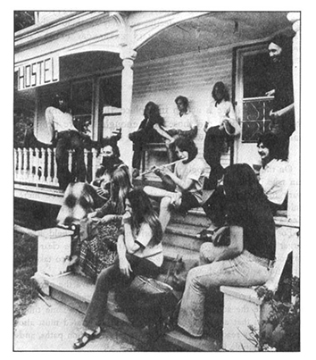
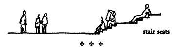

<section class="pattern-plate" aria-labelledby="t-stair-seats">
<a href="/patterns">A Pattern Language</a> · <a href="/patterns#buildings">Buildings</a> · Pattern 125 · p. 603 · *
<h1 class="pattern-title" id="t-stair-seats">Stair Seats</h1><figure class="pattern-figure pl-figure"></figure><nav class="pattern-links" aria-label="Connections"><h2>Links to</h2><ul><li><a href="/patterns/small-public-squares">61 Small Public Squares</a></li><li><a href="/patterns/main-entrance">110 Main Entrance</a></li><li><a href="/patterns/path-shape">121 Path Shape</a></li><li><a href="/patterns/open-stairs">158 Open Stairs</a></li><li><a href="/patterns/connection-to-the-earth">168 Connection To The Earth</a></li><li><a href="/patterns/seat-spots">241 Seat Spots</a></li><li><a href="/patterns/soft-tile-and-brick">248 Soft Tile And Brick</a></li></ul><h2>Linked from</h2><ul><li><a href="/patterns/small-public-squares">61 Small Public Squares</a></li><li><a href="/patterns/street-cafe">88 Street Cafe</a></li><li><a href="/patterns/roof-garden">118 Roof Garden</a></li><li><a href="/patterns/path-shape">121 Path Shape</a></li><li><a href="/patterns/building-fronts">122 Building Fronts</a></li><li><a href="/patterns/pedestrian-density">123 Pedestrian Density</a></li><li><a href="/patterns/something-roughly-in-the-middle">126 Something Roughly In The Middle</a></li><li><a href="/patterns/staircase-as-a-stage">133 Staircase As A Stage</a></li><li><a href="/patterns/open-stairs">158 Open Stairs</a></li><li><a href="/patterns/building-edge">160 Building Edge</a></li><li><a href="/patterns/staircase-volume">195 Staircase Volume</a></li><li><a href="/patterns/seat-spots">241 Seat Spots</a></li><li><a href="/patterns/raised-flowers">245 Raised Flowers</a></li></ul></nav></section><article class="pattern-text" aria-label="The text of Stair Seats">
604… we know that paths and larger public gathering places need a definiteshape and a degree of enclosure, with people looking into them,not out of them—<a class="pl-ref" href="/patterns/small-public-squares">SMALL PUBLIC SQUARES (61)</a>, POSITIVE OUTDOOR SPACE (l06), <a class="pl-ref" href="/patterns/path-shape">PATH SHAPE (121)</a>. Stairs around the edge do it just perfectly; and they also help embellish FAMILY OF ENTRANCES (l02),<a class="pl-ref" href="/patterns/main-entrance">MAIN ENTRANCES (110)</a>, and <a class="pl-ref" href="/patterns/open-stairs">OPEN STAIRS (158)</a>.

◆ ◆ ◆

<strong>Wherever there is action in a place, the spots which are the most inviting, are those high enough to give people a vantage point, and low enough to put them in action.</strong>

On the one hand, people seek a vantage point from which they can take in the action as a whole. On the other hand, they still want to be part of the action; they do not want to be mere onlookers. Unless a public space provides for both these tendencies, a lot of people simply will not stay there.

For a person looking at the horizon, the visual field is far larger below the horizon than above it. It is therefore clear that anybody who is “people-watching” will naturally try to take up a position a few feet above the action.

The trouble is that this position will usually have the effect of removing a person from the action. Yet most people want to be able to take the action in and to be part of it at the same time. This means that any places which are slightly elevated must also be within easy reach of passers-by, hence on circulation paths, and directly accessible from below.

The bottom few steps of stairs, and the balusters and rails along stairs, are precisely the kinds of places which resolve these tendencies. People sit on the edges of the lower steps, if they are wide enough and inviting, and they lean against the rails.

There is a simple kind of evidence, both for the reality of the forces described here and for the value of the pattern. When there are areas in public places which are both slightly raised and very accessible, people naturally gravitate toward them. 605Stepped cafe terraces, steps surrounding public plazas, stepped porches, stepped statues and seats, are all examples.

Therefore:

<strong>In any public place where people loiter, add a few steps at the edge where stain come down or where there is a change of level Make these raised areas immediately accessible from below, so that people may congregate and sit to watch the goings-on.</strong>

<figure class="pl-figure"></figure>
Give the stair seats the same orientation as <a class="pl-ref" href="/patterns/seat-spots">SEAT SPOTS (241)</a>. Make the steps out of wood or tile or brick so that they wear with time, and show the marks of feet, and are soft to the touch for people sitting on them—<a class="pl-ref" href="/patterns/soft-tile-and-brick">SOFT TILE AND BRICK (248)</a>; and make the steps connect directly to surrounding buildings—<a class="pl-ref" href="/patterns/connection-to-the-earth">CONNECTION TO THE EARTH (168)</a>….
</article>

Christopher Alexander, Sara Ishikawa and Murray Silverstein, with Max Jacobson, Ingrid Fiksdahl-King and Shlomo Angel, <cite>A Pattern Language</cite> (Oxford University Press, 1977), pattern 125, pp. 603–605. Text and illustrations from the <a href="https://github.com/natureoforder/sources">Nature of Order sources</a> reading edition, transcribed from the 1977 printing; report errors on <a href="https://github.com/natureoforder/alexander-wiki/issues">GitHub</a>.

<a href="/patterns/activity-pockets">← 124 Activity Pockets</a> · <a href="/patterns">All 253 patterns</a> · <a href="/patterns/something-roughly-in-the-middle">126 Something Roughly In The Middle →</a>

