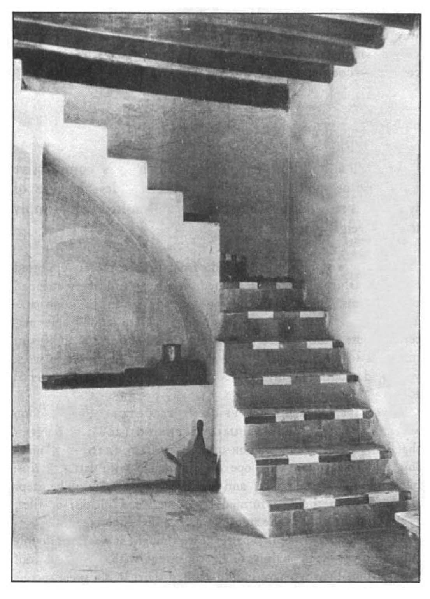
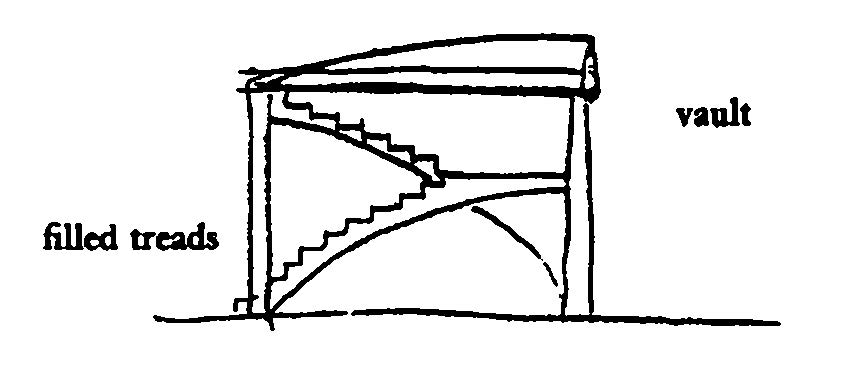

<section class="pattern-plate" aria-labelledby="t-stair-vault">
<a href="/patterns">A Pattern Language</a> · <a href="/patterns#construction">Construction</a> · Pattern 228 · p. 1073 · *
<h1 class="pattern-title" id="t-stair-vault">Stair Vault</h1><figure class="pattern-figure pl-figure"></figure><nav class="pattern-links" aria-label="Connections"><h2>Links to</h2><ul><li><a href="/patterns/staircase-as-a-stage">133 Staircase As A Stage</a></li><li><a href="/patterns/alcoves">179 Alcoves</a></li><li><a href="/patterns/staircase-volume">195 Staircase Volume</a></li><li><a href="/patterns/closets-between-rooms">198 Closets Between Rooms</a></li><li><a href="/patterns/child-caves">203 Child Caves</a></li><li><a href="/patterns/efficient-structure">206 Efficient Structure</a></li><li><a href="/patterns/good-materials">207 Good Materials</a></li><li><a href="/patterns/gradual-stiffening">208 Gradual Stiffening</a></li><li><a href="/patterns/floor-ceiling-vaults">219 Floor-Ceiling Vaults</a></li><li><a href="/patterns/floor-surface">233 Floor Surface</a></li><li><a href="/patterns/soft-tile-and-brick">248 Soft Tile And Brick</a></li></ul><h2>Linked from</h2><ul><li><a href="/patterns/staircase-volume">195 Staircase Volume</a></li><li><a href="/patterns/frames-as-thickened-edges">225 Frames As Thickened Edges</a></li></ul></nav></section><article class="pattern-text" aria-label="The text of Stair Vault">
1074… this pattern helps complete the rough shape and location of stairs given by <a class="pl-ref" href="/patterns/staircase-as-a-stage">STAIRCASE AS A STACE (133)</a> and by <a class="pl-ref" href="/patterns/staircase-volume">STAIRCASE VOLUME (195)</a>. If you want to build a conventional stair, you can find what you need in any handbook. But how to build a stair in a way which is consistent with the compressive structure of <a class="pl-ref" href="/patterns/efficient-structure">EFFICIENT STRUCTURE (206)</a>, without using wood or steel or concrete—<a class="pl-ref" href="/patterns/good-materials">GOOD MATERIALS (207)</a> ?

◆ ◆ ◆

<strong>Within a building technology which uses compressive materials as much as possible, and excludes the use of wood, it is natural to build stairs over a vaulted void, simply to save weight and materials.</strong>

A concrete stair is usually made from precast pieces supported by steel stringers; or it is formed in place, and then stripped of its forms. But for the reasons already given in <a class="pl-ref" href="/patterns/good-materials">GOOD MATERIALS (207)</a>, precast concrete and steel are undesirable materials to use—they call for modular planning; they are unpleasant materials to touch, look at, and walk on; they are hard to work with and modify in any relaxed way, since they call for special tools.

Given the principles of <a class="pl-ref" href="/patterns/efficient-structure">EFFICIENT STRUCTURE (206)</a>, <a class="pl-ref" href="/patterns/good-materials">GOOD MATERIALS (207)</a>, and <a class="pl-ref" href="/patterns/gradual-stiffening">GRADUAL STIFFENING (208)</a>, we suggest that stairs be made like <a class="pl-ref" href="/patterns/floor-ceiling-vaults">FLOOR-CEILING VAULTS (219)</a>—by making a half-vault (to the slope of the stair), with lattice strips, burlap, resin, chickenwire, and lightweight concrete. The steps themselves can then be formed by using wood planks, or tiles, as risen, and filling in the steps with trowelled concrete.

When we fint wrote this pattern, we thought it was very doubtful—and put it in mainly to be consistent with floor and roof vaults. Since then we have built a vaulted stair. It is a great success—beautiful—and we recommend it heartily.

Therefore:

<strong>Build a curved diagonal vault in the fame way that you 1075build your <a class="pl-ref" href="/patterns/floor-ceiling-vaults">FLOOR-CEILING VAULTS (219)</a>. Once the vault hardens, cover it with steps of lightweight concrete, trowel-formed into position.</strong>

<figure class="pl-figure"></figure>
◆ ◆ ◆

A lightweight concrete tread, colored, waxed, and polished can be quite beautiful and soft enough to be comfortable—see <a class="pl-ref" href="/patterns/floor-surface">FLOOR SURFACE (233)</a>—and will eventually take on the patina of wear called for in <a class="pl-ref" href="/patterns/soft-tile-and-brick">SOFT TILE AND BRICK (248)</a>.

The vaulted space under the stair can be used as an <a class="pl-ref" href="/patterns/alcoves">ALCOVE (179)</a> a <a class="pl-ref" href="/patterns/child-caves">CHILD CAVE (203)</a>, or <a class="pl-ref" href="/patterns/closets-between-rooms">CLOSETS BETWEEN ROOMS (198)</a>. If it is plastered, like a regular ceiling—see <a class="pl-ref" href="/patterns/floor-ceiling-vaults">FLOOR-CEILING VAULTS (219)</a>, it makes a much more pleasant and useful space than the space under an ordinary stair.
</article>

Christopher Alexander, Sara Ishikawa and Murray Silverstein, with Max Jacobson, Ingrid Fiksdahl-King and Shlomo Angel, <cite>A Pattern Language</cite> (Oxford University Press, 1977), pattern 228, pp. 1073–1075. Text and illustrations from the <a href="https://github.com/natureoforder/sources">Nature of Order sources</a> reading edition, transcribed from the 1977 printing; report errors on <a href="https://github.com/natureoforder/alexander-wiki/issues">GitHub</a>.

<a href="/patterns/column-connections">← 227 Column Connections</a> · <a href="/patterns">All 253 patterns</a> · <a href="/patterns/duct-space">229 Duct Space →</a>

