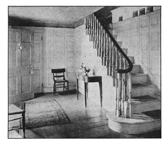
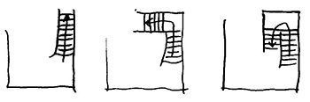
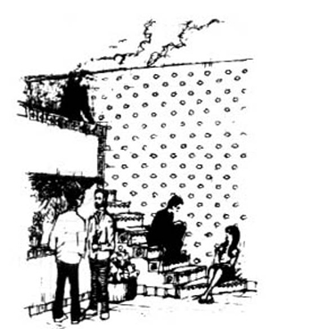
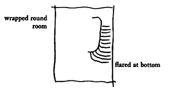

<section class="pattern-plate" aria-labelledby="t-staircase-as-a-stage">
<a href="/patterns">A Pattern Language</a> · <a href="/patterns#buildings">Buildings</a> · Pattern 133 · p. 637
<h1 class="pattern-title" id="t-staircase-as-a-stage">Staircase As A Stage</h1><figure class="pattern-figure pl-figure"></figure><nav class="pattern-links" aria-label="Connections"><h2>Links to</h2><ul><li><a href="/patterns/main-entrance">110 Main Entrance</a></li><li><a href="/patterns/stair-seats">125 Stair Seats</a></li><li><a href="/patterns/common-areas-at-the-heart">129 Common Areas At The Heart</a></li><li><a href="/patterns/entrance-room">130 Entrance Room</a></li><li><a href="/patterns/the-flow-through-rooms">131 The Flow Through Rooms</a></li><li><a href="/patterns/short-passages">132 Short Passages</a></li><li><a href="/patterns/zen-view">134 Zen View</a></li><li><a href="/patterns/tapestry-of-light-and-dark">135 Tapestry Of Light And Dark</a></li><li><a href="/patterns/the-shape-of-indoor-space">191 The Shape Of Indoor Space</a></li><li><a href="/patterns/staircase-volume">195 Staircase Volume</a></li></ul><h2>Linked from</h2><ul><li><a href="/patterns/something-roughly-in-the-middle">126 Something Roughly In The Middle</a></li><li><a href="/patterns/the-flow-through-rooms">131 The Flow Through Rooms</a></li><li><a href="/patterns/zen-view">134 Zen View</a></li><li><a href="/patterns/tapestry-of-light-and-dark">135 Tapestry Of Light And Dark</a></li><li><a href="/patterns/staircase-volume">195 Staircase Volume</a></li><li><a href="/patterns/stair-vault">228 Stair Vault</a></li></ul></nav></section><article class="pattern-text" aria-label="The text of Staircase As A Stage">
638… if the entrances are in position—<a class="pl-ref" href="/patterns/main-entrance">MAIN ENTRANCE (110)</a>; and the pattern of movement through the building is established <a class="pl-ref" href="/patterns/the-flow-through-rooms">THE FLOW THROUGH ROOMS (131)</a>, <a class="pl-ref" href="/patterns/short-passages">SHORT PASSAGES (132)</a> the main stairs must be put in and given an appropriate social character.

◆ ◆ ◆

<strong>A staircase is not just a way of getting from one floor to another. The stair is itself a space, a volume, a part of the building; and unless this space is made to live, it will be a dead spot, and work to disconnect the building and to tear its processes apart.</strong>

Our feelings for the general shape of the stair are based on this conjecture: changes of level play a crucial role at many moments during social gatherings; they provide special places to sit, a place where someone can make a graceful or dramatic entrance, a place from which to speak, a place from which to look at other people while also being seen, a place which increases face to face contact when many people are together.

If this is so, then the stair is one of the few places in a building which is capable of providing for this requirement, since it is almost the only place in a building where a transition between levels occurs naturally.

This suggests that the stair always be made rather open to the room below it, embracing the room, coming down around the outer perimeter of the room, so that the stairs together with the room form a socially connected space. Stairs that are enclosed in stairwells or stairs that are free standing and chop up the space below, do not have this character at all. Bat straight stairs, stairs that follow the contour of the walls below, or stairs that doable back can all be made to work this way.

<figure class="pl-figure"><figcaption><em>Examples of stair rooms</em>.</figcaption></figure>

639Furthermore, the first four or five steps are the places where people are most likely to sit if the stair is working well. To support this fact, make the bottom of the staircase flare out, widen the steps, and make them comfortable to sit on.

<figure class="pl-figure"><figcaption><em>Stair seats</em>.</figcaption></figure>

Finally, we must decide where to place the stair. On the one hand, of course, the stair is the key to movement in a building. It must therefore be visible from the front door; and, in a building with many different rooms upstairs, it must be in a position which commands as many of these rooms as possible, so that it forms a kind of axis people can keep clearly in their minds.

However, if the stair is too near the door, it will be so public that its position will undermine the vital social character we have described. Instead, we suggest that the stair be clear, and central, yes—but in the common area of the building, a little further back from the front door than usual. Not usually in the <a class="pl-ref" href="/patterns/entrance-room">ENTRANCE ROOM (130)</a>, but in the <a class="pl-ref" href="/patterns/common-areas-at-the-heart">COMMON AREA AT THE HEART (129)</a>. Then it will be clear and visible, and also keep its necessary social character.

Therefore:

<strong>Place the main stair in a key position, central and visible. 640Treat the whole staircase as a room (or if it is outside, as a courtyard). Arrange it so that the stair and the room are one, with the stair coming down around one or two walls of the room. Flare out the bottom of the stair with open windows or balustrades and with wide steps so that the people coming down the stair become part of the action in the room while they are on the stair, and so that people below will naturally use the stair for seats.</strong>

<figure class="pl-figure"></figure>
◆ ◆ ◆

Treat the bottom steps as <a class="pl-ref" href="/patterns/stair-seats">STAIR SEATS (125)</a>; provide a window or a view half-way up the stair, both to light the stair and to create a natural focus of attention—<a class="pl-ref" href="/patterns/zen-view">ZEN VIEW (134)</a>, <a class="pl-ref" href="/patterns/tapestry-of-light-and-dark">TAPESTRY OF LIGHT AND DARK (135)</a>; remember to calculate the length and shape of the stair while you are working out its position—<a class="pl-ref" href="/patterns/staircase-volume">STAIRCASE VOLUME (195)</a>. Get the final shape of the staircase room and the beginnings of its construction from <a class="pl-ref" href="/patterns/the-shape-of-indoor-space">THE SHAPE OF INDOOR SPACE (191)</a>….
</article>

Christopher Alexander, Sara Ishikawa and Murray Silverstein, with Max Jacobson, Ingrid Fiksdahl-King and Shlomo Angel, <cite>A Pattern Language</cite> (Oxford University Press, 1977), pattern 133, pp. 637–640. Text and illustrations from the <a href="https://github.com/natureoforder/sources">Nature of Order sources</a> reading edition, transcribed from the 1977 printing; report errors on <a href="https://github.com/natureoforder/alexander-wiki/issues">GitHub</a>.

<a href="/patterns/short-passages">← 132 Short Passages</a> · <a href="/patterns">All 253 patterns</a> · <a href="/patterns/zen-view">134 Zen View →</a>

