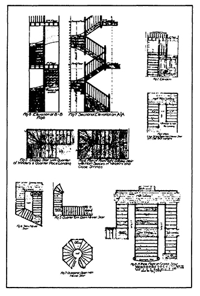
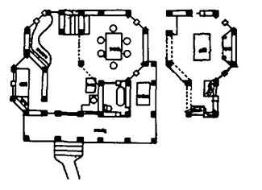
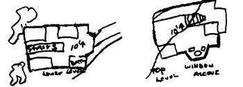
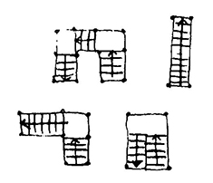
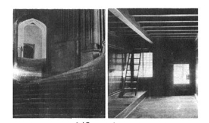
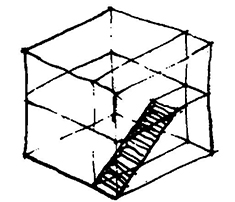

<section class="pattern-plate" aria-labelledby="t-staircase-volume">
<a href="/patterns">A Pattern Language</a> · <a href="/patterns#buildings">Buildings</a> · Pattern 195 · p. 900 · *
<h1 class="pattern-title" id="t-staircase-volume">Staircase Volume</h1><figure class="pattern-figure pl-figure"></figure><nav class="pattern-links" aria-label="Connections"><h2>Links to</h2><ul><li><a href="/patterns/stair-seats">125 Stair Seats</a></li><li><a href="/patterns/staircase-as-a-stage">133 Staircase As A Stage</a></li><li><a href="/patterns/open-stairs">158 Open Stairs</a></li><li><a href="/patterns/child-caves">203 Child Caves</a></li><li><a href="/patterns/columns-at-the-corners">212 Columns At The Corners</a></li><li><a href="/patterns/stair-vault">228 Stair Vault</a></li></ul><h2>Linked from</h2><ul><li><a href="/patterns/staircase-as-a-stage">133 Staircase As A Stage</a></li><li><a href="/patterns/open-stairs">158 Open Stairs</a></li><li><a href="/patterns/dressing-rooms">189 Dressing Rooms</a></li><li><a href="/patterns/stair-vault">228 Stair Vault</a></li></ul></nav></section><article class="pattern-text" aria-label="The text of Staircase Volume">
901… <a class="pl-ref" href="/patterns/staircase-as-a-stage">STAIRCASE AS A STAGE (133)</a> and <a class="pl-ref" href="/patterns/open-stairs">OPEN STAIRS (158)</a> will tell you roughly where to place the various stairs, both indoors and outdoors. This pattern gives each stair exact dimensions and treats it like a room so that it becomes realistic in the plan.

◆ ◆ ◆

<strong>We arc putting this pattern in the language because our experiments have shown us that lay people often make mistakes about the volume which a staircase needs and therefore make their plans unbuildable.</strong>

Here are some examples of the stairs which people who are not used to building, draw, or think of, when they try to lay out houses for themselves.

<figure class="pl-figure"><figcaption><em>Staircase problems—too thort</em></figcaption></figure>
<figure class="pl-figure"><figcaption><em>… no upstairs volume</em>.</figcaption></figure>

Obviously, these stairs will not work; and the misunderstandings of the nature of the stair are so basic, that it is hard to correct 902these plans without destroying them. In order to put in a realistic stair, it would be necessary to rethink the plan entirely. To avoid this kind of mental backtracking, it is essential that stairs be more or less realistic <em>from the very start</em>.

The simplest way to understand a stair is this. <em>Every staircase occupies a volume, Itco stories high</em>. If this volume is the right shape, and large enough to give the stair its rise, then it will be possible to fill it later, with a stair which works.

<figure class="pl-figure"><figcaption><em>Two-story space</em>.</figcaption></figure>

There are several possible layouts for this volume: any one of them will work, provided that the length of run is long enough for the slope of the stair, and the floor to floor height. We urge you to be as free as possible when you decide the slope of the stair. Unfortunately, the search for perfect safety in housing laws, insurance standards, and bank policies, has exaggerated the standardisation of slopes. For example, Federal Housing Authority regulations specify that stairs should be between 30 and 35 degrees in slope. But in some cases—a very small house, a stair to the roof—such a shallow stair is a waste of space; a steep stair is far more appropriate. And in other cases—a main stair in a public building, or an outdoor stair—a much shallower stair is more generous, and more appropriate.

<figure class="pl-figure"><figcaption><em>Different slopes</em>.</figcaption></figure>

903Therefore:

<strong>Make a two story volume to contain the stairs. It may be straight, L-shaped, U-shaped, or C-shaped. The stair may be 2 feet wide (for a very steep stair) or 5 feet wide for a generous shallow stair. But, in all cases, the entire stairwell must form one complete structural bay, two stories high.</strong>

<strong>Do not assume that all stairs have to have the “standard” angle of 30 degrees. The steepest stair may almost be a ladder. The most generous stair can be as shallow as a ramp and quite wide. As you work out the exact slope of your stair, bear in mind the relationship: riser + tread = 17 1/2 inches. .</strong>

<figure class="pl-figure"></figure>
◆ ◆ ◆

Construct the staircase as a vault, within a space defined by columns, just like every other room—<a class="pl-ref" href="/patterns/columns-at-the-corners">COLUMNS AT THE CORNERS (212)</a>, <a class="pl-ref" href="/patterns/stair-vault">STAIR VAULT (228)</a>. And make the most of the staircase; underneath it is a place where the children can play and hide—<a class="pl-ref" href="/patterns/child-caves">CHILD CAVES (203)</a>; and it is a place to sit and talk—<a class="pl-ref" href="/patterns/stair-seats">STAIR SEATS (125)</a>….
</article>

Christopher Alexander, Sara Ishikawa and Murray Silverstein, with Max Jacobson, Ingrid Fiksdahl-King and Shlomo Angel, <cite>A Pattern Language</cite> (Oxford University Press, 1977), pattern 195, pp. 900–903. Text and illustrations from the <a href="https://github.com/natureoforder/sources">Nature of Order sources</a> reading edition, transcribed from the 1977 printing; report errors on <a href="https://github.com/natureoforder/alexander-wiki/issues">GitHub</a>.

<a href="/patterns/interior-windows">← 194 Interior Windows</a> · <a href="/patterns">All 253 patterns</a> · <a href="/patterns/corner-doors">196 Corner Doors →</a>

