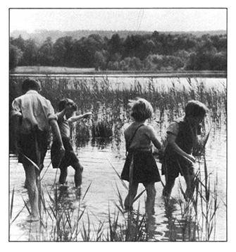
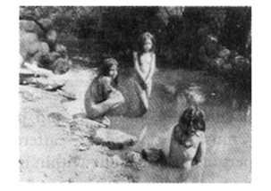
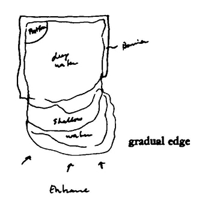

<section class="pattern-plate" aria-labelledby="t-still-water">
<a href="/patterns">A Pattern Language</a> · <a href="/patterns#towns">Towns</a> · Pattern 71 · p. 358 · *
<h1 class="pattern-title" id="t-still-water">Still Water</h1><figure class="pattern-figure pl-figure"></figure><nav class="pattern-links" aria-label="Connections"><h2>Links to</h2><ul><li><a href="/patterns/access-to-water">25 Access To Water</a></li><li><a href="/patterns/house-cluster">37 House Cluster</a></li><li><a href="/patterns/work-community">41 Work Community</a></li><li><a href="/patterns/health-center">47 Health Center</a></li><li><a href="/patterns/pools-and-streams">64 Pools And Streams</a></li><li><a href="/patterns/common-land">67 Common Land</a></li><li><a href="/patterns/local-sports">72 Local Sports</a></li><li><a href="/patterns/trellised-walk">174 Trellised Walk</a></li><li><a href="/patterns/sitting-wall">243 Sitting Wall</a></li></ul><h2>Linked from</h2><ul><li><a href="/patterns/subculture-boundary">13 Subculture Boundary</a></li><li><a href="/patterns/eccentric-nucleus">28 Eccentric Nucleus</a></li><li><a href="/patterns/quiet-backs">59 Quiet Backs</a></li><li><a href="/patterns/holy-ground">66 Holy Ground</a></li><li><a href="/patterns/something-roughly-in-the-middle">126 Something Roughly In The Middle</a></li><li><a href="/patterns/bathing-room">144 Bathing Room</a></li><li><a href="/patterns/a-place-to-wait">150 A Place To Wait</a></li><li><a href="/patterns/garden-growing-wild">172 Garden Growing Wild</a></li></ul></nav></section><article class="pattern-text" aria-label="The text of Still Water">
359… the patterns <a class="pl-ref" href="/patterns/access-to-water">access to water (25)</a> and <a class="pl-ref" href="/patterns/pools-and-streams">pools and streams (64)</a> provide a variety of kinds of water throughout the community. This pattern helps to embellish the still waters—the pools and ponds and swimming holes—and provide them with a safe edge for children. It also helps to differentiate the public space in <a class="pl-ref" href="/patterns/house-cluster">house cluster (37)</a>, <a class="pl-ref" href="/patterns/work-community">work community (41)</a>, <a class="pl-ref" href="/patterns/health-center">health CENTER (47)</a>, <a class="pl-ref" href="/patterns/common-land">COMMON LAND (67)</a>, <a class="pl-ref" href="/patterns/local-sports">LOCAL SPORTS (72)</a>.

◆ ◆ ◆

<strong>To be in touch with water, we must above all be able to swim; and to swim daily, the pools and ponds and holes for swimming must be so widely scattered through the city, that each person can reach one within minutes.</strong>

We have already explained, in <a class="pl-ref" href="/patterns/pools-and-streams">pools and streams (64)</a>, how important it is to be in touch with water—and how the ordinary water of an area can, if left open, be a natural component of the everyday ecology of a community.

In this pattern we go a little further, and put the emphasis on swimming. On the one hand, adults cannot have any substantial contact with water unless they can swim in it, and for this purpose the body of water must be large enough and deep enough to swim in. On the other hand, the highly chlorinated, private, walled, and fenced off swimming pools, which have become common in rich people’s suburbs, work directly against the very forces we have described in <a class="pl-ref" href="/patterns/pools-and-streams">pools and streams (64)</a>, and make the touch of water almost meaningless, because it is so private and so antiseptic.

We believe that the swimming cannot come into its proper place, unless everyone who wants to can swim every day: and this means, that, to all intents and purposes, there needs to be a swimming pool on every block, almost in every cluster, and at least in every neighborhood, within no more than about 100 yards of every house.

In this pattern, we shall therefore try to establish a model for a kind of “swimming hole”: public, so that it becomes a communal 360function, not a wholly private one; and safe, so that this public water can be deep enough for swimming without being dangerous to tiny children playing at the edge.

For millions of years, children have grown up in perfect safety along the edge of oceans, rivers, and lakes. Why is a swimming pool so dangerous P The answer depends simply on the edge.

<figure class="pl-figure"><figcaption><em>… the edge …</em></figcaption></figure>

As a rule, the natural edges between water and shore are marked by a slow, rough transition. There is a certain well-marked sequence of changes in materials, texture, and ecology as one passes from land to water. The human consequences of this transition are important: it means that people can walk lazily along the edge, without concern for their safety; they can sit at the edge and have their feet in the water, or walk along with the water around their ankles.

Children can play in the water safely when the edge is gradual. A baby crawling into a lake comes to no abrupt surprises; he stops when the water gets too deep, and goes back out again. It has even been shown that children teach themselves to swim when they are free to play around a pool with an extremely gradual slope toward the deep. In such a pool, some children have even learned to swim before they can walk. Even the rocks at the steep edge of a rock-bound lake are not that surprising—because the sandy earth further from the edge gives way to rocks, which change their angle and their texture, as one comes to the sharp edge.

But a swimming pool, and any kind of water with a hard and artificial edge, has none of this gradualness. A child may be running 361along, at top speed, when splash, suddenly he finds himself in six feet of water.

The abrupt edge, most serious for children, has its effects in psychological terms for adults too. Although they are not literally endangered by the edge—since they can learn its dangers—the presence of an ecologically wrong kind of abruptness is disconcerting—and destroys the peace and calm which water often has.

It is therefore essential that every water’s edge, whether on a pond, or lake, or swimming pool, or river, or canal, be made so that it has a natural gradient, which changes as a person comes up to the edge, and goes on changing as the water is first very shallow, and then gradually gets deeper.

Of course, some deep water is essential for swimming; but the edge of the deep water must not be directly accessible. Instead, the edge around the deep end needs to be protected by a wall or a fence; and islands can be built there, for people to swim to, and to dive from.

Therefore:

<strong>In every neighborhood, provide some still water—a pond, a pool—for swimming. Keep the pool open to the public at all times, but make the entrance to the pool only from the shallow side of the pool, and make the pool deepen gradually, starting from one or two inches deep.</strong>

<figure class="pl-figure"></figure>
362

◆ ◆ ◆

If possible, arrange the pool as part of a system of natural running water, so that it purifies itself, and does not have to be chlorinated—pools and streams (64). Make sure the pool has southern exposure—south facing outdoors (105). If possible, embellish the edge of the pool with a small outdoor room or trellis, where people can sit and watch—public outdoor room (69), <a class="pl-ref" href="/patterns/trellised-walk">trellised walk (174)</a>, <a class="pl-ref" href="/patterns/sitting-wall">sitting wall (243)</a>….
</article>

Christopher Alexander, Sara Ishikawa and Murray Silverstein, with Max Jacobson, Ingrid Fiksdahl-King and Shlomo Angel, <cite>A Pattern Language</cite> (Oxford University Press, 1977), pattern 71, pp. 358–362. Text and illustrations from the <a href="https://github.com/natureoforder/sources">Nature of Order sources</a> reading edition, transcribed from the 1977 printing; report errors on <a href="https://github.com/natureoforder/alexander-wiki/issues">GitHub</a>.

<a href="/patterns/grave-sites">← 70 Grave Sites</a> · <a href="/patterns">All 253 patterns</a> · <a href="/patterns/local-sports">72 Local Sports →</a>

