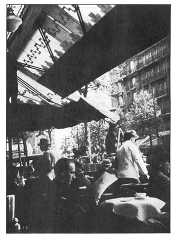
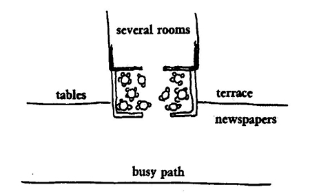

<section class="pattern-plate" aria-labelledby="t-street-cafe">
<a href="/patterns">A Pattern Language</a> · <a href="/patterns#towns">Towns</a> · Pattern 88 · p. 436 · **
<h1 class="pattern-title" id="t-street-cafe">Street Cafe</h1><figure class="pattern-figure pl-figure"></figure><nav class="pattern-links" aria-label="Connections"><h2>Links to</h2><ul><li><a href="/patterns/identifiable-neighborhood">14 Identifiable Neighborhood</a></li><li><a href="/patterns/activity-nodes">30 Activity Nodes</a></li><li><a href="/patterns/small-public-squares">61 Small Public Squares</a></li><li><a href="/patterns/building-complex">95 Building Complex</a></li><li><a href="/patterns/stair-seats">125 Stair Seats</a></li><li><a href="/patterns/a-place-to-wait">150 A Place To Wait</a></li><li><a href="/patterns/opening-to-the-street">165 Opening To The Street</a></li><li><a href="/patterns/sitting-wall">243 Sitting Wall</a></li><li><a href="/patterns/canvas-roofs">244 Canvas Roofs</a></li><li><a href="/patterns/different-chairs">251 Different Chairs</a></li></ul><h2>Linked from</h2><ul><li><a href="/patterns/neighborhood-boundary">15 Neighborhood Boundary</a></li><li><a href="/patterns/activity-nodes">30 Activity Nodes</a></li><li><a href="/patterns/night-life">33 Night Life</a></li><li><a href="/patterns/childrens-home">86 Children’s Home</a></li><li><a href="/patterns/individually-owned-shops">87 Individually Owned Shops</a></li><li><a href="/patterns/sleeping-in-public">94 Sleeping In Public</a></li><li><a href="/patterns/pedestrian-density">123 Pedestrian Density</a></li><li><a href="/patterns/activity-pockets">124 Activity Pockets</a></li><li><a href="/patterns/a-place-to-wait">150 A Place To Wait</a></li><li><a href="/patterns/opening-to-the-street">165 Opening To The Street</a></li></ul></nav></section><article class="pattern-text" aria-label="The text of Street Cafe">
437… neighborhoods are defined by <a class="pl-ref" href="/patterns/identifiable-neighborhood">IDENTIFIABLE NEIGHBORHOOD (14)</a>; their natural points of focus are given by <a class="pl-ref" href="/patterns/activity-nodes">ACTIVITY NODES (30)</a> and <a class="pl-ref" href="/patterns/small-public-squares">SMALL PUBLIC SQUARES (61)</a>. This pattern, and the ones which follow it, give the neighborhood and its points of focus, their identity.

◆ ◆ ◆

<strong>The street cafe provides a unique setting, special to cities: a place where people can sit lazily, legitimately, be on view, and watch the world go by.</strong>

The most humane cities are always full of street cafes. Let us try to understand the experience which makes these places so attractive.

We know that people enjoy mixing in public, in parks, squares, along promenades and avenues, in street cafes. The preconditions seem to be: the setting gives you the right to be there, by custom; there are a few things to do that are part of the scene, almost ritual: reading the newspaper, strolling, nursing a beer, playing catch; and people feel safe enough to relax, nod at each other, perhaps even meet. A good cafe terrace meets these conditions. But it has in addition, special qualities of its own: a person may sit there for hours—in public! Strolling, a person must keep up a pace; loitering is only for a few minutes. You can sit still in a park, but there is not the volume of people passing, it is more a private, peaceful experience. And sitting at home on one’s porch is again different: it is far more protected; and there is not the mix of people passing by. But on the cafe terrace, you can sit still, relax, and be very public. As an experience it has special possibilities; “perhaps the next person …”; it is a risky place.

It is this experience that the street cafe supports. And it is one of the attractions of cities, for only in cities do we have the concentration of people required to bring it off. But this experience need not be confined to the special, extraordinary parts of town. In European cities and towns, there is a street cafe in every neighborhood—they are as ordinary as gas stations are in the United 438States. And the existence of such places provides social glue for the community. They become like clubs—people tend to return to their favorite, the faces become familiar. When there is a successful cafe within walking distance of your home, in the neighborhood, so much the better. It helps enormously to increase the identity of a neighborhood. It is one of the few settings where a newcomer to the neighborhood can start learning the ropes and meeting the people who have been there many years.

The ingredients of a successful street cafe seem to be:

1. There is an established local clientele. That is, by name, location, and staff, the cafe is very much anchored in the neighborhood in which it is situated.

2. In addition to the terrace which is open to the street, the cafe contains several other spaces: with games, fire, soft chairs, newspapers…. This allows a variety of people to start using it, according to slightly different social styles.

3. The cafe serves simple food and drinks—some alcoholic drinks, but it is not a bar. It is a place where you are as likely to go in the morning, to start the day, as in the evening, for a nightcap.

When these conditions are present, and the cafe takes hold, it offers something unique to the lives of the people who use it: it offers a setting for discussions of great spirit—talks, two-bit lectures, half-public, half-private, learning, exchange of thought.

When we worked for the University of Oregon, we compared the importance of such discussion in cafes and cafe-like places, with the instruction students receive in the classroom. We interviewed 30 students to measure the extent that shops and cafes contributed to their intellectual and emotional growth at the University. We found that “talking with a small group of students in a coffee shop” and “discussion over a glass of beer” scored as high and higher than “examinations” and “laboratory study.” Apparently the informal activities of shops and cafes contribute as much to the growth of students, as the more formal educational activities.

We believe this phenomenon is general. The quality that we tried to capture in these interviews, and which is present in a neighborhood cafe, is essential to all neighborhoods—not only student neighborhoods. It is part of their life-blood.

439Therefore:

<strong>Encourage local cafes to spring up in each neighborhood. Make them intimate places, with several rooms, open to a busy path, where people can sit with coffee or a drink and watch the world go by. Build the front of the cafe so that a set of tables stretch out of the cafe, right into the street.</strong>

<figure class="pl-figure"></figure>
◆ ◆ ◆

Build a wide, substantial opening between the terrace and the indoors—<a class="pl-ref" href="/patterns/opening-to-the-street">OPENING TO THE STREET (165)</a>; make the terrace double as <a class="pl-ref" href="/patterns/a-place-to-wait">A PLACE TO WAIT (150)</a> for nearby bus stops and offices; both indoors and on the terrace use a great variety of different kinds of chairs and tables—<a class="pl-ref" href="/patterns/different-chairs">DIFFERENT CHAIRS (251)</a>; and give the terrace some low definition at the street edge if it is in danger of being interrupted by street action—<a class="pl-ref" href="/patterns/stair-seats">STAIR SEATS (125)</a>, <a class="pl-ref" href="/patterns/sitting-wall">SITTING WALL (243)</a>, perhaps a <a class="pl-ref" href="/patterns/canvas-roofs">CANVAS ROOF (244)</a>. For the shape of the building, the terrace, and the surroundings, begin with <a class="pl-ref" href="/patterns/building-complex">BUILDING COMPLEX (95)</a>….
</article>

Christopher Alexander, Sara Ishikawa and Murray Silverstein, with Max Jacobson, Ingrid Fiksdahl-King and Shlomo Angel, <cite>A Pattern Language</cite> (Oxford University Press, 1977), pattern 88, pp. 436–439. Text and illustrations from the <a href="https://github.com/natureoforder/sources">Nature of Order sources</a> reading edition, transcribed from the 1977 printing; report errors on <a href="https://github.com/natureoforder/alexander-wiki/issues">GitHub</a>.

<a href="/patterns/individually-owned-shops">← 87 Individually Owned Shops</a> · <a href="/patterns">All 253 patterns</a> · <a href="/patterns/corner-grocery">89 Corner Grocery →</a>

