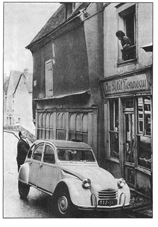
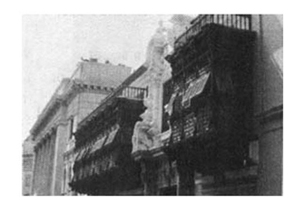
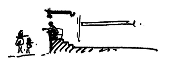
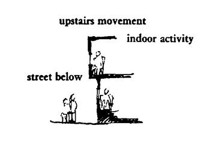

<section class="pattern-plate" aria-labelledby="t-street-windows">
<a href="/patterns">A Pattern Language</a> · <a href="/patterns#buildings">Buildings</a> · Pattern 164 · p. 769 · *
<h1 class="pattern-title" id="t-street-windows">Street Windows</h1><figure class="pattern-figure pl-figure"></figure><nav class="pattern-links" aria-label="Connections"><h2>Links to</h2><ul><li><a href="/patterns/green-streets">51 Green Streets</a></li><li><a href="/patterns/small-public-squares">61 Small Public Squares</a></li><li><a href="/patterns/building-thoroughfare">101 Building Thoroughfare</a></li><li><a href="/patterns/window-place">180 Window Place</a></li><li><a href="/patterns/windows-which-open-wide">236 Windows Which Open Wide</a></li><li><a href="/patterns/filtered-light">238 Filtered Light</a></li><li><a href="/patterns/climbing-plants">246 Climbing Plants</a></li></ul><h2>Linked from</h2><ul><li><a href="/patterns/pedestrian-street">100 Pedestrian Street</a></li><li><a href="/patterns/path-shape">121 Path Shape</a></li><li><a href="/patterns/building-fronts">122 Building Fronts</a></li><li><a href="/patterns/pedestrian-density">123 Pedestrian Density</a></li><li><a href="/patterns/a-place-to-wait">150 A Place To Wait</a></li><li><a href="/patterns/old-age-cottage">155 Old Age Cottage</a></li><li><a href="/patterns/open-stairs">158 Open Stairs</a></li><li><a href="/patterns/building-edge">160 Building Edge</a></li><li><a href="/patterns/opening-to-the-street">165 Opening To The Street</a></li><li><a href="/patterns/window-place">180 Window Place</a></li><li><a href="/patterns/natural-doors-and-windows">221 Natural Doors And Windows</a></li></ul></nav></section><article class="pattern-text" aria-label="The text of Street Windows">
770… wherever there are <a class="pl-ref" href="/patterns/green-streets">GREEN STREETS (51)</a>, <a class="pl-ref" href="/patterns/small-public-squares">SMALL PUBLIC SQUARES (61)</a>, PEDESTRIAN STREETS (lOO), <a class="pl-ref" href="/patterns/building-thoroughfare">BUILDING THOROUGHFARES (101)</a>—in short, any streets with people in them, these streets will only come to life if they are helped to do so by the people looking out on them, hanging out of windows, laughing, shouting, whistling.

◆ ◆ ◆

<strong>A street without windows is blind and frightening. And it is equally uncomfortable to be in a house which bounds a public street with no window at all on the street</strong>

The street window provides a unique kind of connection between the life inside buildings and the street. Franz Kafka wrote a short commentary entitled “The Street Window,” which expresses beautifully the power of this relationship.

Whoever leads a solitary life and yet now and then wants to attach himself somewhere, whoever, according to changes in the time of day, the weather, the state of his business, and the like, suddenly wishes to see any arm at all to which he might cling—he will not be able to manage for long without a window looking onto the street. And if he is in the mood of not desiring anything and only goes to his window sill a tired man, with eyes turning from his public to heaven and back again, not wanting to look out and having thrown his head up a little, even then the horses below will draw him down into their train of wagons and tumult, and so at last into the human harmony. (Franz Kafka, <em>The Complete Stories</em>, ed. Nahum N. Glatzer, New York: Schocken Books, 1972, p. 384).

The process of watching the street from upper story windows is strongly embedded in traditional Peruvian culture in the form of the <em>mirador</em>, the beautiful ornamented gallery which sticks out over the street from many of the colonial buildings in Lima. Peruvian girls especially love to watch the street, but only if they are not too visible. They can watch the street from the mirador without any impropriety, something they cannot do so easily from the front door. If anyone looks at them too hard, they can pull back into the window.

771

<figure class="pl-figure"><figcaption><em>The mirador—the lookout</em>.</figcaption></figure>

Street windows are most successful on the second and third floors. Anything higher, and the street becomes a “view”—the vitality of the connection is destroyed. From the second and third floors people can shout down to the street, throw down a jacket or a ball; people in the street can whistle for a person to come to the window, and even glimpse the expressions on a person’s face inside.

At ground level, street windows are less likely to work. If they are too far back from the street, they don’t really give a view onto the street—though of course they still give light. If they are too close to the street, they don’t work at all, because they get boarded up or curtained to protect the privacy of the rooms inside—see the empirical findings presented in <em>Houses Generated by Patterns</em>, Center for Environmental Structure, 1969, pp. 179–80.

One possible way of making a street window at ground level might be to build an alcove, two or three steps up, with a window on the street, its window-sill five feet above the street. People in the alcove, can lean on the window sill, and watch the street; people in the street can see them, without being able to see into the room behind them. It is even easier, of course, if the ground floor of the house is two or three feet above the street, as many ground floors are.

<figure class="pl-figure"><figcaption><em>An alcove street window at ground level</em>.</figcaption></figure>

772Finally, on whatever floor it is, a street window must be placed in a position which the people inside pass often, a place where they are likely to pause and stand beside the window: the head of a stair, the bay window of a favorite room, a kitchen, bedroom, or window in a passage.

Therefore:

<strong>Where buildings run alongside busy streets, build windows with window seats, looking out onto the street. Place them in bedrooms or at some point on a passage or stair, where people keep passing by. On the first floor, keep these windows high enough to be private.</strong>

<figure class="pl-figure"></figure>
◆ ◆ ◆

On the inside, give each of these windows a substantial place, so that a person feels encouraged to sit there or stand and watch the street—<a class="pl-ref" href="/patterns/window-place">WINDOW PI.ACE (180)</a>; make the windows open outward—<a class="pl-ref" href="/patterns/windows-which-open-wide">WINDOWS WHICH OPEN WIDE (236)</a>; enrich the outside of the window with flower boxes and climbing plants—then people, in the course of caring for the flowers, will have the opportunity for hanging out—<a class="pl-ref" href="/patterns/filtered-light">FILTERED LIGHT (238)</a>, <a class="pl-ref" href="/patterns/climbing-plants">CLIMBING PLANTS (246)</a>….
</article>

Christopher Alexander, Sara Ishikawa and Murray Silverstein, with Max Jacobson, Ingrid Fiksdahl-King and Shlomo Angel, <cite>A Pattern Language</cite> (Oxford University Press, 1977), pattern 164, pp. 769–772. Text and illustrations from the <a href="https://github.com/natureoforder/sources">Nature of Order sources</a> reading edition, transcribed from the 1977 printing; report errors on <a href="https://github.com/natureoforder/alexander-wiki/issues">GitHub</a>.

<a href="/patterns/outdoor-room">← 163 Outdoor Room</a> · <a href="/patterns">All 253 patterns</a> · <a href="/patterns/opening-to-the-street">165 Opening To The Street →</a>

