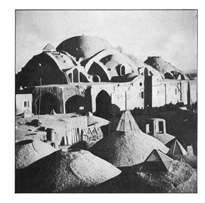
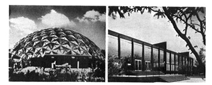
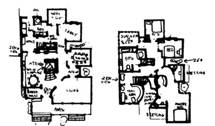
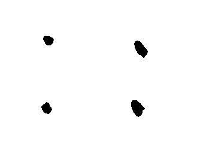
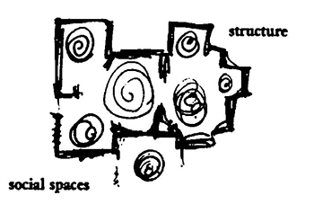

<section class="pattern-plate" aria-labelledby="t-structure-follows-social-spaces">
<a href="/patterns">A Pattern Language</a> · <a href="/patterns#construction">Construction</a> · Pattern 205 · p. 940 · **
<h1 class="pattern-title" id="t-structure-follows-social-spaces">Structure Follows Social Spaces</h1><figure class="pattern-figure pl-figure"></figure><nav class="pattern-links" aria-label="Connections"><h2>Links to</h2><ul><li><a href="/patterns/light-on-two-sides-of-every-room">159 Light On Two Sides Of Every Room</a></li><li><a href="/patterns/efficient-structure">206 Efficient Structure</a></li><li><a href="/patterns/good-materials">207 Good Materials</a></li><li><a href="/patterns/gradual-stiffening">208 Gradual Stiffening</a></li><li><a href="/patterns/columns-at-the-corners">212 Columns At The Corners</a></li><li><a href="/patterns/floor-ceiling-vaults">219 Floor-Ceiling Vaults</a></li></ul><h2>Linked from</h2><ul><li><a href="/patterns/building-complex">95 Building Complex</a></li><li><a href="/patterns/number-of-stories">96 Number Of Stories</a></li><li><a href="/patterns/shielded-parking">97 Shielded Parking</a></li><li><a href="/patterns/main-building">99 Main Building</a></li><li><a href="/patterns/wings-of-light">107 Wings Of Light</a></li><li><a href="/patterns/car-connection">113 Car Connection</a></li><li><a href="/patterns/cascade-of-roofs">116 Cascade Of Roofs</a></li><li><a href="/patterns/arcades">119 Arcades</a></li><li><a href="/patterns/teenagers-cottage">154 Teenager’s Cottage</a></li><li><a href="/patterns/old-age-cottage">155 Old Age Cottage</a></li><li><a href="/patterns/outdoor-room">163 Outdoor Room</a></li><li><a href="/patterns/ceiling-height-variety">190 Ceiling Height Variety</a></li><li><a href="/patterns/the-shape-of-indoor-space">191 The Shape Of Indoor Space</a></li><li><a href="/patterns/efficient-structure">206 Efficient Structure</a></li><li><a href="/patterns/good-materials">207 Good Materials</a></li><li><a href="/patterns/gradual-stiffening">208 Gradual Stiffening</a></li><li><a href="/patterns/floor-and-ceiling-layout">210 Floor And Ceiling Layout</a></li><li><a href="/patterns/columns-at-the-corners">212 Columns At The Corners</a></li><li><a href="/patterns/floor-ceiling-vaults">219 Floor-Ceiling Vaults</a></li><li><a href="/patterns/roof-vaults">220 Roof Vaults</a></li></ul></nav></section><article class="pattern-text" aria-label="The text of Structure Follows Social Spaces">
941… if you have used the-earlier patterns in the language, your plans arc based on subtle arrangements of social spaces. But the beauty and subtlety of all these social spaces will be destroyed, when you start building, unless you find a way of building which is able to follow the social spaces without distorting or rearranging them for engineering reasons.

This pattern gives you the beginning of such a way of building. It is the first of the 49 patterns which deal specifically with structure and construction; it is the bottleneck through which all languages pass from the larger patterns for rooms and building layout to the smaller ones which specify the process of construction. It not only has its own intrinsic arguments about the relation between social spaces and load-bearing structure—it also contains, at the end, a list of all the connections which you need for patterns on structure, columns, walls, floors, roofs, and all the details of construction.

◆ ◆ ◆

<strong>No building ever feels right to the people in it unless the physical spaces (defined by columns, walls, and ceilings) are congruent with the social spaces (defined by activities and human groups).</strong>

And yet this congruence is hardly ever present in modern construction. Most often the physical and social spaces are incongruent. Modern construction—that is, the form of construction most commonly practiced in the mid-twentieth century—usually forces social spaces into the framework of a building whose shape is given by engineering considerations.

There are two different versions of this incongruence.

On the one hand, there are those buildings whose structural form is very demanding indeed and actually forces the social space to follow the shape of the construction—Buckminster Fuller domes, hyperbolic paraboloids, tension structures are examples.

On the other hand, there are those buildings in which there are very few structural elements—a few giant columns and no more. In these buildings the social spaces are defined by lightweight nonstructural partitions floating free within the “neutral” physical structure given by the engineering. The buildings of Mies van der Rohe and Skidmore Owings and Merrill are examples.

942

<figure class="pl-figure"><figcaption><em>Geodesic dome. Steel and glass</em>.</figcaption></figure>

We shall now argue that both these kinds of incongruence do fundamental damage—for entirely different reasons.

In the first case the structure does damage simply because it constrains the social space and makes it different from what it naturally wants to be. To be specific: we know from our experiments that people are able to use this pattern language to design buildings for themselves; and that the plans they create, Unhampered by other considerations, have an astonishing range of free arrangements, always finely tuned to the details of their lives and habits.

<figure class="pl-figure"><figcaption><em>User’s house flan</em>.</figcaption></figure>

943Any form of construction which makes it impossible to implement these plans and forces them into the strait jacket of an alien geometry, simply for structural reasons, is doing social damage.

Of course, it could be argued that the structural needs of a building are as much a part of its nature as the social and psychological needs of its inhabitants. This argument might perhaps, perhaps, hold water if there were indeed no way of building buildings which conform more exactly to the loose plans based on activities alone.

<em>But the next few patterns in this book make it very clear that there do exist ways of building which are structurally sound and yet perfectly congruent with social space, without any compromise whatever. It is therefore clear that we may legitimately reject any form of construction which cannot adapt itself perfectly to the forms of space required by social action</em>.

What of the second kind of incongruence between social space and building form—the kind where the structure creates huge areas of almost uninterrupted “flexible” space, punctuated by occasional columns, and the social spaces are created inside this framework by nonstructural partitions.

Once again, many important patterns cannot be incorporated into the design—<a class="pl-ref" href="/patterns/light-on-two-sides-of-every-room">LIGHT ON TWO SIDES OF EVERY ROOM (159)</a>, for example simply cannot be included in a giant rectangle. But in this type of building, there is an additional kind of incongruence between social space and engineering structure which comes from the fact that the two are virtually independent of each other. The engineering follows its own laws, the social space follows its laws—and they do not match.

This mismatch is perceived and felt not merely as a mismatch, but as a fundamental and disturbing incoherence in the fabric of the building, which makes people feel uneasy and unsure of themselves and their relation to the world. We offer four possible explanations.

First: the spaces called for by the patterns dealing with social and psychological needs are critical. If the spaces are not right, the needs are not met and problems are not solved. Since these spaces are so critical, it stands to reason that they must be felt as real spaces, not flimsily or haphazardly partitioned spaces, which

944only pay lip-service to the needs people experience. For instance, if an entrance room is created with flimsy partitions, it will not take hold; people won’t take it seriously. Only when the most solid elements of the building form the spaces will the spaces be fully felt and the needs which call for the space then fully be satisfied.

Second: a building will also seem alien unless it gives to its users a direct and intuitive sense of its structure—how it is put together. Buildings where the structure is hidden leave yet another gap in people’s understanding of the environment around them. We know this is important to children and suspect it must be important to adults too.

Third: when the social space has, as its own surrounding, the fabric of the load-bearing structure which supports that space, then the forces of gravity are integrated with the social forces, and one feels the resolution of <em>all</em> the forces which are acting in this one space. The experience of being in a place where the forces are resolved together at once is completely restful and whole. It is like sitting under an oak tree: things in nature resolve all the forces acting on them together: they are, in this sense, whole and balanced.

Fourth: it is a psychological fact that a space is defined by its corners. Just as four dots define a rectangle to your eye, so four posts (or more) define an imaginary space between them.

<figure class="pl-figure"><figcaption><em>Four points make a rectangle</em>.</figcaption></figure>

This is the most fundamental way in which solids define space. Unless the actual solids which make up the building lie at the corners of its social spaces, they must, instead, be creating <em>other</em> virtual spaces at odds with the intended ones. The building will only be at rest psychologically if the corners of its rooms are clearly marked and coincide, at least in the majority of cases, with its most solid elements.

945Therefore:

<strong>A first principle of construction: on no account allow the engineering to dictate the building’s form. Place the load bearing elements—the columns and the walls and floors—according to the social spaces of the building; never modify the social spaces to conform to the engineering structure of the building.</strong>

<figure class="pl-figure"></figure>
◆ ◆ ◆

You will be able to guarantee that structure follows social spaces by placing columns at the comer of every social space—<a class="pl-ref" href="/patterns/columns-at-the-corners">COLUMNS AT THE CORNERS (212)</a>; and by building a distinct and separate vault over each room and social space—<a class="pl-ref" href="/patterns/floor-ceiling-vaults">FLOOR CEILING VAULTS (219)</a>.

For the principles of structure which will make it possible to build your building according to this pattern, begin with <a class="pl-ref" href="/patterns/efficient-structure">EFFICIENT STRUCTURE (206)</a>; for the class of compatible materials, see <a class="pl-ref" href="/patterns/good-materials">GOOD MATERIALS (207)</a>; for the fundamentals of the process of construction, see <a class="pl-ref" href="/patterns/gradual-stiffening">GRADUAL STIFFENING (208)</a>….
</article>

Christopher Alexander, Sara Ishikawa and Murray Silverstein, with Max Jacobson, Ingrid Fiksdahl-King and Shlomo Angel, <cite>A Pattern Language</cite> (Oxford University Press, 1977), pattern 205, pp. 940–945. Text and illustrations from the <a href="https://github.com/natureoforder/sources">Nature of Order sources</a> reading edition, transcribed from the 1977 printing; report errors on <a href="https://github.com/natureoforder/alexander-wiki/issues">GitHub</a>.

<a href="/patterns/secret-place">← 204 Secret Place</a> · <a href="/patterns">All 253 patterns</a> · <a href="/patterns/efficient-structure">206 Efficient Structure →</a>

