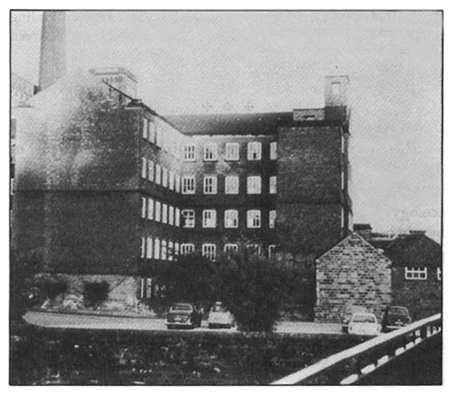
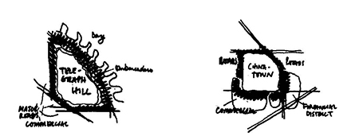
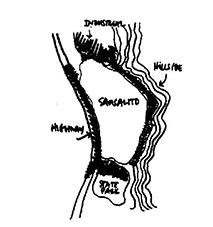
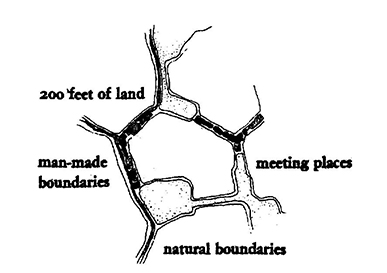

<section class="pattern-plate" aria-labelledby="t-subculture-boundary">
<a href="/patterns">A Pattern Language</a> · <a href="/patterns#towns">Towns</a> · Pattern 13 · p. 75 · *
<h1 class="pattern-title" id="t-subculture-boundary">Subculture Boundary</h1><figure class="pattern-figure pl-figure"></figure><nav class="pattern-links" aria-label="Connections"><h2>Links to</h2><ul><li><a href="/patterns/the-countryside">7 The Countryside</a></li><li><a href="/patterns/mosaic-of-subcultures">8 Mosaic Of Subcultures</a></li><li><a href="/patterns/community-of-7000">12 Community Of 7000</a></li><li><a href="/patterns/identifiable-neighborhood">14 Identifiable Neighborhood</a></li><li><a href="/patterns/ring-roads">17 Ring Roads</a></li><li><a href="/patterns/parallel-roads">23 Parallel Roads</a></li><li><a href="/patterns/sacred-sites">24 Sacred Sites</a></li><li><a href="/patterns/access-to-water">25 Access To Water</a></li><li><a href="/patterns/eccentric-nucleus">28 Eccentric Nucleus</a></li><li><a href="/patterns/activity-nodes">30 Activity Nodes</a></li><li><a href="/patterns/work-community">41 Work Community</a></li><li><a href="/patterns/industrial-ribbon">42 Industrial Ribbon</a></li><li><a href="/patterns/quiet-backs">59 Quiet Backs</a></li><li><a href="/patterns/accessible-green">60 Accessible Green</a></li><li><a href="/patterns/pools-and-streams">64 Pools And Streams</a></li><li><a href="/patterns/still-water">71 Still Water</a></li><li><a href="/patterns/teen-age-society">84 Teen-Age Society</a></li><li><a href="/patterns/shielded-parking">97 Shielded Parking</a></li></ul><h2>Linked from</h2><ul><li><a href="/patterns/mosaic-of-subcultures">8 Mosaic Of Subcultures</a></li><li><a href="/patterns/scattered-work">9 Scattered Work</a></li><li><a href="/patterns/local-transport-areas">11 Local Transport Areas</a></li><li><a href="/patterns/community-of-7000">12 Community Of 7000</a></li><li><a href="/patterns/neighborhood-boundary">15 Neighborhood Boundary</a></li><li><a href="/patterns/ring-roads">17 Ring Roads</a></li><li><a href="/patterns/web-of-shopping">19 Web Of Shopping</a></li><li><a href="/patterns/parallel-roads">23 Parallel Roads</a></li><li><a href="/patterns/eccentric-nucleus">28 Eccentric Nucleus</a></li><li><a href="/patterns/density-rings">29 Density Rings</a></li><li><a href="/patterns/activity-nodes">30 Activity Nodes</a></li><li><a href="/patterns/industrial-ribbon">42 Industrial Ribbon</a></li><li><a href="/patterns/ornament">249 Ornament</a></li></ul></nav></section><article class="pattern-text" aria-label="The text of Subculture Boundary">
76… the <a class="pl-ref" href="/patterns/mosaic-of-subcultures">MOSAIC OF SUBCULTURES (8)</a> and its individual subcultures, whether they arc <a class="pl-ref" href="/patterns/community-of-7000">COMMUNITEIS OF 7000 (12)</a> or <a class="pl-ref" href="/patterns/identifiable-neighborhood">IDENTIFIADLE NEIGHBORHOODS (14)</a>, need to be completed by boundaries. In fact, the mere creation of the boundary areas, according to this pattern, will begin to give life to the subcultures between the boundaries, by giving them a chance to be themselves,

◆ ◆ ◆

<strong>The mosaic of subcultures requires that hundreds of different cultures live, in their own way, at full intensity, next door to one another. But subcultures have their own ecology. They can only live at full intensity, unhampered by their neighbors, if they arc physically separated by physical boundaries.</strong>

In <a class="pl-ref" href="/patterns/mosaic-of-subcultures">MOSAIC OF SUBCULTURES (8)</a> we have argued that a great variety of subcultures in a city is not a racist pattern which forms ghettos, but a pattern of opportunity which allows a city to contain a multitude of different ways of life with the greatest possible intensity.

But this mosaic will only come into being if the various subcultures are insulated from one another, at least enough so that no one of them can oppress, or subdue, the life style of its neighbors, nor, in return, feel oppressed or subdued. As we shall see, this requires that adjacent subcultures are separated by swaths of open land, workplaces, public buildings, water, parks, or other natural boundaries.

The argument hinges on the following fact. Wherever there is an area of homogeneous housing in a city, its inhabitants will exert strong pressure on the areas Adjacent to it to make them conform to their values and style. For example, the “straight” people who lived near the “hippie” Haight Ashbury district in San Francisco in 1967 were afraid that the Haight would send their land values down, so they put pressure on City Hall to get the Haight “cleaned up”—that is, to make the Haight more like their own area. This seems to happen whenever one subculture is 77very different in style from another one next to it. People will be afraid that the neighboring area is going to “encroach” on their own area, upset their land values, undermine their children, send the “nice” people away, and so forth, and they will do everything they can to make the next door area like their own.

Carl Werthman, Jerry Mandel, and Ted Dienstfrey (<em>Planning and the Purchase Decision: Why People Buy in Planned Communities</em>, University of California, Berkeley, July 1965) have noticed the same phenomenon even among very similar subcultures. In a study of people living in tract developments, they found that the tension created by adjacencies between dissimilar social groups disappeared when there was enough open land, unused land, freeway, or water between them. In short, a physical barrier between the adjacent subcultures, if big enough, took the heat off.

Obviously, a rich mix of subcultures will not be possible if each subculture is being inhibited by pressure from its neighbors. <em>The subcultures must there/ ore be separated by land, which is not residential land, and by as much of it as possible</em>.

There is another kind of empirical observation which supports this last statement. If we look around a metropolitan area, and pinpoint the strongly differentiated subcultures, those with character, we shall always find that they are near boundaries and hardly ever close to other communities. For example, in San Francisco the two most distinctive areas are Telegraph Hill and Chinatown. Telegraph Hill is surrounded on two sides by the docks. Chinatown is bounded on two sides by the city’s banking area. The same is true in the larger Bay Area. Point Richmond and Sausalito, two of the most distinctive communities in the greater Bay Area, are both almost completely isolated. Sausalito is surrounded by hills and water; Point.Richmond by water and industrial land. Communities which are cut off to some extent are free to develop their own character.

<figure class="pl-figure"><figcaption><em>Subculture boundaries</em>.</figcaption></figure>

78

<figure class="pl-figure"></figure>
Further support for our argument comes from ecology. I n nature, the differentiation of a species into subspecies is largely due to the process of geographic speciation, the genetic changes which take place during a period of spatial isolation (see, for example, Ernst Mayr, <em>Animal Species and Evlolution</em>, Cambridge, 1963, Chapter 18: “The Ecology of Speciation,” pp. 556–85). It has been observed in a multitude of ecological studies that members of the same species develop distinguishable traits when separated from other members of the species by physical boundaries like a mountain ridge, a valley, a river, a dry strip of land, a cliff, or a significant change in climate or vegetation. In just the same way, differentiation between subcultures in a city will be able to take place most easily when the fiow of those elements which account for cultural variety—values, style, information, and so on—is at least partially restricted between neighboring subcultures.

Therefore:

<strong>Separate neighboring subcultures with a swath of land at least 200 feet wide. Let this boundary be natural—wilderness, farmland, water—or man-made—railroads, major roads, parks, schools, some housing. Along the seam between 79two subcultures, build meeting places, shared functions, touching each community.</strong>

<figure class="pl-figure"></figure>
◆ ◆ ◆

Natural boundaries can be things like <a class="pl-ref" href="/patterns/the-countryside">THE COUNTRYSIDE (7)</a>, <a class="pl-ref" href="/patterns/sacred-sites">SACRED SITES (24)</a>, <a class="pl-ref" href="/patterns/access-to-water">ACCESS TO WATER (25)</a>, <a class="pl-ref" href="/patterns/quiet-backs">QUIET BACKS (59)</a>, <a class="pl-ref" href="/patterns/accessible-green">ACCESSIBLE GREEN (60)</a>, <a class="pl-ref" href="/patterns/pools-and-streams">POOLS AND STREAMS (64)</a>, <a class="pl-ref" href="/patterns/still-water">STILL WATER (71)</a>. Artificial boundaries can include <a class="pl-ref" href="/patterns/ring-roads">RING ROADS (17)</a>, <a class="pl-ref" href="/patterns/parallel-roads">PARALLEL ROADS (23)</a>, <a class="pl-ref" href="/patterns/work-community">WORK COMMUNITIES (41)</a>, <a class="pl-ref" href="/patterns/industrial-ribbon">INDUSTRIAL RIBBONS (42)</a>, <a class="pl-ref" href="/patterns/teen-age-society">TEENAGE SOCIETY (84)</a>, <a class="pl-ref" href="/patterns/shielded-parking">SHIELDED PARKING (97)</a>. The interior organization of the subculture boundary should follow two broad principles. It should concentrate the various land uses to form functional clusters around activity—<a class="pl-ref" href="/patterns/activity-nodes">ACTIVITY NODES (30)</a>, <a class="pl-ref" href="/patterns/work-community">WORK COMMUNITY (41)</a>. And the boundary should be accessible to both the neighboring communities, so that it is a meeting ground for them—<a class="pl-ref" href="/patterns/eccentric-nucleus">ECCENTRIC NUCLEUS (28)</a>….
</article>

Christopher Alexander, Sara Ishikawa and Murray Silverstein, with Max Jacobson, Ingrid Fiksdahl-King and Shlomo Angel, <cite>A Pattern Language</cite> (Oxford University Press, 1977), pattern 13, pp. 75–79. Text and illustrations from the <a href="https://github.com/natureoforder/sources">Nature of Order sources</a> reading edition, transcribed from the 1977 printing; report errors on <a href="https://github.com/natureoforder/alexander-wiki/issues">GitHub</a>.

<a href="/patterns/community-of-7000">← 12 Community Of 7000</a> · <a href="/patterns">All 253 patterns</a> · <a href="/patterns/identifiable-neighborhood">14 Identifiable Neighborhood →</a>

