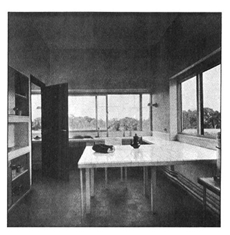
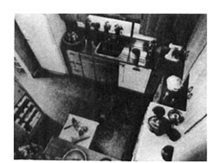
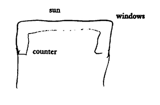

<section class="pattern-plate" aria-labelledby="t-sunny-counter">
<a href="/patterns">A Pattern Language</a> · <a href="/patterns#buildings">Buildings</a> · Pattern 199 · p. 916 · *
<h1 class="pattern-title" id="t-sunny-counter">Sunny Counter</h1><figure class="pattern-figure pl-figure"></figure><nav class="pattern-links" aria-label="Connections"><h2>Links to</h2><ul><li><a href="/patterns/indoor-sunlight">128 Indoor Sunlight</a></li><li><a href="/patterns/farmhouse-kitchen">139 Farmhouse Kitchen</a></li><li><a href="/patterns/cooking-layout">184 Cooking Layout</a></li><li><a href="/patterns/windows-overlooking-life">192 Windows Overlooking Life</a></li><li><a href="/patterns/open-shelves">200 Open Shelves</a></li><li><a href="/patterns/thickening-the-outer-walls">211 Thickening The Outer Walls</a></li><li><a href="/patterns/warm-colors">250 Warm Colors</a></li></ul><h2>Linked from</h2><ul><li><a href="/patterns/indoor-sunlight">128 Indoor Sunlight</a></li><li><a href="/patterns/farmhouse-kitchen">139 Farmhouse Kitchen</a></li><li><a href="/patterns/cooking-layout">184 Cooking Layout</a></li><li><a href="/patterns/corner-doors">196 Corner Doors</a></li><li><a href="/patterns/thick-walls">197 Thick Walls</a></li><li><a href="/patterns/thickening-the-outer-walls">211 Thickening The Outer Walls</a></li></ul></nav></section><article class="pattern-text" aria-label="The text of Sunny Counter">
917… <a class="pl-ref" href="/patterns/farmhouse-kitchen">FARMHOUSE KITCHEN (139)</a> and <a class="pl-ref" href="/patterns/cooking-layout">COOKING LAYOUT (184)</a> give the overall design of the kitchen, and its workspace, <a class="pl-ref" href="/patterns/indoor-sunlight">indoor sunlight (128)</a> makes sure of sunshine in the kitchen. But tc help create these larger patterns, and to make the kitchen as warm and beautiful as possible, it is worth taking a great deal of care placing the counter and its windows.

◆ ◆ ◆

<strong>Dark gloomy kitchens are depressing. The kitchen needs the sun more than the other rooms, not less.</strong>

Look how beautiful the workspace in our main picture is. Nearly the whole counter is lined with windows. The work surface is bathed in light, and there is a sense of spaciousness all around. There is a view out, an air of calm.

<figure class="pl-figure"><figcaption><em>A gloomy kitchen</em>.</figcaption></figure>

Compare it with this gloomy kitchen. There is no natural light on the work counter, the cabinets are a clutter; it is a shabby experience to work there—to work below a cabinet, facing a wall with artificial light in the middle of the day.

This gloomy kitchen is typical of many thousands of kitchens in modern houses. It happens for two reasons. First, people often place kitchens to the north, because they reserve the south for living rooms and then put the kitchen in the left over areas. And it happens, secondly, when the kitchen is thought of as 918an “efficient” place, only meant for the mechanical cooking operations In many apartments, efficiency kitchens are even in positions where they get no natural light at all. But, of course, the arguments we have presented in <a class="pl-ref" href="/patterns/farmhouse-kitchen">FARMHOUSE KITCHEN (139)</a> for making the kitchen a living room, not merely a machine-shop, change all this.

Therefore:

<strong>Place the main part of the kitchen counter on the south and southeast side of the kitchen, with big windows around it, so that sun can flood in and fill the kitchen with yellow light both morning and afternoon.</strong>

<figure class="pl-figure"></figure>
◆ ◆ ◆

Give the windows a view toward a garden or the area where children play—<a class="pl-ref" href="/patterns/windows-overlooking-life">WINDOWS OVERLOOKING LIFE (192)</a>. If storage space is tight, you can build open shelves for bowls and plates and plants right across the windows and still let in the sun—<a class="pl-ref" href="/patterns/open-shelves">OPEN SHELVES (200)</a>. Build the counter as a special part of the room, integral with the building structure, able to take many modifications later—<a class="pl-ref" href="/patterns/thickening-the-outer-walls">THICKENING THE OUTER WALLS (211)</a>. Use <a class="pl-ref" href="/patterns/warm-colors">WARM COLORS (250)</a> around the window to soften and warm the sunlight….
</article>

Christopher Alexander, Sara Ishikawa and Murray Silverstein, with Max Jacobson, Ingrid Fiksdahl-King and Shlomo Angel, <cite>A Pattern Language</cite> (Oxford University Press, 1977), pattern 199, pp. 916–918. Text and illustrations from the <a href="https://github.com/natureoforder/sources">Nature of Order sources</a> reading edition, transcribed from the 1977 printing; report errors on <a href="https://github.com/natureoforder/alexander-wiki/issues">GitHub</a>.

<a href="/patterns/closets-between-rooms">← 198 Closets Between Rooms</a> · <a href="/patterns">All 253 patterns</a> · <a href="/patterns/open-shelves">200 Open Shelves →</a>

