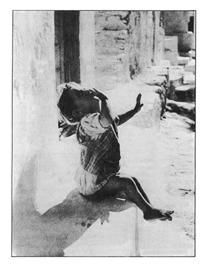
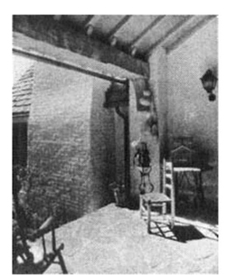
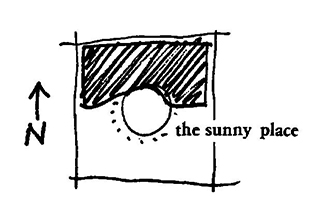

<section class="pattern-plate" aria-labelledby="t-sunny-place">
<a href="/patterns">A Pattern Language</a> · <a href="/patterns#buildings">Buildings</a> · Pattern 161 · p. 757 · **
<h1 class="pattern-title" id="t-sunny-place">Sunny Place</h1><figure class="pattern-figure pl-figure"></figure><nav class="pattern-links" aria-label="Connections"><h2>Links to</h2><ul><li><a href="/patterns/house-cluster">37 House Cluster</a></li><li><a href="/patterns/work-community">41 Work Community</a></li><li><a href="/patterns/south-facing-outdoors">105 South Facing Outdoors</a></li><li><a href="/patterns/private-terrace-on-the-street">140 Private Terrace On The Street</a></li><li><a href="/patterns/building-edge">160 Building Edge</a></li><li><a href="/patterns/outdoor-room">163 Outdoor Room</a></li><li><a href="/patterns/six-foot-balcony">167 Six-Foot Balcony</a></li><li><a href="/patterns/trellised-walk">174 Trellised Walk</a></li><li><a href="/patterns/filtered-light">238 Filtered Light</a></li><li><a href="/patterns/seat-spots">241 Seat Spots</a></li><li><a href="/patterns/canvas-roofs">244 Canvas Roofs</a></li></ul><h2>Linked from</h2><ul><li><a href="/patterns/south-facing-outdoors">105 South Facing Outdoors</a></li><li><a href="/patterns/courtyards-which-live">115 Courtyards Which Live</a></li><li><a href="/patterns/roof-garden">118 Roof Garden</a></li><li><a href="/patterns/home-workshop">157 Home Workshop</a></li><li><a href="/patterns/open-stairs">158 Open Stairs</a></li><li><a href="/patterns/building-edge">160 Building Edge</a></li><li><a href="/patterns/north-face">162 North Face</a></li><li><a href="/patterns/outdoor-room">163 Outdoor Room</a></li><li><a href="/patterns/six-foot-balcony">167 Six-Foot Balcony</a></li><li><a href="/patterns/garden-seat">176 Garden Seat</a></li></ul></nav></section><article class="pattern-text" aria-label="The text of Sunny Place">
758… this pattern helps to embellish and give life to any <a class="pl-ref" href="/patterns/south-facing-outdoors">SOUTH FACING OUTDOORS (105)</a>; and, in a situation where the outdoors is not to the south, but east or west, it can help to modify the building so that the effective part of the outdoors moves towards the south. It also helps to complete <a class="pl-ref" href="/patterns/building-edge">BUILDING EDGE (160)</a>, and to place <a class="pl-ref" href="/patterns/outdoor-room">OUTDOOR ROOM (163)</a>.

◆ ◆ ◆

<strong>The area immediately outside the building, to the south—that angle between its walls and the earth where the sun falls—must be developed and made into a place which lets people bask in it.</strong>

We have already made the point that important outdoor areas should be to the south of buildings which they serve, and we presented the empirical evidence for this idea in <a class="pl-ref" href="/patterns/south-facing-outdoors">SOUTH FACING OUTDOORS (105)</a>. But even if the outdoor areas around a building are toward the south, this still won’t guarantee that people actually will use them.

In this pattern, we shall now discuss the subtler fact that a south-facing court or garden will still not work, unless there is a functionally important sunny place within it, intently and specifically placed for sun, at a central juncture between indoors and outdoors and immediately next to the indoor rooms which it serves.

We have some evidence—presented in <a class="pl-ref" href="/patterns/south-facing-outdoors">SOUTH-FACING OUTDOORS (105)</a>—that a deep band of shade between a building and a sunny area can act as a barrier and keep the area from being well used. It is this evidence which makes us believe that the most important sunny places occur up against the exterior walls of buildings, where people can see into them from inside and step directly out into the light, leaning in the doorway of the building. Furthermore, we have observed that these places are more inviting if they are placed in the crook of a building or wall, where there is just enough enclosure from a hedge, a low wall, a column, to provide a backdrop, a place to sit up against and take in the sun.

759And finally, of course, if the place is really to work, there must be a good reason for going there: something special which draws a person there—a swing, a potting table for plants, a special view, a brick step to sit upon and look into a pool—whatever, so long as it has the power to bring a person there almost without thinking about it.

Here is an example—a sunny place at the edge of a building, directly related to the inside, and set in a nook of the building. Someone comes there every day to sit for a moment, water the hanging plants, see how they are doing, and take in some sun.

<figure class="pl-figure"></figure>
<em>Sunny place</em> …

A particularly beautiful version of this pattern can be made when several sunny places are placed together—perhaps for a <a class="pl-ref" href="/patterns/house-cluster">HOUSE CLUSTER (37)</a> or a <a class="pl-ref" href="/patterns/work-community">WORK COMMUNITY (41)</a>. If the places can be set down so that they form a south-facing half-necklace of sunny spots, each within hailing distance of all the others, it makes the act of coming out into the sun a communal affair.

Therefore:

<strong>Inside a south-facing court, or garden, or yard, find the spot between the building and the outdoors which gets the best sun. Develop this spot as a special sunny place- make it the important outdoor room, a place to work in the sun, or a place for a swing and some special plants, a place to sunbathe. Be very careful indeed to place the 760sunny place in a position where it is sheltered from the wind. A steady wind will prevent you from using the most beautiful place.</strong>

<figure class="pl-figure"></figure>
◆ ◆ ◆

Make the place itself as much as possible like a room—<a class="pl-ref" href="/patterns/private-terrace-on-the-street">PRIVATE TERRACE ON THE STREET (140)</a>, <a class="pl-ref" href="/patterns/outdoor-room">OUTDOOR ROOM (163)</a>; always at least six feet deep, no less—<a class="pl-ref" href="/patterns/six-foot-balcony">SIX-FOOT BALCONY (167)</a>; perhaps with foliage or a canvas to filter the light on hot days—<a class="pl-ref" href="/patterns/filtered-light">FILTERED LIGHT (238)</a>, <a class="pl-ref" href="/patterns/trellised-walk">TRELLISED WALK (174)</a>, <a class="pl-ref" href="/patterns/canvas-roofs">CANVAS ROOF (244)</a>. Put in seats according to <a class="pl-ref" href="/patterns/seat-spots">SEAT SPOTS (241)</a>….
</article>

Christopher Alexander, Sara Ishikawa and Murray Silverstein, with Max Jacobson, Ingrid Fiksdahl-King and Shlomo Angel, <cite>A Pattern Language</cite> (Oxford University Press, 1977), pattern 161, pp. 757–760. Text and illustrations from the <a href="https://github.com/natureoforder/sources">Nature of Order sources</a> reading edition, transcribed from the 1977 printing; report errors on <a href="https://github.com/natureoforder/alexander-wiki/issues">GitHub</a>.

<a href="/patterns/building-edge">← 160 Building Edge</a> · <a href="/patterns">All 253 patterns</a> · <a href="/patterns/north-face">162 North Face →</a>

