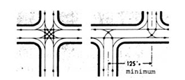
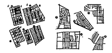
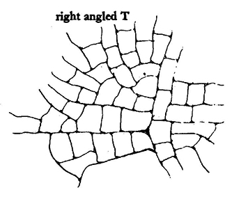

<section class="pattern-plate" aria-labelledby="t-t-junctions">
<a href="/patterns">A Pattern Language</a> · <a href="/patterns#towns">Towns</a> · Pattern 50 · p. 264 · *
<h1 class="pattern-title" id="t-t-junctions">T Junctions</h1><nav class="pattern-links" aria-label="Connections"><h2>Linked from</h2><ul><li><a href="/patterns/parallel-roads">23 Parallel Roads</a></li><li><a href="/patterns/housing-in-between">48 Housing In Between</a></li><li><a href="/patterns/green-streets">51 Green Streets</a></li></ul></nav></section><article class="pattern-text" aria-label="The text of T Junctions">
… if major roads are in position—parallel roads (23), and you are in the process of defining the local roads, this pattern gives the nature of the intersections. It will also greatly influence the layout of the local roads, and will help to generate their loop-like character—looped local roads (49).

◆ ◆ ◆

<strong>Traffic accidents are far more frequent where two roads cross than at T junctions.</strong>

This follows from the geometry. Where two two-way roads cross, there are 16 major collision points, compared with three for a T junction (John Callendar, <em>Time Saver Standards</em>, Fourth Edition, New York, 1966, p. 1230).

<figure class="pl-figure"></figure>
<em>Sixteen collision points</em>…. <em>Three collision faints</em>.

Maps from an empirical study which compares the number of accidents over a period of five years for different street patterns are shown below. They show clearly that T junctions have many fewer accidents than four-way intersections (from <em>Planning for Man and Motor</em>, by Paul Ritter, p. 307).

Further evidence shows that the T junction is safest if it is a right-angled junction. When the angle deviates from the right angle, it is hard for drivers to see round the corner, and accidents increase (Swedish National Board of Urban Planning, “Principles for Urban Planning with Respect to Road Safety,” <em>The Scaft Guidelines 1968, Publication</em> No. 5, Stockholm, Sweden, p. 11).

265

<figure class="pl-figure"><figcaption><em>Accidents at different intersections</em>.</figcaption></figure>

Therefore:

<strong>Lay out the road system so that any two roads which meet at grade, meet in three-way T junctions as near 90 degrees as possible. Avoid four-way intersections and crossing movements.</strong>

<figure class="pl-figure"></figure>
◆ ◆ ◆

At busy junctions, where pedestrian paths converge, make a special raised crossing for pedestrians, something more than the usual crosswalk—road crossing (54)….
</article>

Christopher Alexander, Sara Ishikawa and Murray Silverstein, with Max Jacobson, Ingrid Fiksdahl-King and Shlomo Angel, <cite>A Pattern Language</cite> (Oxford University Press, 1977), pattern 50, pp. 264–265. Text and illustrations from the <a href="https://github.com/natureoforder/sources">Nature of Order sources</a> reading edition, transcribed from the 1977 printing; report errors on <a href="https://github.com/natureoforder/alexander-wiki/issues">GitHub</a>.

<a href="/patterns/looped-local-roads">← 49 Looped Local Roads</a> · <a href="/patterns">All 253 patterns</a> · <a href="/patterns/green-streets">51 Green Streets →</a>

