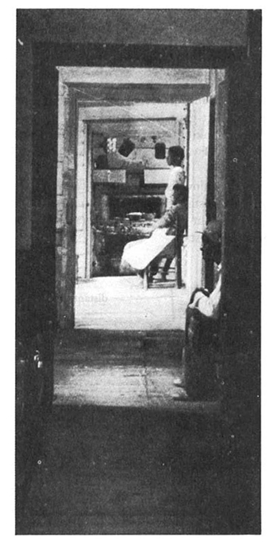
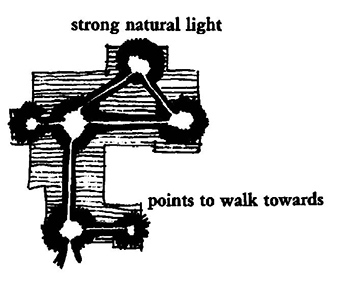

<section class="pattern-plate" aria-labelledby="t-tapestry-of-light-and-dark">
<a href="/patterns">A Pattern Language</a> · <a href="/patterns#buildings">Buildings</a> · Pattern 135 · p. 644 · *
<h1 class="pattern-title" id="t-tapestry-of-light-and-dark">Tapestry Of Light And Dark</h1><figure class="pattern-figure pl-figure"></figure><nav class="pattern-links" aria-label="Connections"><h2>Links to</h2><ul><li><a href="/patterns/the-flow-through-rooms">131 The Flow Through Rooms</a></li><li><a href="/patterns/short-passages">132 Short Passages</a></li><li><a href="/patterns/staircase-as-a-stage">133 Staircase As A Stage</a></li><li><a href="/patterns/zen-view">134 Zen View</a></li><li><a href="/patterns/couples-realm">136 Couple’s Realm</a></li><li><a href="/patterns/childrens-realm">137 Children’s Realm</a></li><li><a href="/patterns/sleeping-to-the-east">138 Sleeping To The East</a></li><li><a href="/patterns/farmhouse-kitchen">139 Farmhouse Kitchen</a></li><li><a href="/patterns/private-terrace-on-the-street">140 Private Terrace On The Street</a></li><li><a href="/patterns/a-room-of-ones-own">141 A Room Of One’s Own</a></li><li><a href="/patterns/sequence-of-sitting-spaces">142 Sequence Of Sitting Spaces</a></li><li><a href="/patterns/bed-cluster">143 Bed Cluster</a></li><li><a href="/patterns/bathing-room">144 Bathing Room</a></li><li><a href="/patterns/bulk-storage">145 Bulk Storage</a></li><li><a href="/patterns/window-place">180 Window Place</a></li><li><a href="/patterns/warm-colors">250 Warm Colors</a></li><li><a href="/patterns/pools-of-light">252 Pools Of Light</a></li></ul><h2>Linked from</h2><ul><li><a href="/patterns/shielded-parking">97 Shielded Parking</a></li><li><a href="/patterns/building-thoroughfare">101 Building Thoroughfare</a></li><li><a href="/patterns/entrance-transition">112 Entrance Transition</a></li><li><a href="/patterns/something-roughly-in-the-middle">126 Something Roughly In The Middle</a></li><li><a href="/patterns/entrance-room">130 Entrance Room</a></li><li><a href="/patterns/the-flow-through-rooms">131 The Flow Through Rooms</a></li><li><a href="/patterns/staircase-as-a-stage">133 Staircase As A Stage</a></li><li><a href="/patterns/zen-view">134 Zen View</a></li><li><a href="/patterns/reception-welcomes-you">149 Reception Welcomes You</a></li><li><a href="/patterns/interior-windows">194 Interior Windows</a></li><li><a href="/patterns/corner-doors">196 Corner Doors</a></li><li><a href="/patterns/solid-doors-with-glass">237 Solid Doors With Glass</a></li></ul></nav></section><article class="pattern-text" aria-label="The text of Tapestry Of Light And Dark">
645passages, entrances, stairs are given their rough position by <a class="pl-ref" href="/patterns/the-flow-through-rooms">THE FLOW THROUGH ROOMS (131)</a>, <a class="pl-ref" href="/patterns/short-passages">SHORT PASSAGES (132)</a>, <a class="pl-ref" href="/patterns/staircase-as-a-stage">STAIRCASE AS A STAGE (133)</a>, <a class="pl-ref" href="/patterns/zen-view">ZEN VIEW (134)</a>. This pattern helps you fine tune their positions by placing light correctly.

◆ ◆ ◆

<strong>In a building with uniform light level, there are few “places” which function as effective settings for human events. This happens because, to a large extent, the places which make effective settings are defined by light.</strong>

People are by nature phototropic—they move toward light, and, when stationary, they orient themselves toward the light. As a result the much loved and much used places in buildings, where the most things happen, are places like window seats, verandas, fireside corners, trellised arbors; all of them defined by nonuniformities in light, and all of them allowing the people who are in them to orient themselves toward the light.

We may say that these places become the settings for the human events that occur in the building. Since there is good reason to believe that people need a rich variety of settings in their lives (see for instance, Roger Barker, <em>The Stream of Behavior: Exflorations of its Structure and Content</em>, New York: Appleton-Century-Crofts, 1963), and since settings are defined by “places,” which in turn seem often to be defined by light, and since light places can only be defined by contrast with darker ones, this suggests that the interior parts of buildings where people spend much time should contain a great deal of alternating light and dark. The building needs to be a tapestry of light and dark.

This tapestry of light and dark must then fit together with the flow of movement, too. As we have said, people naturally tend to walk toward the light. It is therefore obvious that any entrance, or any key point in a circulation system, must be systematically lighter than its surroundings—with light (daylight and artificial light) flooded there, so that its intensity becomes a 646natural target. The reason is simple. If there are places which have more light than the entrances and circulation nodes, people will tend to walk toward <em>them</em> (because of their phototropic tendency) and will therefore end up in the wrong place—with frustration and confusion as the only possible result.

<em>If the places where the light falls are not the places you are meant to go toward, or if the light is uniform, the environment is giving information which contradicts its own meaning</em>. The environment is only functioning in a single-hearted manner, as information, when the lightest spots coincide with the points of maximum importance.

Therefore:

<strong>Create alternating areas of light and dark throughout the building, in such a way that people naturally walk toward the light, whenever they are going to important places: seats, entrances, stairs, passages, places of special beauty, and make other areas darker, to increase the contrast.</strong>

<figure class="pl-figure"></figure>
◆ ◆ ◆

Where the light to walk toward is natural light, build seats and alcoves in those windows which attract the movement—<a class="pl-ref" href="/patterns/window-place">WINDOW PLACE (180)</a>. If you use skylights, then make the surfaces around the skylight warm in color—<a class="pl-ref" href="/patterns/warm-colors">WARM COLORS (250)</a>; otherwise the direct light from the sky is almost always cold. At night make pools of incandescent light which guide the movement—<a class="pl-ref" href="/patterns/pools-of-light">POOLS OF LIGHT (252)</a>….

647<em>within the framework of the wings and their internal gradients of space and movementy define the most important areas and rooms. First, for a house;</em>

<a class="pl-ref" href="/patterns/couples-realm">136. COUPLE’S REALM</a>

<a class="pl-ref" href="/patterns/childrens-realm">137. CHILDREN’S REALM</a>

<a class="pl-ref" href="/patterns/sleeping-to-the-east">138. SLEEPING TO THE EAST</a>

<a class="pl-ref" href="/patterns/farmhouse-kitchen">139. FARMHOUSE KITCHEN</a>

<a class="pl-ref" href="/patterns/private-terrace-on-the-street">140. PRIVATE TERRACE ON THE STREET</a>

<a class="pl-ref" href="/patterns/a-room-of-ones-own">141. A ROOM OF ONE’S OWN</a>

<a class="pl-ref" href="/patterns/sequence-of-sitting-spaces">142. SEQUENCE OF SITTING SPACES</a>

<a class="pl-ref" href="/patterns/bed-cluster">143. BED CLUSTER</a>

<a class="pl-ref" href="/patterns/bathing-room">144. BATHING ROOM</a>

<a class="pl-ref" href="/patterns/bulk-storage">145. BULK STORAGE</a>
</article>

Christopher Alexander, Sara Ishikawa and Murray Silverstein, with Max Jacobson, Ingrid Fiksdahl-King and Shlomo Angel, <cite>A Pattern Language</cite> (Oxford University Press, 1977), pattern 135, pp. 644–647. Text and illustrations from the <a href="https://github.com/natureoforder/sources">Nature of Order sources</a> reading edition, transcribed from the 1977 printing; report errors on <a href="https://github.com/natureoforder/alexander-wiki/issues">GitHub</a>.

<a href="/patterns/zen-view">← 134 Zen View</a> · <a href="/patterns">All 253 patterns</a> · <a href="/patterns/couples-realm">136 Couple’s Realm →</a>

