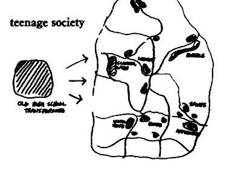

<section class="pattern-plate" aria-labelledby="t-teen-age-society">
<a href="/patterns">A Pattern Language</a> · <a href="/patterns#towns">Towns</a> · Pattern 84 · p. 416
<h1 class="pattern-title" id="t-teen-age-society">Teen-Age Society</h1><nav class="pattern-links" aria-label="Connections"><h2>Links to</h2><ul><li><a href="/patterns/network-of-learning">18 Network Of Learning</a></li><li><a href="/patterns/life-cycle">26 Life Cycle</a></li><li><a href="/patterns/local-sports">72 Local Sports</a></li><li><a href="/patterns/master-and-apprentices">83 Master And Apprentices</a></li><li><a href="/patterns/building-complex">95 Building Complex</a></li><li><a href="/patterns/communal-eating">147 Communal Eating</a></li><li><a href="/patterns/home-workshop">157 Home Workshop</a></li></ul><h2>Linked from</h2><ul><li><a href="/patterns/subculture-boundary">13 Subculture Boundary</a></li><li><a href="/patterns/network-of-learning">18 Network Of Learning</a></li><li><a href="/patterns/life-cycle">26 Life Cycle</a></li><li><a href="/patterns/activity-nodes">30 Activity Nodes</a></li><li><a href="/patterns/children-in-the-city">57 Children In The City</a></li><li><a href="/patterns/your-own-home">79 Your Own Home</a></li><li><a href="/patterns/small-services-without-red-tape">81 Small Services Without Red Tape</a></li></ul></nav></section><article class="pattern-text" aria-label="The text of Teen-Age Society">
… the balanced <a class="pl-ref" href="/patterns/life-cycle">LIFE CYCLE (26)</a> requires that the transition from childhood to adulthood be treated by a far more subtle and embracing kind of teenage institution than a school; this pattern, which begins to define that institution, can take its place in the <a class="pl-ref" href="/patterns/network-of-learning">NETWORK OF LEARNING (18)</a> and help contribute to the network of <a class="pl-ref" href="/patterns/master-and-apprentices">MASTERS AND APPRENTICES (83)</a>.

◆ ◆ ◆

<strong>Teenage is the time of passage between childhood and adulthood. In traditional societies, this passage is accompanied by rites which suit the psychological demands of the transition. But in modern society the “high school” fails entirely to provide this passage.</strong>

The most striking traditional example we know comes from an east African tribe. In order to become a man, a boy of this tribe embarks on a two year journey, which includes a series of more and more difficult tasks, and culminates in the hardest of all—to kill a lion. During his journey, families and villages all over the territory which he roams take him in, and care for him: they recognize their obligation to do so as part of his ritual. Finally, when the boy has passed through all these tasks, and killed his lion, he is accepted as a man.

In modern society, the transition cannot be so direct or simple. For reasons too complex to discuss here, the process of transition, and the time it takes have been extended and elaborated greatly. (See Edgar Friedenberg, <em>The Vanishing Adolescent</em>, Beacon Press, Boston, 1959 and <em>Coming of Age in America</em>, Random House Inc. N.Y., 1965). Teenage lasts, typically, from <em>12</em> to 18; six years instead of one or two. The simple sexual transformation, the change from childhood to maturity, has given way to a much vaster, slower change, in which the self of a person emerges 417during a long struggle in which the person decides “what he or she is going to”be”. Almost no one does what his father did before him; instead, in a world of infinite possibilities, it has to be worked out from nothing. This long process, new to the world since the industrial revolution is the process we call adolescence.

And this process of adolescence calls up an extraordinary hope. Since coming of age traditionally marks the birth of self, might not an extended coming of age bring with it a more profound and varied self-conception?

That is the hope; but so far it hasn’t worked that way. Every culture that has an adolescent period has also a complicated adolescent problem. Throughout the technically developed world, puberty sets off a chain of forces that lead, in remarkably similar ways, to crisis and impasse. High rates of delinquency, school dropout, teenage suicide, drug addiction, and runaway are the dramatic forms this problem takes. And under these circumstances even “normal” adolescence is full of anxiety and, far from opening the doors to a more whole and complicated self, it tends to benumb us morally and intellectually.

The institution of the high school has particularly borne the brunt of the adolescent problem. Just at the time when teenagers need to band together freely in groups of their own making and explore, step back from, and explore again, the adult world: its work, love, science, laws, habits, travel, play, communications, and governance, they get treated as if they were large children. They have no more responsibility or authority in a high school than the children in a kindergarten do. They are responsible for putting away their things, and for playing in the school band, perhaps even for electing class leaders. But these things all happen in a kindergarten too. There is no new form of society, which is a microcosm of adult society, where they can test their growing adulthood in any serious way. And under these circumstances, the adult forces which are forming in them, lash out, and wreak terrible vengeance. Blind adults can easily, then, call this vengeance “delinquency.”

This has finally been recognized by an official agency. In December 1973 the National Commission on the Reform of 418Secondary Education, working with the Kittering Foundation, has come to the conclusion that the high schools in American cities are simply not working; that they are breaking down as institutions. They recommend that high school be non-compulsory after 14 years of age, and that teenagers be given many options for participation in society; that the size of high schools be reduced drastically, so that they are not so much a world apart from society; that each city provide opportunities for its young to work as apprentices in the local businesses and services,—and that such work be considered part of one’s formal learning.

More specifically, we believe that the teenagers in a town, boys and girls from the ages of about 12 to 18, should be encouraged to form a miniature society, in which they are as differentiated, and as responsible mutually, as the adults in the full-scale adult society. It is necessary that they are responsible to one another, that they are able to play a useful role with respect to one another, that they have different degrees of power and authority according to their age and their maturity. It is necessary, in short, that their society is a microcosm of adult society, not an artificial society where people play at being adult, but the real thing, with real rewards, real tragedies, real work, real love, real friendship, real achievements, real responsibility. For this to happen it is necessary that each town have one or more actual teenage societies, partly enclosed, watched over, helped by adults, but run, essentially, by adults and the teenagers together.

Therefore:

<strong>Replace the “high school” with an institution which is actually a model of adult society, in which the students take on most of the responsibility for learning and social life, with clearly defined roles and forms of discipline. Provide adult guidance, both for the learning, and the social structure of the society; but keep them as far as feasible, in the hands of the students.</strong>

419

<figure class="pl-figure"></figure>
◆ ◆ ◆

Provide one central place which houses social functions, and a directory of classes in the community. Within the central place, provide communal eating for the students, opportunities for sports and games, a library and counseling for the network of learning which gives the students access to the classes, work communities, and home workshops that are scattered through the town—<a class="pl-ref" href="/patterns/network-of-learning">NETWORK OF LEARNING (18)</a>, <a class="pl-ref" href="/patterns/local-sports">LOCAL SPORTS (72)</a>, <a class="pl-ref" href="/patterns/communal-eating">COMMUNAL EATING (147)</a>, <a class="pl-ref" href="/patterns/home-workshop">HOME WORKSHOPS (157)</a>; for the shape of what buildings there are, begin with <a class="pl-ref" href="/patterns/building-complex">BUILDING COMPLEX (95)</a>….
</article>

Christopher Alexander, Sara Ishikawa and Murray Silverstein, with Max Jacobson, Ingrid Fiksdahl-King and Shlomo Angel, <cite>A Pattern Language</cite> (Oxford University Press, 1977), pattern 84, pp. 416–419. Text and illustrations from the <a href="https://github.com/natureoforder/sources">Nature of Order sources</a> reading edition, transcribed from the 1977 printing; report errors on <a href="https://github.com/natureoforder/alexander-wiki/issues">GitHub</a>.

<a href="/patterns/master-and-apprentices">← 83 Master And Apprentices</a> · <a href="/patterns">All 253 patterns</a> · <a href="/patterns/shopfront-schools">85 Shopfront Schools →</a>

