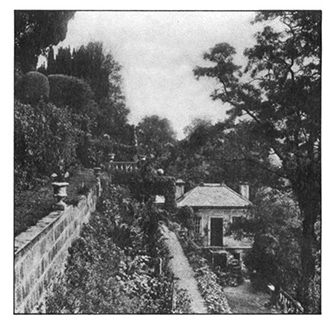
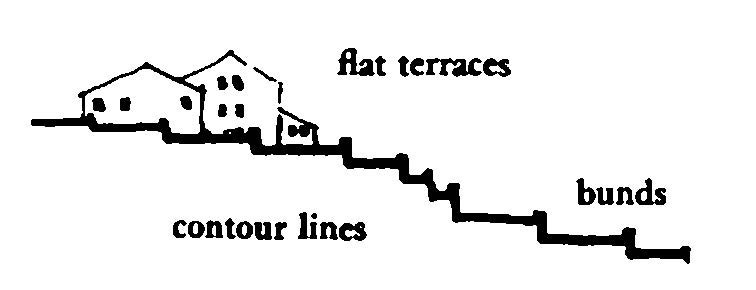
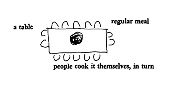

<section class="pattern-plate" aria-labelledby="t-terraced-slope">
<a href="/patterns">A Pattern Language</a> · <a href="/patterns#buildings">Buildings</a> · Pattern 169 · p. 790 · *
<h1 class="pattern-title" id="t-terraced-slope">Terraced Slope</h1><figure class="pattern-figure pl-figure"></figure><nav class="pattern-links" aria-label="Connections"><h2>Links to</h2><ul><li><a href="/patterns/site-repair">104 Site Repair</a></li><li><a href="/patterns/building-edge">160 Building Edge</a></li><li><a href="/patterns/connection-to-the-earth">168 Connection To The Earth</a></li><li><a href="/patterns/fruit-trees">170 Fruit Trees</a></li><li><a href="/patterns/vegetable-garden">177 Vegetable Garden</a></li><li><a href="/patterns/sitting-wall">243 Sitting Wall</a></li><li><a href="/patterns/raised-flowers">245 Raised Flowers</a></li></ul><h2>Linked from</h2><ul><li><a href="/patterns/site-repair">104 Site Repair</a></li><li><a href="/patterns/private-terrace-on-the-street">140 Private Terrace On The Street</a></li><li><a href="/patterns/bulk-storage">145 Bulk Storage</a></li><li><a href="/patterns/connection-to-the-earth">168 Connection To The Earth</a></li><li><a href="/patterns/garden-growing-wild">172 Garden Growing Wild</a></li><li><a href="/patterns/raised-flowers">245 Raised Flowers</a></li><li><a href="/patterns/paving-with-cracks-between-the-stones">247 Paving With Cracks Between The Stones</a></li></ul></nav></section><article class="pattern-text" aria-label="The text of Terraced Slope">
791… this pattern helps to complete <a class="pl-ref" href="/patterns/site-repair">SITE REPAIR (104)</a>. Where there are buildings, it ties into the <a class="pl-ref" href="/patterns/building-edge">BUILDING EDGE (160)</a> and can help form it; and it helps create the <a class="pl-ref" href="/patterns/connection-to-the-earth">CONNECTION TO THE EARTH (168)</a>. If the ground is sloping at all, this pattern tells you how to handle the slope of the ground in a way that makes sense for the people • in the building, and for the plants and grasses on the ground.

◆ ◆ ◆

<strong>On sloping land, erosion caused by run off can kill the soil. It also creates uneven distribution of rainwater over the land, which naturally does less for plant life than it could if it were evenly distributed.</strong>

Terraces and bunds, built along contour lines, have been used for thousands of years to solve this problem. Erosion starts when the water runs down certain lines, erodes the earth along these lines, makes it hard for plants to grow there, then forms rills in the mud and dust, which are then still more vulnerable to more runoff, and get progressively worse and worse. The terraces control erosion by slowing down the water, and preventing the formation of these rills in the first place.

Even more important, the terraces spread the water evenly over the entire landscape. In a given area, each square meter of earth gets the s.me amount of water since the water stays where it falls. Under these conditions, plants can grow everywhere—on the steepest parts of hillsides as easily as in the most luscious valleys.

The pattern of terracing makes as much sense on a small house lot as it does on the hills around a valley. Proper terracing on a small lot creates a stable micro-system of drainage, and protects the top soil for the local gardens. Our main photograph shows a small building that is built on a terraced site. Once the terracing has been accomplished, the building can fit to it, and stretch across the lines of the terrace.

At both scales—the house lot and the hills—this method of 792conserving the land and making it healthy is ancient. “Only very lately has modern anti-erosion practice, for example, through contour ploughing, managed to match the effectiveness of traditional methods of terracing long practiced in countries as far apart as Japan and Peru.” (M. Nicholson, <em>The Environmental Revolution</em>, New York: McGraw Hill, 1970, p. 192.)

At the scale of hillsides and valleys, China is making an impressive attempt to reclaim her eroded land in this way. For instance, Joseph Alsop, “Terraced Fields in China”:

In the Chinese countryside, no effort has ever been spared to get a maximum crop with the resources available. Even so, I was hardly prepared for the “terrace fields” that they took me to see in the farming communes around Chungking.

The countryside hereabouts is both rocky and largely composed of such steep hills that even Chinese would not think of trying to grow rice on them. The old way, ruinously eroding, was to grow as much rice as possible in the valleys: and then plant the hillsides, too, where soil remained.

The new way is to make “terrace fields.” The rocks arc dynamited to get the needed building materials. Heavy dry-stone walls are then built to heights of six or seven feet, following the contours of the land. And earth is finally brought to fill in behind the stone walls, thereby producing a terrace field.

Therefore:

<strong>On all land which slopes—in fields, in parks, in public gardens, even in the private gardens around a house—make a system of terraces and bunds which follow the contour lines. Make them by building low walls along the contour lines, and then backfilling them with earth to form the terraces.</strong>

<strong>There is no reason why the building itself should fit into the terraces—it can comfortably cross terrace lines.</strong>

<figure class="pl-figure"></figure>
◆ ◆ ◆

793Plant vegetables and orchards on the terraces—<a class="pl-ref" href="/patterns/vegetable-garden">VEGETABLE GARDEN (177)</a>, <a class="pl-ref" href="/patterns/fruit-trees">FRUIT TREES (170)</a>; along the walls which form the terraces, plant flowers high enough to touch and smell—<a class="pl-ref" href="/patterns/raised-flowers">RAISED FLOWERS (245)</a>. And it is also very natural to make the walls so people can sit on them—<a class="pl-ref" href="/patterns/sitting-wall">SITTING WALL (243)</a>….

<figure class="pl-figure"></figure></article>

Christopher Alexander, Sara Ishikawa and Murray Silverstein, with Max Jacobson, Ingrid Fiksdahl-King and Shlomo Angel, <cite>A Pattern Language</cite> (Oxford University Press, 1977), pattern 169, pp. 790–793. Text and illustrations from the <a href="https://github.com/natureoforder/sources">Nature of Order sources</a> reading edition, transcribed from the 1977 printing; report errors on <a href="https://github.com/natureoforder/alexander-wiki/issues">GitHub</a>.

<a href="/patterns/connection-to-the-earth">← 168 Connection To The Earth</a> · <a href="/patterns">All 253 patterns</a> · <a href="/patterns/fruit-trees">170 Fruit Trees →</a>

