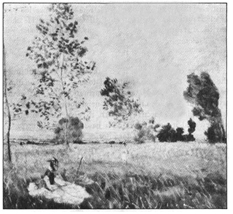
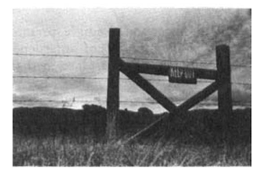
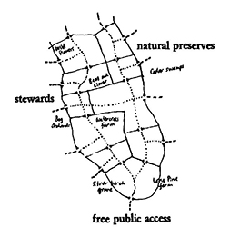

<section class="pattern-plate" aria-labelledby="t-the-countryside">
<a href="/patterns">A Pattern Language</a> · <a href="/patterns#towns">Towns</a> · Pattern 7 · p. 36 · *
<h1 class="pattern-title" id="t-the-countryside">The Countryside</h1><figure class="pattern-figure pl-figure"></figure><nav class="pattern-links" aria-label="Connections"><h2>Links to</h2><ul><li><a href="/patterns/the-distribution-of-towns">2 The Distribution Of Towns</a></li><li><a href="/patterns/city-country-fingers">3 City Country Fingers</a></li><li><a href="/patterns/agricultural-valleys">4 Agricultural Valleys</a></li><li><a href="/patterns/lace-of-country-streets">5 Lace Of Country Streets</a></li><li><a href="/patterns/country-towns">6 Country Towns</a></li><li><a href="/patterns/mosaic-of-subcultures">8 Mosaic Of Subcultures</a></li><li><a href="/patterns/scattered-work">9 Scattered Work</a></li><li><a href="/patterns/magic-of-the-city">10 Magic Of The City</a></li><li><a href="/patterns/local-transport-areas">11 Local Transport Areas</a></li><li><a href="/patterns/house-cluster">37 House Cluster</a></li><li><a href="/patterns/green-streets">51 Green Streets</a></li></ul><h2>Linked from</h2><ul><li><a href="/patterns/independent-regions">1 Independent Regions</a></li><li><a href="/patterns/agricultural-valleys">4 Agricultural Valleys</a></li><li><a href="/patterns/lace-of-country-streets">5 Lace Of Country Streets</a></li><li><a href="/patterns/country-towns">6 Country Towns</a></li><li><a href="/patterns/subculture-boundary">13 Subculture Boundary</a></li><li><a href="/patterns/access-to-water">25 Access To Water</a></li><li><a href="/patterns/hierarchy-of-open-space">114 Hierarchy Of Open Space</a></li></ul></nav></section><article class="pattern-text" aria-label="The text of The Countryside">
37… within each region, in between the towns, there are vast areas of countryside-farmland, parkland, forests, deserts, grazing meadows, lakes, and rivers. The legal and ecological character of this countryside is crucial to the balance of the region. When properly done, this pattern will help to complete <a class="pl-ref" href="/patterns/the-distribution-of-towns">THE DISTRIBUTION OF TOWNS (2)</a>, <a class="pl-ref" href="/patterns/city-country-fingers">CITY COUNTRY FINGERS (3)</a>, <a class="pl-ref" href="/patterns/agricultural-valleys">AGRICULTURAL VALLEYS (4)</a>, <a class="pl-ref" href="/patterns/lace-of-country-streets">LACE OF COUNTRY STREETS (5)</a> and <a class="pl-ref" href="/patterns/country-towns">COUNTRY TOWNS (6)</a>.

◆ ◆ ◆

<strong>I conceive that land belongs for use to a vast family of which many are dead, few are living, and countless members are still unborn.</strong>

<strong>—a Nigerian tribesman</strong>

Parks are dead and artificial. Farms, when treated as private property, rob the people of their natural biological heritage-the countryside from which they came.

<figure class="pl-figure"><figcaption><em>Property is theft</em></figcaption></figure>

In Norway, England, Austria, it is commonly understood that people have a right to picnic in farmland, and walk and play—provided they respect the animals and crops. And the reverse is also true—there is no wilderness which is abandoned to its own processes—even the mountainsides are terraced, mown, and grazed and cared for.

We may summarize these ideas by saying that there is only one kind of non urban <em>land—the countryside</em>. There are no parks; 38no farms; no uncharted wilderness. Every piece of countryside has keepers who have the right to farm it, if it is arable; or the obligation to look after it, if it is wild; and every piece of land is open to the people at large, provided they respect the organic processes which are going on there.

The central conception behind this view of the land is given by Aldo Leopold in his essay, “The Land Ethic” (<em>A Sand County Almanac</em>, New York: Oxford University Press, 1949); Leopold believes that our relationship to the land will provide the framework for the next great ethical transformation in the human community:

This extension of ethics, so far studied only by philosophers, is actually a process in ecological evolution. Its sequences may be described in ecological as well as in philosophical terms. An ethic, ecologically, is a limitation on freedom of action in the struggle for existence. An ethic, philosophically, is a differentiation of social from anti-social conduct. These are two definitions of one thing. The thing has its origin in the tendency of interdependent individuals or groups to evolve modes of co-operation. The ecologist calls these symbioses. Politics and economics are advanced symbioses in which the original free-for-all competition has been replaced, in part, by co-operative mechanisms with an ethical content….

All ethics so far evolved rest upon a single premise: that the individual is a member of a community of interdependent parts. His instincts prompt him to compete for his place in that community, but his ethics prompt him also to co-operate….

The land ethic simply enlarges the boundaries of the community to include soils, waters, plants, and animals, or collectively: the land …

Within the framework of this ethic, parks and campgrounds conceived as “pieces of nature” for people’s recreation, without regard for the intrinsic value of the land itself, are dead things and immoral. So also are farms conceived as areas “owned” by the farmers for their own exclusive profit. If we continue to treat the land as an instrument for our enjoyment, and as a source of economic profit, our parks and camps will become more artificial, more plastic, more like Disneyland. And our farms will become more and more like factories. The land ethic replaces the idea of public parks and public campgrounds with the concept of a single countryside.

39One example of support for this idea lies in the <em>Blueprint for Suroioal</em>, and the proposal there to give traditional communities stewardship over certain estuaries and marshes. These wetlands are the spawning grounds for the fish and shellfish which form the base of the food chain for 60 per cent of the entire ocean harvest, and they can only be properly managed by a group who respects them as a cooperating part in the chain of life. (The Ecologist, England: Penguin, 1972, p. 4-1.)

The residential forests of Japan provide another example. A village grows up along the edge of a forest; the villagers tend the forest. Thinning it properly is one of their responsibilities. The forest is available to anyone who wants to come there and partake in the process:

The farmhouses of Kurume-machi stand in a row along the main road for about a mile. Each house is surrounded by a belt of trees of similar species, giving the aspect of a single large forest. The main trees are located so as to produce a shelter-belt. In addition, these small forests are homes for birds, a device for conserving water, a source of :firewood and timber, which is selectively cut, and a means of climate control, since the temperature inside the residential forest is cooler in summer and warmer in winter.

It should be noted that these residential forests, established more than 300 years ago, are still intact as a result of the careful selective cutting and replacement program followed by the residents. (John L. Creech, “Japan-Like a National Park,” <em>Yearbook of Agriculture</em> 1963, U, S. Department of Agriculture, pp. 525–28.)

Therefore:

<strong>Define all farms as parks, where the public has a right to be; and make all regional parks into working farms.</strong>

<strong>Create stewardships among groups of people, families and cooperatives, with each stewardship responsible for one part of the countryside. The stewards are given a lease for the land, and they are free to tend the land and set ground rules for its use—as a small farm, a forest, manhland, desert, and so forth. The public is free to visit the land, hike there, picnic, explore, boat, so long as they conform to the ground rules. With such a setup, a farm near a city might have picnickers in its fields every day during the summer.</strong>

<figure class="pl-figure"></figure>
40

◆ ◆ ◆

Within each natural preserve, we imagine <em>a</em> limited number of houses—<a class="pl-ref" href="/patterns/house-cluster">HOUSE CLUSTER (37)</a>—with access on unpaved country lanes—<a class="pl-ref" href="/patterns/green-streets">GREEN STREETS (51)</a>….

<strong><em>41through city policies, encourage the piecemeal formation of those major structures which define the city:</em></strong>

<a class="pl-ref" href="/patterns/mosaic-of-subcultures">8. MOSAIC OF SUBCULTURES</a>

<a class="pl-ref" href="/patterns/scattered-work">9. SCATTERED WORK</a>

<a class="pl-ref" href="/patterns/magic-of-the-city">10. MAGIC OF THE CITY</a>

<a class="pl-ref" href="/patterns/local-transport-areas">11. LOCAL TRANSPORT AREAS</a>
</article>

Christopher Alexander, Sara Ishikawa and Murray Silverstein, with Max Jacobson, Ingrid Fiksdahl-King and Shlomo Angel, <cite>A Pattern Language</cite> (Oxford University Press, 1977), pattern 7, pp. 36–41. Text and illustrations from the <a href="https://github.com/natureoforder/sources">Nature of Order sources</a> reading edition, transcribed from the 1977 printing; report errors on <a href="https://github.com/natureoforder/alexander-wiki/issues">GitHub</a>.

<a href="/patterns/country-towns">← 6 Country Towns</a> · <a href="/patterns">All 253 patterns</a> · <a href="/patterns/mosaic-of-subcultures">8 Mosaic Of Subcultures →</a>

