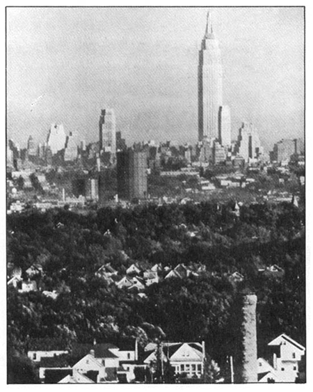

<section class="pattern-plate" aria-labelledby="t-the-distribution-of-towns">
<a href="/patterns">A Pattern Language</a> · <a href="/patterns#towns">Towns</a> · Pattern 2 · p. 16
<h1 class="pattern-title" id="t-the-distribution-of-towns">The Distribution Of Towns</h1><figure class="pattern-figure pl-figure"></figure><nav class="pattern-links" aria-label="Connections"><h2>Links to</h2><ul><li><a href="/patterns/independent-regions">1 Independent Regions</a></li><li><a href="/patterns/city-country-fingers">3 City Country Fingers</a></li><li><a href="/patterns/agricultural-valleys">4 Agricultural Valleys</a></li><li><a href="/patterns/country-towns">6 Country Towns</a></li></ul><h2>Linked from</h2><ul><li><a href="/patterns/independent-regions">1 Independent Regions</a></li><li><a href="/patterns/city-country-fingers">3 City Country Fingers</a></li><li><a href="/patterns/country-towns">6 Country Towns</a></li><li><a href="/patterns/the-countryside">7 The Countryside</a></li></ul></nav></section><article class="pattern-text" aria-label="The text of The Distribution Of Towns">
17… consider now the character of settlements within the region: what balance of villages, towns, and cities is in keeping with the independence of the region-<a class="pl-ref" href="/patterns/independent-regions">INDEPENDENT REGIONS (1)</a>?

◆ ◆ ◆

<strong>If the population of a region is weighted too far toward small villages, modem civilization can never emerge; but if the population is weighted too far toward big cities, the earth will go to ruin because the population isn’t where it needs to be, to take care of it.</strong>

Two different necessities govern the distribution of population in a region. On the one hand, people are drawn to cities: they are drawn by the growth of civilization, jobs, education, economic growth, information. On the other hand, the region as a social and ecological whole will not be properly maintained unless the people of the region are fairly well spread out across it, living in many different kinds of settlements-farms, villages, towns, and cities-with each settlement taking care of the land around it. Industrial society has so far been following only the first of these necessities. People leave the farms and towns and villages and pack into the cities, leaving vast parts of the region depopulated and undermaintained.

In order to establish a reasonable distribution of population within a region, we must fix two separate features of the distribution: its statistical character and its spatial character. First, we must be sure that the statistical distribution of towns, by size, is appropriate: we must be sure that there are many small towns and few large ones. Second, we must then be sure that the spatial distribution of towns within the region is appropriate: we must be sure that the towns in any given size category are evenly spread out across the region, not highly concentrated.

In practice, the statistical distribution will take care of itself. A large number of studies has shown that the natural demographic and political and economic processes at work in city growth and population movement will create a distribution of 18towns with many small towns and few large ones; and indeed, the nature of this distribution does correspond, roughly, to the logarithmic distribution that we propose in this pattern. Various explanations have been given by Christaller, Zipf, Herbert Simon, and others; they are summarized in Brian Berry and William Garrison, “Alternate Explanations of Urban Rank-Size Relationships,” <em>Annals of the Association of American Geographers</em>, Vol.if-8, March 1958, No. 1, pp. 83–91.

Let us assume, then, that towns will have the right distribution of sizes. But are they adjacent to one another, or are they spread out! If all the towns in a region, large, medium, and small, were crammed together in one continuous urban area, the fact that some are large and some are small, though interesting politically, would have no ecological meaning whatsoever. As far as the ecology of the region is concerned, it is the <em>spatial</em> distribution of the towns which matters, not the statistics of political boundaries within the urban sprawl.

Two arguments have led us to propose that the towns in any one size category should be uniformly distributed across the region: an economic argument and an ecological argument.

<em>Economic</em>. All over the world, underdeveloped areas are facing economic ruin because the jobs, and then the people, move toward the largest cities, under the influence of their economic gravity. Sweden, Scotland, Israel, and Mexico are all examples. The population moves toward Stockholm, Glasgow, Tel Aviv, Mexico City—as it does so, new jobs get created in the city, and then even more people have to come to the city in search of jobs. Gradually the imbalance between city and country becomes severe. The city becomes richer, the outlying areas continuously poorer. In the end the region may have the highest standard of living in the world at its center, yet only a few miles away, at its periphery, people may be starving.

This can only be halted by policies which guarantee an equal sharing of resources, and economic development, across the entire region. In Israel, for example, there has been some attempt to pour the limited resources with which the government can subsidize economic growth into those areas which are most backward economically. (See “Urban Growth Policies in Six 19European Countries,” Urban Growth Policy Study Group, Office of International Affairs, HUD, Washington, D.C., 1972.)

<em>Ecological</em>. An over concentrated population, in space, puts a huge burden on the region’s overall ecosystem. As the big cities grow, the population movement overburdens these areas with air pollution, strangled transportation, water shortages, housing shortages, and living densities which go beyond the realm of human reasonableness. In some metropolitan centers, the ecology is perilously close to cracking. By contrast, a population that is spread more evenly over its region minimizes its impact on the ecology of the environment, and finds that it can take care of itself and the land more prudently, with less waste and more humanity:

This is because the actual urban superstructure required per inhabitant goes up radically as the size of the town increases beyond a certain point. For example, the <em>per capita</em> cost of high rise flats is much greater than that of ordinary houses; and the cost of roads and other transportation routes increases with the number of commuters carried. Similarly, the <em>per capita</em> expenditure on other facilities such as those for distributing food and removing wastes is much higher in cities than in small towns and villaget. Thus, if everybody lived in villages the need for sewage treatment plants would be somewhat reduced, while in an entirely urban society they are essential, and the cost of treatment is high. Broadly speaking, it is only by decentralization that we can increase self-sufliciency and self-sufficiency is vital if we are to minimize the burden of social systems on the ecosystems that support them. The Ecologist, <em>Blueprint for Survival</em>, England: Penguin, 1972, pp. 52–53.)

Therefore:

<strong>Encourage a birth and death process for towns within the region, which gradually has these effects:</strong>

<strong>1.  The population is evenly distributed in terms of different sizes-for example. one town with l,000,000 people, 10 towns with 100,000 people each, 100 towns with 10,000 people each, and 1000 towns with loo people each.</strong>

<strong>2.  These towns are distributed in space in such a way that within each size category the towns arc homogeneously distributed all across the region.</strong>

<strong>20This process can be implemented by regional zoning policies, land. grants, and incentives which encourage industries to locate according to the dictates of the distribution.</strong>

<figure class="pl-figure"></figure>
<strong>towns of 1,000,000 – 250 miles apart 
towns of 100,000 – 80 miles apart 
towns of 10,000 – 25 miles apart 
towns of 1,000 – 8 miles apart</strong>

As the distribution evolves, protect the prime agricultural land for farming—<a class="pl-ref" href="/patterns/agricultural-valleys">AGRICULTURAL VALLEYS (4)</a>; protect the smaller outlying towns, by establishing belts of countryside around them and by decentralizing industry, so that the towns are economically stable—<a class="pl-ref" href="/patterns/country-towns">COUNTRY TOWNS (6)</a>. In the larger more central urban areas work toward land policies which maintain open belts of countryside between the belts of city—<a class="pl-ref" href="/patterns/city-country-fingers">CITY COUNTRY FINGERS (3)</a> …
</article>

Christopher Alexander, Sara Ishikawa and Murray Silverstein, with Max Jacobson, Ingrid Fiksdahl-King and Shlomo Angel, <cite>A Pattern Language</cite> (Oxford University Press, 1977), pattern 2, pp. 16–20. Text and illustrations from the <a href="https://github.com/natureoforder/sources">Nature of Order sources</a> reading edition, transcribed from the 1977 printing; report errors on <a href="https://github.com/natureoforder/alexander-wiki/issues">GitHub</a>.

<a href="/patterns/independent-regions">← 1 Independent Regions</a> · <a href="/patterns">All 253 patterns</a> · <a href="/patterns/city-country-fingers">3 City Country Fingers →</a>

