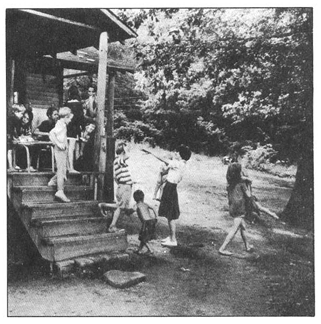
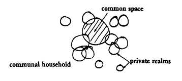

<section class="pattern-plate" aria-labelledby="t-the-family">
<a href="/patterns">A Pattern Language</a> · <a href="/patterns#towns">Towns</a> · Pattern 75 · p. 376 · *
<h1 class="pattern-title" id="t-the-family">The Family</h1><figure class="pattern-figure pl-figure"></figure><nav class="pattern-links" aria-label="Connections"><h2>Links to</h2><ul><li><a href="/patterns/life-cycle">26 Life Cycle</a></li><li><a href="/patterns/household-mix">35 Household Mix</a></li><li><a href="/patterns/row-houses">38 Row Houses</a></li><li><a href="/patterns/housing-hill">39 Housing Hill</a></li><li><a href="/patterns/house-for-a-couple">77 House For A Couple</a></li><li><a href="/patterns/house-for-one-person">78 House For One Person</a></li><li><a href="/patterns/building-complex">95 Building Complex</a></li><li><a href="/patterns/communal-eating">147 Communal Eating</a></li></ul><h2>Linked from</h2><ul><li><a href="/patterns/life-cycle">26 Life Cycle</a></li><li><a href="/patterns/household-mix">35 Household Mix</a></li><li><a href="/patterns/house-cluster">37 House Cluster</a></li><li><a href="/patterns/animals">74 Animals</a></li><li><a href="/patterns/house-for-a-small-family">76 House For A Small Family</a></li><li><a href="/patterns/house-for-a-couple">77 House For A Couple</a></li><li><a href="/patterns/your-own-home">79 Your Own Home</a></li><li><a href="/patterns/childrens-home">86 Children’s Home</a></li><li><a href="/patterns/wings-of-light">107 Wings Of Light</a></li><li><a href="/patterns/couples-realm">136 Couple’s Realm</a></li><li><a href="/patterns/a-room-of-ones-own">141 A Room Of One’s Own</a></li><li><a href="/patterns/communal-eating">147 Communal Eating</a></li><li><a href="/patterns/rooms-to-rent">153 Rooms To Rent</a></li><li><a href="/patterns/teenagers-cottage">154 Teenager’s Cottage</a></li><li><a href="/patterns/old-age-cottage">155 Old Age Cottage</a></li><li><a href="/patterns/settled-work">156 Settled Work</a></li></ul></nav></section><article class="pattern-text" aria-label="The text of The Family">
377… assume now, that you have decided to build a house for yourself. If you place it properly, this house can help to form a cluster, or a row of houses, or a hill of houses—house cluster (37), <a class="pl-ref" href="/patterns/row-houses">row houses (38)</a>, <a class="pl-ref" href="/patterns/housing-hill">housing hill (39)</a>—or it can help to keep a working community alive—housing in between (48). This next pattern now gives you some vital information about the social character of the household itself. If you succeed in following this pattern, it will help repair <a class="pl-ref" href="/patterns/life-cycle">life cycle (26)</a> and <a class="pl-ref" href="/patterns/household-mix">household mix (35)</a> in your community.

◆ ◆ ◆

<strong>The nuclear family is not by itself a viable social form.</strong>

Until a few years ago, human society was based on the extended family: a family of at least three generations, with parents, children, grandparents, uncles, aunts, and cousins, all living together in a single or loosely knit multiple household. But today people move hundreds of miles to marry, to find education, and to work. Under these circumstances the only family units which are left are those units called nuclear families: father, mother, and children. And many of these are broken down even further by divorce and separation.

Unfortunately, it seems very likely that the nuclear family is not a viable social form. It is too small. Each person in a nuclear family is too tightly linked to other members of the family; any one relationship which goes sour, even for a few hours, becomes critical; people cannot simply tum away toward uncles, aunts, grandchildren, cousins, brothers. Instead, each difficulty twists the family unit into ever tighter spirals of discomfort; the children become prey to all kinds of dependencies and oedipal neuroses; the parents are so dependent on each other that they are finally forced to separate.

Philip Slater describes this situation for American families and finds in the adults of the family, especially the women, a terrible, brooding sense of deprivation. There are simply not enough people around, not enough communal action, to give the ordinary 378experience around the home any depth or richness. (Philip E. Slater, <em>The Pursuit of Loneliness</em>, Boston: Beacon Press, 1970, p. 67, and throughout.)

It seems essential that the people in a household have at least a dozen people round them, so that they can find the comfort and relationships they need to sustain them during their ups and downs. Since the old extended family, based on blood ties, seems to be gone—at least for the moment—this can only happen if small families, couples, and single people join together in voluntary “families” of ten or so.

In his final book, <em>Island</em>, Aldous Huxley portrayed a lovely vision of such a development:

“How many homes does a Palanese child have?”

“About twenty on the average.”

“Twenty? My God!”

“We all belong,” Susila explained, “to a MAC—a Mutual Adoption Club. Every MAC consists of anything from fifteen to twenty-five assorted couples. Newly elected brides and bridegrooms, old-timers with growing children, grandparents and great-grandparents—everybody in the club adopts everyone else. Besides our own blood relations, we all have our quota of deputy mothers, deputy fathers, deputy aunts and uncles, deputy brothers and sisters, deputy babies and toddlers and teen-agers.”

Will shook bis head. “Making twenty families grow where only one grew before.”

“But what grew before was <em>your</em> kind of family….” As though reading instructions from a cookery book, “Take one sexually inept wage slave,” she went on, “one dissatisfied female, two or (if preferred) three small television addicts; marinate in a mixture of Freudism and dilute Christianity; then bottle up tightly in a four-room flat and stew for fifteen years in their own juice. <em>Our</em> recipe is rather different: Take twenty sexually satisfied couples and their offspring; add science, intuition and humor in equal quantities; steep in Tantrik Buddhism and simmer indefinitely in an open pan in the open air over a brisk flame of affection.”

“And what comes out of your open pan?” he asked.

“An entirely different kind of family. Not exclusive, like your families, and not predestined, not compulsory. An inclusive, unpredestined and voluntary family. Twenty pairs of fathers and mothers, eight or nine ex-fathers and ex-mothers, and forty or fifty assorted children of all ages.” (Aldous Huxley, <em>Island</em>, New York: Bantam, 1962, pp. 89–90.)

Physically, the setting for a large voluntary family must provide 379for a balance of privacy and communality. Each small family, each person, each couple, needs a private realm, almost a private household of their own, according to their territorial need. In the movement to build communes, it is our experience that group have not taken this need for privacy seriously enough. It has been shrugged off, as something to overcome. But it is a deep and basic need; and if the setting does not let each person and each small household regulate itself on this dimension, it is sure to cause trouble. We propose, therefore, that individuals, couples, people young and old—each subgroup—have its own legally independent household—in some cases, physically separate households and cottages, at least separate room;, suites, and floors.

The private realms are then set off against the common space and the common functions. The most vital commons are the kitchen, the place to sit down and eat, and a garden. Common meals, at least several nights a week, seem to play the biggest role in binding the group. The meals, and taking time at the cooking, provide the kind of casual meeting time when everything else can be comfortably discussed: the child care arrangements, maintenance, projects—see <a class="pl-ref" href="/patterns/communal-eating">communal eating (147)</a>.

This would suggest, then, a large family room-farmhouse kitchen, right at the heart of the site—at the main crossroads, where everyone would tend to meet toward the end of the day. Again, according to the style of the family, this might be a separate building, with workshop and gardens, or one wing of a house, or the entire first floor of a two or three story building.

There is some evidence that processes which generate large voluntary group households are already working in the society. (Cf. Pamela Hollie, “More families share houses with others to enhance ‘life style,’”<em>Wall Street Journal</em>, July 7, 1972.)

One way to spur the growth of voluntary families: When someone turns over or sells their home or room or apartment, they first tell everyone living around them—their neighbors. These neighbors then have the right to find friends of theirs to take the place—and thus to extend their “family.” If friends are able to move in, then they can arrange for themselves how to create a functioning family, with commons, and so on. They might build a connection between the homes, knock out a wall, add a 380room. If the people immediately around the place cannot make the sale in a few months, then it reverts to the normal marketplace.

Therefore:

<strong>Set up processes which encourage groups of 8 to 12 people to come together and establish communal households. Morphologically, the important things are:</strong>

<strong>1.  Private realms for the groups and individuals that make up the extended family: couple’s realms, private rooms, sub-households for small families.</strong>

<strong>2.  Common space for shared functions: cooking, working, gardening, child care.</strong>

<strong>3.  At the important crossroads of the site, a place where the entire group can meet and sit together.</strong>

<figure class="pl-figure"></figure>
◆ ◆ ◆

Each individual household within the larger family must, at all costs, have a clearly defined territory of its own, which it controls—your own home (79); treat the individual territories according to the nature of the individual households—house for a small family (76), <a class="pl-ref" href="/patterns/house-for-a-couple">house for a couple (77)</a>, <a class="pl-ref" href="/patterns/house-for-one-person">house for one person (78)</a>; and build common space between them, where the members of the different smaller households can meet and eat together—common areas at the heart (129), <a class="pl-ref" href="/patterns/communal-eating">communal eating (147)</a>. For the shape of the building, gardens, parking, and surroundings, begin with <a class="pl-ref" href="/patterns/building-complex">building complex (95)</a>….
</article>

Christopher Alexander, Sara Ishikawa and Murray Silverstein, with Max Jacobson, Ingrid Fiksdahl-King and Shlomo Angel, <cite>A Pattern Language</cite> (Oxford University Press, 1977), pattern 75, pp. 376–380. Text and illustrations from the <a href="https://github.com/natureoforder/sources">Nature of Order sources</a> reading edition, transcribed from the 1977 printing; report errors on <a href="https://github.com/natureoforder/alexander-wiki/issues">GitHub</a>.

<a href="/patterns/animals">← 74 Animals</a> · <a href="/patterns">All 253 patterns</a> · <a href="/patterns/house-for-a-small-family">76 House For A Small Family →</a>

