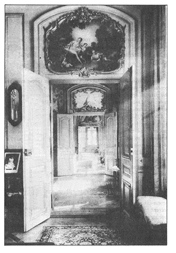
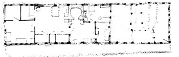
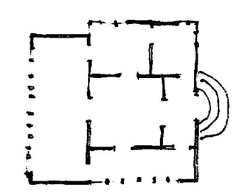
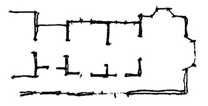
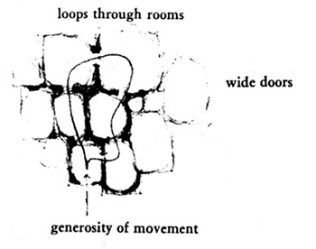

<section class="pattern-plate" aria-labelledby="t-the-flow-through-rooms">
<a href="/patterns">A Pattern Language</a> · <a href="/patterns#buildings">Buildings</a> · Pattern 131 · p. 627
<h1 class="pattern-title" id="t-the-flow-through-rooms">The Flow Through Rooms</h1><figure class="pattern-figure pl-figure"></figure><nav class="pattern-links" aria-label="Connections"><h2>Links to</h2><ul><li><a href="/patterns/intimacy-gradient">127 Intimacy Gradient</a></li><li><a href="/patterns/common-areas-at-the-heart">129 Common Areas At The Heart</a></li><li><a href="/patterns/entrance-room">130 Entrance Room</a></li><li><a href="/patterns/short-passages">132 Short Passages</a></li><li><a href="/patterns/staircase-as-a-stage">133 Staircase As A Stage</a></li><li><a href="/patterns/zen-view">134 Zen View</a></li><li><a href="/patterns/tapestry-of-light-and-dark">135 Tapestry Of Light And Dark</a></li><li><a href="/patterns/light-on-two-sides-of-every-room">159 Light On Two Sides Of Every Room</a></li><li><a href="/patterns/corner-doors">196 Corner Doors</a></li></ul><h2>Linked from</h2><ul><li><a href="/patterns/something-roughly-in-the-middle">126 Something Roughly In The Middle</a></li><li><a href="/patterns/common-areas-at-the-heart">129 Common Areas At The Heart</a></li><li><a href="/patterns/short-passages">132 Short Passages</a></li><li><a href="/patterns/staircase-as-a-stage">133 Staircase As A Stage</a></li><li><a href="/patterns/tapestry-of-light-and-dark">135 Tapestry Of Light And Dark</a></li><li><a href="/patterns/half-open-wall">193 Half-Open Wall</a></li><li><a href="/patterns/interior-windows">194 Interior Windows</a></li><li><a href="/patterns/corner-doors">196 Corner Doors</a></li><li><a href="/patterns/low-doorway">224 Low Doorway</a></li></ul></nav></section><article class="pattern-text" aria-label="The text of The Flow Through Rooms">
628… next to the gradient of spaces created by <a class="pl-ref" href="/patterns/intimacy-gradient">INTIMACY GRADIENT (127)</a> and <a class="pl-ref" href="/patterns/common-areas-at-the-heart">COMMON AREAS AT THE HEART (129)</a>, the way that rooms connect to one another will play the largest role in governing the character of indoor space. This pattern describes the most fundamental way of linking rooms to one another.

◆ ◆ ◆

<strong>The movement between rooms is as important as the rooms themselves; and its arrangement has as much effect on social interaction in the rooms, as the interiors of the rooms</strong>.

The movement between rooms, the circulation space, may be generous or mean. In a building where the movement is mean, the passages are dark and narrow—rooms open off them as dead ends; you spend your time entering the building, or moving between rooms, like a crab scuttling in the dark.

Compare this with a building where the movement is generous. The passages are broad, sunlit, with seats in them, views into gardens, and they are more or less continuous with the rooms themselves, so that the smell of woodsmoke and cigars, the sound of glasses, whispers, laughter, all that which enlivens a room, also enlivens the places where you move.

These two approaches to movement have entirely different psychological effects.

In a complex social fabric, human relations are inevitably subtle. It is essential that each person feels free to make connections or not, to move or not, to talk or not, to change the situation or not, according to his judgment. If the physical environment inhibits him and reduces his freedom of action, it will prevent him from doing the best he can to keep healing and improving the social situations he is in as he sees fit.

The building with generous circulation allows each person’s instincts and intuitions full play. The building with ungenerous circulation inhibits them. It not only separates rooms from one another to such an extent that it is an ordeal to move from room 629to room, but kills the joy of time spent between rooms and may discourage movement altogether.

The following incident shows how important freedom of movement is to the life of a building. An industrial company in Lausanne had the following experience. They installed TV-phone intercoms between all offices to improve communication. A few months later, the firm was going down the drain—and they called in a management consultant. He finally traced their problems back to the TV-phones. People were calling each other on the TV-phone to ask specific questions—but as a result, people never talked in the halls and passages any more—no more “Hey, how are you, say, by the way, what do you think of this idea…” The organization was falling apart, because the informal talk—the glue which held the organization together—had been destroyed. The consultant advised them to junk the TV-phones—and they lived happily ever after.

This incident happened in a large organization. But the principle is just the same in a small work group or a family. The possibility of small momentary conversations, gestures, kindnesses, explanations which clear up misunderstandings, jokes and stories is the lifeblood of a human group. If it gets prevented, the group will fall apart as people’s individual relationships go gradually downhill.

It is almost certain that the building with ungenerous circulation makes it harder for people to maintain their social fabric. In the long run, there is a good chance that social order in the building with ungenerous circulation will break down altogether.

The generosity of movement depends on the overall arrangement of the movement in the building, not on the detailed design of individual passages. In fact, it is at its most generous, when there are no passages at all and movement is created by a string of interconnecting rooms with doors between them.

<figure class="pl-figure"><figcaption><em>A sequence of rooms without a passage</em>.</figcaption></figure>

630Even better, is the case where there is a loop. A loop, which passes through all the major rooms, public and common, establishes an enormous feeling of generosity. With a loop it is always possible to come and go in two different directions. It is possible to walk around and around, and it ties the rooms together. And, when such a loop passes through rooms (at one end so as not to disturb them), it connects rooms far more than a simple passage does.

<figure class="pl-figure"><figcaption><em>A generous circulation loop</em>.</figcaption></figure>

A building where there is a chain of rooms in sequence also works like this, if there is a passage in parallel with the chain of rooms.

<figure class="pl-figure"><figcaption><em>Passage in parallel forms the loop</em>.</figcaption></figure>

Therefore:

<strong>As far as possible, avoid the use of corridors and passages. Instead, use public rooms and common rooms as rooms for movement and for gathering. To do this, place the common rooms to form a chain, or loop, so that it becomes possible to walk from room to room—and so that private rooms open directly off these public rooms. In every 631case, give this indoor circulation from room to room a feeling of great generosity, passing in a wide and ample loop around the house, with views of fires and great windows.</strong>

<figure class="pl-figure"></figure>
◆ ◆ ◆

Whenever passages or corridors are unavoidable, make them wide and generous too; and try to place them on one aide of the building, so that they can be filled with light—<a class="pl-ref" href="/patterns/short-passages">SHORT PASSAGES (132)</a>. Furnish them like rooms, with carpets, bookshelves, easy chairs and tables, filtered light, and do the same for <a class="pl-ref" href="/patterns/entrance-room">ENTRANCE ROOM (130)</a> and <a class="pl-ref" href="/patterns/staircase-as-a-stage">STAIRCASE AS A STAGE (133)</a>. Always make sure that these rooms for movement have plenty of light in them and perhaps a view—<a class="pl-ref" href="/patterns/zen-view">ZEN VIEW (134)</a>, <a class="pl-ref" href="/patterns/tapestry-of-light-and-dark">TAPESTRY OF LIGHT AND DARK (135)</a>, and <a class="pl-ref" href="/patterns/light-on-two-sides-of-every-room">LIGHT ON TWO SIDES OF EVERY ROOM (159)</a>. Keep doors which open into rooms, or doors between rooms which create the flow through rooms, in the corners of the rooms—<a class="pl-ref" href="/patterns/corner-doors">CORNER DOORS (196)</a>….
</article>

Christopher Alexander, Sara Ishikawa and Murray Silverstein, with Max Jacobson, Ingrid Fiksdahl-King and Shlomo Angel, <cite>A Pattern Language</cite> (Oxford University Press, 1977), pattern 131, pp. 627–631. Text and illustrations from the <a href="https://github.com/natureoforder/sources">Nature of Order sources</a> reading edition, transcribed from the 1977 printing; report errors on <a href="https://github.com/natureoforder/alexander-wiki/issues">GitHub</a>.

<a href="/patterns/entrance-room">← 130 Entrance Room</a> · <a href="/patterns">All 253 patterns</a> · <a href="/patterns/short-passages">132 Short Passages →</a>

