

<section class="pattern-plate" aria-labelledby="t-the-shape-of-indoor-space">
<a href="/patterns">A Pattern Language</a> · <a href="/patterns#buildings">Buildings</a> · Pattern 191 · p. 883 · **
<h1 class="pattern-title" id="t-the-shape-of-indoor-space">The Shape Of Indoor Space</h1><nav class="pattern-links" aria-label="Connections"><h2>Links to</h2><ul><li><a href="/patterns/positive-outdoor-space">106 Positive Outdoor Space</a></li><li><a href="/patterns/ceiling-height-variety">190 Ceiling Height Variety</a></li><li><a href="/patterns/half-open-wall">193 Half-Open Wall</a></li><li><a href="/patterns/thick-walls">197 Thick Walls</a></li><li><a href="/patterns/closets-between-rooms">198 Closets Between Rooms</a></li><li><a href="/patterns/structure-follows-social-spaces">205 Structure Follows Social Spaces</a></li><li><a href="/patterns/floor-and-ceiling-layout">210 Floor And Ceiling Layout</a></li><li><a href="/patterns/columns-at-the-corners">212 Columns At The Corners</a></li><li><a href="/patterns/wall-membrane">218 Wall Membrane</a></li><li><a href="/patterns/floor-ceiling-vaults">219 Floor-Ceiling Vaults</a></li></ul><h2>Linked from</h2><ul><li><a href="/patterns/individually-owned-shops">87 Individually Owned Shops</a></li><li><a href="/patterns/corner-grocery">89 Corner Grocery</a></li><li><a href="/patterns/common-areas-at-the-heart">129 Common Areas At The Heart</a></li><li><a href="/patterns/entrance-room">130 Entrance Room</a></li><li><a href="/patterns/short-passages">132 Short Passages</a></li><li><a href="/patterns/staircase-as-a-stage">133 Staircase As A Stage</a></li><li><a href="/patterns/couples-realm">136 Couple’s Realm</a></li><li><a href="/patterns/farmhouse-kitchen">139 Farmhouse Kitchen</a></li><li><a href="/patterns/a-room-of-ones-own">141 A Room Of One’s Own</a></li><li><a href="/patterns/sequence-of-sitting-spaces">142 Sequence Of Sitting Spaces</a></li><li><a href="/patterns/bed-cluster">143 Bed Cluster</a></li><li><a href="/patterns/bathing-room">144 Bathing Room</a></li><li><a href="/patterns/reception-welcomes-you">149 Reception Welcomes You</a></li><li><a href="/patterns/a-place-to-wait">150 A Place To Wait</a></li><li><a href="/patterns/small-meeting-rooms">151 Small Meeting Rooms</a></li><li><a href="/patterns/half-private-office">152 Half-Private Office</a></li><li><a href="/patterns/rooms-to-rent">153 Rooms To Rent</a></li><li><a href="/patterns/teenagers-cottage">154 Teenager’s Cottage</a></li><li><a href="/patterns/old-age-cottage">155 Old Age Cottage</a></li><li><a href="/patterns/home-workshop">157 Home Workshop</a></li><li><a href="/patterns/outdoor-room">163 Outdoor Room</a></li><li><a href="/patterns/six-foot-balcony">167 Six-Foot Balcony</a></li><li><a href="/patterns/alcoves">179 Alcoves</a></li><li><a href="/patterns/workspace-enclosure">183 Workspace Enclosure</a></li><li><a href="/patterns/sitting-circle">185 Sitting Circle</a></li><li><a href="/patterns/marriage-bed">187 Marriage Bed</a></li><li><a href="/patterns/dressing-rooms">189 Dressing Rooms</a></li><li><a href="/patterns/windows-overlooking-life">192 Windows Overlooking Life</a></li><li><a href="/patterns/half-open-wall">193 Half-Open Wall</a></li><li><a href="/patterns/thick-walls">197 Thick Walls</a></li><li><a href="/patterns/efficient-structure">206 Efficient Structure</a></li><li><a href="/patterns/roof-layout">209 Roof Layout</a></li></ul></nav></section><article class="pattern-text" aria-label="The text of The Shape Of Indoor Space">
… from <a class="pl-ref" href="/patterns/ceiling-height-variety">CEILING HEIGHT VARIETY (190)</a> you have an overall conception of each floor in the building as a cascade of heights, typically highest in the middle where the largest rooms are, lower toward the edge where the small rooms are, and varying with floor also, so that the lower floors will tend to have a higher average ceiling height than upper floors. This pattern takes each individual space, within this overall cascade, and gives it a more definite shape.

◆ ◆ ◆

<strong>The perfectly crystalline squares and rectangles of ultramodern architecture make no special sense in human or in structural terms. They only express the rigid desires and fantasies which people have when they get too preoccupied with systems and the means of their production.</strong>

<figure class="pl-figure">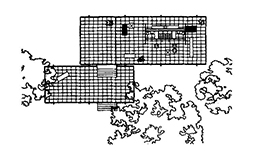</figure>
… <em>crystalline</em> …

To get away from this madness a new wave of thought has thrown the right angle away completely. Many of the new organic technologies create buildings and rooms shaped more or less like wombs and holes and caves.

884

<figure class="pl-figure">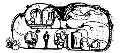</figure>
… <em>pseudo biological</em> …

But these biological rooms are as irrational, as much based on images and fantasies as the rigid crystals they are trying to replace. When we think about the human forces acting on rooms, we see that they need a shape which lies between the two. There are reasons why their sides should be more or less straight; and there are reasons why their angles, or many of them anyway, should be rough right angles. Yet their sides have no good reason to be perfectly equal, their angles have no good reason to be perfectly right angles. They only need to be irregular, rough, imperfect rectangles.

The core of our argument is this. We postulate that every space, which is recognizable and walled enough to be distinct, must have walls which are roughly straight, except when the walls are thick enough to be concave in both directions.

The reason is simple. Every wall has social spaces on both sides of it. Since a social space is convex—see the extensive argument in <a class="pl-ref" href="/patterns/positive-outdoor-space">positive outdoor space (106)</a>—it must either have a wall which is concave (thus forming a convex space) or a wall which is perfectly straight. But any “thin” wall which is concave toward one side, will be convex toward the other and will, therefore, leave a concave space on at least one side.

<figure class="pl-figure"></figure>
<em>Two convex spaces pressed up against each other</em>, <em>form a straight wall between them</em>.

885

<figure class="pl-figure">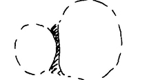<figcaption><em>A wall thick enough to be concave on both tides</em>.</figcaption></figure>
<figure class="pl-figure">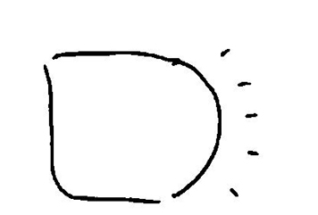</figure>
<em>A thin wall, makes a convex space on one side</em>, <em>and destroys the other tide</em>.

Essentially then, every wall with social spaces on both sides of it, must have straight walls, except where it is thick enough to be concave on both sides. And, of course, a wall may be curved whenever there is no significant social space on the outside of it. This happens sometimes in a position where an entrance butts out into a street, or where a bay window stands in a part of a garden which is unharmed by it.

<figure class="pl-figure">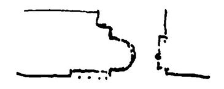<figcaption><em>A place where a wall can be curved, because it works with the outside</em>.</figcaption></figure>

So much for the walls. They must most <em>often</em> be roughly straight. Now for the angles between walls. Acute angles are hardly ever appropriate, for reasons of social integrity again. It is an uphill struggle to make an acute angle in a room, which works. Since the argument for convexity rules out angles of more than 180 degrees, this means that the corners of spaces must almost 886always be obtuse angles between 80 and 180 degrees. (We say 80, because a few degrees less than a right angle makes no difference.)

<figure class="pl-figure">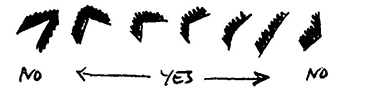<figcaption><em>The range of possible corners</em>.</figcaption></figure>

And one further word about the angles. Most often rooms will pack in such a way that angles somewhere near right angles (say between 80 and ioo degrees) make most sense. The reason, simply, is that other obtuse angles do not pack well at corners where several rooms meet. Here are the most likely typical kinds of corners:

<figure class="pl-figure">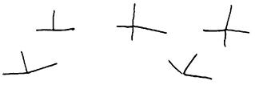<figcaption><em>Only angles that are nearly right angles pack successfully</em>.</figcaption></figure>

This means that the majority of spaces in a building must be polygons, in plan, with roughly straight walls and obtuse-angled corners. Most often they will probably be irregular, squashed, rough rectangles. Indeed, respect for the site and the subtleties of the plan will inevitably lead to slightly irregular shapes. And occasionally they may have curved walls—either if the wall is thick enough to be concave on both sides or, on an exterior wall, where there is no important social space outside.

<figure class="pl-figure">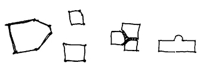<figcaption><em>Polygon, rough rectangle, thick curved •wall, exterior curved viall</em>.</figcaption></figure>

887A final point. Our experience has led us to an even stronger version of this pattern—which constrains the shape of ceilings too. Specifically, we believe that people feel uncomfortable in spaces like these:

<figure class="pl-figure">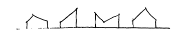<figcaption><em>Rooms whose ceilings can make you uncomfortable</em>.</figcaption></figure>

We can only speculate on the possible reasons for these feelings. It seems just possible that they originate from some kind of desire for a person to be surrounded by a spherical bubble roughly related to the human axis. Room shapes which are more or less versions of this bubble are comfortable; while those which depart from it strongly are uncomfortable. <em>Perhaps when the sface around us is too sharply different from the imaginary social bubble around us, we do not feel quite like persons</em>.

<figure class="pl-figure">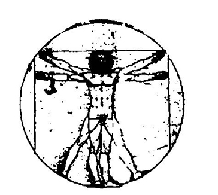<figcaption><em>The shape of the space bubble</em>.</figcaption></figure>

A ceiling that is flat, vaulted in one direction or vaulted in two directions, has the necessary character. A ceiling sloping to one side does not. We must emphasize that this conjecture is not intended as an argument in favor of rigidly simple or symmetric spaces. It only speaks against those rather abnormal spaces with one-sided sloping ceilings, high apexed ceilings, weird bulges into the room, and re-entrant angles in the wall.

888Therefore

<strong>With occasional exceptions, make each indoor space or each position of a space, a rough rectangle, with roughly straight walls, near right angles in the corners, and a roughly symmetrical vault over each room.</strong>

<figure class="pl-figure">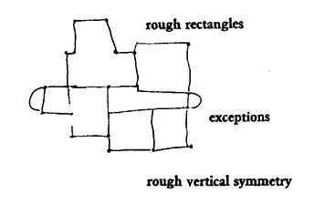</figure>
◆ ◆ ◆

You can define the room with columns, one at each corner—<a class="pl-ref" href="/patterns/columns-at-the-corners">COLUMNS AT THE CORNERS (212)</a>; and the shape of the ceiling can be given exactly by the ceiling vault—<a class="pl-ref" href="/patterns/floor-and-ceiling-layout">FLOOR AND CEILING LAYOUT (210)</a>, <a class="pl-ref" href="/patterns/floor-ceiling-vaults">FLOOR-CEILING VAULT (219)</a>. Avoid curved walls except where they are strictly necessary—<a class="pl-ref" href="/patterns/wall-membrane">WALL MEMBRANES (218)</a>. Where occasional curved walls like bay windows do jut out into the outside, place them to help create positive outdoor spaces (106). Make the walls of each room generous and deep—<a class="pl-ref" href="/patterns/thick-walls">THICK WALLS (197)</a>, <a class="pl-ref" href="/patterns/closets-between-rooms">CLOSETS BETWEEN ROOMS (198)</a>; and where it is appropriate, make them <a class="pl-ref" href="/patterns/half-open-wall">HALF-OPEN WALLS (193)</a>. For the patterns on the load-bearing structure, engineering, and construction, begin with <a class="pl-ref" href="/patterns/structure-follows-social-spaces">STRUCTURE FOLLOWS SOCIAL SPACES (205)</a>….
</article>

Christopher Alexander, Sara Ishikawa and Murray Silverstein, with Max Jacobson, Ingrid Fiksdahl-King and Shlomo Angel, <cite>A Pattern Language</cite> (Oxford University Press, 1977), pattern 191, pp. 883–888. Text and illustrations from the <a href="https://github.com/natureoforder/sources">Nature of Order sources</a> reading edition, transcribed from the 1977 printing; report errors on <a href="https://github.com/natureoforder/alexander-wiki/issues">GitHub</a>.

<a href="/patterns/ceiling-height-variety">← 190 Ceiling Height Variety</a> · <a href="/patterns">All 253 patterns</a> · <a href="/patterns/windows-overlooking-life">192 Windows Overlooking Life →</a>

