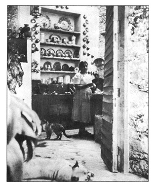
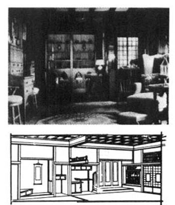
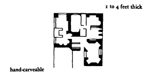

<section class="pattern-plate" aria-labelledby="t-thick-walls">
<a href="/patterns">A Pattern Language</a> · <a href="/patterns#buildings">Buildings</a> · Pattern 197 · p. 908 · **
<h1 class="pattern-title" id="t-thick-walls">Thick Walls</h1><figure class="pattern-figure pl-figure"></figure><nav class="pattern-links" aria-label="Connections"><h2>Links to</h2><ul><li><a href="/patterns/building-edge">160 Building Edge</a></li><li><a href="/patterns/alcoves">179 Alcoves</a></li><li><a href="/patterns/window-place">180 Window Place</a></li><li><a href="/patterns/ceiling-height-variety">190 Ceiling Height Variety</a></li><li><a href="/patterns/the-shape-of-indoor-space">191 The Shape Of Indoor Space</a></li><li><a href="/patterns/closets-between-rooms">198 Closets Between Rooms</a></li><li><a href="/patterns/sunny-counter">199 Sunny Counter</a></li><li><a href="/patterns/open-shelves">200 Open Shelves</a></li><li><a href="/patterns/waist-high-shelf">201 Waist-High Shelf</a></li><li><a href="/patterns/built-in-seats">202 Built-In Seats</a></li><li><a href="/patterns/child-caves">203 Child Caves</a></li><li><a href="/patterns/secret-place">204 Secret Place</a></li><li><a href="/patterns/thickening-the-outer-walls">211 Thickening The Outer Walls</a></li><li><a href="/patterns/columns-at-the-corners">212 Columns At The Corners</a></li></ul><h2>Linked from</h2><ul><li><a href="/patterns/individually-owned-shops">87 Individually Owned Shops</a></li><li><a href="/patterns/corner-grocery">89 Corner Grocery</a></li><li><a href="/patterns/cooking-layout">184 Cooking Layout</a></li><li><a href="/patterns/bed-alcove">188 Bed Alcove</a></li><li><a href="/patterns/dressing-rooms">189 Dressing Rooms</a></li><li><a href="/patterns/the-shape-of-indoor-space">191 The Shape Of Indoor Space</a></li><li><a href="/patterns/corner-doors">196 Corner Doors</a></li><li><a href="/patterns/closets-between-rooms">198 Closets Between Rooms</a></li><li><a href="/patterns/open-shelves">200 Open Shelves</a></li><li><a href="/patterns/built-in-seats">202 Built-In Seats</a></li><li><a href="/patterns/child-caves">203 Child Caves</a></li><li><a href="/patterns/secret-place">204 Secret Place</a></li><li><a href="/patterns/thickening-the-outer-walls">211 Thickening The Outer Walls</a></li><li><a href="/patterns/deep-reveals">223 Deep Reveals</a></li><li><a href="/patterns/ornament">249 Ornament</a></li></ul></nav></section><article class="pattern-text" aria-label="The text of Thick Walls">
909… once the plan is accurate to the nearest 5 or 6 feet, there is a final process in which the smallest spaces—niches, built-in seats, counters, closets and shelves—get built to form the walls. Or of course, you can build this pattern into an existing house. In either case, use the pattern so that it helps to create the proper shapes for rooms—<a class="pl-ref" href="/patterns/the-shape-of-indoor-space">THE SHAPE OF INDOOR SPACE (191)</a>, THE CEILING HEIGHTS—<a class="pl-ref" href="/patterns/alcoves">ALCOVES (179)</a>, <a class="pl-ref" href="/patterns/window-place">WINDOW PLACES (180)</a>, and <a class="pl-ref" href="/patterns/ceiling-height-variety">CEILING HEIGHT VARIETY (190)</a>, and, on the outside of the rooms, the nooks and crannies of the <a class="pl-ref" href="/patterns/building-edge">BUILDING EDGE (160)</a>.

◆ ◆ ◆

<strong>Houses with smooth hard walls made of prefabricated panels, concrete, gypsum, steel, aluminum, or glass always stay impersonal and dead.</strong>

In the world we live in today, newly built houses and apartments are more and more standardized. People no longer have a chance to make them personal and individual. A personal house tells us about the people who live there. A child’s swing hanging in a doorway reflects the attitude of parents to their children. A window seat overlooking a favorite bush supports a contemplative, dreamy nature. Open counters between kitchen and living space are specific to informal family life; small closable hatches between the two are specific to more formal styles. An open shelf around a room should be seen at one height to display a collector’s porcelain, best seen from above; at another height and depth if it is to be used to support a photographer’s latest pictures; at another height again for setting down drinks in the house of a perennial party-giver. A large enough fireplace nook, with enough built-in seats, invites a family of six to sit together.

Each of these things gives us a sense about the people living in the house because each expresses some special personal need. And everyone needs the opportunity to adapt his surroundings to his own way of life.

In traditional societies this personal adaptation came about very easily. People lived in the same place for very long periods, 910often for whole lifetimes. And houses were made of hand-processed materials like wood, brick, mud, straw, plaster, which are easily modified by hand by the inhabitants themselves. Under these conditions, the personal character of the houses came about almost automatically from the fact of occupancy.

However, in a modern technological society, neither of these two conditions holds good. People move frequently, and houses are increasingly built of factory-made, factory-finished materials, like 4x8 foot sheets of finished plaster board, aluminum windows, prefabricated baked enamel steel kitchens, glass, concrete, steel—these materials do not lend themselves at all to the gradual modification which personal adaptation requires. Indeed, the processes of mass production are almost directly incompatible with the possibility of personal adaptation.

The crux of the matter lies in the walls. Smooth hard flat industrialized walls make it impossible for people to express their own identity, because most of the identity of a dwelling lies in or near its surfaces—in the 3 or 4 feet near the walls. This is where people keep most of their belongings; this is where special lighting fixtures are; this is where special built-in furniture is placed; this is where the special cosy nooks and corners are that individual family members make their own; this is where the identifiable small-scale variation is; this is the place where people can most easily make changes and see the product of their own craftsmanship.

<figure class="pl-figure"></figure>
911<em>The identity of a house comes from its walls</em>.

The house will become personal only if the walls are so constructed that each new family can leave its mark on them—they must, in other words, invite incremental fine adjustments, so that the variety of the inhabitants who live in it rubs off on them. And the walls must be so constructed that these fine adjustments are permanent—so that they do accumulate over time and so that the stock of available dwellings becomes progressively more and more differentiated.

All this means that the walls must be extremely deep. To contain shelves, cabinets, displays, special lights, special surfaces, deep window reveals, individual niches, built in seats and nooks, the walls must be at least a foot deep; perhaps even three or four feet deep.

And the walls must be made of some material which is inherently structural—to that however much of it gets carved out, the whole remains rigid and the surface remains continuous almost no matter how much is removed or added.

Then, as time goes on, each family will be able to work the wall surfaces in a very gradual, piecemeal, incremental manner. After a year or two of occupancy, each dwelling will begin to show its own characteristic pattern of niches, bay windows, breakfast nooks, seats built into the walls, shelves, closets, lighting arrangements, sunken parts of the floor, raised parts of the ceiling.

Each house will have a memory; the characteristics and personalities of different human individuals can be written in the thickness of the walls; the houses will become progressively more and more differentiated as they grow older, and the process of personal adaptation—both by choice and by piecemeal modification—has room to breathe. The full version of this pattern was originally published by Christopher Alexander: “Thick Walls,” <em>Architectural Design</em>, July 1968, pp. 324–26.

Therefore:

<strong>Open your mind to the possibility that the walls of your building can be thick, can occupy a substantial volume—even actual usable space—and need not be merely thin 912membranes which have no depth. Decide where these thick walls ought to be.</strong>

<figure class="pl-figure"></figure>
◆ ◆ ◆

Where the thickness is 3 or 4 feet, build the thickness and the volume of the walls according to the process described in <a class="pl-ref" href="/patterns/thickening-the-outer-walls">THICKENING THE OUTER WALLS (211)</a>; where it is less, a foot or 18 inches, build it from open shelves stretched between deep vertical COLUMNS—<a class="pl-ref" href="/patterns/open-shelves">OPEN SHELVES (200)</a>, <a class="pl-ref" href="/patterns/columns-at-the-corners">COLUMNS AT THE CORNERS (212)</a>. Get the detailed position of the various things within the wall from the patterns which define them: <a class="pl-ref" href="/patterns/window-place">WINDOW PLACE (180)</a>, <a class="pl-ref" href="/patterns/closets-between-rooms">CLOSETS BETWEEN ROOMS (198)</a>, <a class="pl-ref" href="/patterns/sunny-counter">SUNNY COUNTER (199)</a>, <a class="pl-ref" href="/patterns/waist-high-shelf">WAIST HIGH SHELF (201)</a>, <a class="pl-ref" href="/patterns/built-in-seats">BUILT-IN SEATS (202)</a>, <a class="pl-ref" href="/patterns/child-caves">CHILD CAVES (203)</a>, <a class="pl-ref" href="/patterns/secret-place">SECRET PLACE (204)</a>….
</article>

Christopher Alexander, Sara Ishikawa and Murray Silverstein, with Max Jacobson, Ingrid Fiksdahl-King and Shlomo Angel, <cite>A Pattern Language</cite> (Oxford University Press, 1977), pattern 197, pp. 908–912. Text and illustrations from the <a href="https://github.com/natureoforder/sources">Nature of Order sources</a> reading edition, transcribed from the 1977 printing; report errors on <a href="https://github.com/natureoforder/alexander-wiki/issues">GitHub</a>.

<a href="/patterns/corner-doors">← 196 Corner Doors</a> · <a href="/patterns">All 253 patterns</a> · <a href="/patterns/closets-between-rooms">198 Closets Between Rooms →</a>

