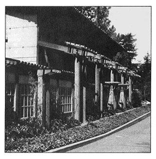
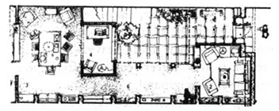
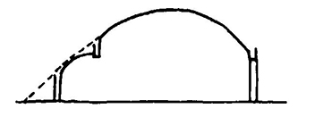
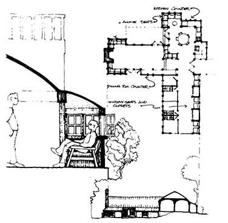
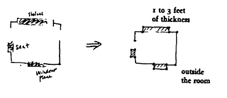

<section class="pattern-plate" aria-labelledby="t-thickening-the-outer-walls">
<a href="/patterns">A Pattern Language</a> · <a href="/patterns#construction">Construction</a> · Pattern 211 · p. 983 · *
<h1 class="pattern-title" id="t-thickening-the-outer-walls">Thickening The Outer Walls</h1><figure class="pattern-figure pl-figure"></figure><nav class="pattern-links" aria-label="Connections"><h2>Links to</h2><ul><li><a href="/patterns/cascade-of-roofs">116 Cascade Of Roofs</a></li><li><a href="/patterns/alcoves">179 Alcoves</a></li><li><a href="/patterns/window-place">180 Window Place</a></li><li><a href="/patterns/thick-walls">197 Thick Walls</a></li><li><a href="/patterns/sunny-counter">199 Sunny Counter</a></li><li><a href="/patterns/built-in-seats">202 Built-In Seats</a></li><li><a href="/patterns/child-caves">203 Child Caves</a></li><li><a href="/patterns/secret-place">204 Secret Place</a></li><li><a href="/patterns/efficient-structure">206 Efficient Structure</a></li><li><a href="/patterns/roof-layout">209 Roof Layout</a></li><li><a href="/patterns/floor-and-ceiling-layout">210 Floor And Ceiling Layout</a></li><li><a href="/patterns/columns-at-the-corners">212 Columns At The Corners</a></li><li><a href="/patterns/perimeter-beams">217 Perimeter Beams</a></li><li><a href="/patterns/floor-ceiling-vaults">219 Floor-Ceiling Vaults</a></li></ul><h2>Linked from</h2><ul><li><a href="/patterns/arcades">119 Arcades</a></li><li><a href="/patterns/alcoves">179 Alcoves</a></li><li><a href="/patterns/thick-walls">197 Thick Walls</a></li><li><a href="/patterns/sunny-counter">199 Sunny Counter</a></li><li><a href="/patterns/open-shelves">200 Open Shelves</a></li><li><a href="/patterns/built-in-seats">202 Built-In Seats</a></li><li><a href="/patterns/child-caves">203 Child Caves</a></li><li><a href="/patterns/secret-place">204 Secret Place</a></li><li><a href="/patterns/gradual-stiffening">208 Gradual Stiffening</a></li><li><a href="/patterns/roof-layout">209 Roof Layout</a></li><li><a href="/patterns/floor-and-ceiling-layout">210 Floor And Ceiling Layout</a></li></ul></nav></section><article class="pattern-text" aria-label="The text of Thickening The Outer Walls">
984… the arrangement of roof and floor vaults will generate horizontal outward thrust, which needs to be buttressed—<a class="pl-ref" href="/patterns/cascade-of-roofs">CASCADE OF ROOFS (116)</a>. It also happens, that in a sensibly made building every floor is surrounded, at various places, by small alcoves, window seats, niches, and counters which form “thick walls” around the outside edge of rooms—<a class="pl-ref" href="/patterns/window-place">WINDOW PLACE (180)</a>, <a class="pl-ref" href="/patterns/thick-walls">THICK WALLSE (197)</a>, <a class="pl-ref" href="/patterns/sunny-counter">SUNNY COUNTER (199)</a>, <a class="pl-ref" href="/patterns/built-in-seats">BUILT-IN SEATS (202)</a>, <a class="pl-ref" href="/patterns/child-caves">CHILD CAVES (203)</a>, <a class="pl-ref" href="/patterns/secret-place">SECRET PLACE (204)</a>. The beauty of a natural building is that these thick walls—since they need lower ceilings, always, than the rooms they come from—can work as buttresses.

Once the <a class="pl-ref" href="/patterns/roof-layout">ROOF LAYOUT (209)</a>, and the <a class="pl-ref" href="/patterns/floor-and-ceiling-layout">floor and CEILING LAYOUT (210)</a> are clear these thick walls can be laid out in such a way as to form the most effective butresses, against the horizontal thrust developed by the vaults.

◆ ◆ ◆

<strong>We have established in <a class="pl-ref" href="/patterns/thick-walls">THICK WALLS (197)</a>, how important it is for the walls of a building to have “depth” and “volume,” so that character accumulates in them, with time. But when it comes to laying out a building and constructing it, this turns out to be quite hard to do.</strong>

The walls will not usually be thick in the literal sense, except in certain special cases where mud construction, for example, lends itself to the making of walls. More often, the thickness of the wall has to be built up from foam, plaster, columns, struts, and membranes. In this case columns, above all, play the major role, because they do the most to encourage people to develop the walls. For instance, if the framework of a wall is made of columns standing away from the back face of the wall, then the wall invites modification—it becomes natural and easy to nail planks to the columns, and so make seats, and shelves, and changes there. But a pure, flat, blank wall does not give this kind of encouragement. Even though, theoretically, a person can always add things which stick out from the wall, the very smoothness of the 985wall makes it much less likely to happen. Let us assume then, that a thick wall becomes effective when it is a volume defined by columns.

<figure class="pl-figure"><figcaption><em>Thick walls made effective by columns</em>.</figcaption></figure>

How is it possible for a wall of this kind to justify its expense by helping the structure of the building? The fact that the building is conceived as a compressive structure, whose floors and roofs are vaults—<a class="pl-ref" href="/patterns/efficient-structure">EFFICIENT STRUCTURE (206)</a>, means that there are horizontal thrusts developed on the outside of the building, where the vaults do not counterbalance one another.

To some extent this horizontal thrust can be avoided by arranging the overall shape of the building as an upside down catenary—see <a class="pl-ref" href="/patterns/cascade-of-roofs">CASCADE OF ROOFS (116)</a>. If it were a perfect catenary, there would be no outward thrust at all. Obviously, though, most buildings are narrower and steeper than the ideal structural catenary, so there are horizontal thrusts remaining. Although these thrusts can be resolved by tensile reinforcing in the perimeter beams—see <a class="pl-ref" href="/patterns/perimeter-beams">PERIMETER BEAMS (217)</a>—it is simplest, and most natural, and stable to use the building itself to buttress the horizontal thrusts.

This possibility occurs naturally wherever there are “thick walls”—alcoves, window seats, or any other small spaces at the outside edge of rooms, which can have lower ceilings than the main room and can therefore have their roofs shaped as continuations of the ceiling vault inside. This requires that thick walls be outside the structure of the main room, so that their roofs and walls come close to forming a catenary with the main vault.

<figure class="pl-figure"><figcaption><em>Alcoves within the catenary</em>.</figcaption></figure>

986It is of course rare to be able to have the alcove or thick walls approach a true catenary section—we hardly ever want them that deep or that low. But even when the thick walls and alcoves are inside the line of the catenary, they arc still helping to counter outward thrusts. And their buttressing effect can be improved still more by making their roofs heavy. The extra weight will tend to redirect the forces coming from the main vault slightly more toward the ground.

The drawing below shows the way this pattern works, and the kind of effect it has on a building.

<figure class="pl-figure"><figcaption><em>The effect of thickening the outer walls, shown in flan and section</em>.</figcaption></figure>

987Therefore:

<strong>Mark all those places in the plan where seats and closets are to be. These places are given individually by <a class="pl-ref" href="/patterns/alcoves">ALCOVES (179)</a>, <a class="pl-ref" href="/patterns/window-place">WINDOW PLACES (180)</a>, <a class="pl-ref" href="/patterns/thick-walls">THICK WALLS (197)</a>, SUNNY COUNTER (l99) WAIST-HIGH SHELF (20l), <a class="pl-ref" href="/patterns/built-in-seats">BUILT-IN SEATS (202)</a>, and so on-Lay out a wide swath on the plan to correspond to these positions. Make it two or three feet deep; recognize that it will be outside the main space of the room; your seats, niches, shelves, will feel attached to the main space of rooms but not inside them. Then, when you lay out columns and minor columns, place the columns in such a way that they surround and define these thick volumes of wall, as if they were rooms or alcoves.</strong>

<strong>For shelves and counters less than 2 feet deep, there is no need to go to these lengths. The thickening can be built simply by deepening columns and placing shelves between them.</strong>

<figure class="pl-figure"></figure>
◆ ◆ ◆

In order to make an alcove or thick wall work as a buttress, build its roof as near as possible to a continuation of the curve of the floor vault immediately inside. Load the roof of the buttress with extra mass to help change the direction of the forces—roof vaults (220). Recognize that these thick walls must be <em>outside</em> 988the main space of the room, below the main vault of the room—<a class="pl-ref" href="/patterns/floor-ceiling-vaults">FLOOR-CEILING VAULTS (219)</a>, so that they help to buttress the horizontal forces generated by the main vault of the ceiling. When you lay out columns and minor columns, put a column at the corner of every thick wall, so that the wall space, like other social spaces, becomes a recognizable part of the building structure <a class="pl-ref" href="/patterns/columns-at-the-corners">COLUMNS AT THE CORNERS (212)</a>….
</article>

Christopher Alexander, Sara Ishikawa and Murray Silverstein, with Max Jacobson, Ingrid Fiksdahl-King and Shlomo Angel, <cite>A Pattern Language</cite> (Oxford University Press, 1977), pattern 211, pp. 983–988. Text and illustrations from the <a href="https://github.com/natureoforder/sources">Nature of Order sources</a> reading edition, transcribed from the 1977 printing; report errors on <a href="https://github.com/natureoforder/alexander-wiki/issues">GitHub</a>.

<a href="/patterns/floor-and-ceiling-layout">← 210 Floor And Ceiling Layout</a> · <a href="/patterns">All 253 patterns</a> · <a href="/patterns/columns-at-the-corners">212 Columns At The Corners →</a>

